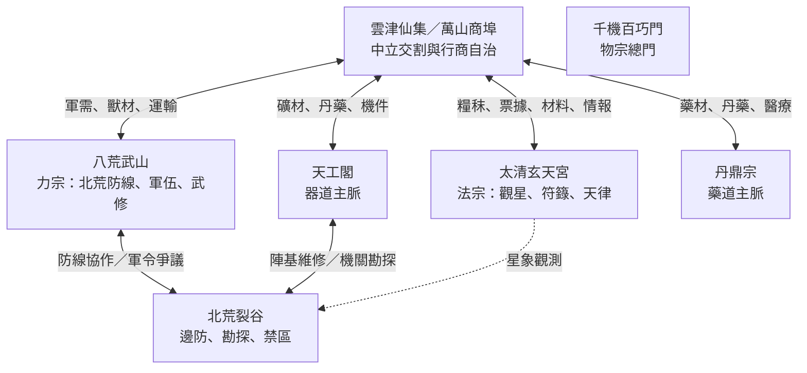

# Tier 2 勢力與社會結構設定（第三卷素材庫）

> 版本：0.1（世界建設提案）  
> 適用範圍：第三卷《名山問道》Tier 2  
> 原則：本文件延續 `world_setting.md` §5.2 的三大名山與雲津仙集設定；新增的內部編制、人物職位及政治關係屬本次擴寫提案，尚未寫入全域正典前，應標記為 `proposed`。

## 0. 設定狀態與不可越界事項

| 標記 | 意義 |
|---|---|
| `canon` | 原始 `world_setting.md`、`volume3.md` 或第二卷人物／事件文件已明確記載 |
| `proposed` | 為第三卷新增的人物、制度、地點或事件提案 |
| `derived` | 由既有設定直接推導，但原文未逐項命名 |
| `open` | 尚待作者裁定，不可在正文中當成已證實事實 |

本卷勢力設計必須遵守：

1. Tier 1 三大道統只有地方傳承與據點，不提前擁有 Tier 2 宗門祖庭的完整權力結構。
2. 三大名山並非單一意志。每宗至少存在守成、改革、利益依附及普通弟子等不同立場。
3. 地煞血精是危險資源與制度依賴，不可把所有宗門成員都寫成知情共犯。
4. 雲津仙集不是宗門附屬市集，而是依靠跨宗門互相制衡而存在的脆弱中立區。
5. 沈泥不是宗門弟子，也不因身世自動取得商埠統治權；其影響力來自信用、供應、資訊與可驗證的履約紀錄。

## 1. Tier 2 區域政治結構

## 2. 太清玄天宮（法宗）

**正典基礎**：`world_setting.md` §5.2；位於北境雲頂絕峰，古稱紫霄道宮，擅長觀星定數、符籙天雷、御劍乘風；兩脈為周天星律與太清雷符。高階修士存在神魂道化結晶風險。

### 2.1 組織編制（新增提案）

| 單位 | 職掌 | 對外立場 | 內部矛盾 |
|---|---|---|---|
| 紫霄議殿 | 宮務、長老議決、對外盟約 | 維持宗門威望與北境秩序 | 是否公開道化病況 |
| 周天星律院 | 星圖、曆算、觀測、陣法校準 | 以觀測維持天象秩序 | 部分星圖遭到週期性修訂 |
| 太清雷符殿 | 雷符、護山、鎮壓異常 | 強調服從法度與執行效率 | 執法權可能被私盟挪用 |
| 藏星秘閣 | 古星圖、禁卷、歷代觀測檔 | 對外封閉 | 管理者未必知道卷宗被改寫的全貌 |
| 外門經院 | 抄經、測算、符紙製備 | 提供人才與基礎勞務 | 弟子升遷高度依賴師承 |

### 2.2 派系

- **守律派（proposed）**：認為即使天象資料存在異常，也不能在沒有可重複證據前破壞宗門秩序。其立場可能保守，但並非必然邪惡。
- **實證派（proposed）**：要求保留原始觀測值、儀器誤差及推算過程，反對只留修訂後星圖。
- **雷符執行派（derived）**：重視即時防衛與命令鏈，對內部政治未必關心。
- **延命私盟關係人（canon premise, individual guilt open）**：原始大綱指向太清宮執法長老涉入血精採辦；具體參與者、知情程度及受益範圍須以證據逐步確定。

### 2.3 宗門生活

外門弟子每日需完成星曆校讀、符紙校驗、觀測輪值與靈息調息。觀測失誤會造成實際後果：山道封閉、風雪預報錯誤、護山符陣延遲。宗門因此確有公共價值，不能只被描寫成冷漠的修行工廠。

## 3. 八荒武山（力宗）

**正典基礎**：`world_setting.md` §5.2；盤踞北荒裂谷大黑山，鎮守外荒獸潮防線，擅長血氣化罡、煞火淬骨、肉身搏殺；高階武修面臨氣血枯竭與五臟乾涸。

### 3.1 組織編制（新增提案）

| 單位 | 職掌 | 對外立場 | 內部矛盾 |
|---|---|---|---|
| 黑山議武堂 | 宗門軍令、戰略、任命 | 防線優先 | 是否以弟子壽元換取戰力 |
| 煞血霸體營 | 二階武修訓練、戰陣 | 強調戰場成果 | 高強度訓練與氣血反噬 |
| 破軍重弓塞 | 遠程防線、弩炮、箭械 | 守住裂谷南沿 | 補給與裝備分配不均 |
| 北荒巡哨隊 | 巡邏、救援、獸群觀測 | 保護邊民與哨站 | 常被宗門高層當成消耗品 |
| 傷兵養息院 | 傷病照護、復健、退役安置 | 保留戰力與人命 | 資源不足、延命藥物爭議 |

### 3.2 派系

- **守關派（derived）**：以北荒居民及防線存續為優先，反對抽調過多兵力參與宗門爭權。
- **霸戰派（proposed）**：認為只有更強的武力才能壓住獸潮，傾向高強度煞血訓練。
- **養息改革派（proposed）**：主張建立傷病統計、輪休制度及非血精療法。
- **延命私盟關係人（canon premise, individual guilt open）**：八荒武山是否直接參與血精交易尚未在原始大綱中定案；不可擅自把整座武山列為私盟成員。其高層可能接受過相關藥物或軍需支援，但需逐案查證。

### 3.3 宗門生活

弟子除了修行，還需輪值城牆、修補拒馬、搬運傷兵、護送糧秣。武山的威望來自真實犧牲；若改革導致防線短期變弱，也會有人反對。這是燕隼必須理解的兩難，而非單純打敗壞長老即可解決。

## 4. 千機百巧門（物宗總門）

**正典基礎**：`world_setting.md` §5.2；依傍萬仞天工山火脈，分天工閣器道主脈與丹鼎宗藥道主脈。物道追求人巧奪天，但可能心為物役、靈樞反噬。

### 4.1 天工閣（器道主脈）

| 單位 | 職掌 | 主要資源 | 風險 |
|---|---|---|---|
| 千機院 | 機關設計、傳動、應力與控制 | 黑鐵、精鋼、符銅 | 對古代機件過度依賴 |
| 萬機地窟 | 古傀、母機殘件、機關測試 | 太古構件、地火 | 未知機構誤啟動 |
| 地火鍛兵台 | 合金、鍛造、熱處理 | 炭、礦、耐火泥 | 地火失控與職業傷害 |
| 陣圖工房 | 山門陣基、機關防線 | 陣盤、銅線、靈石 | 陣圖版本與維護責任不清 |

### 4.2 丹鼎宗（藥道主脈）

| 單位 | 職掌 | 主要資源 | 風險 |
|---|---|---|---|
| 百草谷 | 靈植培育、藥性辨識 | 靈草、土壤、水源 | 稀有藥材被過度採集 |
| 地肺丹火窟 | 煉丹、火候、藥性穩定 | 地火、丹爐、礦物催化材 | 丹毒與地煞污染 |
| 醫理院 | 傷病診治、藥理記錄 | 病案、藥材、器具 | 病患被當成試藥樣本 |
| 廢丹崖 | 廢丹分類、回收與無害化 | 殘丹、毒渣 | 偷排與非法再製 |

### 4.3 內部派系

- **格物派（proposed）**：重視測量、可重複工藝、失敗紀錄及安全規程。
- **奪天派（derived）**：追求效率與極限性能，容易接受身體靈樞化或高風險試藥。
- **醫工互助派（proposed）**：主張器道與藥道合作改善普通人的生產、醫療與防災。
- **延命私盟關係人（canon premise）**：原始第三卷大綱點名天工閣赤煉長老、丹鼎宗鶴壽長老及其採辦網絡；是否所有下屬均知情仍屬 `open`。

## 5. 雲津仙集（萬山商埠）

**正典基礎**：`world_setting.md` §5.2 與 `volume3.md`；位於三大名山交匯的雲海峽谷，是凡俗跨州行商、外門採買、黑市情報及上古遺物交易樞紐。沈泥持跨州特等通行信印，在此創立泥途商棧。

### 5.1 治理模型（新增提案）

雲津不由單一宗門管轄，而由「萬山商埠公所」執行市場秩序。公所席位由常駐商號、三宗交割代表、行旅與倉儲業者共同推舉；三宗代表各有否決能力，但任何一宗不得單獨改變全埠規則。這個模型脆弱、緩慢，卻能避免一宗控制其他兩宗的補給。

| 機構 | 職掌 | 限制 |
|---|---|---|
| 萬山商埠公所 | 市場規章、糾紛仲裁、攤位與倉契 | 無權干涉宗門內部戒律 |
| 三宗交割廳 | 物資驗收、供奉結算、跨宗門對帳 | 只能核對交易，不保證貨物來源合法 |
| 靈石票號 | 票據、託管、匯兌、信用記錄 | 不得無限兌付，須公布準備金規則 |
| 山道行會 | 馬隊、雪橇、嚮導、護運 | 受季節與獸潮影響 |
| 雲海鬼市 | 非公開交易、古物與情報 | 風險高，傳聞不可直接當證據 |

### 5.2 商業規則

1. 靈石票是記帳與兌付工具，不是無限供應的貨幣；每種票據須標示發行者、兌付條件、準備金或擔保物。
2. 宗門供奉額、商埠現貨價與私人契約價必須分開記錄。
3. 商棧的信用來自履約紀錄、可追索擔保與公開帳簿，不因主角身分自動取得。
4. 黑市提供線索，不直接提供定罪結論；交易紀錄可能被偽造或斷鏈。
5. 冬季道路中斷、獸潮、丹爐事故與宗門禁令都會改變市場供需。

### 5.3 泥途商棧的定位

泥途商棧初期是小型倉棧與跨山門代辦，不是全埠最大商號。其優勢是金石府六縣的供應聯絡、五人技能互補及願意公開履約紀錄；弱點是資本有限、缺乏本地政治保護、容易被大商號封鎖貨源。沈泥必須為契約承擔真實損失，不能只靠資訊差獲利。

## 6. 北荒防線與裂谷

北荒不是單一怪物刷新區，而是軍事、勘探、採集、流民遷徙與生態壓力重疊的邊境社會。

| 組織 | 職掌 | 與主線關係 |
|---|---|---|
| 八荒北線軍寨 | 長城哨站、巡防、撤離 | 燕隼與燕山線；獸潮防衛 |
| 三宗聯合勘探隊 | 地脈、礦脈、遺跡調查 | 第三幕主線；存在任務目的不一致 |
| 雪原行腳隊 | 補給、嚮導、遺體回收 | 展現普通人承擔的風險 |
| 裂谷採集戶 | 獸材、藥材、礦物採集 | 資源依賴與生計衝突 |
| 失蹤者家屬互助會（proposed） | 登記失蹤者、保存口述與遺物 | 燕山事件的社會後果 |

## 7. 勢力關係矩陣

| 關係 | 太清 | 八荒 | 千機 | 雲津 | 北荒 |
|---|---|---|---|---|---|
| 太清 | — | 星象預警／軍令摩擦 | 陣法與機關合作 | 票據與符材採買 | 觀測，不直接控制 |
| 八荒 | 軍情互通但互不完全信任 | — | 武備維修與藥品採買 | 軍需交割 | 防線責任核心 |
| 千機 | 陣基合作 | 裝備與醫療供應 | — | 材料、丹藥與機件交易 | 勘探及維修 |
| 雲津 | 中立交割 | 中立交割 | 中立交割 | — | 補給轉運節點 |
| 北荒 | 觀測區 | 防線區 | 勘探區 | 供應來源與風險 | — |

## 8. 待作者裁定

- 三宗是否共同承擔北荒防線經費，或由八荒獨立負責？
- 太清宮執法長老的姓名、職權及其與延命私盟的直接關係。
- 八荒武山是否曾直接收受血精禁丹；現階段不可把此事視為既定事實。
- 雲津公所是否有固定任期、席位數及仲裁上訴程序。
- 三宗會武的主辦輪值與歷屆慣例。
