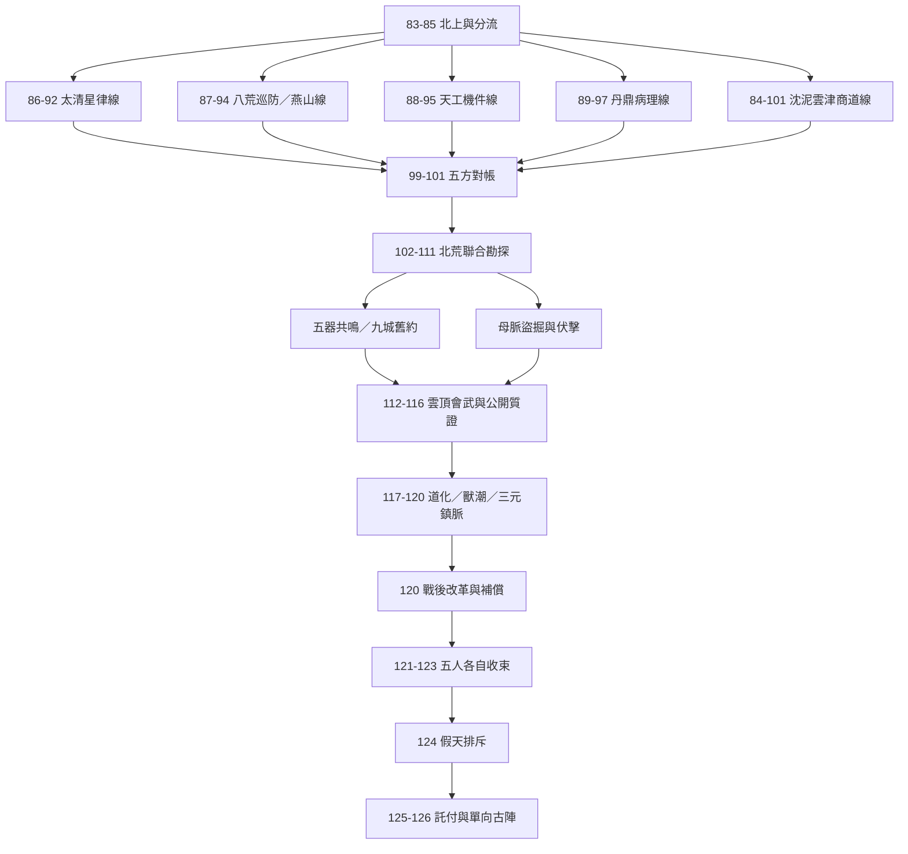

# 第三卷跨章任務網絡與 JSON 設計（第二階段延伸）

> 版本：0.1｜範圍：第83–126章｜性質：任務網絡設計與 JSON 初稿，不是已完成 LPC 實裝。
> 依據：`narrative/volume3_story_design.md`、`events/volume3_events.md`、Tier 2 NPC 名冊與地圖草案，以及現有 `quests/**/*.json`、`daemon/quest_engine_d.c` 的實際格式。

## 1. 設計決策

1. **章節不是任務**：跨章任務以人物目標／玩家行動組織；同一章可被多個任務引用。
2. **事件與任務分離**：`EV301–EV327` 是小說世界事件；任務 JSON 是玩家可採取的行動鏈。
3. **不虛構引擎能力**：現有引擎可讀取 `once`、`stage_chain`、`event_quest`，步驟支援 `talk`、`action`、`kill`、`deliver`；但目前程式碼沒有可用的 `deliver` 事件發送端，Tier 2 新地圖也未實裝。本批 JSON 優先採 `talk`，不使用尚未驗證的自訂欄位。
4. **分支先以獨立任務與事件結果表達**：現有步驟是線性 `step` 狀態機，沒有一般性 if/else、任務間 prerequisite DAG 或 NPC world-state transition DSL。不可在 JSON 裡自行加入 `branch`、`set_flag` 等欄位並假稱引擎會執行。
5. **事件型任務採既有世界事件介面**：`world_event`、`valid_stages`、`deadline_stage`、`event_outcomes`；指標與 facts 僅用引擎稽核器已允許的名稱。
6. **正典與玩家局部結果分離**：玩家能改變證據完整度、補給、信任、傷亡與補償細節；不任意改寫燕山生死未明、赤煉下落未明、五人進入 Tier 3 等正典骨架。

## 2. 跨章任務網絡總覽



## 3. 任務包與章節覆蓋

| 任務 ID | 類型 | 章節 | 事件 | 主責人物 | 功能 |
|---|---|---:|---|---|---|
| `v3_northbound_and_yunjin_arrival` | main | 83–85 | EV301–303 | 五人／穆雪／羅九秤 | 北上、退門者、雲津入市與考核分流 |
| `v3_yuntu_market_charter` | main | 84、90、98–101 | EV302、309 | 沈泥 | 商棧登記、履約與信用 |
| `v3_taiqing_star_archive` | main | 86、91–92 | EV303–304 | 柳清虛 | 入門、原始星圖與道化個案觀察 |
| `v3_bahuang_bloodline_watch` | main | 87、93–94 | EV303、305、312 | 燕隼 | 巡防、傷兵症狀、走山舊案 |
| `v3_tiangong_ancient_mechanism` | main | 88、95 | EV303、306 | 林鐵生 | 入門、巨靈神機與黑鐵同源 |
| `v3_danding_blood_pill_cases` | main | 89、96–97 | EV303、307–308 | 顧玄 | 入門、藥田、病案與樣本 |
| `v3_five_way_evidence_convergence` | main | 99–101 | EV304–309 | 五人 | 五線證據整理與互通 |
| `v3_north_wastes_expedition` | main | 102–108 | EV310–316 | 五人／祁十六 | 北荒勘探、走山隊、方舟與契版 |
| `v3_five_relic_resonance` | epic | 107–108 | EV315–316 | 五人 | 五件遺物與九城契版的分階段有限驗證 |
| `v3_ark_excavation_evidence` | main | 109–111 | EV317–319 | 林鐵生／顧玄／燕隼 | 盜掘、母脈壓力、物證封存 |
| `v3_evidence_chain_hearing` | main | 112–116 | EV320–321 | 五人 | 會武與跨來源公開質證 |
| `v3_preserve_field_evidence` | event | 104–111 | EV312–319 | 韓素／白岩／顧蘭舟 | 走山遺物與方舟樣本的編號、雙份保管及可驗證度 |
| `v3_cross_sect_evidence_audit` | event | 115–116 | EV321 | 沈泥／羅九秤 | 保管鏈與證據完整度的世界事件結果 |
| `v3_crystal_quarantine_response` | event | 117–120 | EV322、324 | 顧玄／柳清虛 | 晶化毒域隔離、病患救援 |
| `v3_north_wall_beast_surge` | event | 118–119 | EV323–324 | 燕隼／林鐵生／沈泥 | 防線、補給與撤離協同 |
| `v3_postwar_reform_and_restitution` | main | 120、123、125 | EV325 | 沈泥／韓素 | 補償、共同治理與改革 |
| `v3_tier2_departure` | epic | 121–126 | EV326–327 | 五人 | 各自修行收束、假天排斥、洞天入口 |

## 4. 重要任務依賴（設計層，不是現行 JSON 可執行的 prerequisite）

| 上游 | 下游 | 依賴內容 | 目前處理方式 |
|---|---|---|---|
| 四宗門人物線 | `v3_five_way_evidence_convergence` | 星曆、軍需、機件、病案四組線索 | 由劇情／NPC 接取條件確認；引擎尚無跨任務 flag 條件 |
| `v3_yuntu_market_charter` | 五方對帳 | 商帳、貨單與票號資料 | 玩家對話流程；需後續增加任務狀態查詢 |
| `v3_north_wastes_expedition` | `v3_five_relic_resonance` | 方舟陣基與五器訊號 | epic stage chain 分段；仍需引擎確認 stage 解鎖語義 |
| `v3_ark_excavation_evidence` | 公開質證 | 盜掘批次、母脈壓力與封存鏈 | 以任務完成紀錄及事件證物登錄串接 |
| 公開質證 | 晶化／獸潮應變 | 查核結果及世界事件階段推進 | event manager 統一推進 T-2 至 T+2 |
| 戰後改革 | Tier 2 離境 | 補償名冊、治理交接、修行完成 | epic chain 的 stage 1–3；需補完跨任務狀態 API |

## 5. JSON 格式設計

### 5.1 一般任務（現有引擎格式）

```json
{
  "id": "v3_example_main",
  "name": "任務名稱",
  "category": "main",
  "type": "once",
  "start_npc": "npc_id",
  "start_topic": "接取話題",
  "requirements": { "level": 50 },
  "steps": [
    {
      "step": 1,
      "title": "步驟標題",
      "hint": "玩家提示",
      "target_type": "talk",
      "target_npc": "npc_id",
      "target_topic": "對話話題",
      "location": "/d/region/room.c",
      "on_complete": { "msg": "步驟完成訊息" }
    }
  ],
  "rewards": { "exp": 300, "pot": 100 }
}
```

### 5.2 多階段史詩任務（現有引擎格式）

- 根層 `type` 使用 `stage_chain`，定義 `total_stages` 與 `stages[]`；若第一步是 `talk`，根層必須提供 `start_npc`／`start_topic`，否則現行引擎不會由對話啟動該鏈。
- 每階段使用 `stage`、`title`、`region`、`region_name`、`required_level`、`status_on_finish`、`finish_desc`、`steps[]`。
- 階段解鎖可沿用既有 `unlock_condition.need_stage/target_npc/target_topic` 格式。
- **注意**：現有程式 `handle_stage_completion()` 會優先讀 `stage.on_finish`，否則讀 `stage.rewards`；不要只在最末 stage 寫一個引擎不會讀取的獎勵欄位。

### 5.3 世界事件型任務（現有引擎格式）

```json
{
  "id": "v3_example_event",
  "name": "事件任務名稱",
  "category": "event",
  "type": "event_quest",
  "start_npc": "npc_id",
  "start_topic": "接取話題",
  "world_event": "tier2_crisis",
  "deadline_stage": "T0",
  "valid_stages": ["T-1", "T0"],
  "steps": [],
  "event_outcomes": {
    "success": { "status": "success", "deltas": {"evidence_strength": 1}, "facts": {}, "message": "..." },
    "partial": { "status": "partial", "deltas": {"evidence_strength": 1}, "facts": {}, "message": "..." },
    "failure": { "status": "failure", "deltas": {}, "facts": {}, "message": "..." }
  },
  "rewards": { "exp": 300, "pot": 100 }
}
```

**重要：** 現有 `apply_world_event_outcome()` 只會選擇 `success` 或 `partial`：只有設定 `eval_metric`／`eval_min_for_success` 且指標低於門檻時才選 `partial`；目前不會自動選擇 `failure`。因此 JSON 保留 `failure` 作為未來擴充規格，但不能宣稱現行引擎已能走到該分支。

目前事件稽核器允許的 metric：`herd_pressure`、`route_confidence`、`diversion_effect`、`settlement_capacity`、`evidence_strength`、`civilian_trust`、`intel_confidence`、`evidence_verifiability`、`assault_cost`、`settlement_resilience`。facts 使用既有 allowlist：`autopsy_performed`、`sulfur_poisoning_found`、`flight_direction_mapped`、`diversion_ditch_dug`、`cold_smoke_stock`、`signal_arrows_ready`、`merchant_fled`、`merchant_supplies_looted`、`canyon_road_destroyed`、`residual_breach_occurred`。不要在本批 JSON 任意創造新鍵。

## 6. JSON 初稿清單

本套件新增 `quests/` 內的 17 份任務 JSON，以及 `data/event_defs/tier2_crisis.json` 世界事件定義（`narrative/events/tier2_crisis.json` 為敘事側同步副本）。它們刻意採用現有引擎已知欄位；所有 Tier 2 NPC ID 與地圖路徑都是依素材庫名冊／地圖草案建立的**待實裝參照**，不是已存在的 LPC 檔案。

| 檔案 | 目前狀態 |
|---|---|
| `main/v3_northbound_and_yunjin_arrival.json` | 格式初稿；房間與 NPC 待實裝 |
| `main/v3_yuntu_market_charter.json` | 格式初稿；房間與 NPC 待實裝 |
| `main/v3_taiqing_star_archive.json` | 格式初稿；房間與 NPC 待實裝 |
| `main/v3_bahuang_bloodline_watch.json` | 格式初稿；房間與 NPC 待實裝 |
| `main/v3_tiangong_ancient_mechanism.json` | 格式初稿；房間與 NPC 待實裝 |
| `main/v3_danding_blood_pill_cases.json` | 格式初稿；房間與 NPC 待實裝 |
| `main/v3_five_way_evidence_convergence.json` | 格式初稿；跨任務 prerequisite 尚待引擎支援 |
| `main/v3_north_wastes_expedition.json` | 格式初稿；房間與 NPC 待實裝 |
| `epic/v3_five_relic_resonance.json` | 格式初稿；stage chain 需實測 |
| `main/v3_ark_excavation_evidence.json` | 格式初稿；房間與 NPC 待實裝 |
| `main/v3_evidence_chain_hearing.json` | 格式初稿；房間與 NPC 待實裝 |
| `event/v3_preserve_field_evidence.json` | 格式初稿；先建立物證保管鏈並提升可驗證度 |
| `event/v3_cross_sect_evidence_audit.json` | 格式初稿；需註冊 tier2_crisis event，依 `evidence_verifiability` 判定 success／partial |
| `event/v3_crystal_quarantine_response.json` | 格式初稿；需註冊 tier2_crisis event，依 `settlement_resilience` 判定 success／partial |
| `event/v3_north_wall_beast_surge.json` | 格式初稿；需註冊 tier2_crisis event，依前置救援成果判定 success／partial |
| `main/v3_postwar_reform_and_restitution.json` | 格式初稿；房間與 NPC 待實裝 |
| `epic/v3_tier2_departure.json` | 格式初稿；stage chain 與終局條件需實測 |

## 7. 目前 JSON 與引擎的落差／待開發項目

1. **跨任務前置條件**：目前沒有一般任務依賴 DAG 或 `requires_quest`，需新增查詢 API；在此之前，任務間依賴只在本文件標示，不可假裝 JSON 能執行。
2. **條件分支**：目前線性 step chain 不支援 `if/else`；可先用獨立支線任務與 `event_outcomes` 的 success/partial；現行引擎不會選取 failure，真正分支需擴充引擎。
3. **NPC／地圖存在性**：Tier 2 NPC roster 與地圖仍是 draft，所有新 NPC ID、room path 在 LPC 實裝前會通不過完整資源稽核。
4. **事件資料註冊**：定義檔放在 `data/event_defs/tier2_crisis.json`，但 `daemon/event_manager.c` 的 `load_event_definitions()` 目前只列出 `beast_surge.json` 與 `military_crisis.json`；`init_event_defaults()` 與 `load_state()` 也把事件 ID 寫死為兩個。必須同步擴充這三處，否則新事件不會被正常初始化／遷移。
5. **`deliver` 事件**：引擎有 deliver 分支判斷，但現有程式沒有穩定事件發送端；本批先不使用。
6. **事件定義白名單與存檔初始化**：除新增 `data/event_defs/tier2_crisis.json` 外，必須在 `event_manager.c` 的 `load_event_definitions()` 檔案清單、`init_event_defaults()` 的 `target_ids`、`load_state()` 的遷移迴圈與 `reset_event()`／事件重置路徑中註冊 `tier2_crisis`。現有程式只初始化兩個既有事件，單純放入 JSON 檔不會生效。
7. **世界狀態與 NPC 動態狀態**：本批使用既有 event metrics/facts，不自創 NPC state 欄位；NPC 職務、態度、出場位置與派系立場需後續由世界狀態服務接管。
8. **任務失敗與重試**：一般 `once` 任務的逾時、放棄、重試與永久失敗政策仍需釐清；事件任務依 `deadline_stage` 判斷過期。
9. **物品與證據**：本批不發放尚未建立的 clone item；物證登錄目前以 event manager 的 evidence 結構為主。

## 8. 推進建議與驗收順序

**Phase A — 任務引擎能力確認**
- 實測 `stage_chain` 的 `unlock_condition`、`required_level` 與 `status_on_finish`。
- 新增 `requires_quest`／任務 DAG API，至少支援 ALL/ANY 條件與完成狀態查詢。
- 為 `deliver` 增加事件發送端，否則維持禁用。

**Phase B — Tier 2 基礎資料落地**
- 先實作六區域地圖與主要出入口，再實作 roster 中 NPC ID。
- 讓任務 JSON 的 `location` 逐一通過房間存在性稽核。

**Phase C — 五條人物主線 MVP**
- 優先落地沈泥商道、柳清虛星律、燕隼走山、林鐵生機件、顧玄病理五條線。
- 每條線先做 1 個可完整接取、推進、結算的任務，跑自動化測試。

**Phase D — 北荒／證據鏈／事件危機**
- 串接北荒勘探、五器共鳴、公開質證、晶化隔離與獸潮防線。
- 對每種結果驗證 metrics/facts/evidence 是否正確累積且不重複計算。

**Phase E — 卷末與 Tier 3 轉場**
- 完成修行收束、假天排斥、託付與單向古陣。
- 驗證任一支線失敗不會阻止小說正典必要事件，但會改變可見證據、資源與代價。

## 9. 作者裁定事項

- 三年甄選週期與第82章初秋離城日期的精確對齊。
- 莫三於第82章離隊後，何時、為何、如何重新北上；在交代前不把他放在北荒或雲津現場。
- 魯長老正式姓名與職位；白鶴年正式職位。
- 八荒武山是否直接供應血精、哪些層級知情。
- 五件遺物與沈泥持有天門引／九城青銅契版的槽位與驗證程序。
- Tier 2 Lv.100 成長節奏、洞天古陣能源成本與單向風險。
