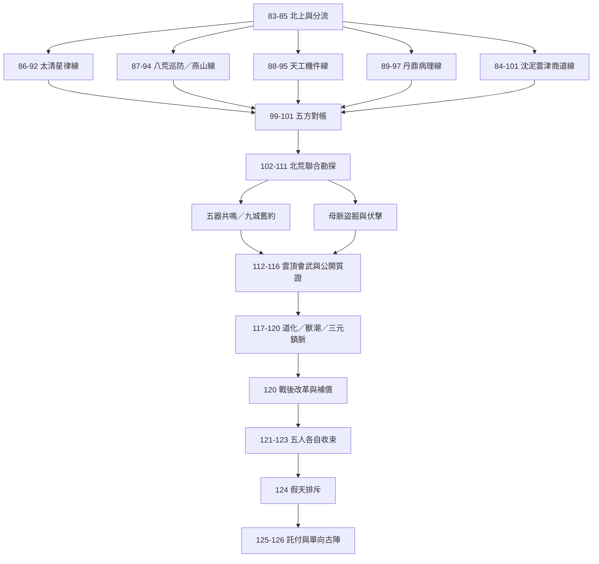

# 第三卷跨章任務網絡與 JSON 設計（第二階段延伸）

> 版本：1.0｜範圍：第83–126章｜狀態：全卷一至五幕 29 份 `v3_*` 任務 JSON、66 間 Tier 2 房間及 `/d/realm/peach_plateau.c` 均已完成 LPC 實裝並通過 `quest_audit.py` 與 `test_v3_act1`～`act5` 自動化驗證。
> 依據：`narrative/volume3_story_design.md`、`events/volume3_events.md`、Tier 2 NPC 名冊與地圖草案，以及現有 `quests/**/*.json`、`daemon/quest_engine_d.c` 的實際格式。

## 1. 設計決策

1. **章節不是任務**：跨章任務以人物目標／玩家行動組織；同一章可被多個任務引用。
2. **事件與任務分離**：`EV301–EV327` 是小說世界事件；任務 JSON 是玩家可採取的行動鏈。
3. **不虛構引擎能力**：現有引擎可讀取 `once`、`stage_chain`、`event_quest`，步驟支援 `talk`、`action`、`kill`、`deliver`；但目前程式碼沒有可用的 `deliver` 事件發送端，Tier 2 新地圖也未實裝。本批 JSON 優先採 `talk`，不使用尚未驗證的自訂欄位。
4. **分支先以獨立任務與事件結果表達**：現有步驟是線性 `step` 狀態機，沒有一般性 if/else、任務間 prerequisite DAG 或 NPC world-state transition DSL。不可在 JSON 裡自行加入 `branch`、`set_flag` 等欄位並假稱引擎會執行。
5. **事件型任務採既有世界事件介面**：`world_event`、`valid_stages`、`deadline_stage`、`event_outcomes`；指標與 facts 僅用引擎稽核器已允許的名稱。
6. **正典與玩家局部結果分離**：玩家能改變證據完整度、補給、信任、傷亡與補償細節；不任意改寫燕山生死未明、赤煉下落未明、五人進入 Tier 3 等正典骨架。

## 2. 跨章任務網絡總覽



## 3. 任務包與章節覆蓋

| 任務 ID | 類型 | 章節 | 事件 | 主責人物 | 功能 | 實裝狀態 |
|---|---|---:|---|---|---|---|
| `v3_northbound_and_yunjin_arrival` | main | 83–84 | EV301–302 | 五人／穆雪／羅九秤／何萬金 | 北上斷崖石棚、雲津入市與試單 | Act 1 實裝 |
| `v3_act1_cold_plain_rescue` | side | 83 | EV301 | 顧玄／穆雪／周鐵山／陳青 | 斷崖石棚 `brew decoction` 救傷與訪談兩位退門者 | Act 1 實裝 |
| `v3_yuntu_market_charter` | main | 84–85、90、98–101 | EV302、EV309 | 沈泥／羅九秤／邱禾／顧蘭舟 | 商棧登記、交割帳簿與信用履約 | Act 1 實裝 |
| `v3_act1_taiqing_ladder` | main | 86 | EV303 | 柳清虛／陸觀瀾／宋知微 | 千丈雲梯 `measure ladder` 測千分之三息公差領玉牌 | Act 1 實裝 |
| `v3_act1_bahuang_gorge` | main | 87 | EV303 | 燕隼／岳停山／雷烈 | 黑石峽擊殺缺耳鐵背荒狼王領黑山營腰牌 | Act 1 實裝 |
| `v3_act1_tiangong_forge` | main | 88 | EV303 | 林鐵生／章百鍊／魯長老 | 千鍛地火廊 `repair puppet` 量半厘偏角領匠牌 | Act 1 實裝 |
| `v3_act1_danding_valley` | main | 89 | EV303 | 顧玄／葉青枝／白鶴年 | 百毒試藥谷 `extract moss` 溫火冷萃領百草谷藥牌 | Act 1 實裝 |
| `v3_taiqing_star_archive` | main | 86、91–92 | EV303–304 | 柳清虛／宋知微／余守拙／陸觀瀾 | 藏星秘閣 `collate archive` 核出一度半平推誤差（發校驗板） | Act 2 實裝 |
| `v3_act2_taiqing_ascension_secret` | side | 92 | EV304 | 柳清虛／簡素／陸觀瀾 | 升仙台 `collect crystal` 見證鶴鳴玉化並獲 `dao_crystal` | Act 2 實裝 |
| `v3_bahuang_bloodline_watch` | main | 87、93–94 | EV303、305 | 燕隼／杜青禾／雷烈／祁無傷 | 養息院急鎮丸病案實據、巡哨與地底震聲 | Act 2 實裝 |
| `v3_act2_bahuang_ghost_gorge` | side | 93–94 | EV305、312 | 燕隼／唐映／阿滿／雷烈 | 擊殺鐵甲寒犛、鬼哭冰澗 `probe ice` 取斷箭與軍需副本 | Act 2 實裝 |
| `v3_tiangong_ancient_mechanism` | main | 88、95 | EV303、306 | 林鐵生／季衡／聞九／魯長老 | 萬機地窟 `inspect core`、延長線 `trace blueprint` 封存晶柱 | Act 2 實裝 |
| `v3_danding_blood_pill_cases` | main | 89、96–97 | EV303、307–308 | 顧玄／葉青枝／陶生／孫聞露 | 丹火窟 `peek flue`、廢丹崖 `dissect ape` 與十七份匿名病案互核 | Act 2 實裝 |
| `v3_five_way_evidence_convergence` | main | 99–101 | EV304–309 | 五人／余守拙／雷烈／邱禾／顧蘭舟 | 五線線索分袋封存與跨來源對帳（保留四大缺口） | Act 2 實裝 |
| `v3_act2_yunjin_ghost_and_sanyuan` | main | 98–101 | EV309 | 沈泥／顧蘭舟／鬼見愁／莫三／羅九秤 | 鬼市情報、`rumor audit` 截密帳、莫三認玄木、`strip filament` 剝晶絲 | Act 2 實裝 |
| `v3_north_wastes_expedition` | main | 102–106 | EV310–314 | 五人／祁十六／白岩 | 北荒出關、測車偏、破雙頭地龍、半寸膏實驗、黑冰九骸與化驗母脈 | Act 3 實裝 |
| `v3_act3_war_god_tomb` | side | 104–111 | EV312–313、319 | 燕隼／韓素／冰熊王 | 鑿釘垂降、竹夾護血書、戰神遺塚《沉岳引》護心鏡與歸還乙十七銅哨 | Act 3 實裝 |
| `v3_five_relic_resonance` | epic | 107–111 | EV315–316 | 五人／宋知微／季衡／顧蘭舟 | 八角核心圓台五器再鳴、後勤總契合璧揭沈雲妮身世與雙鑰舊盟對帳 | Act 3 實裝 |
| `v3_ark_excavation_evidence` | main | 109–111 | EV317–319 | 林鐵生／顧玄／燕隼／聞九 | 鎖死東側七成總閘、雪崩伏擊斬大執事奪令牌、聞九魯長老核批並封證 | Act 3 實裝 |
| `v3_preserve_field_evidence` | event | 104–111 | EV312–319 | 韓素／白岩／顧蘭舟 | 走山遺物與方舟樣本雙人封蠟、雙份保管鏈暨 `tier2_crisis` 推進 `T0` | Act 3 實裝 |
| `v3_act4_cloud_top_tournament` | side | 112–115 | EV320–321 | 簡素／林鐵生／顧玄／燕隼／柳清虛／羅九秤 | 清修偏峰救元青、天台丹器力法四試揭違規暨交割廳查封萬寶閣 | Act 4 實裝 |
| `v3_evidence_chain_hearing` | main | 115–116 | EV320–321 | 羅九秤／紫霄／鐵背／玄樞 | 交割廳暨問道天台四線證物與財政賬冊公開質證及五方查核席宣令 | Act 4 實裝 |
| `v3_cross_sect_evidence_audit` | event | 115–116 | EV321 | 羅九秤／孫聞露／顧蘭舟 | 第一第二來源保管鏈登錄與跨宗門互證查核結果（`T0 → T+1`） | Act 4 實裝 |
| `v3_act4_sanyuan_defense` | main | 117–119 | EV322–324 | 五人／陸觀瀾／杜青禾／鐵背山主 | 毒域搶箱、石牌坊生石灰百草霧、玄鐵暗門巨靈神機撐長城兼破核擊退 Lv.95 骨龍 | Act 4 實裝 |
| `v3_crystal_quarantine_response` | event | 117–120 | EV322、324 | 孫聞露／杜青禾／顧玄 | 石牌坊甲區隔離、十丈生石灰撤離通道暨毒瘤不可根治醫理紀錄 | Act 4 實裝 |
| `v3_north_wall_beast_surge` | event | 118–119 | EV323–324 | 雷烈／邱禾／祁十六 | 長城分段三段輪替、萬山廣場八十雪橇補給暨東道疏散狀態回報 | Act 4 實裝 |
| `v3_postwar_reform_and_restitution` | main | 120 | EV325 | 韓素／沈泥／陶生 | 停採封爐、走山隊暨雲記平反、共同議事席暨重組西街無毒回收廠兜底窯工 | Act 4 實裝 |
| `v3_act5_lvl100_trials` | main | 121–123、125 | EV326–327 | 周師叔／林／燕／柳／沈／莫三 | 五道破境 Lv.100 守人實證（祛道錄、可拆卸台、輪替操典、反例補遺、共治章程）兼故人家書與三十年約 | Act 5 實裝 |
| `v3_tier2_departure` | epic | 121–126 | EV326–327 | 孫聞露／宋知微／季衡／祁十六／莫三 | 三階段終局：各自圓滿 → 封存觀測室假天排斥暨《祖師密錄》 → 五石台啟門入 Tier 3 碎石高原 | Act 5 實裝 |

## 4. 重要任務依賴（設計層，不是現行 JSON 可執行的 prerequisite）

| 上游 | 下游 | 依賴內容 | 目前處理方式 |
|---|---|---|---|
| 四宗門人物線 | `v3_five_way_evidence_convergence` | 星曆、軍需、機件、病案四組線索 | 由劇情／NPC 接取條件確認；引擎尚無跨任務 flag 條件 |
| `v3_yuntu_market_charter` | 五方對帳 | 商帳、貨單與票號資料 | 玩家對話流程；需後續增加任務狀態查詢 |
| `v3_north_wastes_expedition` | `v3_five_relic_resonance` | 方舟陣基與五器訊號 | epic stage chain 分段；仍需引擎確認 stage 解鎖語義 |
| `v3_ark_excavation_evidence` | 公開質證 | 盜掘批次、母脈壓力與封存鏈 | 以任務完成紀錄及事件證物登錄串接 |
| 公開質證 | 晶化／獸潮應變 | 查核結果及世界事件階段推進 | event manager 統一推進 T-2 至 T+2 |
| 戰後改革 | Tier 2 離境 | 補償名冊、治理交接、修行完成 | epic chain 的 stage 1–3；需補完跨任務狀態 API |

## 5. JSON 格式設計

### 5.1 一般任務（現有引擎格式）

```json
{
  "id": "v3_example_main",
  "name": "任務名稱",
  "category": "main",
  "type": "once",
  "start_npc": "npc_id",
  "start_topic": "接取話題",
  "requirements": { "level": 50 },
  "steps": [
    {
      "step": 1,
      "title": "步驟標題",
      "hint": "玩家提示",
      "target_type": "talk",
      "target_npc": "npc_id",
      "target_topic": "對話話題",
      "location": "/d/region/room.c",
      "on_complete": { "msg": "步驟完成訊息" }
    }
  ],
  "rewards": { "exp": 300, "pot": 100 }
}
```

### 5.2 多階段史詩任務（現有引擎格式）

- 根層 `type` 使用 `stage_chain`，定義 `total_stages` 與 `stages[]`；若第一步是 `talk`，根層必須提供 `start_npc`／`start_topic`，否則現行引擎不會由對話啟動該鏈。
- 每階段使用 `stage`、`title`、`region`、`region_name`、`required_level`、`status_on_finish`、`finish_desc`、`steps[]`。
- 階段解鎖可沿用既有 `unlock_condition.need_stage/target_npc/target_topic` 格式。
- **注意**：現有程式 `handle_stage_completion()` 會優先讀 `stage.on_finish`，否則讀 `stage.rewards`；不要只在最末 stage 寫一個引擎不會讀取的獎勵欄位。

### 5.3 世界事件型任務（現有引擎格式）

```json
{
  "id": "v3_example_event",
  "name": "事件任務名稱",
  "category": "event",
  "type": "event_quest",
  "start_npc": "npc_id",
  "start_topic": "接取話題",
  "world_event": "tier2_crisis",
  "deadline_stage": "T0",
  "valid_stages": ["T-1", "T0"],
  "steps": [],
  "event_outcomes": {
    "success": { "status": "success", "deltas": {"evidence_strength": 1}, "facts": {}, "message": "..." },
    "partial": { "status": "partial", "deltas": {"evidence_strength": 1}, "facts": {}, "message": "..." },
    "failure": { "status": "failure", "deltas": {}, "facts": {}, "message": "..." }
  },
  "rewards": { "exp": 300, "pot": 100 }
}
```

**重要：** 現有 `apply_world_event_outcome()` 只會選擇 `success` 或 `partial`：只有設定 `eval_metric`／`eval_min_for_success` 且指標低於門檻時才選 `partial`；目前不會自動選擇 `failure`。因此 JSON 保留 `failure` 作為未來擴充規格，但不能宣稱現行引擎已能走到該分支。

目前事件稽核器允許的 metric：`herd_pressure`、`route_confidence`、`diversion_effect`、`settlement_capacity`、`evidence_strength`、`civilian_trust`、`intel_confidence`、`evidence_verifiability`、`assault_cost`、`settlement_resilience`。facts 使用既有 allowlist：`autopsy_performed`、`sulfur_poisoning_found`、`flight_direction_mapped`、`diversion_ditch_dug`、`cold_smoke_stock`、`signal_arrows_ready`、`merchant_fled`、`merchant_supplies_looted`、`canyon_road_destroyed`、`residual_breach_occurred`。不要在本批 JSON 任意創造新鍵。

## 6. JSON 任務清單（Act 1–5 全數 29 份皆已實裝並通過驗證）

`quests/` 內目前包含 **29 份第三卷任務 JSON**（第一至五幕 Ch. 83–126 全數已實裝完畢，無任何未落地草稿），以及 `data/event_defs/tier2_crisis.json` 世界事件定義（`narrative/events/tier2_crisis.json` 為敘事側同步副本）。其中 **Act 1–5 全部 29 份任務（Ch. 83–126）** 已連通實際存在的 66 間 Tier 2 LPC 房間＋1 間 Tier 3 初臨點（`north_road` 3、`wastes` 深處 16、`yunjin` 18、`taiqing` 9、`bahuang` 9、`tiangong` 6、`danding` 5、`/d/realm/peach_plateau.c` 1）、50 個新建 `/clone/npc/*.c`（另複用 `mo_beggar`、`under_black_market_broker`）與 38 項新實裝物證／道具（另複用 `dao_crystal.c`），並通過 `quest_audit.py`、`test_v3_act1.c` 至 `test_v3_act5.c` 全數驗證：

| 檔案 | 目前狀態 |
|---|---|
| `main/v3_northbound_and_yunjin_arrival.json` | **Act 1 已實裝**（已對齊 `post_station`／`public_office`／`wanbao_pavilion` 無 `.c` 路徑並通過測試） |
| `side/v3_act1_cold_plain_rescue.json` | **Act 1 已實裝**（斷崖石棚 `brew decoction` 救治凍傷腳夫與訪談周鐵山、陳青） |
| `main/v3_yuntu_market_charter.json` | **Act 1 已實裝**（已對齊 `public_office`／`mudway_store`／`exchange_hall` 並通過測試） |
| `main/v3_act1_taiqing_ladder.json` | **Act 1 已實裝**（太清登天雲梯 `measure ladder` 測算公差並領取玉牌） |
| `main/v3_act1_bahuang_gorge.json` | **Act 1 已實裝**（黑石峽擊殺缺耳鐵背荒狼王並於黑山營領取腰牌） |
| `main/v3_act1_tiangong_forge.json` | **Act 1 已實裝**（千鍛地火廊 `repair puppet` 修復傀儡軸套並領取匠牌） |
| `main/v3_act1_danding_valley.json` | **Act 1 已實裝**（百毒試藥谷 `extract moss` 溫火冷萃並領取百草谷藥牌） |
| `main/v3_taiqing_star_archive.json` | **Act 2 已實裝**（藏星秘閣 `collate archive` 發放 `tool_star_observation_plate.c` 並對齊 `gate`） |
| `side/v3_act2_taiqing_ascension_secret.json` | **Act 2 已實裝**（新增；升仙台 `collect crystal` 取 `dao_crystal.c` 並訪談 `jian_su`、`lu_guanlan`） |
| `main/v3_bahuang_bloodline_watch.json` | **Act 2 已實裝**（已對齊 `restoration_hall`／`north_watch`，涵蓋杜青禾、雷烈、祁無傷） |
| `side/v3_act2_bahuang_ghost_gorge.json` | **Act 2 已實裝**（新增；長城擊殺 `iron_yak`、鬼哭冰澗 `probe ice` 得斷箭與軍需副本） |
| `main/v3_tiangong_ancient_mechanism.json` | **Act 2 已實裝**（對齊 `machinery_depths`／`array_drafting_room`，`inspect core`＋`trace blueprint` 發錨機草圖） |
| `main/v3_danding_blood_pill_cases.json` | **Act 2 已實裝**（涵蓋地肺丹火窟 `peek flue`、廢丹崖 `dissect ape` 與醫理院病案互核） |
| `main/v3_five_way_evidence_convergence.json` | **Act 2 已實裝**（已對齊 `hidden_archive`／`black_mountain_camp`／`mudway_store`／`exchange_hall` 五方對帳） |
| `main/v3_act2_yunjin_ghost_and_sanyuan.json` | **Act 2 已實裝**（新增；鬼市 `rumor audit` 截密帳、莫三認 `玄木`、地窖 `strip filament` 與聯合勘探鋪路） |
| `v3_north_wastes_expedition.json` | **Act 3 已實裝**（6 步：出關→雪橇測偏→雙頭霜甲地龍→前哨膏藥對照→黑冰斷谷銅哨→方舟母液化驗） |
| `side/v3_act3_war_god_tomb.json` | **Act 3 已實裝**（新增；垂降雪壁、岩凹取血書、北荒冰熊王、戰神遺塚護心鏡與歸還韓素乙十七銅哨） |
| `epic/v3_five_relic_resonance.json` | **Act 3 已實裝**（三階段完整閉環：`ark_core_chamber` 五器入龕 → `ark_logistics_hall` 九城總契合璧 → 返山兼雲海雙鑰對帳與祁十六安全備案） |
| `main/v3_ark_excavation_evidence.json` | **Act 3 已實裝**（6 步：鎖死七成總閘取鑽頭→冰谷雪崩→斬殺私盟大執事取暗金令牌→聞九魯長老核批兼互助所雙封存） |
| `event/v3_preserve_field_evidence.json` | **Act 3 已實裝**（對齊 `missing_families_hall`、`north_outpost_infirmary`、`exchange_hall` 並聯動 `tier2_crisis`） |
| `side/v3_act4_cloud_top_tournament.json` | **Act 4 已實裝**（新增；偏峰 `strip yuanqing` ＋東器西丹試＋點星破王鐵牛、死角勝韓蒼＋交割廳 `audit wanbao`） |
| `main/v3_evidence_chain_hearing.json` | **Act 4 已實裝**（對齊 `exchange_hall`／`hearing_hall`／`medical_archive`／`machinery_depths`，聯手三掌門宣讀五方核查令） |
| `event/v3_cross_sect_evidence_audit.json` | **Act 4 已實裝**（對齊 `hearing_hall`／`medical_archive`／`exchange_hall`，完成兩來源保管鏈登錄與互證） |
| `main/v3_act4_sanyuan_defense.json` | **Act 4 已實裝**（新增；`crystal_poison_edge` 搶箱救衛士與陸觀瀾＋`stone_arch_quarantine` 撒生石灰＋`west_wall_breach` 推神機退骨龍） |
| `event/v3_crystal_quarantine_response.json` | **Act 4 已實裝**（對齊 `medical_archive`／`stone_arch_quarantine`／`restoration_hall`，維繫甲區隔離與撤離通道） |
| `event/v3_north_wall_beast_surge.json` | **Act 4 已實裝**（對齊 `black_mountain_camp`／`mudway_store`／`black_mountain_pass`，長城輪替與八十雪橇東線上行補給） |
| `main/v3_postwar_reform_and_restitution.json` | **Act 4 已實裝**（對齊 `hearing_hall`／`missing_families_hall`／`public_office`／`west_street_recycling` `open recycling`，平反兼設回收廠） |
| `main/v3_act5_lvl100_trials.json` | **Act 5 已實裝**（新增；醫理祛道錄＋萬機連動台＋黑山輪替操典＋星律反例補遺＋泥途分權總號＋三十年約暨故人家書） |
| `epic/v3_tier2_departure.json` | **Act 5 已實裝**（對齊 `medical_archive`／`machinery_depths`／`sealed_observatory`／`ark_portal_chamber`，三階段全閉環兼開門入 `peach_plateau`） |

## 7. 目前 JSON 與引擎的落差／實裝進度

1. **跨任務前置條件**：目前沒有一般任務依賴 DAG 或 `requires_quest`，需新增查詢 API；在此之前，任務間依賴只在本文件標示，不可假裝 JSON 能執行。
2. **條件分支**：目前線性 step chain 不支援 `if/else`；可先用獨立支線任務與 `event_outcomes` 的 success/partial；現行引擎不會選取 failure，真正分支需擴充引擎。
3. **NPC／地圖存在性（Act 1–5 核心 67 房 ＋ 生活擴建 11 房＝78 房全數落地）**：第一至五幕核心 66 間 Tier 2 房間、1 間 Tier 3 初窺高原與 Phase 1–2A 新增的 11 間庶民生活房（`north_road` 3、`wastes` 深處 17、`yunjin` 21、`taiqing` 11、`bahuang` 10、`tiangong` 8、`danding` 7、`realm` 1，合計 78 房）與全數登場人物、掌門首徒、敵對執事及二階骨龍王已實裝並通過 `quest_audit.py`、`world_liveness_audit.py`、`test_v3_act1.c` 至 `test_v3_act5.c` 全數驗證。
4. **事件資料註冊與動態評估（Act 2–5 `T-2 → T+2` 全數貫通）**：`EVENT_TIER2_CRISIS` 已於 `daemon/event_manager.c` 實裝 `evaluate_tier2_crisis()`、`on_stage_timeout_tier2_crisis()` 與 `dump_status()` 證物帳本檢視，涵蓋會武前評估至毒域獸潮三檔 `defense_outcome`（`contained_with_scars` / `fragile_hold` / `critical_breach`）。
5. **`deliver` 事件**：引擎有 deliver 分支判斷，但本批仍以 action/talk/kill 為主保持跨區域統一驅動。
6. **事件推進與階段切換（`T-2 → T+2` 全階段齊備）**：`test_v3_act2.c`～`test_v3_act5.c` 已全面驗證會武定案、雙重危機隔離、戰後善後評估與單向古陣離境。
7. **世界狀態與 NPC 動態狀態**：本批使用既有 event metrics/facts 與 `defense_outcome`；NPC 職務、態度與出缺動態延續現有系統。
8. **任務失敗與重試**：一般 `once` 任務的逾時、放棄、重試與永久失敗政策仍需釐清；事件任務依 `deadline_stage` 判斷過期。
9. **物品與證據（Act 1–5 已實裝 38 項物件）**：於 `/clone/item/` 累積建立 Act 1（8 項）、Act 2（8 項＋複用 `dao_crystal.c`）、Act 3（9 項）、Act 4（6 項）及 Act 5（7 項：`sanyuan_bencao_draft`、`detachable_feedback_spec`、`bahuang_rotation_manual`、`reverse_star_addendum`、`wanshan_charter_deed`、`hometown_letters_bag`、`ancestor_secret_record`），全數通過 `quest_audit.py` D 區實物驗證。

## 8. 推進建議與驗收順序

**Phase A — 任務引擎能力確認**
- 實測 `stage_chain` 的 `unlock_condition`、`required_level` 與 `status_on_finish`。
- 新增 `requires_quest`／任務 DAG API，至少支援 ALL/ANY 條件與完成狀態查詢。
- 為 `deliver` 增加事件發送端，否則維持禁用。

**Phase B — Tier 2 基礎資料落地（Act 1–2 已完成）**
- 已完成北境官道、雲津仙集、三宗四脈（共 41 間房間）、全數一至二幕人物與荒獸、16 項新規道具與 15 條 Act 1–2 主支線任務（Ch. 83–101），並通過 `quest_audit.py`、`test_v3_act1.c` 與 `test_v3_act2.c`。
- 後續進度（Act 3–5）：依 `events/volume3_events.md` 逐步擴充北荒裂谷與雲頂會武房間／NPC，令其餘 10 份任務 JSON 通過存在性稽核。

**Phase C — 五條人物主線 MVP**
- 優先落地沈泥商道、柳清虛星律、燕隼走山、林鐵生機件、顧玄病理五條線。
- 每條線先做 1 個可完整接取、推進、結算的任務，跑自動化測試。

**Phase D — 北荒／證據鏈／事件危機**
- 串接北荒勘探、五器共鳴、公開質證、晶化隔離與獸潮防線。
- 對每種結果驗證 metrics/facts/evidence 是否正確累積且不重複計算。

**Phase E — 卷末與 Tier 3 轉場**
- 完成修行收束、假天排斥、託付與單向古陣。
- 驗證任一支線失敗不會阻止小說正典必要事件，但會改變可見證據、資源與代價。

## 9. 作者裁定與正典定案事項

- **已定案（Vol 3 正文）**：三山開山甄選為**三年一度、固定於立冬同日**舉行（銜接第 82 章秋末離城 → 17 日北行抵青石埡口／霜降後 → 雲津候試近 20 日至立冬，見 `tier2_timeline.md`）。
- **已定案（Vol 3 正文）**：莫三於第 82 章先隨陸大山南返（Ch. 85–86 餞別宴僅於對話提及），不置入 `EV301`／Act 1 現場，至第 98 章（第二幕）始率金石冬糧車隊北上與沈泥會合。
- **已定案（角色與職位）**：白鶴年定為丹鼎宗外聘醫理師；魯長老為千機院長老（本名仍依正典刻意留白，與 Tier 1 `魯長生` 區分）。
- **尚待二至五幕實裝收束**：八荒武山高層對血精供應的涉入層級、五件遺物與天門引／九城青銅契版槽位驗證程序、Lv.100 成長節奏與單向古陣成本。
