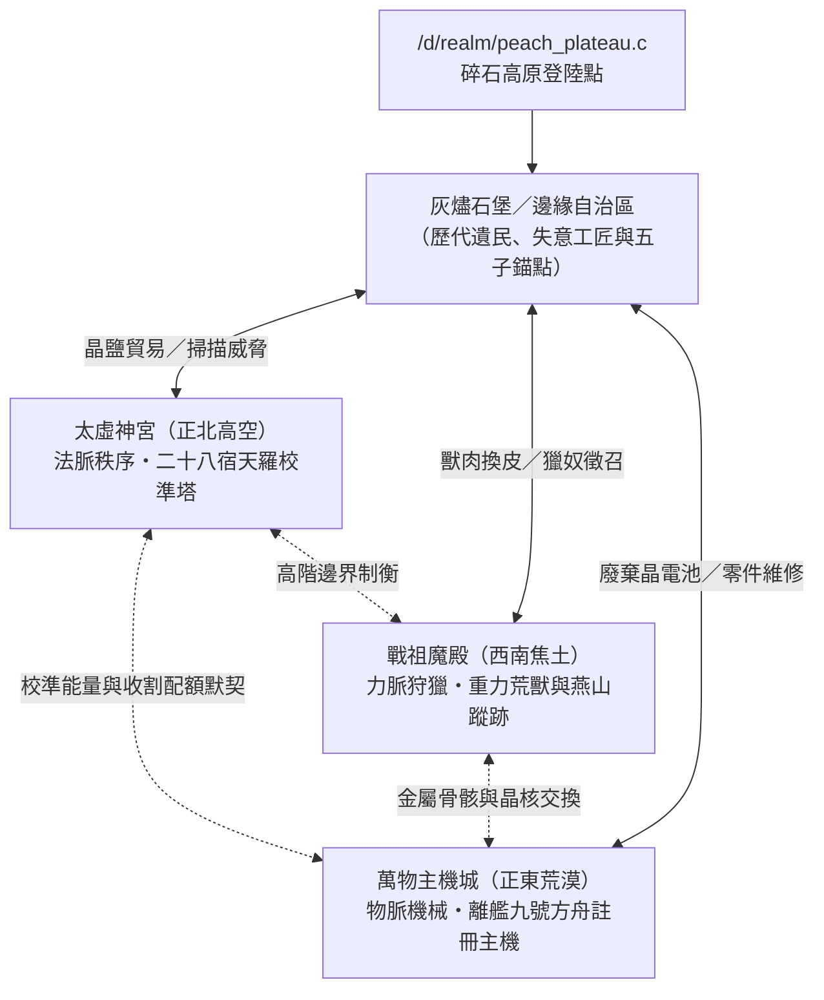

# Tier 3 勢力與社會結構設定（第四卷規劃素材庫）

> 版本：1.0（第四卷結構規劃基準）  
> 適用範圍：第四卷《洞天避難・異界問真篇》Tier 3（`Ch. 127–170`）  
> 原則：延續 `world_setting.md` §5.3【太虛神宮】【戰祖魔殿】【萬物主機城】正典設定，並嚴格杜絕「鐵板一塊反派」與「無後勤烏托邦」。每座巨構內部均存在維護日常運作的**守舊掌權派、務實技術官僚、異見派與底層耗材勞動者**。

---

## 0. 第四卷勢力設計紅線

1. **三極皆有真實功能，亦有致命剝削**：三座太古巨構並非純粹邪惡堡壘；它們在遠古曾各自承擔維持大清洗後封閉生態的功能，只因千年損耗與資源稀缺而將外來 Lv.100 修士與底層生靈納入強制循環（飛升收割）。
2. **「飛升收割（Ascension Harvest）」不是陰謀劇本而是能源經濟**：二十八宿天羅每三百年篩出高純度二階極境者進入洞天，太虛吸納結晶神識、戰祖吸收氣血戰魄、萬物拆解奇材黑鐵——三方各自解決自身維護缺口，彼此默契對峙又暗中忌憚。
3. **沈泥與遺民不被動等死，靠後勤卡位談判**：三極看似不可撼動，但均高度依賴晶鹽導流礦、標準齒輪配件與獵場血晶補給。

---

## 1. Tier 3 宏觀政治拓撲

---

## 2. 【太虛神宮】（正北雲霧高空）

- **正典基礎** (`world_setting.md` §5.3)：通體純白星輝玉石築成的懸浮宏大宮闕，代表極端純化之法道秩序。
- **核心功能**：運行與維護籠罩凡間界上空的「二十八宿天羅校準網絡」，監控跨界空間波動。
- **內部階層與派系（規劃提案）**：
  - **巡天執律閣（掌權保守派）**：認定凡人只配作為修正宇宙幾何誤差的「秩序零件」，每三百年啟動全境清剿收割新生神識晶核。
  - **校星觀測院（異見／實證派，代表 NPC：`taixu_observer_heng` 衡真道人）**：發現天羅校準每隔三百年衰減半拍且必須靠凡間玉化電池維持，對「永久犧牲新進修士卻仍無法阻止網脈老化」深感懷疑。
  - **白玉苦役階（被收割後之半玉化前輩）**：含歷史上失蹤的部分太清先賢與散修，神識被固定於導流陣塔內，尚餘微弱清醒意識者暗中協助柳清虛。

---

## 3. 【戰祖魔殿】（西南赤黑焦土裂谷）

- **正典基礎** (`world_setting.md` §5.3)：由太古巨獸白骨與暗紅玄鐵堆疊而成的猙獰巨殿，裂谷重力場週期性脈動。
- **核心功能**：鎮壓洞天西南斷層不斷溢出的高階變異混沌獸，並以獵取三階獸髓結晶作為動力源。
- **內部階層與派系（規劃提案）**：
  - **骨座血督軍（鐵血狩獵主派）**：奉「強者吞弱者生機」為天律，將飛升入界之體修視為補充前線獵手的天然耗材。
  - **獵奴與邊防小隊（代表人物：大伯【燕山】／營長【拓跋重】`zhanzu_packmaster_tuo`）**：在致命重力裂谷與獸潮中換取生存配額，為保身後老幼而吞咽殘酷規則，掌握裂谷地形與獸骨換防密帳，亦是牽動「赤煉／五年暗道線索」的關鍵活證。

---

## 4. 【萬物主機城】（正東無邊荒漠）

- **正典基礎** (`world_setting.md` §5.3)：將半片地平線改造成自體運轉青金幾何電路與巨型齒輪的鋼鐵城邦，低頻轟鳴直透地脈。
- **核心功能**：太古「九號破界方舟群」失落於洞天邊際的陸上中央維護節點，存有完整太古建築圖譜與**【九城萬物商盟】離線補給總冊**。
- **內部階層與派系（規劃提案）**：
  - **中央仲裁核心（失控的自動修復程序）**：無善惡感情，僅按萬年前「材料齊全前凍結一切非授權生命流動」殘破代碼運行，強制徵收外來金屬器物與靈能電池。
  - **外環維修工會（代表 NPC：`wanwu_auditor_qi` 齊九軸）**：世代在機械噪音與高熱廢氣中工作的凡民工匠與半機械改裝者，苦於原廠配件遭凍結與工傷無撫恤，與林鐵生「可拆卸守人匠道」產生強烈共鳴。
  - **九城商盟休眠帳庫**：僅認【天門引】與合併後之【九城總契銅版】驗證權限，成為沈泥撬動全城法理仲裁權的核心槓桿。

---

## 5. 【灰燼石堡與邊緣自治聚落】（高原溝壑夾縫）

- **性質**：既無仙丹泉水、亦無完美民主的底層求生據點（代表 NPC：`ash_warden_qi` 戚老頭）。
- **住民組成**：
  - 曆代拒絕被三大巨構吸納或負傷逃出的 Tier 2 先輩（十七批前輩極少數後裔與老兵）。
  - 在三極間夾縫求存的晶鹽運夫、報廢晶電池修復戶、苦苔採集農。
- **核心衝突**：究竟應低頭替三極繳納人頭稅換取苟延殘喘，還是跟著五個剛進門的毛頭小子賭一把「改寫天網與開門返鄉」並承擔遭清剿滅門之險？

---

## 6. 留待第五卷（Tier 4 【歸墟古淵】）最終裁決項目

- 歸墟古淵入口底下沉睡之「三元未分母核」與當初導致大清洗爆發之第一責任者實情。
- 洞天千萬名無法適應凡間稀薄法則之遺民後裔在「打碎牢籠」後的去處安排。
- 赤煉潛逃及玄冥身後之跨界最終代理人結算。
