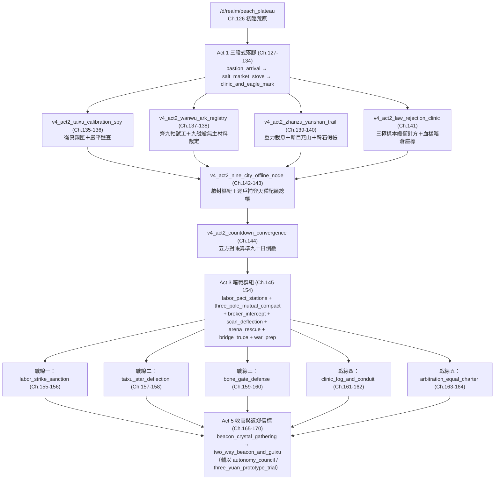

# 第四卷跨章任務網絡與 Tier 3 MUD 接口規劃 (`Tier 3 Quest Network`)

> 版本：1.1（已完成 Step 3 底層規格鎖定與 26 份任務密度重組）｜對應範圍：第 127 ～ 170 章｜對應地圖：`/d/realm/`（起點 `/d/realm/peach_plateau.c` 與底層 `/daemon/tier3_d.c`、`/data/event_defs/tier3_calibration.json` 已實裝）。

---

## 1. 核心系統設計對齊（`TIER3_D` ＋ `COMBAT_D` ＋ `QUEST_ENGINE_D` ＋ `EVENT_MANAGER_D`）

1. **`K × U` 非計數器實驗門檻（已落地於 `/daemon/tier3_d.c` 與 `/secure/combat_d.c`）**：
   - `tier3_k/<domain>` 嚴禁以整數計數旗標或裸字串寫入；必須通過已註冊之可驗證環境實驗（`TIER3_D->grant_k_from_experiment()`）存入結構化實證紀錄。
   - 每個領域的 `tier3_u/<domain>` 均設有**兩條以上不同觀察／取得路徑**（`TIER3_D->unlock_u_via_path()`），且必須先具 `tier3_k/<domain>` 方能解鎖。
   - 在 `/d/realm/` 空間內，未具對應道途 `U` 的舊招式由 `TIER3_D->tier3_tuning` 單一可調表統一施加**三倍消耗、半威力（50%）**阻尼；解鎖任一條觀察路徑之 `U` 後立即解除該罰則。
2. **「資源成本帳目（§3.12）」與高代價雙向信標**：
   - `TIER3_D->transmit_beacon_parcel()` 硬性驗證：禁止活人強渡（`allow_living_transit = 0`）、限重半斤（`max_weight_liang = 5`）、消耗三百斤高純鹽晶儲柱（`salt_crystal_jin = 300`）與一具特鍛黑鐵導波環（`conduit_rings = 1`）。
3. **正典與世界狀態連動 (`EVENT_TIER3_CALIBRATION` & `CROSS-05`)**：
   - `/data/event_defs/tier3_calibration.json` 與 `/daemon/event_manager.c` 實作為**週期性全服階段事件**（`T-2` → `T-1` → `T0` → `T+1` → `T+2`），五條指標（`labor_solidarity`、`array_deflection`、`outpost_defense`、`charter_legitimacy`、`beacon_readiness`）均為非二元且不綁特定身世之並行貢獻目標。
   - **嚴格區隔 Tier 4 解鎖門檻**：`evaluate_tier3_calibration()` 明確鎖定 `tier4_auto_unlocked = 0`；玩家通關後須另外滿足 `TIER3_D->evaluate_tier4_unlock_eligibility()`（即 `traceability §4.2` 三要件：`enc_map_fusion`、`three_yuan_resonance`、`personal_event/pierced_false_heaven`）方可進入 `/d/secret/`。

---

## 2. 第四卷跨章任務網拓撲（26 份規劃任務）

---

## 3. 推進階段與驗收標準（Step 4 分幕實作依循規格）

1. **分幕雙軌實作**：詳細 26 份規劃任務位於 `/quests/`；Act 1 → Act 2 → Act 3 → Act 4 → Act 5 同步對接正文與 `/d/realm/*`、`/quests/*/v4_*.json`。
2. **Act 4 五條並行戰線不綁定身世**：玩家無論為 `herbalist`、`smith`、`hunter`、`daoist` 或 `beggar`，均可自由參與五條戰線任何一條並計入 `EVENT_TIER3_CALIBRATION` 貢獻度。
3. **驗收閘門**：每幕完成須通過 `novel_mud_sync_audit.py`（含 `docs lint` 與正文現代科技禁詞掃描）、`quest_audit.py`、BFS 連通檢驗、`world_liveness_audit.py` 與 `make test`＋完整 `MUD_TEST_MODE=1` 套件。
