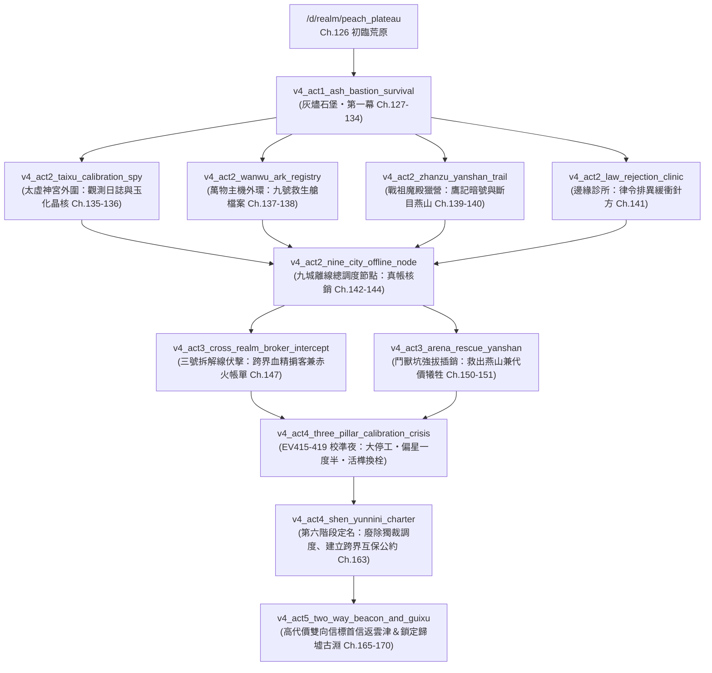

# 第四卷跨章任務網絡與 Tier 3 MUD 接口規劃 (`Tier 3 Quest Network`)

> 版本：1.0｜對應範圍：第 127 ～ 170 章｜對應地圖：`/d/realm/`（起點 `/d/realm/peach_plateau.c` 已實裝）｜性質：第四卷規劃設計文件（供日後寫作第四卷正文暨實作 `/quests/*/v4_*.json` 時作為標準工程藍圖）。

---

## 1. 核心系統設計對齊（承襲並延伸 Tier 2 `QUEST_ENGINE_D`）

1. **從「單純等級判定」改為「`K/U` 認知解鎖旗標」**：
   - 在現有 `QUEST_ENGINE_D` 的 `stage_chain`、`event_quest` 與 `once` 狀態機基礎上，第四卷規劃新增角色認知欄位（如 `tier3_k/<domain>` 與 `tier3_u/<domain>`）及 `ACTION` 環境解謎（如算準幾何向量再出手）。
2. **「資源成本帳目（§3.12）」融入任務完成條件**：
   - `v4_*` 任務步驟不設「白嫖免費領取」；修復、開門與發送雙向信標須核驗並消耗實物道具（如報廢蓄能石匣、`salt_crystal_pack`、可拆卸接口鍛件），確保小說成本與 MUD 玩法同步。
3. **正典與世界狀態連動 (`EVENT_TIER3_CALIBRATION` & `CROSS-05`)**：
   - 比照 `EVENT_TIER2_CRISIS`（`/daemon/event_manager.c`），規劃 **`EVENT_TIER3_CALIBRATION`（三百年天羅校準與停工博弈）** 為**週期性全服階段事件**：從 `T-2`（預熱警告）→ `T-1`（三極籌備停工與截獲跨界掮客）→ `T0`（校準夜三線並進偏轉脈衝）→ `T+1`（三極停戰暨離線總帳公開）→ `T+2`（雙向微光信標試通暨歸墟現口）。
   - **嚴格區隔 Tier 4 解鎖門檻**：完成 `EVENT_TIER3_CALIBRATION` 僅授予玩家三階洞天宗師認證、開啟高代價輕物信標通訊與遙見歸墟微光，**絕不自動發放 `/d/secret/`（Tier 4 歸墟殘塚）入場座標**；欲入 Tier 4 仍須另行集齊 `traceability_and_scope_baseline.md §4.2` 三大要件（多源史前拼圖、三元共鳴窗口、`pierced_false_heaven` 心魔勘破）。

---

## 2. 第四卷跨章任務網拓撲

---

## 3. 規劃任務清單與對應章節

| 任務 ID（規劃鍵） | 類別 | 對應章節 | 對應事件 | 主責角色／NPC | 核心設計與產出物證 |
|---|---|---|---|---|---|
| `v4_act1_ash_bastion_survival` | `main` | 127–134 | `EV401–EV405` | 五人／戚老頭（`ash_warden_qi`） | 熄燈避偵測、實測舊招高耗、改裝可拆卸換芯暖爐與初立石堡醫療台 |
| `v4_act2_taixu_calibration_spy` | `main` | 135–136 | `EV406` | 柳清虛／衡真道人（`taixu_observer_heng`） | 隨鹽晶搬運隊潛入白玉階座，核對三百年老化表與玉化晶核實證，攜出銅匣與芯件債 |
| `v4_act2_wanwu_ark_registry` | `main` | 137–138 | `EV407` | 林鐵生／齊九軸（`wanwu_auditor_qi`） | 過公差試工取得模組通行權，拷錄九號離艦救生艙與自動徵收清單 |
| `v4_act2_zhanzu_yanshan_trail` | `main` | 139–140 | `EV408` | 燕隼／拓跋重（`zhanzu_packmaster_tuo`）／燕山 | 獵殺熔岩骨鬣獸證清重力截息（`U`），重逢斷目燕山得獵戶配額內情 |
| `v4_act2_law_rejection_clinic` | `side` | 130、141 | `EV409` | 顧玄／蘇青竹（`stone_clinic_healer_su`） | 比對太虛玉屑／主機廢液／獸血三Sample，編妥【律令排異緩衝針方】 |
| `v4_act2_nine_city_offline_node` | `main` | 142–144 | `EV410` | 沈泥／萬物仲裁子機 | 合璧【天門引】與總契啟封離線總庫，確認《曾祖手諭》兼發現三百年校準倒數 |
| `v4_act3_cross_realm_broker_intercept` | `side` | 147 | `EV411` | 林鐵生／燕隼／`cross_realm_broker` | 截獲帶天工「赤火」篆印之跨界貨箱，證實凡間血精偷運與洞天掮客鏈 |
| `v4_act3_taixu_scan_deflection` | `event` | 148–149 | `EV412` | 柳清虛／衡真／石堡眾人 | 以 `U` 級無星向量護幕偏折天羅掃描三息（`EVENT_TIER3_CALIBRATION` `T-2 → T-1`） |
| `v4_act3_arena_rescue_yanshan` | `main` | 150–151 | `EV413–414` | 燕隼／燕山／顧玄／林鐵生 | 降壓煙與可拆卸力場解鎖鬥獸坑，奪出燕山並取得五年前密牌證物（含犧牲事件） |
| `v4_act4_three_pillar_calibration_crisis` | `event` | 155–162 | `EV415–419` | 五人／三極異見與工會聯盟 | 大停工談判籌碼 ＋ 太虛偏星一度半 ＋ 哨卡阻獸 ＋ 匯流井換栓（`T0 → T+1`） |
| `v4_act4_shen_yunnini_charter` | `main` | 152、163–164 | `EV420` | 沈泥／萬物仲裁子機 | 援引「保全火種優先條款」平分權限、定名「沈雲妮／沈泥」完成身世第六階段 |
| `v4_act5_two_way_beacon_and_guixu` | `epic` | 165–170 | `EV421–422` | 五人／故土回響／戚老頭 | 構築三息微光信標遞信致雲津莫三，合試三元流並開啟萬丈下層【歸墟古淵】門檻（`T+2`） |

---

## 4. 推進階段與驗收標準（供第五階段開發依序落地）

1. **先補寫 `ch0127.md` ～ `ch0170.md` 或同步分幕落地**：沿用「一幕正文 → 對應 `/d/realm/` 實裝房間與 `v4_*.json` → `quest_audit.py` & `make test`」雙軌紀律。
2. **所有新增任務維持五項底層規則**：禁止虛構未實作引擎欄位、位置字串皆預先對照 `/d/realm/` 地圖規格、保持 `EV401–EV422` 之結果非二元（如大停工規模與礦工傷亡依備戰評分變動）。
