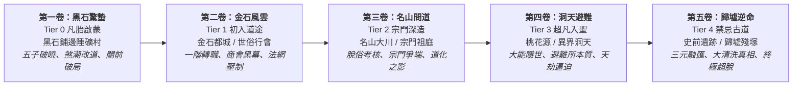
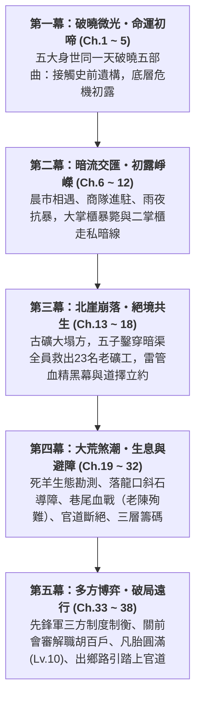

# 《遺忘的世界》小說大綱與章節規劃 (Novel Outline)

> **所屬專案**：`forgotten-space` 敘事設定集  
> **關聯文檔**：[世界觀與 Mudlib 架構設定集](file:///home/wade/src/github/mudscript/forgotten-space/world_setting.md) ｜ [第一卷大綱【黑石驚蟄】](file:///home/wade/src/github/mudscript/forgotten-space/narrative/volume1.md) ｜ [章節正文目錄](file:///home/wade/src/github/mudscript/forgotten-space/narrative/chapters/README.md)  
> **更新時間**：2026-10-19  

---

## 一、全書宏觀卷次與修煉空間晉升藍圖

小說情節嚴格遵守「世界階梯（Tier 0 ~ Tier 4）」與空間地理的對稱推進，摒棄虛浮的修仙境界詞，緊扣凡間生活與世界真相的揭露：

---

## 二、第一卷：【黑石驚蟄】(全 38 章 / Tier 0 凡胎啟蒙)

> 💡 **進度狀態**：全卷五幕宏觀大綱完全錨定。**第 1 ~ 38 章全卷正文已全部撰寫完畢並完成系統性校驗**；第一卷【黑石驚蟄】（全 38 章）正式圓滿完結！

### 【第一幕：破曉微光・命運初啼】（第 1 ~ 5 章・已完結）
以黑石鋪同一天清晨（破曉時分）為統一時間錨點，從五位不同身世底層少年的生活切入，層層揭開被大清洗掩蓋的太古真相：
* [**第 1 章：晨曦微光與磨刀石**](file:///home/wade/src/github/mudscript/forgotten-space/narrative/chapters/ch0001.md)
  * 主視角：顧玄（採藥孤兒）｜主場景：南谷碎石溪灘 (`/d/village/stream.c`)
  * 失落秘密：洗衣石板深處被水流沖洗出的【逆行蒼龍七宿星圖】與太古大清洗殘篆。
* [**第 2 章：爐火、重錘與不融黑鐵**](file:///home/wade/src/github/mudscript/forgotten-space/narrative/chapters/ch0002.md)
  * 主視角：林鐵生（打鐵學徒）｜主場景：老鐵匠鋪・打鐵爐房 (`/d/village/forge.c`)
  * 失落秘密：地爐萬度熔火不化的【太古不融黑鐵齒輪構件】，上古工聖失落的微型機械造物。
* [**第 3 章：鹿角哨亭、陷阱與大荒異動**](file:///home/wade/src/github/mudscript/forgotten-space/narrative/chapters/ch0003.md)
  * 主視角：燕隼（獵戶之子）｜主場景：獵戶哨亭 (`/d/village/hunter_cabin.c`) 與荒林口
  * 失落秘密：化骨泥沼巨榕下被黑熊撞開石衣的【太古戰神獵獸圖騰玄柱】，荒古肉身血脈共鳴。
* [**第 4 章：殘壇罡風、觀星與道化之影**](file:///home/wade/src/github/mudscript/forgotten-space/narrative/chapters/ch0004.md)
  * 主視角：柳清虛（破落道童）｜主場景：迎風孤岩・荒廢道壇 (`/d/village/altar.c`)
  * 失落秘密：孤松下玉化晶骨揭開「清修道化」死劫，神識窺天洞悉蒼穹星空背後的【天羅地網活體牢籠】。
* [**第 5 章：背街柴房、市井耳目與黑市古令**](file:///home/wade/src/github/mudscript/forgotten-space/narrative/chapters/ch0005.md)
  * 主視角：沈泥（流浪乞兒）｜主場景：客棧背街・廢柴房 (`/d/village/shed.c`)
  * 失落秘密：客棧後巷爛泥深處發掘的【萬物行商・天門引】青金古令（休眠殘缺），揭開商道被勒索真相。

### 【第二幕：暗流交匯・初露崢嶸】（第 6 ~ 12 章・已完結）
* 晨集開市，金石商會馱隊入駐青石街市，五位少年因換藥、賣皮、鍛刀、施捨在中央廣場首次產生交集；
* 二掌櫃趙德貴勾結官軍盜採地煞血精；大掌櫃蘇遠山暴斃，蘇凝霜孤身深入黑石鋪查案；
* 黑市亡命徒與城防暗樁現身，風雨之夜五位少年各施所長合力擊殺巡檢凶徒，初露鋒芒。

### 【第三幕：北崖崩落・絕境共生】（第 13 ~ 18 章・已完結）
* 萬年地煞逆衝引發北崖大塌方，魯大山等 23 名老礦工被困地下三百米；趙德貴扣押絞盤鋼釬企圖封山滅口；
* 蘇凝霜血書立下天字委託；五子冒險下井，鐵生骨裂砸穿暗渠，沈泥銜藥鑽穴，燕隼連珠箭殺盲眼巨蜥，全員生還救出 23 名老礦工；
* 礦坪對質拋出生鐵雷管引信筒與血紋晶石鐵證逼退胡百戶；深夜破柴房火塘前，五子確立各自道擇並立下生死信賴。

### 【第四幕：大荒煞潮・生息與避障】（第 19 ~ 32 章・已完結）
* **生態勘測與因果假說**：胡百戶封關，糧價暴漲；草廬分診老李頭主動推拒吊命藥留給年輕人安詳辭世（具名犧牲者 #1，此後倖存 22 名老礦工）；顧玄解剖暴斃黃羊，確立地煞煙塵擴散引發的「大荒動物逃荒假說」；
* **工程改道與利益博弈**：三十一名工人踏勘落龍口，發現辰巳時分短暫逆風窗口；拉落危岩因支點頁岩崩塌受挫，改採分段魚鱗坎；沈泥草煙實測確認草食獸繞行而野豬狂躁的真實邊界；富戶王周私逃翻覆南谷，自周家馬車起獲四尊【金石內造・丙字柒號】除渣坩堝；
* **偏折深澗與巷戰血淚**：辰末數千獸群壓境，五子協同長輩以斜石導向障與草煙將七八成獸潮主力引向二十五里落龍深澗；一兩成殘獸漏入外街，爆發慘烈巷戰，木匠老陳以粗榆木梁捨身刺殺黑鬃野豬王壯烈殉難（具名犧牲者 #2）；
* **官道斷絕與三層籌碼**：先頭獸群與後續主力衝出深澗，將虎跳峽半里木棧道徹底壓垮，押運糧車墜崖，官道與軍需全線斷絕；五子與蘇凝霜按證明力梳理出三大籌碼（雷管批號拓印、精煉坩堝暗賬、22名倖存礦工按手印證言）。

### 【第五幕：多方博弈・破局遠行】（第 33 ~ 38 章・已完結）
* [**第 33 章：迷霧扣關・三軍陣前**](file:///home/wade/src/github/mudscript/forgotten-space/narrative/chapters/ch0033.md) - 府城先鋒軍八百精銳扣關，胡百戶誣告謀反；陳鎮山洞悉三大破綻推遲強攻；
* [**第 34 章：暗賬分牒・多點投書**](file:///home/wade/src/github/mudscript/forgotten-space/narrative/chapters/ch0034.md) - 沈泥莫三穿行地下暗渠支洞，燕隼外圍掩護，三路密信精準制衡軍械監軍、主帥陳鎮山與督糧官；
* [**第 35 章：軍心如鑑・天威難欺**](file:///home/wade/src/github/mudscript/forgotten-space/narrative/chapters/ch0035.md) - 校場公開質證，雷管鋼印與老礦工血淚動搖軍心，陳鎮山解職胡百戶改強攻為封存會審；
* [**第 36 章：商會殘骨・利益之毒**](file:///home/wade/src/github/mudscript/forgotten-space/narrative/chapters/ch0036.md) - 提審趙德貴揭穿副會長錢百川走私謀殺黑幕，天門引與總堂密室線索浮現，確立赴府城之必然推力；
* [**第 37 章：回首黑石・凡胎圓滿**](file:///home/wade/src/github/mudscript/forgotten-space/narrative/chapters/ch0037.md) - 聚落展開真實重建，五子心性與技藝全面突破晉升 **Tier 0 凡胎圓滿（Level 10）**，獲頒出鄉路引腰牌；
* [**第 38 章：大荒官道・天門驚蟄**](file:///home/wade/src/github/mudscript/forgotten-space/narrative/chapters/ch0038.md) - 虎跳峽便道搶通，五子向五位師長深沉道別，護衛商隊踏上大荒官道邁向金石府城，第一卷正式圓滿收官！

---

## 三、第二卷：【金石風雲】(Tier 1 初入道途・府城篇規劃)

### 1. 空間場景與世俗風貌
* **大荒金石官道驛站**：翻山越嶺、殘留獸痕的官道驛站，流民與商隊殘部交織。
* **金石都城 (`/d/city/`)**：
  * **城東軍陣**：城防兵營、鐵血教場、八方武館鏢局（力修世俗分舵）。
  * **城西道院**：官辦道觀、登仙道壇、演法坪（法修世俗分舵）。
  * **城北百工**：天工行會總堂、金石商會萬寶樓、黑市古玩鬼市（物修世俗分舵）。
  * **城南流民市井**：底層貧民窟、暗渠碼頭、江湖耳目匯聚之地。

### 2. 修行進階與轉職機制
* **Level 10 ~ 50 數值躍遷**：城門登記戶籍與根骨勘測，正式選定一階流派（武館・力 / 道壇・法 / 行會・物）。
* **基礎技能樹解鎖**：開放一階門派技能（Skill Lv. 31 ~ 100），經歷擂台比武與行會考核。
* **紅塵濁氣侵蝕與絕靈法網**：大都城內修煉真元受紅塵七情阻滯；城防大陣嚴禁二階以上動武，凸顯世俗朝廷與修仙體系的張力。

### 3. 主線深層衝突
* **金石商會內造局走私黑幕**：深挖「原礦盜採—本地除渣—官道走私」背後的商會高層黑手，牽扯府城撫司與都防大營的權力傾軋。
* **【天門引】第二枚信物甦醒**：沈泥自鬼市發掘史前商盟共鳴物件，揭示九大神城與史前商道的遠古全貌。
* **二階名門考核伏筆**：名山宗門（紫霄道宮、霸王崩山宗、千機百巧門）世俗選拔使者進駐，五子面臨各自門派深造之抉擇。

---

## 四、核心創作守則與敘事原則 (Writing Canon)

1. **嚴格因果律（拒絕機械降神）**：主角的勝利來自情報收集、物理結構、生態規律、制度制衡與代價承擔，絕非臨陣爆種或老爺爺天降解圍。
2. **制度性制衡與官僚武裝邏輯**：反派與官軍不是意志統一的扁平臉譜，各自受制於政治責任、糧道補給、職權管轄與考績風險。破局關鍵在於改變各方「承擔風險的得失天平」。
3. **證明力分級思維**：嚴格區分「可核驗實物編號」、「可供交叉核對的賬冊」、「解釋事件後果的現場材料」，展現嚴謹的探案推理與公文博弈。
4. **非烏托邦的底層秩序**：聚落不會因主角振臂一呼就無私團結，災難過後依然有人計較受損房屋與分糧不均；真正的秩序是經歷共同流血後，在各方妥協中維持的最低限度生存契約。
