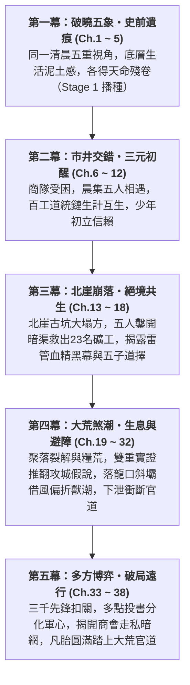

# 《遺忘的世界》第一卷：黑石凡胎・驚蟄篇 (Volume 1 Outline)

> **版本**：v2.0.0 (長篇全景規格大綱・因果校準版)  
> **篇幅規模**：全 38 章（約 15 ~ 18 萬字）  
> **主舞台**：大荒邊陲・黑石鋪聚落（Tier 0 凡胎微茫，Lv.1 ~ Lv.10）  
> **核心主題**：**「凡胎微芒、泥濘求生、五象合流、破障出鄉」**  
> **對應 MUD 空間**：`/d/village/`（全 10 間核心地圖及周邊微生態）  
> **對應 MUD 任務進程**：三大道統鏈 Stage 1 + 史詩奇遇【太古遺脈・天門引】Stage 1 + 全域世界事件【大荒煞潮】與【黑石關軍事危機】

---

## 卷前引言 (Volume Premise)

大清洗抹去了諸天神魔與通天大道，將天下修士割裂為盲目修法、自殘修力、玩物喪志的偏門三道。在世人眼中，八百里黑石山脈只是邊陲流民與狂暴野獸爭食的荒蠻之地。

五位身處社會最底層的少年——採藥孤兒、打鐵學徒、獵戶之子、破落道童、流浪乞兒——在同一個清晨各自觸碰了一角不可思議的史前遺痕。

這不是天降神兵的無敵傳奇，而是一群在飢餓、凍餒、官府盤剝與地煞猛獸的泥潭裡，用粗糙手掌與血汗骨肉生生鑿出一條生路的凡胎少年史詩。

---

## 五大主角成長曲線與階位對照 (Character Arcs & Tier Progression)

| 主角 | 初登場身份 (Ch.1~5) | 核心性格與生活痛感 | 觸發史前機緣 (Stage 1) | 卷末成長轉變 (Ch.33~38) |
| :--- | :--- | :--- | :--- | :--- |
| **顧玄** | 採藥孤兒 (Lv.1) 草廬雜役 | 清秀知禮，內心冷靜沉毅；赤足受盡寒潭凍痛，對瘋郎中又敬又怕 | 南谷碎石溪灘・【史前逆星斷碑】拓片 | 突破【感知/自然】瓶頸，從理想書生蛻變為直面生死抉擇、以病理實證與草木生機護持眾生的醫者 |
| **林鐵生** | 打鐵學徒 (Lv.1) 老鐵匠鋪 | 憨厚寡言，沉穩如古松；手臂結滿燙傷白泡，雙手滿是老繭 | 老鐵匠鋪・地爐【太古不融黑鐵齒輪】 | 右腕骨裂下突破蠻力執念，領悟岩層應力、滑輪槓桿與結構百工之道，由打鐵學徒蛻變為工程匠師 |
| **燕隼** | 獵戶之子 (Lv.1) 鹿角哨亭巡狩 | 警覺如隼，深諳弱肉強食；恐懼飢餓與猛獸，背負大伯失蹤陰影 | 泥沼巨榕根・【太古戰神獵獸圖騰柱】 | 克服孤狼盲點與經驗誤判，掌握群獸遷徙規律與機巧偏折戰術，成為團隊最致命的荒野斥候與射手 |
| **柳清虛** | 破落道童 (Lv.1) 殘觀觀星者 | 蒼白清癯，思辨天道哲理；深受漏風殘觀之苦，目睹道化真相瀕臨崩潰 | 迎風孤岩・【天羅偽籠活體牢籠】真相 | 落地入世，將高邈觀星術轉化為地勢測繪、微氣候觀風與證據邏輯推演，化作洞悉迷局之靈眼 |
| **沈泥** | 流浪乞兒 (Lv.1) 後巷柴房窩鋪 | 油滑狠厲，如野狗求生；看透世態炎涼，對莫三斷腿血仇感同身受 | 廢柴房黑泥・【萬物行商・天門引】殘令 | 以市井交易與底層共情凝聚流民乞兒、摸通太古暗渠情報網，掌握多點投書與破局出鄉之鑰 |

---

## 全卷五幕篇章架構 (Five-Act Narrative Blueprint)

---

### 第一幕：破曉五象・史前遺痕 (第 1 ~ 5 章)
*聚焦於黑石鋪同一天清晨（破曉卯末至辰初），以極致的微觀鏡頭刻畫底層少年的殘酷生計，並偶然觸碰被大清洗掩埋的史前機緣。*

* [x] **第 1 章：晨曦微光與磨刀石（顧玄・採藥）**
  * **主場景**：南谷碎石溪灘 (`/d/village/stream.c`)
  * **生活痛感**：赤足踏在冰冷刺骨鵝卵石上的寒痛，晨露草葉尖的泥苦味，瘋郎中葛半仙古怪嚴厲的咆哮。
  * **核心事件**：張屠戶與村婦在溪石上磨刀捶衣，水流洗去青苔，露出被世人當作洗衣板的【史前逆星斷碑】；顧玄拓印星圖殘卷，胸膛傳來萬古共鳴。
* [x] **第 2 章：爐火、重錘與不融黑鐵（林鐵生・打鐵）**
  * **主場景**：老鐵匠鋪・打鐵爐房 (`/d/village/forge.c`)
  * **生活痛感**：一人高牛皮風箱的窒息熱浪，三十把開山柴刀催單重壓，七斤重錘震得虎口發麻。
  * **核心事件**：阿鐵師傅提及北崖暗震地煞；鐵生奮力砸開粗鐵礦核，地爐烈火燒不融的【太古不融黑鐵齒輪構件】現世。
* [x] **第 3 章：鹿角哨亭、陷阱與大荒異動（燕隼・獵戶）**
  * **主場景**：林邊茅屋哨亭 (`/d/village/hunter_cabin.c`) 與 荒林口 (`/d/village/forest.c`)
  * **生活痛感**：大伯深入大荒未歸的生死陰霾，倒刺竹籤與黑蝮蛇毒的刺鼻腥味，猛獸隨時撲殺的窒息感。
  * **核心事件**：荒林吊套被狂暴山狼撞碎，追蹤暗紫濁血深入化骨泥沼，黑熊暴斃撞裂古石衣，震懾於【太古戰神獵獸圖騰柱】的蠻荒狂暴。
* [x] **第 4 章：殘壇罡風、觀星與道化之影（柳清虛・道童）**
  * **主場景**：迎風孤岩・荒廢道壇 (`/d/village/altar.c`)
  * **生活痛感**：七十丈孤岩冰冷刺骨的罡風，破觀漏風漏雨的寒酸，盲眼師傅枯木老道乾枯可怖的嚴厲。
  * **核心事件**：老松下玉化晶骨揭開「羽化道化」慘烈真相；清虛冒險神識衝霄，驚駭目睹蒼穹星空背後的【天羅地網活體牢籠】，嘔血誓言換天。
* [x] **第 5 章：背街柴房、市井耳目與黑市古令（沈泥・乞兒）**
  * **主場景**：老客棧後巷・廢柴房 (`/d/village/shed.c`)
  * **生活痛感**：油垢硬如牛皮的補丁破袍，廚房泔水桶翻撿肉骨頭的飢餓屈辱，瘸腿老丐莫三抓蝨子剔牙的市井江湖。
  * **核心事件**：貼牆「聽風辨器」洞悉金石商隊被官軍暗卡；在柴房黑泥半尺深處扒出莫三藏了三十年的【萬物行商・天門引】青金古令，接下血債託付。

---

### 第二幕：市井交錯・三元初醒 (第 6 ~ 12 章)
*早市銅鑼敲響，商隊被迫入駐，五位原本各守一方的少年，因生活所需首次在青石街市產生碰撞與交集。*

* [x] **第 6 章：晨集初開・五方交匯**
  * **核心情節**：老客棧敲響三聲破銅鑼，青石街市人頭攢動。顧玄背著藥簍送藥草、鐵生推著板車送柴刀、燕隼扛著狼皮換鹽、沈泥沿街行乞探聽虛實、清虛替破廟換取香燭。五位少年在老茶棚前首次產生眼神與言語碰撞。
* [x] **第 7 章：百工之環・生計互生**
  * **核心情節**：阿鐵鋪子急需解毒草藥，葛半仙索要精鋼藥碾；鐵生與顧玄在爐房前建立交情，燕隼送來堅韌筋線，三大道統鏈（物/力/法）的底層依存關係在市井煙火中自然展開。
* [x] **第 8 章：荒澗伏擊・氣血如爐**
  * **核心情節**：燕隼在南谷瀑布鍛體，顧玄點撥經絡與草石之理；商隊趙四勾結城防軍巡檢伍長疤面胡三尾隨伏擊欲殺人奪寶；顧玄物道初啼以生石膽苔化毒霧，燕隼生死一瞬激發戰神圖騰印「氣血如爐」逆殺強敵，搜出城防軍屠村滅口密信。
* [x] **第 9 章：逆星殘卷・知見道爭**
  * **核心情節**：顧玄在藥鋪畫出逆星符號引發清虛震動；暗巷密會中，地碑拓片與道門殘篇青銅圖完美咬合，拼出太古逆星全圖；法與物爆發深刻道爭（偽天牢籠 vs 踏地為爐）；沈泥倉皇報信商隊大掌櫃暴斃、城防軍調五十重甲弩衛欲屠村搜查，少年夜奔集結五子。
* [x] **第 10 章：暗巷驚鴻・少年心氣**
  * **核心情節**：暴雨夜城防軍黑甲弩衛封鎖全鎮搜捕；商隊大掌櫃之女蘇凝霜攜紫金信印與暗賬赤足奔逃，在死巷絕境被逼行凶之際，五傑神級破局英雄救美；柴房火堆旁五子心氣暗湧、較勁護短；凝霜道出太古神機密匙與屠村真相，五子歃手立下反獵之誓。
* [x] **第 11 章：瘋醫與盲道・老輩殘影**
  * **核心情節**：少年組戰術伏擊斬殺六名弩衛；暗線阿鐵、葛半仙、趙老獵、莫三、枯木五大導師天井聚首，目睹弟子成長熱血復甦；揭開三十年前守墓人與避劫真相；城防大統領下令屠村，老骨頭們不再隱忍，拔出太古陌刀與蛟骨巨箭暗中撐天。
* [x] **第 12 章：凡骨微瀾・修為初進**
  * **核心情節**：五人修為在生死磨礪中全面突破至 Tier 0 凡胎中期（Lv.3~4）；柴房中少年男女溫情流淌、暗暗較勁護短；突發驚天巨變——地煞逆衝，北崖古礦山大塌方，魯大山等二十餘名老礦工被埋地底三百米生死不知，五子熱血逆行搶險，第二幕圓滿收官。

---

### 第三幕：北崖崩落・絕境共生 (第 13 ~ 18 章)
*黑石鋪遭遇第一次全域生存危機——北崖古礦道發生毀滅性大塌方，底層生命在天災與人禍面前爆發出震撼的共生凝聚力。*

* [x] **第 13 章：地煞崩鳴・山崩礦塌**
  * **核心情節**：北崖古礦遭遇萬年地煞逆衝發生滅頂大塌方，萬斤黑石堵死洞口，魯大山等二十三名礦工被困地下三百米。商會二掌櫃趙德貴扣押軍用鋼釬絞盤企圖封山滅口，五子拔刀狂怒對峙。危急時刻，蘇凝霜手持「紫金雙龍信印」傲然現身，當眾揭穿叛逆，咬指血書立下【天字甲級特等緊急救援委託】，徵調全部大車物資並獻出太古採掘殘圖，五子誓死下井救人！
* [x] **第 14 章：逆流而上・人心如鑑**
  * **核心情節**：全鎮百工震撼響應，老鐵匠阿鐵抱病淬鍊破煞鋼鑿，瞎老道送來定脈符，瘋郎中贈避煞烈酒，老獵戶指點暗風地穴；五位少年在礦道口立下生死狀，集結物資、整肅隊伍，頂著滾滾地煞毒雲與餘震碎石，義無反顧踏入漆黑死寂的地下三百米古礦深淵。
* [x] **第 15 章：鑿巖破穴・鐵骨生生**
  * **核心情節**：林鐵生手持八角重鍛錘，承受萬斤反震逆血狂噴、右手腕骨裂，以凡胎氣血硬撼石眼砸開兩尺古排沙暗渠；沈泥身形嬌小、主動銜藥探險，在狹窄窒息的排沙死穴中匍匐前進，終於在避風穹頂找到二十三名老礦工並點燃地火霹靂紅煙；外側鐵生、清虛、燕隼釘下百煉鋼鑿架設天車救生索。
* [x] **第 16 章：死線拔河・命懸一線**
  * **核心情節**：生死競速展開，沈泥在石室指揮固定傷患，顧玄針藥齊施起死回生，林鐵生浴血絞動手動天車，二十二名礦工陸續脫險；地底盲眼鐵甲岩蜥被血腥驚醒撲殺，燕隼大荒連珠三箭與柴刀開腹凶悍雙殺；千鈞一髮之際，鐵生將不融黑鐵卡入暗渠青銅閥門撐開最後通道，合力將沈泥與捨身撐木的魯大山拽出生天，身後穹頂徹底崩塌，二十三名老礦工全員生還！
* [x] **第 17 章：生還之後・暗流如沸**
  * **核心情節**：破曉晨光照耀礦坪，礦工家屬痛哭拜謝少年英雄；城防司胡百戶率三十鐵騎與趙德貴企圖扣押軍資、滅口拘捕，蘇凝霜以紫金雙龍印與暗賬當眾反制；阿鐵重錘、趙老獵蛟骨弓、枯木老道、老丐莫三亮出絕世威懾；魯大山咳血拋出金石城軍器局引信管與血紋晶石，揭穿趙德貴勾結官軍盜採地煞血精炸塌地脈之滔天罪證，民憤如潮逼退官兵。
* [x] **第 18 章：分歧之夜・少年道擇**
  * **核心情節**：深夜廢柴房火塘前五人密會，五大核心視角激烈碰撞：顧玄堅持保存證據呈報御史求真；沈泥主張敲詐金銀購路引自保；鐵生憂慮太古神機淪為殺戮凶器主張封存；清虛為砸碎蒼穹天羅囚籠誓死追尋逆星真相；燕隼冷靜警告地煞爆發三日內必引來東林大獸潮。各執己見卻在底層共鳴中化為生死信賴；蘇凝霜深夜傳遞城防司調三千重弩封山屠鎮軍報，五子立下三日破境衝關誓約。

---

### 第四幕：大荒煞潮・生息與避障 (第 19 ~ 32 章)
* **核心理念**：五人沒有打贏獸潮，也沒有打贏官軍，他們只是找到一個能改變局勢的槓桿。黑石鋪不是軍隊，不會因為主角振臂一呼就突然全村團結；商隊不是無條件盟友，官軍也不是臉譜化反派。聚落的生存取決於「先調查成因與遷徙路線，再以引導避障為主、局部疏散為輔」；而將災難引向落龍深澗，本質上是一場帶著道德灰度的生存抉擇——為了保住黑石鋪百餘戶性命，他們在明知可能將獸災轉嫁到下游官道、卻無法完全掌控後果的情況下，親手扳動了這根危險的槓桿。
* **四個時間錨點與三條核心因果鎖鏈（第 19 章 ➔ 第 35 章）**：
  - **時間錨點鎖定**：
    1. **第一天（Ch.19~22）**：發現死羊、建立逃逸假說、看到深澗出路與道德困境（此時獸潮主力尚在北方十餘里外，聚落有時間調查與爭論）。
    2. **第二天（Ch.23~26）**：實地踏勘試風、局部施工、煙料測試、富戶私逃失敗（利用既有地形與遺構，絕非一日建成大型水壩）。
    3. **第三天（Ch.27~29）**：黎明疏散、持續監測風向窗口、辰末獸潮抵達偏折、局部漏獸巷戰。
    4. **第四天（Ch.30~32）**：清理災後爭執、斥候安全偵察確認官道於昨日正午徹底斷絕、整理分層籌碼。
  1. **獸潮因果鏈（統一物理規則、局部導向工程與分波衝擊）**：
     - **地煞煙塵擴散與有限風向窗口**：地脈爆裂後，裂隙持續逸出灼熱、含硫的地煞煙塵。煙塵在背風凹地與狹谷中極易積聚；受北高南低的地形與北風影響，危險區逐步向南擴大。獸群不是精確感知一條「液態毒氣河」，而是因為棲地與通道陸續變得無法停留，沿著仍能通行的山脊和獸道向南逃離。而在落龍口分水嶺，初冬晴日辰巳時分受向陽盆地熱氣流影響，存在一個短暫的「西南側逆風窗口」——角色必須在 Ch.23 實測確認，並在 Ch.28 持續監測風向，預留隨時覆土滅煙與撤退的條件。
     - **局部導向結構與煙霧輔助定位**：「三十度斜向碎石導向障」**不是擋住數千獸潮的牆**，而是一個利用採石場既有危岩與溜石槽、降低西路通行優勢、改變前排頭獸選擇的局部導向結構。工程真正依賴四素合流：① 清除東路深澗入口亂石減阻；② 西路斜向碎石障增加直行難度（不完全封死，否則必被撞毀潰決）；③ 低溫刺鼻煙霧僅作為干擾前排敏感食草獸（黃羊、岩鹿）的輔助手段（對中後段狂躁野豬無效，且濕布面巾僅能擋灰，安全依賴上風位置與撤退線）；④ 鳴鏑火矢驚擾頭獸偏轉。因為西路未完全封死且不同物種反應不一，中後段必然有一至兩成狂獸從缺口穿過，直接構成 Ch.29 局部入侵的失控機制。
     - **二十五里裂谷分波衝擊**：二十五里（約 12.5 公里）裂谷內存在密度差、跌倒、瓶頸堵塞與前後落差。Ch.28 辰末先頭獸群進入深澗，主力隨後湧入；下游虎跳峽先出現先頭群驚亂哨卡，接著正午（午時）前後密集獸群擠壓在狹窄懸崖木棧道，棧道先局部崩塌，隨後才造成後續獸群、車隊與軍需運輸全面中斷（Ch.31）。
  2. **利益與社會因果鏈（兩層因果拆解）**：
     - **第一層（生存危機改變鎮民行為）**：大崩塌後糧價暴漲、商隊外聘護衛譁變奪馬。Ch.21 鐵生認出王、周富戶車上的「封爐耐火泥」，蘇凝霜發現殘賬上的「除渣耗材費」疑點（僅懷疑其私藏違禁器物，尚未揭曉全部真相）。Ch.26 富戶想用金錢買安全路私逃，結果撞上南下獸群，有人死亡、有人失蹤、有人帶傷逃回——這件事首先證明「南逃並不比留下安全」，迫使鎮民放棄僥倖加入防禦，而非立刻無腦團結。
     - **第二層（物證成為後續調查線索）**：散落貨箱中的【地煞精煉坩堝】在 Ch.26 僅作為浮出水面的物證，蘇凝霜先確認其與商會某批貨物記錄相符，直到 Ch.32、34、36 才逐步完成交叉核對。
  3. **權力博弈與制度制衡因果鏈（三層戰略轉機與證據證明力分級）**：
     - **官道中斷的三層結果（Ch.31~32）**：① 胡百戶失去主動權（糧食軍需受限，不敢貿然下山）；② 先鋒軍攻擊成本上升（八百輕裝部隊仍可翻山抵關，具備真實軍事威脅，但重型床弩與糧車受阻）；③ 黑石鋪取得談判時間，而非取得軍事勝利。
     - **三方制度制衡與證據分級（Ch.33~35）**：主帥陳鎮山（忌憚證據不足時承擔錯誤決策責任）、隨軍軍械監軍（核查軍火虧空）、督糧官（憂慮補給運輸）。Ch.34 投書嚴格區分三種證明力：① **可核驗實物編號**（雷管批號拓印，能查申領流向但不能單獨證明誰下令走私）；② **可供交叉核對的帳目**（礦木、火藥與除渣暗賬，需人證與其他記錄支持）；③ **解釋事件後果的現場材料**（礦工證言、傷勢與斷糧地形圖）。Ch.35 胡百戶並非當場認罪崩潰，而是監軍要求封存帳目、督糧官反對高成本強攻、參將計算出「繼續掩蓋問題的風險已高於暫時解除胡百戶部分職權並呈報上級的風險」。

#### 【第一階段：恐懼滲透與生態勘測】（第一天）
* [x] **第 19 章：生息暗湧・晨市米貴**
  * **核心情節**：大崩塌後第一天清晨，胡百戶封死二十里外的黑石關，蘇凝霜核實軍報：三千大軍係半月前駐紮百里外虎跳營的冬防精銳，三四日即可抵關。鎮內恐慌蔓延：菜市粗糧暴漲、老客棧停賒、富戶套車備逃、鐵匠鋪斷煤熄爐。沈泥管束後巷小乞兒；草廬傷患哀嚎，生石膽苔僅餘三十六小時用量，顧玄握著最後三包既能止痛又能護心吊命的麻沸散面臨殘酷分診，老礦工老李頭主動推拒吊命藥留給十八歲柱子與孫大牛、安詳捨己辭世；對右小腿砸斷的孫大牛只能以「寒針截脈法」刺入右膝下委中、陽陵泉、足三里三穴暫時閉塞經氣（明確交代針法不能取代藥物，僅能冒皮肉壞死風險換取一個半時辰喘息）；林鐵生右腕骨裂打著夾板，僅能左手拉風箱、順鐵紋支點修補門鼻。
* [x] **第 20 章：暴斃黃羊・雙重實證**
  * **核心情節**：燕隼與柳清虛、老斥候巡查東林，發現陷阱空置無血、狼羊蹄印重疊卻無捕食痕跡、斷枝朝南等反常現象，於背風石溝尋獲一具無外傷、口鼻溢血沫與地煞黑灰的暴斃黃羊扛回草廬。顧玄以竹片取樣滴水比對舊礦渣，觀察黃羊氣管黏液黑垢與肺部焦黑出血（未見過往妖化案例徵象），結合老礦工魯大山十年前「三號廢坑地煞煙塵窒息案」的獨立歷史證言，確認黃羊死於高濃度地煞煙塵暴露引發的急性肺損傷窒息；柳清虛與老斥候石頭叔帶回北坡八里抽樣調查——草木八成朝南或西南偏折、二十餘處新舊足跡與糞便呈現「食草獸先行、肉食獸隨後且缺乏捕食拖行痕跡」的趨勢，地脈裂隙逸出的含硫煙塵在凹地狹谷積聚並隨北高南低地勢向南擴大危險區。兩組證據共同支撐起更具解釋力的**「逃荒遷徙假說」**。眾人拼合古礦圖與獵戶山圖，區分「已知地形事實」、「部分獸群可能改走東路落龍深澗的設想」與「如何誘導頭獸、如何克服亂石與風向風險等未解難題」，並震驚發現二十五里深澗下游直通虎跳峽官道。
* [x] **第 21 章：市井暗火・人心如鑑**
  * **核心情節**：即便有了遷徙假說，黑石鋪依然因各自利益與恐懼而分裂。陳記雜糧鋪因限購爆發流血推搡，阿鐵以重錘鎮場；商隊外聘護衛譁變被遣散（雷五受阻於山口狼群困守南門），沈泥與鐵生識破富戶王周二家暗藏封爐耐火泥之「地煞精煉坩堝」欲攜贓私逃，趙伯當頭棒喝點破強堵必垮與轉嫁官道之道德重擔。
* [x] **第 22 章：火塘夜議・落龍借勢**
  * **核心情節**：深夜柴房密會。五位長輩各有殘傷與職守，少年們確立低成本可執行方案：放棄正面堵谷，改為**「清東減阻、斜石導西」**——清理深澗入口亂石，在西路利用採石場危岩布設三十度角「碎石導向障」（僅壓縮西路入口、改變前排頭獸選擇，而非封死西路）。柳清虛提出初冬晴日辰巳時分可能存在的「向陽坡西南側逆風窗口」，要求次日清晨帶炭盆實地試風，並設定風向倒灌時立即沙土滅煙與撤退的紅線；顧玄明確煙霧僅對前排敏感食草獸有效而攔不住狂躁野豬；燕隼與沈泥制定應對一兩成從西路缺口漏入殘獸的窄巷分段阻滯與暗渠疏散備案。直面二十五里裂谷衝擊官道木棧道之險情與因果代價，五人承認無法做到萬全無瑕，決定共同背負轉嫁災難的因果槓桿；莫三與蘇凝霜剖析虎跳峽斷道後「胡百戶失主動權、八百輕裝先鋒強攻成本暴增、爭取談判時間」的三層轉機，以及利用三類不同證明力證據分化參將、監軍與督糧官的破局方向。

#### 【第二階段：工程改道與利益博弈】（第二天）
* [x] **第 23 章：落龍天塹・風眼隘口**
  * **核心情節**：清晨眾人踏勘落龍口，情報由不同專業視角逐步拼合：燕隼觀察掉隊幼鹿因東路亂石折返，但指出大群擁擠時仍需改變西路地形；魯大山點破「千層酥」頁岩支點不可硬撬，沈泥算出純靠人力搬石的體能與口糧死結，林鐵生則找出危岩中腰的冰裂紋作為滑動切面；柳清虛以三處瓦盆實測，將辰末至巳初約一個時辰的「西南側逆風」定為受日照與雲層制約的有條件估計。三十一名參與者各有真實社會背景（報恩老礦工、為保重傷丈夫別無退路的張嫂、為掙口糧與避險的車夫鄭老七、自留退路的老石匠幫工劉瘸子）。結尾檢查二號危岩路線時，發現充當轉向支點的天然石柱底座頁岩有暗裂空響，因重鑿木樁耗時過長，眾人被迫冒險墊沙袋箍麻繩一試。
* [x] **第 24 章：百工逆行・萬斤落石**
  * **核心情節**：林鐵生嚴守右腕夾板限制，以炭筆與聽聲判讀應力指揮絞盤拉落一號危岩上半截。牽引二號危岩時，第 23 章暴露隱患的轉向石柱底座頁岩崩塌，鋼索回彈抽斷絞盤木柄並砸毀生鐵導輪，「鐵膀子」王老四為救劉瘸子被飛石砸傷左肩與右小腿退下火線，二號巨石卡在半山腰。面對人手折損與支點失效，魯大山提出「分段落石與魚鱗式碎石坎」替代方案，將三號危岩劈成小條石、抽調東溝車夫合力壘成前低後高的品字形導向坎，降低單點失敗風險並預留三丈側翼洩壓缺口，但也付出了耗盡白晝體力、無法單獨攔住全部野獸的代價。
* [x] **第 25 章：逆風草煙・惡臭之陣**
  * **核心情節**：沈泥在市井動員中兼顧社會條件與安全邊界（嚴禁乞兒出南門涉險、為有幼子的寡婦安排院內剁草、替北巷皮匠孫老頭封釘後窗並給避難竹牌以換取陳年狼糞）。顧玄大幅削減硫磺煤渣，確立低溫悶燒假說並在北面小岔道進行實測，記錄下三種截然不同的動物反應：① 前排嗅覺靈敏的成年黃羊主動繞行無煙岔路；② 處於風尾亂煙區的梅花岩鹿因視線受阻反而慌亂原地打轉、互相頂撞擁擠；③ 成年黑鬃野豬被辛辣煙味激怒直接撞碎木柵衝破煙陣。眾人據此修正為「引導為主（煙堆後退五丈防遮蔽東路視野）、障礙為補、局部疏散與巷戰兜底」的複合策略。
* [x] **第 26 章：私逃血鑑・連鎖破局**
  * **核心情節**：傍晚，王員外、周掌櫃基於自認理性的避險算計（擁有移動財富與十名刀客拳師、不信任少年的臨時防線），強趕四輛重車私逃，途中不僅撞毀南街半成品拒馬、挖走守夜人手，更動搖二十多戶街坊停工跟逃。車隊在南谷窄道遭先頭野豬與狼群伏擊，重車翻覆徹底焊死南谷小道——證明單獨逃跑必死無疑，迫使觀望鎮民回頭配合守城。翻覆周家馬車夾層滾出四尊刻有【金石內造・丙字柒號】的紫銅除渣坩堝，蘇凝霜與顧玄嚴格區分「已知實物」、「與父親殘缺暗賬相符的合理推論」與「尚待趙德貴口供及原始底單證實的府城黑手」，並在夜色中建立起真實、非烏托邦的戰時最低合作秩序。

#### 【第三階段：天災過境與微光守護】（第三天）
* [x] **第 27 章：驚蟄前夜・簷下風聲**
  * **核心情節**：第三天黎明前的酷寒死寂。外圍住戶與 22 名倖存礦工傷患按備案轉移至內街石屋、客棧地窖與暗渠入口，婦孺爭搶位置引發摩擦，由阿鐵、葛半仙與礦工家屬出面彈壓。五位少年與趙老獵、魯大山立於落龍口高崖哨亭，持續監測風向標與北山震動；在極限生存壓力與明確分工中，五人各自在結構判讀、風險控制、獸群預判、空間氣流與人群調度上完成心性與技藝的實質磨合。
* [x] **第 28 章：奔雷偏折・怒轉深澗**
  * **核心情節**：辰末巳初，數千頭大荒獸群如黑色山洪抵近落龍口！清虛持續監測風向，確認西南側風進入操作窗口後果斷下令點火；顧玄控煙封蔽西路下風口，並在巳時山風出現亂流苗頭前及時指揮沙袋壓火撤退；第一批領頭岩鹿與黃羊受煙霧干擾與東路減阻影響出現遲疑，燕隼與趙老獵率獵戶組居高臨下，將鳴鏑與火矢精準射在頭獸右前側；林鐵生在右腕打夾板的限制下，不靠蠻力硬拉，而是精準判讀拉索張力極限，在最後一刻指揮魯大山與老礦工打入備用鐵楔鎖死滑輪組，引落危岩完成西路斜石導向障！在五人與長輩、礦工、獵戶的協同下，前排食草獸偏轉三十度湧入落龍深澗，帶動七至八成獸潮主力順勢入澗；但中後段不懼煙霧的狂躁野豬與受擠壓傷狼，仍順著西路預留的洩壓缺口與邊緣衝向黑石鋪！
* [x] **第 29 章：巷尾餘燼・守望相助**
  * **核心情節**：承接第 28 章「西路未完全封死以避免全線潰決」的工程代價，約一至兩成（數百頭）偏離主道的野豬、傷狼與岩蜥撞破西路外柵衝入黑石鋪外街。五人絕非憑個人武勇殺光獸群，而是與留守獵戶、礦工依托窄巷、交錯車陣、預埋鐵索與屋頂高低差，讓獸群徹底失去集體衝鋒動量，再分段將獸群驅離出南口，僅集中合力擊殺少數卡在巷內的危險個體：鐵生指揮絞索絆獸、阿鐵鎮守水井要衝、沈泥帶乞兒在屋頂投石引導、顧玄守住草廬防線、清虛在高處吹哨調度。木匠老陳以粗榆木梁捨身刺殺黑鬃野豬王壯烈殉難，聚落付出老陳犧牲、外街屋舍受損與數人輕重傷的真實代價，終於撐過天災。

#### 【第四階段：天塹反噬與局勢逆轉】（第四天）
* [x] **第 30 章：晨曦灰燼・劫後微光**
  * **核心情節**：劫後清晨，黑石鋪滿目瘡痍。獸潮過去了，但聚落並未變成理想烏托邦——鎮民仍為受損房屋、富商遺留物資與誰該為漏入外街的獸害負責而爭吵計較；真正的改變是經過共同流血後，眾人開始意識到必須在阿鐵、魯大山與少年們的協調下維持最低限度的共同秩序。聚落於清晨為老李頭與木匠老陳舉行莊嚴簡樸的雪中送別；草廬內十八歲柱子等重傷員挺過毒發期，但藥物耗盡急需外部補給。五人派老斥候順山脊安全路線前往東南偵察虎跳峽官道狀況。
* [x] **第 31 章：錯位天平・狼狽關防**
  * **核心情節**：傍晚老斥候安全返回，帶回昨日虎跳峽的真實戰況：辰末進入二十五里深澗的獸群，因峽谷寬窄不一與踩踏堵塞拉開波次——昨日巳末，先頭黃羊群率先衝出虎跳峽口，驚亂了關南哨卡；正午（午時）前後，後續龐大的密集獸群擠壓在半里長的懸崖木棧道上，導致棧道先局部崩裂，隨後在持續湧出的野豬與棕熊主力衝擊下徹底坍塌，將押運糧車與部分兵丁推入深淵，官道與軍需運輸全面中斷！這場變故帶來**三個層次的結果**：① 胡百戶三十名守軍糧道斷絕，失去主動下山清剿的能力，只能龜縮黑石關；② 後續府城先鋒軍的重裝器械與糧車被阻斷在峽南，但輕裝部隊仍可翻山推進，軍事威脅並未消失；③ 黑石鋪贏得了寶貴的談判與準備時間。
* [x] **第 32 章：迷局反客・籌碼在手**
  * **核心情節**：面對官道崩毀與官兵死傷的報告，五人默默消化這份沉重的生存代價，隨即與蘇凝霜系統梳理手中籌碼，嚴格按證明力分為三類：① **可核驗的實物編號**（軍器局雷管批號拓印，能查申領流向，但單憑此物尚不能證明誰下令走私）；② **可供交叉核對的帳目與器物**（礦木火藥暗賬抄本、與商會某批貨物記錄相符的精煉坩堝，需人證與原始帳目配合）；③ **解釋事件後果的現場材料**（22 名倖存礦工傷勢證言、家書與虎跳峽斷糧地形圖）。眾人制定「分頭投遞、交叉施壓」方案，準備迎接翻山而來的先鋒部隊。

---

### 第五幕：多方博弈・破局遠行 (第 33 ~ 38 章 / 第一卷終章)
* **核心理念**：官軍不是意志統一的反派，而是由不同職責、風險與利益構成的官僚武裝。參將不會因為一句話就相信主角，胡百戶也不會在一場對質裡自動認罪崩潰；破局的關鍵在於讓軍方各方發現「繼續強攻與掩蓋問題的政治與軍事風險，已經高於暫時解除胡百戶職權並呈報上級的風險」。

* [x] **第 33 章：迷霧扣關・三軍陣前**
  * **核心情節**：駐紮虎跳營的府城先鋒軍（約八百名輕裝精銳翻越山嶺先行抵關，具備實質軍事壓迫感，重弩與糧車受阻於虎跳峽斷道）列陣黑石關前。先鋒參將陳鎮山手握「平定礦匪暴亂、封控疫區」軍令，承受上級期限與部隊斷糧的雙重壓力。胡百戶指責黑石鋪聚眾叛亂、引獸毀道；陳鎮山並未立刻站到黑石鋪一方，而是發現三個無法同時成立的矛盾事實：① 村口並無叛軍防禦部署，反而懸掛金石商會旗號；② 虎跳峽斷道確係大規模獸潮自裂谷湧出所致；③ 胡百戶對防區內為何發生礦山大爆炸及軍械去向的說詞前後矛盾。陳鎮山不願在證據不明時承擔錯誤強攻的責任，遂將進攻推遲至次日午時，限令雙方交出實據。
* [x] **第 34 章：暗賬分牒・多點投書**
  * **核心情節**：五子與蘇凝霜執行「多點分投」行動：沈泥與莫三借道北崖古排沙暗渠外延支洞（克服積水與局部塌方）繞過關卡哨騎，燕隼在外圍接應，將三類不同證明力的材料精準投向三方：① 將【軍器局雷管批號拓印】投給隨軍軍械監軍（兵備道核驗官），促使其核查申領記錄；② 將【礦木火藥異常交易暗賬抄本與精煉坩堝線索】投給主帥陳鎮山，點明強攻將替私盜軍火者背鍋；③ 將【虎跳峽斷糧地形圖、礦工家書與傷情陳情】送達督糧官與同鄉士卒營中。
* [x] **第 35 章：軍心如鑑・天威難欺**
  * **核心情節**：關前公開勘驗與風險博弈。胡百戶極力狡辯，試圖將責任推給趙德貴並催促強攻，並未當場認罪；然而三方證據開始發揮制度性制衡作用：① 軍械監軍核對雷管編號，確認批號屬於三個月前申領之軍火，要求立即封存巡檢司相關軍械帳目徹查；② 督糧官指出棧道已斷、八百先鋒隨身乾糧見底，反對立即展開高損耗的攻堅戰；③ 魯大山等二十二名傷殘老礦工出示礦傷與證言，動搖了「單純礦匪暴亂」的定性。陳鎮山經過冷酷的政治風險計算，認定胡百戶已無法獨立指揮調查，繼續掩蓋問題的風險遠高於處理胡百戶的風險，當場下令解除胡百戶部分職權、將胡趙二人及相關人證物證隔離看管，改「強攻令」為「駐關封存、呈報府城會審」。
* [x] **第 36 章：商會殘骨・利益之毒**
  * **核心情節**：屠村危機暫時解除，但黑石鋪的災難並非孤立事件。蘇凝霜綜合趙德貴的局部口供、散落貨箱中的【地煞精煉坩堝】暗記以及父親遺留的暗賬密鑰，確認這條「原礦盜採—本地除渣—官道走私」鏈條的收貨端，指向金石府城內的商會某位高層人物；至於父親大掌櫃之死是否係商會走私派與城防高層聯手滅口，雖有強烈嫌疑，但關鍵實證仍在八百里外的金石府城。這為五位少年與蘇凝霜必須離開黑石鋪、前往府城提供了不可迴避的現實推力。
* [x] **第 37 章：回首黑石・凡胎圓滿**
  * **核心情節**：黑石鋪進入災後重建。聚落並未變成完美世界，人們仍在修補屋舍、清點損失，但魯大山等老礦工與阿鐵師傅決定留守故土重開爐火，維持住劫後新生的底層秩序。五位少年在經歷礦難救人、煞潮改道與關前博弈後，各自將累積的技藝、判斷與心性轉化為實質突破——林鐵生右腕漸癒、由蠻力打鐵蛻變為結構與應力百工；顧玄融會病理實證、藥物分配與風險控制；燕隼精進荒野追蹤、獸群預判與射術；柳清虛將觀星玄理落地為地形氣流堪輿與邏輯推演；沈泥掌握市井動員、暗渠情報與混亂秩序控制。五人水到渠成踏入 **Tier 0 凡胎圓滿（Lv.10）**，並因「配合府城會審、護送商會證物」取得合法出鄉路引。
* [x] **第 38 章：大荒官道・天門驚蟄 (第一卷終章)**
  * **核心情節**：虎跳峽臨時便道搶通，初冬晨霧散盡。五位少年在村口向五位留守師長辭行——五段截然不同、毫不煽情卻各具性格底色的道別（阿鐵只塞給鐵生一柄順手的左手小錘、葛半仙罵罵咧咧地扔給顧玄半本毒經與禁忌、趙老獵只提醒燕隼山外人比獸險、枯木老道枯坐不言挽留、莫三嬉皮笑臉叮囑沈泥別在府城餓死）。少年們護衛著蘇凝霜的商隊殘部與封存證物，踏上滿布獸蹄痕跡與裂紋的金石官道。回望漸漸隱入群山炊煙中的黑石鋪，五位少年邁步走向風雲詭譎的金石府城。第一卷【黑石驚蟄】（全 38 章）正式落幕。

---

## 寫作與精修指引 (Guidelines for Revision)

1. **守住泥土感、生理限制與醫療邊界**：拒絕高大上的修仙浮誇詞；嚴格遵守人物傷勢限制（林鐵生右腕骨裂期間負責判讀與指揮，絕不單手揮大錘或在第 28 章以血肉之軀硬抗超負荷絞盤；孫大牛傷在右小腿，針刺穴位統一為右膝下委中、陽陵泉與足三里，且明確針法僅能短暫閉塞氣血，無法取代止痛護心的稀缺麻沸散）。
2. **嚴格區分證據、假說與結論**：病理剖檢與野外勘測只提供符合角色認知的證據與趨勢，不出現現代實驗室級別的絕對排除或精準吸入次數；地圖揭示時明確區分「已知事實」、「合理假說」與「未解工程難題」。
3. **硬核工程定位與政治風險計算**：地煞煙塵統一為「裂隙逸出之灼熱含硫煙塵，易在凹地狹谷積聚並隨北高南低地勢向南擴大危險區」；三十度斜石障定位為「降低西路通行優勢的局部導向結構」而非封谷大壩；煙霧僅為針對前排敏感食草獸的輔助因素；二十五里裂谷因密度差形成分波衝擊；第五幕政治破局基於「證據證明力分級」與「各方風險計算」，牢記核心命題：**五人沒有打贏獸潮，也沒有打贏官軍，他們只是找到了一個能改變局勢的槓桿**。

