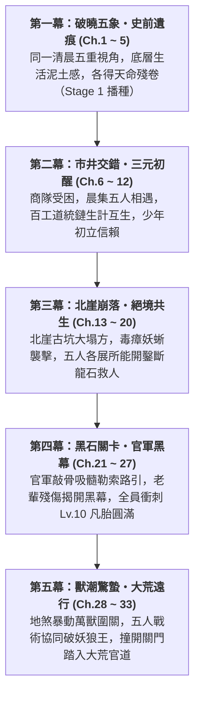

# 《遺忘的世界》第一卷：黑石凡胎・驚蟄篇 (Volume 1 Outline)

> **版本**：v1.0.0 (長篇全景規格大綱)  
> **篇幅規模**：全 33 章（約 12 ~ 15 萬字）  
> **主舞台**：大荒邊陲・黑石鋪聚落（Tier 0 凡胎微茫，Lv.1 ~ Lv.10）  
> **核心主題**：**「凡胎微芒、泥濘求生、五象合流、破障出鄉」**  
> **對應 MUD 空間**：`/d/village/`（全 10 間核心地圖及周邊微生態）  
> **對應 MUD 任務進程**：三大道統鏈 Stage 1 + 史詩奇遇【太古遺脈・天門引】Stage 1 + 出鄉文牒考核 (`village_pass.json`)

---

## 卷前引言 (Volume Premise)

大清洗抹去了諸天神魔與通天大道，將天下修士割裂為盲目修法、自殘修力、玩物喪志的偏門三道。在世人眼中，八百里黑石山脈只是邊陲流民與狂暴野獸爭食的荒蠻之地。

五位身處社會最底層的少年——採藥孤兒、打鐵學徒、獵戶之子、破落道童、流浪乞兒——在同一個清晨各自觸碰了一角不可思議的史前遺痕。

這不是天降神兵的無敵傳奇，而是一群在飢餓、凍餒、官府盤剝與地煞猛獸的泥潭裡，用粗糙手掌與血汗骨肉生生鑿出一條生路的凡胎少年史詩。

---

## 五大主角成長曲線與階位對照 (Character Arcs & Tier Progression)

| 主角 | 初登場身份 (Ch.1~5) | 核心性格與生活痛感 | 觸發史前機緣 (Stage 1) | 卷末成長轉變 (Ch.30~33) |
| :--- | :--- | :--- | :--- | :--- |
| **顧玄** | 採藥孤兒 (Lv.1) 草廬雜役 | 清秀知禮，內心冷靜沉毅；赤足受盡寒潭凍痛，對瘋郎中又敬又怕 | 南谷碎石溪灘・【史前逆星斷碑】拓片 | 突破【感知/自然】瓶頸 (Lv.10)，以草木靈液調和團隊生機，奠定三元歸一感知基礎 |
| **林鐵生** | 打鐵學徒 (Lv.1) 老鐵匠鋪 | 憨厚寡言，沉穩如古松；手臂結滿燙傷白泡，雙手滿是老繭 | 老鐵匠鋪・地爐【太古不融黑鐵齒輪】 | 領悟「瘋魔打鐵法」運力精髓 (Lv.10)，七斤重錘化為護身殺器，百工之造開竅 |
| **燕隼** | 獵戶之子 (Lv.1) 鹿角哨亭巡狩 | 警覺如隼，深諳弱肉強食；恐懼飢餓與猛獸，背負大伯失蹤陰影 | 泥沼巨榕根・【太古戰神獵獸圖騰柱】 | 肉身蠻荒神魔血氣初醒 (Lv.10)，機巧陷阱與破甲重射結合，成為團隊最致命哨兵 |
| **柳清虛** | 破落道童 (Lv.1) 殘觀觀星者 | 蒼白清癯，思辨天道哲理；深受漏風殘觀之苦，目睹道化真相瀕臨崩潰 | 迎風孤岩・【天羅偽籠活體牢籠】真相 | 勘破虛偽仙道知見障 (Lv.10)，以枯木避劫法逆引神識，化身洞悉戰局之靈眼 |
| **沈泥** | 流浪乞兒 (Lv.1) 後巷柴房窩鋪 | 油滑狠厲，如野狗求生；看透世態炎涼，對莫三斷腿血仇感同身受 | 廢柴房黑泥・【萬物行商・天門引】殘令 | 習得「睡夢大法」斂息匿跡 (Lv.10)，市井耳目與暗刺突襲大成，掌握出鄉情報鑰匙 |

---

## 全卷五幕篇章架構 (Five-Act Narrative Blueprint)

---

### 第一幕：破曉五象・史前遺痕 (第 1 ~ 5 章)
*聚焦於黑石鋪同一天清晨（破曉卯末至辰初），以極致的微觀鏡頭刻畫底層少年的殘酷生計，並偶然觸碰被大清洗掩埋的史前機緣。*

* [x] **第 1 章：晨曦微光與磨刀石（顧玄・採藥）**
  * **主場景**：南谷碎石溪灘 (`/d/village/stream.c`)
  * **生活痛感**：赤足踏在冰冷刺骨鵝卵石上的寒痛，晨露草葉尖的泥苦味，瘋郎中葛半仙古怪嚴厲的咆哮。
  * **核心事件**：張屠戶與村婦在溪石上磨刀捶衣，水流洗去青苔，露出被世人當作洗衣板的【史前逆星斷碑】；顧玄拓印星圖殘卷，胸膛傳來萬古共鳴。
* [x] **第 2 章：爐火、重錘與不融黑鐵（林鐵生・打鐵）**
  * **主場景**：老鐵匠鋪・打鐵爐房 (`/d/village/forge.c`)
  * **生活痛感**：一人高牛皮風箱的窒息熱浪，三十把開山柴刀催單重壓，七斤重錘震得虎口發麻。
  * **核心事件**：阿鐵師傅提及北崖暗震地煞；鐵生奮力砸開粗鐵礦核，地爐烈火燒不融的【太古不融黑鐵齒輪構件】現世。
* [x] **第 3 章：鹿角哨亭、陷阱與大荒異動（燕隼・獵戶）**
  * **主場景**：林邊茅屋哨亭 (`/d/village/hunter_cabin.c`) 與 荒林口 (`/d/village/forest.c`)
  * **生活痛感**：大伯深入大荒未歸的生死陰霾，倒刺竹籤與黑蝮蛇毒的刺鼻腥味，猛獸隨時撲殺的窒息感。
  * **核心事件**：荒林吊套被狂暴山狼撞碎，追蹤暗紫濁血深入化骨泥沼，黑熊暴斃撞裂古石衣，震懾於【太古戰神獵獸圖騰柱】的蠻荒狂暴。
* [x] **第 4 章：殘壇罡風、觀星與道化之影（柳清虛・道童）**
  * **主場景**：迎風孤岩・荒廢道壇 (`/d/village/altar.c`)
  * **生活痛感**：七十丈孤岩冰冷刺骨的罡風，破觀漏風漏雨的寒酸，盲眼師傅枯木老道乾枯可怖的嚴厲。
  * **核心事件**：老松下玉化晶骨揭開「羽化道化」慘烈真相；清虛冒險神識衝霄，驚駭目睹蒼穹星空背後的【天羅地網活體牢籠】，嘔血誓言換天。
* [x] **第 5 章：背街柴房、市井耳目與黑市古令（沈泥・乞兒）**
  * **主場景**：老客棧後巷・廢柴房 (`/d/village/shed.c`)
  * **生活痛感**：油垢硬如牛皮的補丁破袍，廚房泔水桶翻撿肉骨頭的飢餓屈辱，瘸腿老丐莫三抓蝨子剔牙的市井江湖。
  * **核心事件**：貼牆「聽風辨器」洞悉金石商隊被官軍暗卡；在柴房黑泥半尺深處扒出莫三藏了三十年的【萬物行商・天門引】青金古令，接下血債託付。

---

### 第二幕：市井交錯・三元初醒 (第 6 ~ 12 章)
*早市銅鑼敲響，商隊被迫入駐，五位原本各守一方的少年，因生活所需首次在青石街市產生碰撞與交集。*

* [x] **第 6 章：晨集初開・五方交匯**
  * **核心情節**：老客棧敲響三聲破銅鑼，青石街市人頭攢動。顧玄背著藥簍送藥草、鐵生推著板車送柴刀、燕隼扛著狼皮換鹽、沈泥沿街行乞探聽虛實、清虛替破廟換取香燭。五位少年在老茶棚前首次產生眼神與言語碰撞。
* [x] **第 7 章：百工之環・生計互生**
  * **核心情節**：阿鐵鋪子急需解毒草藥，葛半仙索要精鋼藥碾；鐵生與顧玄在爐房前建立交情，燕隼送來堅韌筋線，三大道統鏈（物/力/法）的底層依存關係在市井煙火中自然展開。
* [x] **第 8 章：荒澗伏擊・氣血如爐**
  * **核心情節**：燕隼在南谷瀑布鍛體，顧玄點撥經絡與草石之理；商隊趙四勾結城防軍巡檢伍長疤面胡三尾隨伏擊欲殺人奪寶；顧玄物道初啼以生石膽苔化毒霧，燕隼生死一瞬激發戰神圖騰印「氣血如爐」逆殺強敵，搜出城防軍屠村滅口密信。
* [x] **第 9 章：逆星殘卷・知見道爭**
  * **核心情節**：顧玄在藥鋪畫出逆星符號引發清虛震動；暗巷密會中，地碑拓片與道門殘篇青銅圖完美咬合，拼出太古逆星全圖；法與物爆發深刻道爭（偽天牢籠 vs 踏地為爐）；沈泥倉皇報信商隊大掌櫃暴斃、城防軍調五十重甲弩衛欲屠村搜查，少年夜奔集結五子。
* [x] **第 10 章：暗巷驚鴻・少年心氣**
  * **核心情節**：暴雨夜城防軍黑甲弩衛封鎖全鎮搜捕；商隊大掌櫃之女蘇凝霜攜紫金信印與暗賬赤足奔逃，在死巷絕境被逼行凶之際，五傑神級破局英雄救美；柴房火堆旁五子心氣暗湧、較勁護短；凝霜道出太古神機密匙與屠村真相，五子歃手立下反獵之誓。
* [x] **第 11 章：瘋醫與盲道・老輩殘影**
  * **核心情節**：少年組戰術伏擊斬殺六名弩衛；暗線阿鐵、葛半仙、趙老獵、莫三、枯木五大導師天井聚首，目睹弟子成長熱血復甦；揭開三十年前守墓人與避劫真相；城防大統領下令屠村，老骨頭們不再隱忍，拔出太古陌刀與蛟骨巨箭暗中撐天。
* [x] **第 12 章：凡骨微瀾・修為初進**
  * **核心情節**：五人修為在生死磨礪中全面突破至 Tier 0 凡胎中期（Lv.3~4）；柴房中少年男女溫情流淌、暗暗較勁護短；突發驚天巨變——地煞逆衝，北崖古礦山大塌方，魯大山等二十餘名老礦工被埋地底三百米生死不知，五子熱血逆行搶險，第二幕圓滿收官。

---

### 第三幕：北崖崩落・絕境共生 (第 13 ~ 20 章)
*黑石鋪遭遇第一次全域生存危機——北崖古礦道發生毀滅性大塌方，底層生命在天災與人禍面前爆發出震撼的共生凝聚力。*

* [x] **第 13 章：地煞崩鳴・山崩礦塌**
  * **核心情節**：北崖古礦遭遇萬年地煞逆衝發生滅頂大塌方，萬斤黑石堵死洞口，魯大山等二十三名礦工被困地下三百米。商會二掌櫃趙德貴扣押軍用鋼釬絞盤企圖封山滅口，五子拔刀狂怒對峙。危急時刻，蘇凝霜手持「紫金雙龍信印」傲然現身，當眾揭穿叛逆，咬指血書立下【天字甲級特等緊急救援委託】，徵調全部大車物資並獻出太古採掘殘圖，五子誓死下井救人！
* [x] **第 14 章：逆流而上・人心如鑑**
  * **核心情節**：全鎮百工震撼響應，老鐵匠阿鐵抱病淬鍊破煞鋼鑿，瞎老道送來定脈符，瘋郎中贈避煞烈酒，老獵戶指點暗風地穴；五位少年在礦道口立下生死狀，集結物資、整肅隊伍，頂著滾滾地煞毒雲與餘震碎石，義無反顧踏入漆黑死寂的地下三百米古礦深淵。
* [x] **第 15 章：鑿巖破穴・鐵骨生生**
  * **核心情節**：林鐵生手持八角重鍛錘，承受萬斤反震逆血狂噴、右手腕骨裂，以凡胎氣血硬撼石眼砸開兩尺古排沙暗渠；沈泥身形嬌小、主動銜藥探險，在狹窄窒息的排沙死穴中匍匐前進，終於在避風穹頂找到二十三名老礦工並點燃地火霹靂紅煙；外側鐵生、清虛、燕隼釘下百煉鋼鑿架設天車救生索。
* [x] **第 16 章：死線拔河・命懸一線**
  * **核心情節**：生死競速展開，沈泥在石室指揮固定傷患，顧玄針藥齊施起死回生，林鐵生浴血絞動手動天車，二十二名礦工陸續脫險；地底盲眼鐵甲岩蜥被血腥驚醒撲殺，燕隼大荒連珠三箭與柴刀開腹凶悍雙殺；千鈞一髮之際，鐵生將不融黑鐵卡入暗渠青銅閥門撐開最後通道，合力將沈泥與捨身撐木的魯大山拽出生天，身後穹頂徹底崩塌，二十三名老礦工全員生還！
* [x] **第 17 章：生還之後・暗流如沸**
  * **核心情節**：破曉晨光照耀礦坪，礦工家屬痛哭拜謝少年英雄；城防司胡百戶率三十鐵騎與趙德貴企圖扣押軍資、滅口拘捕，蘇凝霜以紫金雙龍印與暗賬當眾反制；阿鐵重錘、趙老獵蛟骨弓、枯木老道、老丐莫三亮出絕世威懾；魯大山咳血拋出金石城軍器局引信管與血紋晶石，揭穿趙德貴勾結官軍盜採地煞血精炸塌地脈之滔天罪證，民憤如潮逼退官兵。
* [x] **第 18 章：分歧之夜・少年道擇**
  * **核心情節**：深夜廢柴房火塘前五人密會，五大核心視角激烈碰撞：顧玄堅持保存證據呈報御史求真；沈泥主張敲詐金銀購路引自保；鐵生憂慮太古神機淪為殺戮凶器主張封存；清虛為砸碎蒼穹天羅囚籠誓死追尋逆星真相；燕隼冷靜警告地煞爆發三日內必引來東林大獸潮。各執己見卻在底層共鳴中化為生死信賴；蘇凝霜深夜傳遞城防司調三千重弩封山屠鎮軍報，五子立下三日破境衝關誓約。
### 第四幕：大荒煞潮・生息與避障 (第 19 ~ 32 章)
*核心理念：改變問題，而不是硬解問題。黑石鋪不是軍隊，無力正面硬撼天災。聚落的生存取決於「以引導避障為主、局部疏散為輔」，弄清野獸移動的生態成因，利用地形、氣味與鳴鏑讓獸潮自然改道，並使獸潮過境產生的外部阻斷與官軍威脅形成時空錯位。*

#### 【第一階段：恐懼滲透與生態勘測】（第一天）
* **第 19 章：生息暗湧・晨市米貴**
  * **核心情節**：大崩塌後第一天清晨，恐懼無聲侵入日常。菜市粗糧價格飆漲三成，老客棧停止賒賬，鐵匠鋪斷煤熄爐。後巷飢餓的小乞兒企圖偷摸商隊馬料，沈泥踢翻喝止並塞給乾饃；草廬傷患哀嚎，顧玄手握最後三包止痛散面臨殘酷的醫療分配抉擇。
* **第 20 章：暴斃黃羊・硫塵窒息**
  * **核心情節**：燕隼自林緣帶回一具口鼻溢血、無撕咬外傷的暴斃黃羊。顧玄當眾解剖胸腔，驗出其氣管內滿是焦黑的地煞硫磺粉塵；結合草食獸先逃、掠食獸尾隨的足跡，五人推翻「凶獸攻城」假說，確立關鍵真相：**野獸是在逃避地底地煞窒息！**
* **第 21 章：市井暗火・人心如鑑**
  * **核心情節**：真相尚未傳開，恐慌已引發衝突。雜貨鋪與米店因限糧爆發流血推搡，掌櫃被打爛眼角；商隊護衛私自串聯企圖強搶駁馬出逃，蘇凝霜以信印與雙倍遣散銀彈壓；鐵生左手拉風箱，看著滿街搶修柴刀斧頭的鄉民，倍感凡人之重。
* **第 22 章：火塘夜議・落龍借勢**
  * **核心情節**：深夜廢柴房密會。五大長輩因各自沉重過往與殘軀無法直接代勞；少年們拼合地形圖，發現黑石鋪東側橫亙著天然乾涸裂谷「落龍深澗」。五人定計：不正面殺敵，而是在落龍口隘道設置阻礙與引流，讓獸群自然改道沖入深澗！

#### 【第二階段：工程改道與利益博弈】（第二天）
* **第 23 章：落龍天塹・風眼隘口**
  * **核心情節**：清晨五子實地踏勘落龍口三叉地形。清虛以羅盤測算地煞靈流走向與谷風風眼；鐵生勘查古代採石場留下的廢棄青銅鉸盤與石眼，敲定用連環落石封堵通往黑石鋪的狹窄小徑，只留通往深澗的開闊大道。
* **第 24 章：百工逆行・萬斤落石**
  * **核心情節**：鐵生右手腕骨裂扎著夾板，以左手結繩拉索，帶領魯大山等輕傷老礦工重回北崖斷壁。老礦工們以數十年的敲山經驗打入鋼釬、架起絞盤，以物理槓桿原理懸吊起萬斤崩落斷石，設下「觸發式阻斷石陣」。
* **第 25 章：逆風草煙・惡臭之陣**
  * **核心情節**：顧玄帶領後巷流民與乞兒搜集鐵匠鋪硫磺渣、曬乾辣蓼草與老狼糞，配製出極具窒息刺激性的「阻獸煙料」。清虛依風向在上風口選定七處煙堆，燕隼校準點火引信，只待獸潮接近便化為讓野獸退避的惡臭屏障。
* **第 26 章：私逃血鑑・狂獸之災**
  * **核心情節**：傍晚，兩戶富商不信少年謀劃，重金收買鏢師套轅牛車，載滿金銀偷偷走東林南道出逃；不料在林口撞上被地煞毒氣逼瘋的先頭花豹與狂狼，車毀人亡、血濺密林。血淋淋的慘劇驚醒全鎮，謠言破滅，人心終於轉向配合封鎖。

#### 【第三階段：天災過境與微光守護】（第三天）
* **第 27 章：驚蟄前夜・簷下風聲**
  * **核心情節**：黎明前的死寂。黑石鋪全鎮熄滅燈火、緊閉門戶，居民在屋內屏息發抖。五位少年身披蓑衣立於高崖哨亭，聽著遠處地平線傳來的低沉轟鳴，五行靈物在體內悄然共鳴，心智與肉身在生死的壓迫下完成蛻變。
* **第 28 章：奔雷偏折・怒轉深澗**
  * **核心情節**：上午，數千頭大荒凶獸化作滾滾黑潮奔騰而來。落龍口七處毒煙沖天而起，刺鼻焦臭瀰漫隘口；鐵生斬斷引索引爆落石封死左道；燕隼立於風口引弓射出三支破甲尖嘯鳴鏑！頭狼吃驚長嚎，黑色洪流在隘口怒然偏折，呼嘯湧入落龍深澗！
* **第 29 章：巷尾餘燼・守望相助**
  * **核心情節**：大部隊雖然改道，但仍有數十頭離群狂暴妖狼與盲眼岩蜥衝入黑石鋪外圍。阿鐵重錘轟碎撲向水井的巨蜥，沈泥穿梭巷尾割斷殘狼咽喉，顧玄以麻沸散封堵草廬院門。底層街坊第一次在生死關頭相互遞刀、合力守住了家園。

#### 【第四階段：天塹反噬與局勢逆轉】（第四天）
* **第 30 章：晨曦灰燼・劫後微光**
  * **核心情節**：天災過境，黑石鋪在灰燼與殘煙中迎來晨曦。全村虛脫生還，抱頭痛哭；草廬傷患在草藥的支撐下熬過危險期。雖然房屋殘破、滿地狼藉，但聚落在沒有犧牲主力軍民的情況下，奇蹟般挺過了滅頂之災。
* **第 31 章：錯位天平・狼狽關防**
  * **核心情節**：震撼消息自二十里外傳來：湧入落龍深澗的數千猛獸順勢下泄，徹底衝垮了通往金石府城的官道咽喉！胡百戶駐守在黑石關的三十名鐵騎後路受阻、運糧大車被毀，派往府城求援的信差騎兵反被散落狼群逼回關內，陷入狼狽恐慌。
* **第 32 章：迷局反客・時空置換**
  * **核心情節**：兩大威脅的時空關係被徹底翻轉。黑石鋪毫髮無傷，反倒是官軍後勤癱瘓、進退維谷。五位少年與蘇凝霜站在礦坪高處，手握地煞血精物證、軍器局雷管與商隊暗賬，宣告黑石鋪正式從被動挨打的魚肉，轉變為手握主動權的執棋者。

---

### 第五幕：多方博弈・破局遠行 (第 33 ~ 38 章 / 第一卷終章)
*核心理念：軍隊不是冰冷的殺戮機器，而是由受蒙蔽的將領、各懷利益的軍官與無辜士卒組成的複雜體制。以「多點投書、利益制衡、證據互證」瓦解屠村軍令，迎向真實世界。*

* **第 33 章：迷霧扣關・三軍陣前**
  * **核心情節**：金石府城增援的三千重弩大軍抵達黑石關外。先鋒將領奉「平定礦工暴亂、封鎖疫病災區」之令拔刀扣關。胡百戶企圖藉機激化矛盾、煽動大軍進攻黑石鋪殺人滅口；黑石關前箭拔弩張，一觸即發。
* **第 34 章：暗賬分牒・多點投書**
  * **核心情節**：五子與蘇凝霜實施「四條件破局」：不把證據押在任何單一長官身上。沈泥與莫三利用太古暗渠繞出關防，顧玄與清虛撰寫文牒，將軍器局雷管拓印、暗賬抄本、礦工血書分別送達前鋒百戶、督糧官與隨軍監軍三處要害。
* **第 35 章：軍心如鑑・天威難欺**
  * **核心情節**：三軍陣前公開對質。基層士兵親眼見到推車上的殘廢老礦工與軍器局密號雷管，譁然失色，拒絕充當滅口儈子手；主帥驚覺這根本不是叛亂，而是地方官私採血精掩蓋大罪，若冒險屠鎮必遭御史抄家，當場下令拘押胡百戶與趙德貴，大軍改為「駐關徹查」。
* **第 36 章：商會殘骨・利益之毒**
  * **核心情節**：官軍危機暫解，蘇凝霜解讀暗賬核心密鑰，卻驚駭發現金石商會高層亦有人深度捲入血精私採分贓；商隊大掌櫃之死正是內部滅口。少年們見證了成人體制的陰險與盤根錯節，破除了最後一絲非黑即白的幼稚幻想。
* **第 37 章：回首黑石・凡胎圓滿**
  * **核心情節**：天災人禍相繼平息。部分眷戀故土的老礦工與工匠選擇留守重建黑石鋪；阿鐵鐵匠鋪重新開爐，瘋郎中草廬熬藥。五位少年在生死、自然與社會博弈的極限洗禮中，身心骨骼全面拔節，正式突破踏入 **Tier 0 凡胎圓滿（Lv.10）**。
* **第 38 章：大荒官道・天門驚蟄 (第一卷終章)**
  * **核心情節**：黑石鋪的故事告一段落，更廣闊的大荒徐徐展開。五位少年告別各自師尊，隨商隊大車踏上通往八百里外金石府城的萬里官道。少年們懷中的星圖、黑鐵、圖騰、殘經與天門令微弱共鳴，目光堅毅地望向地平線盡頭的滾滾紅塵。第一卷【黑石驚蟄】在此圓滿落幕！

---

## 寫作與精修指引 (Guidelines for Revision)

1. **守住泥土感**：拒絕高大上的修仙浮誇詞，文字要帶有草藥的泥苦、鐵屑的焦灼、獸血的腥鹹與後巷泔水的發餿味。
2. **數值文學化**：嚴格遵守 MUD 的 4:1 時間比例與克重標準，但落筆時轉化為具體的肌體痛感、骨骼脆響與物質沉墜感。
3. **推進步調**：以此第一卷大綱為定盤星，逐章深挖人物動機，絕不在前 10 章急於推進大地圖，扎實磨礪底層少年的每一滴汗水。
