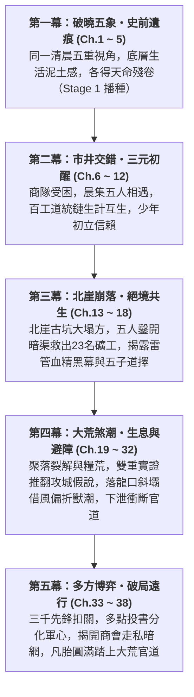

# 《遺忘的世界》第一卷：黑石凡胎・驚蟄篇 (Volume 1 Outline)

> **版本**：v2.0.0 (長篇全景規格大綱・因果校準版)  
> **篇幅規模**：全 38 章（約 15 ~ 18 萬字）  
> **主舞台**：大荒邊陲・黑石鋪聚落（Tier 0 凡胎微茫，Lv.1 ~ Lv.10）  
> **核心主題**：**「凡胎微芒、泥濘求生、五象合流、破障出鄉」**  
> **對應 MUD 空間**：`/d/village/`（全 10 間核心地圖及周邊微生態）  
> **對應 MUD 任務進程**：三大道統鏈 Stage 1 + 史詩奇遇【太古遺脈・天門引】Stage 1 + 全域世界事件【大荒煞潮】與【黑石關軍事危機】

---

## 卷前引言 (Volume Premise)

大清洗抹去了諸天神魔與通天大道，將天下修士割裂為盲目修法、自殘修力、玩物喪志的偏門三道。在世人眼中，八百里黑石山脈只是邊陲流民與狂暴野獸爭食的荒蠻之地。

五位身處社會最底層的少年——採藥孤兒、打鐵學徒、獵戶之子、破落道童、流浪乞兒——在同一個清晨各自觸碰了一角不可思議的史前遺痕。

這不是天降神兵的無敵傳奇，而是一群在飢餓、凍餒、官府盤剝與地煞猛獸的泥潭裡，用粗糙手掌與血汗骨肉生生鑿出一條生路的凡胎少年史詩。

---

## 五大主角成長曲線與階位對照 (Character Arcs & Tier Progression)

| 主角 | 初登場身份 (Ch.1~5) | 核心性格與生活痛感 | 觸發史前機緣 (Stage 1) | 卷末成長轉變 (Ch.33~38) |
| :--- | :--- | :--- | :--- | :--- |
| **顧玄** | 採藥孤兒 (Lv.1) 草廬雜役 | 清秀知禮，內心冷靜沉毅；赤足受盡寒潭凍痛，對瘋郎中又敬又怕 | 南谷碎石溪灘・【史前逆星斷碑】拓片 | 突破【感知/自然】瓶頸，從理想書生蛻變為直面生死抉擇、以病理實證與草木生機護持眾生的醫者 |
| **林鐵生** | 打鐵學徒 (Lv.1) 老鐵匠鋪 | 憨厚寡言，沉穩如古松；手臂結滿燙傷白泡，雙手滿是老繭 | 老鐵匠鋪・地爐【太古不融黑鐵齒輪】 | 右腕骨裂下突破蠻力執念，領悟岩層應力、滑輪槓桿與結構百工之道，由打鐵學徒蛻變為工程匠師 |
| **燕隼** | 獵戶之子 (Lv.1) 鹿角哨亭巡狩 | 警覺如隼，深諳弱肉強食；恐懼飢餓與猛獸，背負大伯失蹤陰影 | 泥沼巨榕根・【太古戰神獵獸圖騰柱】 | 克服孤狼盲點與經驗誤判，掌握群獸遷徙規律與機巧偏折戰術，成為團隊最致命的荒野斥候與射手 |
| **柳清虛** | 破落道童 (Lv.1) 殘觀觀星者 | 蒼白清癯，思辨天道哲理；深受漏風殘觀之苦，目睹道化真相瀕臨崩潰 | 迎風孤岩・【天羅偽籠活體牢籠】真相 | 落地入世，將高邈觀星術轉化為地勢測繪、微氣候觀風與證據邏輯推演，化作洞悉迷局之靈眼 |
| **沈泥** | 流浪乞兒 (Lv.1) 後巷柴房窩鋪 | 油滑狠厲，如野狗求生；看透世態炎涼，對莫三斷腿血仇感同身受 | 廢柴房黑泥・【萬物行商・天門引】殘令 | 以市井交易與底層共情凝聚流民乞兒、摸通太古暗渠情報網，掌握多點投書與破局出鄉之鑰 |

---

## 全卷五幕篇章架構 (Five-Act Narrative Blueprint)

---

### 第一幕：破曉五象・史前遺痕 (第 1 ~ 5 章)
*聚焦於黑石鋪同一天清晨（破曉卯末至辰初），以極致的微觀鏡頭刻畫底層少年的殘酷生計，並偶然觸碰被大清洗掩埋的史前機緣。*

* [x] **第 1 章：晨曦微光與磨刀石（顧玄・採藥）**
  * **主場景**：南谷碎石溪灘 (`/d/village/stream.c`)
  * **生活痛感**：赤足踏在冰冷刺骨鵝卵石上的寒痛，晨露草葉尖的泥苦味，瘋郎中葛半仙古怪嚴厲的咆哮。
  * **核心事件**：張屠戶與村婦在溪石上磨刀捶衣，水流洗去青苔，露出被世人當作洗衣板的【史前逆星斷碑】；顧玄拓印星圖殘卷，胸膛傳來萬古共鳴。
* [x] **第 2 章：爐火、重錘與不融黑鐵（林鐵生・打鐵）**
  * **主場景**：老鐵匠鋪・打鐵爐房 (`/d/village/forge.c`)
  * **生活痛感**：一人高牛皮風箱的窒息熱浪，三十把開山柴刀催單重壓，七斤重錘震得虎口發麻。
  * **核心事件**：阿鐵師傅提及北崖暗震地煞；鐵生奮力砸開粗鐵礦核，地爐烈火燒不融的【太古不融黑鐵齒輪構件】現世。
* [x] **第 3 章：鹿角哨亭、陷阱與大荒異動（燕隼・獵戶）**
  * **主場景**：林邊茅屋哨亭 (`/d/village/hunter_cabin.c`) 與 荒林口 (`/d/village/forest.c`)
  * **生活痛感**：大伯深入大荒未歸的生死陰霾，倒刺竹籤與黑蝮蛇毒的刺鼻腥味，猛獸隨時撲殺的窒息感。
  * **核心事件**：荒林吊套被狂暴山狼撞碎，追蹤暗紫濁血深入化骨泥沼，黑熊暴斃撞裂古石衣，震懾於【太古戰神獵獸圖騰柱】的蠻荒狂暴。
* [x] **第 4 章：殘壇罡風、觀星與道化之影（柳清虛・道童）**
  * **主場景**：迎風孤岩・荒廢道壇 (`/d/village/altar.c`)
  * **生活痛感**：七十丈孤岩冰冷刺骨的罡風，破觀漏風漏雨的寒酸，盲眼師傅枯木老道乾枯可怖的嚴厲。
  * **核心事件**：老松下玉化晶骨揭開「羽化道化」慘烈真相；清虛冒險神識衝霄，驚駭目睹蒼穹星空背後的【天羅地網活體牢籠】，嘔血誓言換天。
* [x] **第 5 章：背街柴房、市井耳目與黑市古令（沈泥・乞兒）**
  * **主場景**：老客棧後巷・廢柴房 (`/d/village/shed.c`)
  * **生活痛感**：油垢硬如牛皮的補丁破袍，廚房泔水桶翻撿肉骨頭的飢餓屈辱，瘸腿老丐莫三抓蝨子剔牙的市井江湖。
  * **核心事件**：貼牆「聽風辨器」洞悉金石商隊被官軍暗卡；在柴房黑泥半尺深處扒出莫三藏了三十年的【萬物行商・天門引】青金古令，接下血債託付。

---

### 第二幕：市井交錯・三元初醒 (第 6 ~ 12 章)
*早市銅鑼敲響，商隊被迫入駐，五位原本各守一方的少年，因生活所需首次在青石街市產生碰撞與交集。*

* [x] **第 6 章：晨集初開・五方交匯**
  * **核心情節**：老客棧敲響三聲破銅鑼，青石街市人頭攢動。顧玄背著藥簍送藥草、鐵生推著板車送柴刀、燕隼扛著狼皮換鹽、沈泥沿街行乞探聽虛實、清虛替破廟換取香燭。五位少年在老茶棚前首次產生眼神與言語碰撞。
* [x] **第 7 章：百工之環・生計互生**
  * **核心情節**：阿鐵鋪子急需解毒草藥，葛半仙索要精鋼藥碾；鐵生與顧玄在爐房前建立交情，燕隼送來堅韌筋線，三大道統鏈（物/力/法）的底層依存關係在市井煙火中自然展開。
* [x] **第 8 章：荒澗伏擊・氣血如爐**
  * **核心情節**：燕隼在南谷瀑布鍛體，顧玄點撥經絡與草石之理；商隊趙四勾結城防軍巡檢伍長疤面胡三尾隨伏擊欲殺人奪寶；顧玄物道初啼以生石膽苔化毒霧，燕隼生死一瞬激發戰神圖騰印「氣血如爐」逆殺強敵，搜出城防軍屠村滅口密信。
* [x] **第 9 章：逆星殘卷・知見道爭**
  * **核心情節**：顧玄在藥鋪畫出逆星符號引發清虛震動；暗巷密會中，地碑拓片與道門殘篇青銅圖完美咬合，拼出太古逆星全圖；法與物爆發深刻道爭（偽天牢籠 vs 踏地為爐）；沈泥倉皇報信商隊大掌櫃暴斃、城防軍調五十重甲弩衛欲屠村搜查，少年夜奔集結五子。
* [x] **第 10 章：暗巷驚鴻・少年心氣**
  * **核心情節**：暴雨夜城防軍黑甲弩衛封鎖全鎮搜捕；商隊大掌櫃之女蘇凝霜攜紫金信印與暗賬赤足奔逃，在死巷絕境被逼行凶之際，五傑神級破局英雄救美；柴房火堆旁五子心氣暗湧、較勁護短；凝霜道出太古神機密匙與屠村真相，五子歃手立下反獵之誓。
* [x] **第 11 章：瘋醫與盲道・老輩殘影**
  * **核心情節**：少年組戰術伏擊斬殺六名弩衛；暗線阿鐵、葛半仙、趙老獵、莫三、枯木五大導師天井聚首，目睹弟子成長熱血復甦；揭開三十年前守墓人與避劫真相；城防大統領下令屠村，老骨頭們不再隱忍，拔出太古陌刀與蛟骨巨箭暗中撐天。
* [x] **第 12 章：凡骨微瀾・修為初進**
  * **核心情節**：五人修為在生死磨礪中全面突破至 Tier 0 凡胎中期（Lv.3~4）；柴房中少年男女溫情流淌、暗暗較勁護短；突發驚天巨變——地煞逆衝，北崖古礦山大塌方，魯大山等二十餘名老礦工被埋地底三百米生死不知，五子熱血逆行搶險，第二幕圓滿收官。

---

### 第三幕：北崖崩落・絕境共生 (第 13 ~ 18 章)
*黑石鋪遭遇第一次全域生存危機——北崖古礦道發生毀滅性大塌方，底層生命在天災與人禍面前爆發出震撼的共生凝聚力。*

* [x] **第 13 章：地煞崩鳴・山崩礦塌**
  * **核心情節**：北崖古礦遭遇萬年地煞逆衝發生滅頂大塌方，萬斤黑石堵死洞口，魯大山等二十三名礦工被困地下三百米。商會二掌櫃趙德貴扣押軍用鋼釬絞盤企圖封山滅口，五子拔刀狂怒對峙。危急時刻，蘇凝霜手持「紫金雙龍信印」傲然現身，當眾揭穿叛逆，咬指血書立下【天字甲級特等緊急救援委託】，徵調全部大車物資並獻出太古採掘殘圖，五子誓死下井救人！
* [x] **第 14 章：逆流而上・人心如鑑**
  * **核心情節**：全鎮百工震撼響應，老鐵匠阿鐵抱病淬鍊破煞鋼鑿，瞎老道送來定脈符，瘋郎中贈避煞烈酒，老獵戶指點暗風地穴；五位少年在礦道口立下生死狀，集結物資、整肅隊伍，頂著滾滾地煞毒雲與餘震碎石，義無反顧踏入漆黑死寂的地下三百米古礦深淵。
* [x] **第 15 章：鑿巖破穴・鐵骨生生**
  * **核心情節**：林鐵生手持八角重鍛錘，承受萬斤反震逆血狂噴、右手腕骨裂，以凡胎氣血硬撼石眼砸開兩尺古排沙暗渠；沈泥身形嬌小、主動銜藥探險，在狹窄窒息的排沙死穴中匍匐前進，終於在避風穹頂找到二十三名老礦工並點燃地火霹靂紅煙；外側鐵生、清虛、燕隼釘下百煉鋼鑿架設天車救生索。
* [x] **第 16 章：死線拔河・命懸一線**
  * **核心情節**：生死競速展開，沈泥在石室指揮固定傷患，顧玄針藥齊施起死回生，林鐵生浴血絞動手動天車，二十二名礦工陸續脫險；地底盲眼鐵甲岩蜥被血腥驚醒撲殺，燕隼大荒連珠三箭與柴刀開腹凶悍雙殺；千鈞一髮之際，鐵生將不融黑鐵卡入暗渠青銅閥門撐開最後通道，合力將沈泥與捨身撐木的魯大山拽出生天，身後穹頂徹底崩塌，二十三名老礦工全員生還！
* [x] **第 17 章：生還之後・暗流如沸**
  * **核心情節**：破曉晨光照耀礦坪，礦工家屬痛哭拜謝少年英雄；城防司胡百戶率三十鐵騎與趙德貴企圖扣押軍資、滅口拘捕，蘇凝霜以紫金雙龍印與暗賬當眾反制；阿鐵重錘、趙老獵蛟骨弓、枯木老道、老丐莫三亮出絕世威懾；魯大山咳血拋出金石城軍器局引信管與血紋晶石，揭穿趙德貴勾結官軍盜採地煞血精炸塌地脈之滔天罪證，民憤如潮逼退官兵。
* [x] **第 18 章：分歧之夜・少年道擇**
  * **核心情節**：深夜廢柴房火塘前五人密會，五大核心視角激烈碰撞：顧玄堅持保存證據呈報御史求真；沈泥主張敲詐金銀購路引自保；鐵生憂慮太古神機淪為殺戮凶器主張封存；清虛為砸碎蒼穹天羅囚籠誓死追尋逆星真相；燕隼冷靜警告地煞爆發三日內必引來東林大獸潮。各執己見卻在底層共鳴中化為生死信賴；蘇凝霜深夜傳遞城防司調三千重弩封山屠鎮軍報，五子立下三日破境衝關誓約。

---

### 第四幕：大荒煞潮・生息與避障 (第 19 ~ 32 章)
* **核心理念**：五人沒有打贏獸潮，也沒有打贏官軍，他們只是找到一個能改變局勢的槓桿。黑石鋪不是軍隊，不會因為主角振臂一呼就突然全村團結；商隊不是無條件盟友，官軍也不是臉譜化反派。聚落的生存取決於「先調查成因與遷徙路線，再以引導避障為主、局部疏散為輔」；而將災難引向落龍深澗，本質上是一場帶著道德灰度的生存抉擇——為了保住黑石鋪百餘戶性命，他們在明知可能將獸災轉嫁到下游官道、卻無法完全掌控後果的情況下，親手扳動了這根危險的槓桿。
* **三條核心因果鎖鏈與物理機制（第 19 章 ➔ 第 35 章）**：
  1. **獸潮因果鏈（地形、雙層氣流與分波推進）**：
     - **重力沉降 vs 熱力側風**：北崖海拔高、南側低。地脈炸裂噴出的高比重地煞硫煙，在夜間與無風谷底如水銀般貼地順北坡溝谷向南沉降（重力流），逼迫北山數千食草獸（黃羊、岩鹿）順山脊走廊南逃，肉食獸尾隨。而在初冬日出後的辰巳時分，向陽的黑石鋪盆地受熱氣流上升，會在分水嶺「落龍口」高處形成自西南吹向東北的**向陽坡面側逆風**——這讓少年們得以在西路高坡點燃刺鼻毒煙封蔽西路嗅覺，而不與谷底沉降的北方地煞硫煙產生風向矛盾。
     - **三十度斜壩與七八成偏折率**：凡人無法封死山谷，而是在落龍口分水嶺尖角處「清東阻西」——清理東路「落龍深澗」入口亂石，在西路入口利用古採石場危岩布設**三十度斜向碎石導流壩**，配合側逆風毒煙與鳴鏑火矢驚擾前排領頭食草獸偏轉三十度湧入深澗，引發後隊盲從效應。主群約**七至八成**折入深澗，中後段因擁擠踩踏仍有**一至兩成（數百頭）**漏網殘獸衝破西路外柵，聚落必須付出巷戰流血代價。
     - **二十五里裂谷密度差與分波衝擊**：二十五里是裂谷長度，不等於每頭野獸都能以固定速度通過。獸群內部存在顯著的密度差、跌倒、瓶頸堵塞與前後隊落差。第 28 章上午（辰末）獸群折入深澗後，體型輕捷的先頭黃羊與岩鹿群於**巳末（近午）**率先衝出虎跳峽出口，驚亂官道哨卡與運糧車隊；**正午（午時）至未初**，最龐大的主力獸群（野豬、棕熊、岩蜥與受驚獸海）如山洪般分波持續湧出，踩塌半里木棧道、將整條輜重線推入深淵，使官道防線在持續兩個時辰的升級衝擊中徹底崩潰（第 31 章）。
  2. **利益與社會因果鏈（從各懷鬼胎到被迫合作）**：
     - **糧荒與私心**：大崩塌後糧價暴漲、富戶囤積備逃、商隊護衛譁變，無人願為公共工程冒險。
     - **精煉坩堝伏筆（Ch.21 ➔ Ch.26）**：地煞血精原礦富含劇毒硫渣，無法直接長途押運八百里，必須在產地進行初級提純。鎮上王員外、周掌櫃實為二掌櫃趙德貴暗中扶植的「本地黑作坊代煉戶」。趙德貴在 Ch.17 倒台被押後，王、周二人深怕商會與官府徹查抄家（私藏軍禁地煞精煉器物乃滅門死罪），這才在第 21 章暗中加固車軸、將封著火泥的沉重【地煞精煉坩堝】裝箱，並在恐懼驅使下於第 26 章不顧獸潮警告強行帶贓物私逃，最終車毀人亡、堵死南道，坩堝滾出車箱成為撬開商會高層黑幕的鐵證。
  3. **權力博弈與制度制衡因果鏈（為何三千官軍不立即屠村）**：
     - 少年們並非靠口才「說服」大軍，而是利用大乾軍制內部的**三方制度性制衡**：① **先鋒主帥（左營參將陳鎮山）**奉命平亂，實則忌憚背上「屠殺持皇朝鐵券商隊」的御史彈劾黑鍋，更怕替胡百戶私盜六百斤軍用火藥的死罪頂缸；② **隨軍監軍（府城兵備道軍器核驗官）**與城防司互不統屬，專司核查軍火虧空，拿到【軍器局雷管批號】即可立下彈劾大功；③ **督糧官與底層同鄉士卒**在虎跳峽棧道被毀、重弩與糧車受阻後，面臨「強攻硬啃必斷糧嘩變」的後勤絕境。五人分頭投遞可核驗物證，讓「封存查辦胡百戶」成為對軍方高層最有利的政治選擇。

#### 【第一階段：恐懼滲透與生態勘測】（第一天）
* [x] **第 19 章：生息暗湧・晨市米貴**
  * **核心情節**：大崩塌後第一天清晨，昨夜「三日衝關」的熱血誓言撞上冷酷現實——胡百戶已封死二十里外的黑石關，且蘇凝霜核實軍報：三千大軍並非自八百里外瞬間飛來，而是城防司半月前藉「冬防演武」駐紮在百里外虎跳營的精銳，接烽火急報後三四日即可抵關。鎮內恐慌蔓延：菜市粗糧暴漲三成、老客棧停賒、富戶暗中套車備逃、鐵匠鋪斷煤熄爐。後巷小乞兒偷摸商隊馬料，沈泥踢翻喝止卻塞給乾饃；草廬 23 名傷患哀嚎，生石膽苔僅餘三十六小時用量，顧玄握著最後三包止痛散面臨殘酷的戰地分診抉擇，以「寒針截脈法」刺入右小腿斷口上方的委中、陽陵泉、足三里三穴替孫大牛阻斷痛覺；林鐵生右腕骨裂打著夾板，僅能左手拉風箱、順鐵紋支點修補門閂農具。燕隼與柳清虛、老斥候巡查東林，發現陷阱空置無血、狼羊蹄印重疊卻不捕食、斷枝全朝南倒等反常跡象，動搖昨晚「妖獸集結攻城」的舊判斷；章末於背風石溝尋獲一具無外傷、口鼻溢血沫與地煞黑灰的暴斃黃羊。
* [x] **第 20 章：暴斃黃羊・雙重實證**
  * **核心情節**：顧玄結合老礦工「石肺病與地煞瘴毒」臨床經驗剖檢黃羊，驗出氣管與肺泡充斥灼熱地煞硫塵與腐蝕血泡，死因係高濃度毒煙急性窒息而非妖化發狂；燕隼、清虛與趙老獵斥候比對第二組獨立生態證據——林緣草木折痕、蹄印深淺與糞便分布呈「由北向南恐慌逃逸」之勢，食草獸在前、肉食獸在後，且北方高比重地煞硫煙正如水銀般順溝谷貼地南流。兩組獨立證據拼合，五人推翻「妖獸攻城」流言，確立更具解釋力的**「逃荒遷徙假說」**：黑石鋪恰處於北獸南逃的西路平緩熟道上。眾人拼合古礦圖與獵戶山圖，首次發現東側二十五里「落龍深澗」及其直通官道虎跳峽棧道的走向。
* [x] **第 21 章：市井暗火・人心如鑑**
  * **核心情節**：即便有了遷徙假說，黑石鋪依然因各自利益與恐懼而分裂。米店因限購爆發流血推搡；商隊四名外聘護衛恐懼被困，串聯強搶駁馬欲走南谷私逃，蘇凝霜持信印與強弩彈壓，卻也不得不發放雙倍遣散銀並重金懸賞送信死士，「商隊隨時可能棄村」的流言四起，暴露出商隊並非無條件盟友；鎮民只顧搶修自家門閂與板車，無人願去北面山口送死。與此同時，沈泥的乞兒眼線「小泥鰍」與送修補車軸鐵轄的林鐵生，發現富戶王員外與周掌櫃正鬼祟地將封著耐火泥、散發刺鼻硫渣味的沉重黑鐵箱裝上加固大車——原來血精原礦含劇毒硫渣無法遠運，王、周二人正是趙德貴在鎮上的私煉代工戶，趙德貴被擒後他們唯恐私藏【地煞精煉坩堝】的滅門死罪敗露，正急於攜贓私逃。五人向長輩請教改道構想，趙老獵與阿鐵一針見血指出：強堵西路必被踩塌；而若引進落龍深澗，雖能救黑石鋪，下游虎跳峽官道上的無辜商旅行人與關防卻可能遭受滅頂之災。
* [x] **第 22 章：火塘夜議・落龍借勢**
  * **核心情節**：深夜柴房密會。五位長輩各有殘傷與職守（葛半仙守重傷員、阿鐵鎮守工坊防暴亂、趙老獵盯防關卡哨騎），少年們必須獨立扛起工程與道德重擔。針對風向矛盾，清虛與趙老獵釐清「谷底地煞重氣貼地南流」與「白晝盆地向陽坡西南側逆風」的雙層氣流差異，確立**「清東阻西、三十度斜壩配合側風毒煙與鳴鏑偏折頭獸」**的主方案（預估偏折七至八成主力，並以北崖暗渠與客棧地窖作為應對一兩成漏網殘獸的防線備案）。面對「將災難轉嫁官道」的道德兩難，五人承認自己並非全知全能的救世主——胡百戶雖已封關斷絕尋常商旅，但引獸入澗仍會因裂谷二十五里的密度差與分波湧出，在次日巳末至午後持續衝垮虎跳峽棧道，將胡百戶守軍推入絕境。老丐莫三與蘇凝霜剖析即將抵關的府城大軍內部「主帥怕背黑鍋、監軍查核火器、督糧官畏懼斷道」的三方制度性裂痕。少年們意識到：他們打不贏獸潮也打不贏三千大軍，但落龍深澗的地形與手中的四樣鐵證，正是撬動這場死局的唯一槓桿。

#### 【第二階段：工程改道與利益博弈】（第二天）
* [ ] **第 23 章：落龍天塹・風眼隘口**
  * **核心情節**：清晨五子與兩名老斥候、老礦工實地踏勘落龍口三叉地形。清虛不用玄虛卜算，而是以迎風孤岩觀雲經驗結合三處炭盆煙火實測，確認初冬辰巳時分盆地吹向北坡高處的「西南側逆風」窗口，以及正午山風倒灌的反噬風險；鐵生檢查古代採石場遺留的溜石槽與鏽蝕青銅絞盤，評估拉索承重極限；燕隼發現先頭零星逃竄野鹿在亂石灘前的猶豫行為，驗證了「減阻與斜向誘導」的可行性。
* [ ] **第 24 章：百工逆行・萬斤落石**
  * **核心情節**：全鎮多數居民仍在觀望私逃，僅有魯大山等感恩的輕傷老礦工、家屬與蘇凝霜出糧雇來的少數學徒參與工程。林鐵生嚴守右腕骨裂限制，不再逞強揮大錘，而是以左手持炭筆標定岩層節理與應力弱點，指揮老礦工打入鋼楔、修復滑輪組絞盤。首次拉索測試因支點岩層酥脆而偏移失敗，鐵生虛心採納魯大山的「斜向卸力壘石法」，撬落危岩築起三十度角的階梯導流斜壩。
* [ ] **第 25 章：逆風草煙・惡臭之陣**
  * **核心情節**：沈泥用粗糧餅子動員後巷乞兒與寡婦，搜集鐵匠鋪硫磺廢渣、陳年狼糞與辣蓼草。顧玄請教老獵戶燻獸土方，配製低溫悶燒的刺鼻煙料。測試中發現單純濃煙對狂躁野豬效果有限，但在側風下能有效迫使領頭黃羊與岩鹿偏離方向；同時因硫煙傷肺，顧玄嚴格劃定下風撤退線、配備濕布面巾與覆土沙袋，杜絕煙霧倒灌傷及己方人員。
* [ ] **第 26 章：私逃血鑑・連鎖破局**
  * **核心情節**：傍晚，鎮上王員外、周掌櫃因恐懼私藏精煉坩堝的死罪暴露，且不信少年工程，重金雇鏢師套轅四輛加固大車載滿家財與黑鐵箱走東林南道私逃，結果在南谷林口撞上先頭南逃的狂暴野豬與血狼群，車毀人亡，傾覆重車徹底堵死南面小路。倖存鏢師逃回報信，全鎮「坐車南逃」的僥倖心理徹底破滅，鎮民為了活命被迫加入加固木柵與搬運石料的行列。散落貨箱中滾出封著耐火泥、刻有金石商會內堂暗記的【地煞精煉坩堝】（與第 21 章伏筆完全咬合），蘇凝霜核對暗賬發現殘缺代號，確認商會高層內部亦有人參與血精提純走私。無主糧車引發流民爭搶，沈泥與商隊護衛在混亂中彈壓並建立戰時配給。

#### 【第三階段：天災過境與微光守護】（第三天）
* [ ] **第 27 章：驚蟄前夜・簷下風聲**
  * **核心情節**：第三天黎明前的酷寒死寂。外圍住戶與 23 名礦工傷患按備案轉移至內街石屋與暗渠入口，婦孺爭搶避難位置引發摩擦，由阿鐵、葛半仙與礦工家屬出面彈壓。五位少年立於落龍口高崖哨亭，監測風向與地平線震動；在極限生存壓力與專注中，五人各自對器物、結構、氣機與生機產生深層領悟（非神兵天降，而是技藝與心境的實質磨合）。
* [ ] **第 28 章：奔雷偏折・怒轉深澗**
  * **核心情節**：辰末巳初，數千頭大荒獸群如黑色山洪奔騰抵達落龍口！清晨向陽坡西南側逆風準時吹拂，顧玄點燃下風煙堆封住西路氣味；第一批領頭岩鹿與黃羊受濃煙與斜向碎石壩阻滯出現遲疑；燕隼與趙老獵率獵戶組居高臨下，將骨製鳴鏑與熊油火矢精準射在頭獸右前側地面；林鐵生指揮絞盤斬索，引落溜石槽危岩封死西側缺口（其中一組拉索崩斷，老礦工與鐵生以血肉之軀死死卡住絞盤木齒）。在地形減阻、斜壩偏折、毒煙與鳴鏑四重作用下，前排數百頭食草獸本能向左偏轉三十度衝入開闊的落龍深澗，帶動後方七至八成獸潮主力如洪流般怒折入澗！
* [ ] **第 29 章：巷尾餘燼・守望相助**
  * **核心情節**：工程無法做到完美無缺——獸潮中後段因密度過大互相擠壓踩踏，約一至兩成（數百頭）被擠出主道的傷狼、盲眼野豬與岩蜥撞破西路外圍木柵衝入黑石鋪外街。五人與留守街坊依托窄巷車陣協同防禦：林鐵生以左手短錘配合預埋鐵索絆倒狂獸，阿鐵師傅揮動大錘鎮守水井，沈泥引導熟悉地形的乞兒在屋頂投石引開狼群，顧玄死守草廬傷患，柳清虛在高處吹哨指引安全通道。聚落付出房屋受損、數人輕重傷與牲畜折損的真實代價，終於將漏網殘獸驅殺殆盡。

#### 【第四階段：天塹反噬與局勢逆轉】（第四天）
* [ ] **第 30 章：晨曦灰燼・劫後微光**
  * **核心情節**：劫後清晨，黑石鋪滿目瘡痍卻生機猶存。村民清點傷亡、掩埋獸屍防範疫病；草廬內柱子等重傷員挺過最危險的毒發期，但藥物耗盡急需補給。圍繞富商遺留物資與受損房屋修繕，鎮民之間仍有算計與爭執，但在共同流過血的礦工與工匠維持下，聚落形成了不再輕易潰散的底層韌性。與此同時，五人望向東南官道方向，心中皆壓著那塊沉甸甸的石頭——那數千頭被他們引進落龍深澗的野獸，究竟在下游造成了怎樣的浩劫？
* [ ] **第 31 章：錯位天平・狼狽關防**
  * **核心情節**：斥候帶回震撼而殘酷的消息：昨日湧入二十五里落龍深澗的獸群，因峽谷狹窄、跌倒踩踏與物種速度差，在虎跳峽出口形成了長達兩個時辰的**「分波段升級衝擊」**！巳末時分，跑得最快的先頭黃羊與岩鹿群率先衝出峽口，撞翻了胡百戶設在棧道口的拒馬與巡邏哨騎；正午（午時）至未初，當胡百戶派出的押運車隊與接應兵丁堵在半里長的懸崖木棧道上進退維谷時，後方最龐大沉重的野豬、棕熊與狂暴獸海主力如決堤山洪般持續噴湧而出！半里木棧道在連綿不絕的重壓下轟然坍塌，糧車與十餘名跳崖逃生的士卒跌入深澗，整條金石官道被坍塌山石與堆積如山的跌死獸屍徹底截斷。胡百戶三十名守軍在黑石關淪為斷糧孤島（僅存三日口糧），其暴怒懷疑黑石鋪故意引獸害他，一度欲率兵下山強搶存糧並屠村滅口，卻因士卒折損驚魂未定、忌憚五大老輩武力且怕強攻徹底毀掉血精線索而投鼠忌器。
* [ ] **第 32 章：迷局反客・籌碼在手**
  * **核心情節**：得知官道棧道徹底崩毀、甚至有官兵在獸潮中死傷，五位少年心中並無大獲全勝的狂喜，而是直面「借天災自保亦伴隨因果代價」的沉重現實。但從戰略全局看，虎跳峽斷道雖堵死了商隊坐車南下的路，卻將後續趕來的府城三千先鋒軍重裝攻城弩車與大批糧草死死卡在斷道之外，僅能由輕裝步騎翻山越嶺。五子與蘇凝霜系統梳理手中四組不同層次的籌碼（軍器局雷管引信、血紋晶石、走私暗賬抄本、王周富商私藏之精煉坩堝），區分「可直接核驗的鐵證」與「尚缺口供的推測」，制定針對軍方內部不同派系的「多點分化博弈方案」。

---

### 第五幕：多方博弈・破局遠行 (第 33 ~ 38 章 / 第一卷終章)
* **核心理念**：官軍不是全體嗜血的反派，而是由「奉命平亂怕背黑鍋的主帥（左營參將陳鎮山）」、「獨立盯防軍械虧空的隨軍監軍（兵備道軍器核驗官）」、「焦慮斷糧的督糧官」與「有同鄉在村裡的底層士卒」組成的官僚武裝集合體。五位少年沒有打贏三千大軍，而是利用虎跳峽斷道造成的後勤困境與四樣可交叉核驗的物證，撬動軍方內部的制度性制衡，讓「立即屠村」變成對軍方高層政治風險最高、最不利的選項。

* [ ] **第 33 章：迷霧扣關・三軍陣前**
  * **核心情節**：駐紮虎跳營的府城先鋒軍（約八百輕裝精銳先行翻越山嶺，主力與重弩受阻於虎跳峽斷道）抵達黑石關。先鋒參將陳鎮山手持「平定礦匪暴亂、封控地煞疫區」之軍令列陣關前。胡百戶惡人先告狀，指責黑石鋪聚眾叛亂、引獸毀道並窩藏軍械；陳鎮山與隨軍監軍卻敏銳察覺異樣——虎跳峽棧道確係天災獸蹄自裂谷湧出所毀，且村口並無叛軍旗號，反高懸金石商會「皇朝特許鐵券」大旗。隨軍監軍當場質問胡百戶為何防區內會出現地煞大崩塌，陳鎮山則要求胡百戶解釋為何「暴民」手中會有商會鐵券，並限令黑石鋪於次日午時前交出首惡與合理解釋。
* [ ] **第 34 章：暗賬分牒・多點投書**
  * **核心情節**：五子與蘇凝霜執行「多點分投、交叉核實」行動：絕不將唯一原件交給胡百戶或單一將領。顧玄、清虛與蘇凝霜連夜分寫三份不同側重的文牒；沈泥與老丐莫三借道北崖古排沙暗渠外延支洞（克服局部積水與塌方阻礙）繞過關卡哨騎，燕隼在外圍接應掩護，將【軍器局雷管批號拓印與六百斤火藥虧空明細】投給與城防司互不統屬的兵備道隨軍監軍、將【胡趙勾結私採血精與地煞精煉坩堝鐵證抄本】投給怕背黑鍋的先鋒參將陳鎮山、將【虎跳峽斷糧地形與避獸山道圖及礦工家書】送達焦頭爛額的督糧官與同鄉士卒手中。
* [ ] **第 35 章：軍心如鑑・天威難欺**
  * **核心情節**：關前公開勘驗與三方制度性對質。兵備道監軍當眾核對雷管編號與精煉坩堝，確認係巡檢司三個月前谎報演武申領之六百斤軍火，若不嚴查自己亦將受失察連坐；督糧官指出虎跳峽棧道已斷、八百先鋒日耗巨糧，若強攻硬啃有老輩高手與地形掩護的黑石鋪，必成斷糧嘩變的泥潭；魯大山等二十三名傷殘老礦工坐著平板車出現在陣前，露出背上礦傷與血書，前排同鄉士卒動容垂弩。胡百戶試圖將罪責全推給趙德貴，趙德貴狗急跳牆當眾反咬。陳鎮山權衡利弊（強行屠村必遭監軍與御史台聯手彈劾，而拿辦胡百戶則可將「平叛不力」轉為「破獲軍火走私大案」立功免責），當場下令解除胡百戶兵權、將胡趙二人戴枷隔離看管，改「進剿令」為「駐關封存、聯名呈報府城三司會審」。
* [ ] **第 36 章：商會殘骨・利益之毒**
  * **核心情節**：屠村危機解除，但真相遠未終結。蘇凝霜綜合趙德貴口供、富商王周二人的精煉坩堝與父親遺留的暗賬密鑰，驚駭發現地煞血精經本地坩堝初煉後，最終買家竟指向金石府城內的商會大長老與更高層的修真世家，父親大掌櫃之死極可能是商會內部走私派與城防高層聯手滅口。少年們第一次深刻認識到：胡百戶與趙德貴只是龐大利益網末端的爪牙，官場與商會並非非黑即白，真正的風暴中心在八百里外的金石府城。
* [ ] **第 37 章：回首黑石・凡胎圓滿**
  * **核心情節**：黑石鋪進入戰後重建與分化。魯大山等老礦工與阿鐵師傅決定留守故土，重開爐火、修繕屋舍；部分受驚商販則準備隨軍撤往內地。五位少年在經歷礦難救人、煞潮改道與三軍博弈後，各自消化傷勢與所得——林鐵生右腕漸癒、融會結構應力與鍛錘之法；顧玄醫毒雙修、感知入微；燕隼氣血凝練、箭術通神；柳清虛神識歸元、堪輿破妄；沈泥暗行斂息、市井通明。五人以不同路徑先後踏入 **Tier 0 凡胎圓滿（Lv.10）**，並拿到合法簽發的出鄉路引。
* [ ] **第 38 章：大荒官道・天門驚蟄 (第一卷終章)**
  * **核心情節**：虎跳峽臨時便道搶通，初冬晨霧散盡。五位少年在村口向阿鐵、葛半仙、趙老獵、枯木老道與莫三五位留守師長鄭重辭行（五段各具性格底色、不煽情卻厚重的道別）。少年們護衛著蘇凝霜的商隊殘部，踏上滿布獸蹄痕跡與滄桑裂紋的金石官道。行過黑石關，五人懷中的逆星拓片、不融黑鐵、戰神圖騰、青銅殘卷與天門引產生微弱而深邃的共鳴。回望漸漸隱入群山炊煙中的黑石鋪，五位少年邁步走向波瀾壯闊的大荒紅塵。第一卷【黑石驚蟄】正式落幕。

---

## 寫作與精修指引 (Guidelines for Revision)

1. **守住泥土感與生理限制**：拒絕高大上的修仙浮誇詞，文字要帶有草藥的泥苦、鐵屑的焦灼、獸血的腥鹹與後巷泔水的發餿味；嚴格遵守人物傷勢限制（如林鐵生右腕骨裂期間絕不單手揮大錘硬砸；孫大牛傷在右小腿，針刺止痛穴位與束縛必須嚴格對應右膝下委中、陽陵泉與足三里）。
2. **拒絕全知劇透與順風團結**：嚴格區分「客觀事實」、「角色假說」與「利益說詞」；黑石鋪居民、商隊護衛與官軍士卒皆有自身算計，絕不為了主角方便而無腦團結或無腦反派。
3. **硬核因果閉環與道德灰度**：從地煞重氣貼地南流 vs 白晝向陽坡側逆風 ➔ 落龍口三十度斜壩偏折七八成頭獸 ➔ 二十五里裂谷因密度差與堵塞形成分波段衝擊（巳末前鋒驚棧道、正午主力毀全線） ➔ 阻斷官軍重械與糧道並觸發三方制度制衡。同時保留少年們「為保聚落而將災難轉嫁官道」的真實心理掙扎，牢記核心命題：**五人沒有打贏獸潮，也沒有打贏官軍，他們只是找到了一個能改變局勢的槓桿**。

