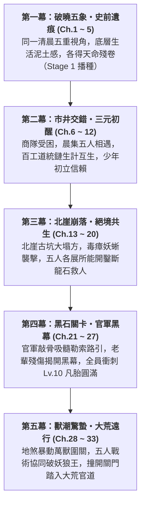

# 《遺忘的世界》第一卷：黑石凡胎・驚蟄篇 (Volume 1 Outline)

> **版本**：v1.0.0 (長篇全景規格大綱)  
> **篇幅規模**：全 33 章（約 12 ~ 15 萬字）  
> **主舞台**：大荒邊陲・黑石鋪聚落（Tier 0 凡胎微茫，Lv.1 ~ Lv.10）  
> **核心主題**：**「凡胎微芒、泥濘求生、五象合流、破障出鄉」**  
> **對應 MUD 空間**：`/d/village/`（全 10 間核心地圖及周邊微生態）  
> **對應 MUD 任務進程**：三大道統鏈 Stage 1 + 史詩奇遇【太古遺脈・天門引】Stage 1 + 出鄉文牒考核 (`village_pass.json`)

---

## 卷前引言 (Volume Premise)

大清洗抹去了諸天神魔與通天大道，將天下修士割裂為盲目修法、自殘修力、玩物喪志的偏門三道。在世人眼中，八百里黑石山脈只是邊陲流民與狂暴野獸爭食的荒蠻之地。

五位身處社會最底層的少年——採藥孤兒、打鐵學徒、獵戶之子、破落道童、流浪乞兒——在同一個清晨各自觸碰了一角不可思議的史前遺痕。

這不是天降神兵的無敵傳奇，而是一群在飢餓、凍餒、官府盤剝與地煞猛獸的泥潭裡，用粗糙手掌與血汗骨肉生生鑿出一條生路的凡胎少年史詩。

---

## 五大主角成長曲線與階位對照 (Character Arcs & Tier Progression)

| 主角 | 初登場身份 (Ch.1~5) | 核心性格與生活痛感 | 觸發史前機緣 (Stage 1) | 卷末成長轉變 (Ch.30~33) |
| :--- | :--- | :--- | :--- | :--- |
| **顧玄** | 採藥孤兒 (Lv.1) 草廬雜役 | 清秀知禮，內心冷靜沉毅；赤足受盡寒潭凍痛，對瘋郎中又敬又怕 | 南谷碎石溪灘・【史前逆星斷碑】拓片 | 突破【感知/自然】瓶頸 (Lv.10)，以草木靈液調和團隊生機，奠定三元歸一感知基礎 |
| **林鐵生** | 打鐵學徒 (Lv.1) 老鐵匠鋪 | 憨厚寡言，沉穩如古松；手臂結滿燙傷白泡，雙手滿是老繭 | 老鐵匠鋪・地爐【太古不融黑鐵齒輪】 | 領悟「瘋魔打鐵法」運力精髓 (Lv.10)，七斤重錘化為護身殺器，百工之造開竅 |
| **燕隼** | 獵戶之子 (Lv.1) 鹿角哨亭巡狩 | 警覺如隼，深諳弱肉強食；恐懼飢餓與猛獸，背負大伯失蹤陰影 | 泥沼巨榕根・【太古戰神獵獸圖騰柱】 | 肉身蠻荒神魔血氣初醒 (Lv.10)，機巧陷阱與破甲重射結合，成為團隊最致命哨兵 |
| **柳清虛** | 破落道童 (Lv.1) 殘觀觀星者 | 蒼白清癯，思辨天道哲理；深受漏風殘觀之苦，目睹道化真相瀕臨崩潰 | 迎風孤岩・【天羅偽籠活體牢籠】真相 | 勘破虛偽仙道知見障 (Lv.10)，以枯木避劫法逆引神識，化身洞悉戰局之靈眼 |
| **沈泥** | 流浪乞兒 (Lv.1) 後巷柴房窩鋪 | 油滑狠厲，如野狗求生；看透世態炎涼，對莫三斷腿血仇感同身受 | 廢柴房黑泥・【萬物行商・天門引】殘令 | 習得「睡夢大法」斂息匿跡 (Lv.10)，市井耳目與暗刺突襲大成，掌握出鄉情報鑰匙 |

---

## 全卷五幕篇章架構 (Five-Act Narrative Blueprint)

---

### 第一幕：破曉五象・史前遺痕 (第 1 ~ 5 章)
*聚焦於黑石鋪同一天清晨（破曉卯末至辰初），以極致的微觀鏡頭刻畫底層少年的殘酷生計，並偶然觸碰被大清洗掩埋的史前機緣。*

* [x] **第 1 章：晨曦微光與磨刀石（顧玄・採藥）**
  * **主場景**：南谷碎石溪灘 (`/d/village/stream.c`)
  * **生活痛感**：赤足踏在冰冷刺骨鵝卵石上的寒痛，晨露草葉尖的泥苦味，瘋郎中葛半仙古怪嚴厲的咆哮。
  * **核心事件**：張屠戶與村婦在溪石上磨刀捶衣，水流洗去青苔，露出被世人當作洗衣板的【史前逆星斷碑】；顧玄拓印星圖殘卷，胸膛傳來萬古共鳴。
* [x] **第 2 章：爐火、重錘與不融黑鐵（林鐵生・打鐵）**
  * **主場景**：老鐵匠鋪・打鐵爐房 (`/d/village/forge.c`)
  * **生活痛感**：一人高牛皮風箱的窒息熱浪，三十把開山柴刀催單重壓，七斤重錘震得虎口發麻。
  * **核心事件**：阿鐵師傅提及北崖暗震地煞；鐵生奮力砸開粗鐵礦核，地爐烈火燒不融的【太古不融黑鐵齒輪構件】現世。
* [x] **第 3 章：鹿角哨亭、陷阱與大荒異動（燕隼・獵戶）**
  * **主場景**：林邊茅屋哨亭 (`/d/village/hunter_cabin.c`) 與 荒林口 (`/d/village/forest.c`)
  * **生活痛感**：大伯深入大荒未歸的生死陰霾，倒刺竹籤與黑蝮蛇毒的刺鼻腥味，猛獸隨時撲殺的窒息感。
  * **核心事件**：荒林吊套被狂暴山狼撞碎，追蹤暗紫濁血深入化骨泥沼，黑熊暴斃撞裂古石衣，震懾於【太古戰神獵獸圖騰柱】的蠻荒狂暴。
* [x] **第 4 章：殘壇罡風、觀星與道化之影（柳清虛・道童）**
  * **主場景**：迎風孤岩・荒廢道壇 (`/d/village/altar.c`)
  * **生活痛感**：七十丈孤岩冰冷刺骨的罡風，破觀漏風漏雨的寒酸，盲眼師傅枯木老道乾枯可怖的嚴厲。
  * **核心事件**：老松下玉化晶骨揭開「羽化道化」慘烈真相；清虛冒險神識衝霄，驚駭目睹蒼穹星空背後的【天羅地網活體牢籠】，嘔血誓言換天。
* [x] **第 5 章：背街柴房、市井耳目與黑市古令（沈泥・乞兒）**
  * **主場景**：老客棧後巷・廢柴房 (`/d/village/shed.c`)
  * **生活痛感**：油垢硬如牛皮的補丁破袍，廚房泔水桶翻撿肉骨頭的飢餓屈辱，瘸腿老丐莫三抓蝨子剔牙的市井江湖。
  * **核心事件**：貼牆「聽風辨器」洞悉金石商隊被官軍暗卡；在柴房黑泥半尺深處扒出莫三藏了三十年的【萬物行商・天門引】青金古令，接下血債託付。

---

### 第二幕：市井交錯・三元初醒 (第 6 ~ 12 章)
*早市銅鑼敲響，商隊被迫入駐，五位原本各守一方的少年，因生活所需首次在青石街市產生碰撞與交集。*

* [x] **第 6 章：晨集初開・五方交匯**
  * **核心情節**：老客棧敲響三聲破銅鑼，青石街市人頭攢動。顧玄背著藥簍送藥草、鐵生推著板車送柴刀、燕隼扛著狼皮換鹽、沈泥沿街行乞探聽虛實、清虛替破廟換取香燭。五位少年在老茶棚前首次產生眼神與言語碰撞。
* [x] **第 7 章：百工之環・生計互生**
  * **核心情節**：阿鐵鋪子急需解毒草藥，葛半仙索要精鋼藥碾；鐵生與顧玄在爐房前建立交情，燕隼送來堅韌筋線，三大道統鏈（物/力/法）的底層依存關係在市井煙火中自然展開。
* **第 8 章：肉身打熬・氣血如爐**
  * **核心情節**：燕隼在南谷瀑布下赤身硬撼千鈞水流（鍛鍊 `str/con`）；顧玄在旁辨析水汽地衣，兩人交流林間與深潭生存技巧，野性力修與細膩物道初步相融。
* **第 9 章：逆星殘卷・知見道爭**
  * **核心情節**：柳清虛下山換米，在藥鋪偶遇顧玄。顧玄隨手畫出石板上的逆星符號，清虛大驚失色；兩位少年避入暗巷，就著殘經推演，第一次發現「天上的星宿與地上的石頭」竟隱藏著同一個謊言。
* **第 10 章：老街夜巡・黑市暗湧**
  * **核心情節**：夜深人靜，沈泥憑藉「睡夢大法」潛伏於客棧屋簷，目睹黑石關城防軍暗探深夜密會商隊二掌櫃，意圖栽贓商隊走私、吞沒全部貨物。
* **第 11 章：瘋醫與盲道・老輩殘影**
  * **核心情節**：深夜老鐵匠鋪內，葛半仙提著酒葫蘆晃入，與阿鐵、趙獵戶低聲密談；枯木道人遠立崖頭默算。老一代殘存者深知大荒將變，彼此心照不宣地加速錘鍊五名弟子。
* **第 12 章：凡骨微瀾・修為初進**
  * **核心情節**：五人修為各自逼近 Lv.3~4，體內天命種子微弱發芽。他們察覺到北崖方向的地底頻率與東林深處的野獸氣息，正在醞釀一場席捲全村的風暴。

---

### 第三幕：北崖崩落・絕境共生 (第 13 ~ 20 章)
*黑石鋪遭遇第一次全域生存危機——北崖古礦道發生毀滅性大塌方，底層生命在天災與人禍面前爆發出震撼的共生凝聚力。*

* **第 13 章：地煞崩鳴・山崩礦塌**
  * **核心情節**：午未之交，北崖傳來驚天動地的巨響，萬斤巨石滾落，黑石鋪唯一賴以生存的古礦坑洞口被徹底封死，十幾名老礦工（包括魯大山）生死不知。
* **第 14 章：命如草芥・官商推諉**
  * **核心情節**：商隊二掌櫃只心疼貨期延誤，城防軍藉口地煞濃郁拒絕下坑救援。阿鐵與趙獵戶大怒卻受限於宿傷，五位少年站了出來：「長輩動不了，我們去！」
* **第 15 章：鑿巖破穴・鐵骨生生**
  * **核心情節**：林鐵生手持粗鐵鎬與八角重錘，頂著落石狂暴開鑿；在極限重壓下，肌肉如火灼燒，氣血順著腰胯腳跟灌注錘尖，第一次打出了超越凡胎極限的「裂石勁」。
* **第 16 章：毒瘴蔓延・草廬配藥**
  * **核心情節**：坑道裂縫滲出致命暗紫地煞毒瘴，搶險隊伍紛紛窒息倒地。顧玄就地嚼碎晨露草與避毒藤，配製出應急活絡藥散；沈泥身材瘦小，嘴銜藥包鑽入僅容一人爬行的碎石狹縫給裡面送藥。
* **第 17 章：地底荒影・洞穴搏殺**
  * **核心情節**：塌方震醒了地底盤踞的「鐵甲岩蜥群」，衝出地道撕咬人群。燕隼冷靜指揮，在狹窄坑道口佈設倒刺地釘陷阱，反手柴刀精準切斷蜥王喉管，力道凶悍狠辣。
* **第 18 章：神識穿岩・盲心探穴**
  * **核心情節**：坑道深處七拐八彎，盲目挖掘隨時引發二次塌方。柳清虛盤坐碎石堆前，咬牙運轉神識，視角穿透厚重花崗岩層，在千鈞一髮之際鎖定了老礦工們藏身的避風石穴。
* **第 19 章：生天重見・百工同心**
  * **核心情節**：在五人分工協作下，最後一塊斷龍巨石被合力撬起！老礦工魯大山被救出，全村轟動。五個滿身泥灰、血跡斑斑的少年在坑口相視大笑，生死信賴徹底焊死。
* **第 20 章：地脈之源・太古採掘站**
  * **核心情節**：在救援最深處，林鐵生與顧玄意外發現了半截鏽蝕在石壁深處的史前金屬軌道與礦車遺骸。黑石鋪的礦坑，在萬年前根本不是凡人手刨的土坑，而是一座太古神闕的基建採石場！

---

### 第四幕：黑石關卡・官軍黑幕 (第 21 ~ 27 章)
*天災剛過，人禍降臨。官府城防軍企圖敲骨吸髓，全聚落陷入絕境；少年們迎來精神與肉身的雙重拔節。*

* **第 21 章：關防令下・豺狼當道**
  * **核心情節**：城防軍統領抵達黑石鋪，非但不撫恤災民，反而宣佈「商道全面封鎖」，私自將出鄉保書路引炒至八十兩白銀一張，企圖吞併金石商會全部貨物。
* **第 22 章：市井毒計・逼上梁山**
  * **核心情節**：官兵以「抓捕逃役」為名搜查後巷柴房，意圖將沈泥抓去當苦力充數。老丐莫三暴起，手握半截斷竹籤刺穿官差佩刀護手，展露昔日快刀趟子手的恐怖餘威。
* **第 23 章：暗巷密議・天門引信**
  * **核心情節**：五位少年秘密齊聚廢柴房。沈泥拿出【天門引】，顧玄取出【星圖拓片】，鐵生拿出【不融黑鐵】，燕隼指出大荒巨獸異變，清虛道出天羅牢籠。五人震驚發現，自己的奇遇竟然是同一副失落拼圖！
* **第 24 章：極限打熬・衝擊凡胎瓶頸**
  * **核心情節**：要想不受制於官差，唯一合法的生路是達到 **Tier 0 圓滿（Lv.10）**，以實力逼迫官府具保出鄉。五人在五位導師的魔鬼特訓下，展開最後的晝夜衝刺。
* **第 25 章：淬骨洗髓・五火破封**
  * **核心情節**：顧玄服下葛半仙珍藏的猛藥淬體；鐵生在千度地爐前揮錘萬次；燕隼獨戰深林狼王；清虛以逆血衝穴；沈泥在木樁間練就驚鴻身法。五人相繼打破肉身桎梏，踏入 Lv.10 凡胎圓滿！
* **第 26 章：公堂對質・百工具保**
  * **核心情節**：鐵匠阿鐵以名匠印信具保鐵生，趙老獵以獵戶世家保燕隼，商隊大掌櫃親自為顧玄、清虛、沈泥擔保。五人昂首挺立公堂，面對拔刀相向的官兵毫無懼色，迫使城防官員蓋下血紅大印。
* **第 27 章：山雨欲來・煞潮前夕**
  * **核心情節**：路引到手，但天空陰雲密佈。東林深處的地煞紅霧沖天而起，被地脈震動驚擾的萬千大荒凶獸，正匯聚成一場前所未有的毀滅性獸潮，直撲黑石關！

---

### 第五幕：獸潮驚蟄・大荒遠行 (第 28 ~ 33 章)
*第一卷終極大高潮！天崩地裂的獸潮圍城戰，體制崩塌，少年們戰術協同、破關遠行，徹底告別新手村。*

* **第 28 章：血月狼嚎・大荒狂潮**
  * **核心情節**：朔月之夜，整座黑石鋪被獸吼震得瓦片碎裂。數百頭眼冒赤紅幽光的嗜血魔狼與地煞山豬如黑潮般撞向鹿角木柵，城防軍防線瞬間被撕得粉碎。
* **第 29 章：五行協同・陣前鏖戰**
  * **核心情節**：官兵潰逃，五位少年挺身守衛街市路口：清虛居高施展法術引導風雷、燕隼連環弩與地陷阻滯獸群、鐵生身披厚甲持柴刀如鐵塔堵門、顧玄拋灑麻沸藥粉、沈泥陰影穿梭割喉補刀。五人首次打出天衣無縫的戰鬥閉環！
* **第 30 章：以力破巧・斬殺首領**
  * **核心情節**：一頭高逾丈許、背生骨刺的狂暴狂煞狼王撲入街市。五人捨命搏殺，鐵生正麵扛住巨爪，燕隼破甲箭射穿其左眼，沈泥近身刺其動脈，顧玄毒刺入腦，清虛引動孤壇殘陣一擊斃命！
* **第 31 章：破關開門・撕裂枷鎖**
  * **核心情節**：獸潮雖退，黑石關守軍企圖落井下石關閉城門。五人與金石商隊合力，鐵生掄起巨錘砸碎城門鐵鎖，商隊重型大車如雷霆般撞開緊閉的黑石關隘！
* **第 32 章：回首黑石・晨霧如煙**
  * **核心情節**：衝出險關，晨曦微露。五位少年站在大荒官道的高坡上回望。黑石斷崖在晨霧中漸漸縮小，老鐵匠、瘋郎中、老獵戶、瞎老道、瘸老丐立在殘破的寨牆頭上，舉碗送行。
* **第 33 章：大荒官道・天門初引 (第一卷終章)**
  * **核心情節**：商隊浩浩蕩蕩踏上通往金石府城的大荒官道。五位少年圍坐在同一輛顛簸的大車上，各自取出胸口的星圖、黑鐵、圖騰、殘經與天門令。沈泥懷中的青金古令發出微弱的熱度，遙指八百里外雄渾的金石古城。凡胎驚蟄，大荒路長，少年的眼睛望向了地平線盡頭的滾滾紅塵。

---

## 寫作與精修指引 (Guidelines for Revision)

1. **守住泥土感**：拒絕高大上的修仙浮誇詞，文字要帶有草藥的泥苦、鐵屑的焦灼、獸血的腥鹹與後巷泔水的發餿味。
2. **數值文學化**：嚴格遵守 MUD 的 4:1 時間比例與克重標準，但落筆時轉化為具體的肌體痛感、骨骼脆響與物質沉墜感。
3. **推進步調**：以此 33 章大綱為定盤星，逐章深挖人物動機，絕不在前 10 章急於推進大地圖，扎實磨礪底層少年的每一滴汗水。
