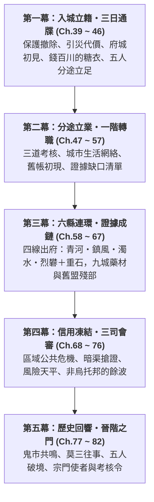

# 《遺忘的世界》第二卷：金石風雲・入城立籍篇 (Volume 2 Outline)

> **版本**：v0.1 企劃草案  
> **篇幅規模**：全 44 章（Ch.39 ~ Ch.82）  
> **主舞台**：金石府城 `/d/city/`（九大分區）＋ 六大次級縣城（青河・烈礬・盤木・鎮風・濁水・重石）  
> **階位**：Tier 1 初入道途（角色等級 Lv.10 → Lv.50，一階技能 Skill Lv.31 → 100）  
> **核心主題**：**「入城立籍、分途不分道、證據成鏈、信用為網」**  
> **對應 MUD 任務進程**：Tier 1 四條任務網匯流（生存環境／制度勢力／修行轉職／歷史謎題）＋ 三種跨區域模式（A 事件型・B 任務型・C 人物型）  
> **依據文件**：`docs/tier1_regional_network_and_career_spec.md` v2.1、`world_setting.md` §3.14、`narrative/volume1.md`、`narrative/character_profiles.md`、`narrative/characters/shen_ni.md`

**標記說明**：【提案】＝本大綱新增、正典未載，需你確認；未標記者皆取自現有文件。章節編號延續卷一。

---

## 卷前引言 (Volume Premise)

卷一的五個少年沒有打贏獸潮，也沒有打贏官軍，他們只是找到了一個槓桿。卷二要問的是：**槓桿之外，世界怎麼運轉？**

他們帶著證物與傷痕走進金石府城，以為會撞上一個藏著大反派的巢穴。實際上這是一座八到十二萬人的自治城邦，府衙、商會、百工總會、宣道司與武館各有各的利益與底線。副會長錢百川不是孤立的惡人，而是一條「原礦盜採—本地除渣—官道走私」利益鏈在府城的接口，血精的買家、軍械的簽領人、坩堝的鑄爐、毒藥的來源散落在六縣與城內各行會。

同時，Tier 0 的保護已經撤除：沒有免費的客棧，沒有人認得「黑石鋪」三個字，入城七十二小時內不立籍就是流民。五人第一次要靠專業資格而不是同村情誼立足，而且為此**分途**：兩人入物道（藥道分診、百工鍛造）、一人入力道（軍陣開弦）、一人入法道（觀象），沈泥則走自由身的市井暗線。卷一是「五象合流」，卷二是「**分途而不分道**」：三道互不隸屬、互相驗證，才拼得出一條足以撼動城邦的證據鏈。

勝利不是揭發一個人。揭發會牽動血精價格、烈礬作坊的生計、濁水的黑市，每一環都有人付代價，五人要學會承擔「揭開蓋子」的後果。

---

## 一、與卷一的銜接：未結線索處理表

| 卷一懸念 | 卷二處理 | 落點章節 |
| :--- | :--- | :--- |
| 趙德貴・胡百戶押赴府城聽審 | 趙德貴在途中遭毒，入死牢後成為「可翻供的證人」；胡百戶革職下獄 | Ch.41、44、75、76 |
| 錢百川「金蓮環刀印」與「總堂交割正底單」 | 底單鎖在天字一號密室外層；錢百川先以信用凍結反攻，再設局毀證 | Ch.57、68、71、73 |
| 蘇遠山之死（地陰腐骨散） | 毒源追到濁水毒囊提純；經手線止於商會調撥糧，不能直接定罪 | Ch.41、55、64 |
| 軍器局雷管批號（三個月前申領） | 簽領人指向城防司軍需官；證人被「調任」保護，需靠其他證據補強 | Ch.57、72、75 |
| 金石內造・丙字柒號坩堝與耐火泥 | 鐵生追鑄爐與出貨單：工坊街私爐＋烈礬分舵批次 | Ch.57、63 |
| 天門引（青金古令）與玉佩「沈雲妮」 | 按六階段節奏推進到「舊約初現」，不到「更名與贏家」 | Ch.51、65、73、77、78 |
| 燕隼的大伯燕山與「走山令」 | 找到勘探隊的檔案與殘牌，**不找到人**；證明「他被商會僱用過」，生死留給後卷 | Ch.62、80 |
| 逆星斷碑拓片、天羅牢籠、太古不融黑鐵、獵獸圖騰 | 五件殘片在宣道司與百工總會被「看見」，但不揭曉大清洗真相 | Ch.50、54、81、82 |
| 引獸入落龍深澗的道德代價（虎跳峽斷道） | 下游傷亡者家屬、盤木林道損失、便道修復全部回到前景 | Ch.40、42、66、82 |
| 黑石鋪傷患與重建 | 九城藥材鏈中顧玄為黑石鋪籌藥；老礦工證言與黑石鋪證人隊進城 | Ch.60、73、82 |
| 蘇凝霜的大掌櫃之位 | 守孝期內由副會長代理；信用凍結中被停職查賬；結局暫任大掌櫃（折衷） | Ch.45、68、76 |

---

## 二、五大主角卷二成長曲線 (Character Arcs & Tier 1 Progression)

一階身分取自規範書 §7.3，**不可消除之限制**同為規範書原文。

| 主角 | 一階身分與道途 | 卷二核心試煉 | 不可消除之限制 | 卷末狀態 |
| :--- | :--- | :--- | :--- | :--- |
| **顧玄** | 【物】藥道分診（採百草分堂外門藥童、杏林醫館試藥童） | 從山野草廬單打獨鬥，走進城市醫療體制（官定藥價、診金、配給）；藥荒與瘴氣中學會「集體分診」，不再獨自扛決斷 | 醫療決策受藥材存量與生理極限束縛；絕不能與力修硬撼 | 一階藥道登頂；破境（藥性淬鍊） |
| **林鐵生** | 【物】百工鍛造（千錘地爐坊初階匠工） | 右腕未癒，以判讀與精密工具補足；行會配額與材料批件的政治；追坩堝與耐火泥，並直面「自己的手藝被拿去做髒事」 | 精密工具不能取代數十年火候經驗；不能僅靠力氣硬掰材料 | 右腕痊癒；破境（精金淬鍊） |
| **燕隼** | 【力】軍陣開弦（巡防營獵弓射士） | 孤狼變軍陣一員：學「等號令」；擂台三合試先敗後過；追大伯的線索 | 裝備不能取代荒野決策與對體能極限的估算；不能憑直覺莽撞硬闖 | 破境（真氣逆沖）；大伯線索停在「他被僱用過」 |
| **柳清虛** | 【法】觀象道（宣道司清虛外門記名經生） | 紅塵濁氣與絕靈法網下修行；「假天道化」辯證考核；把觀星術落地為水情、風向與血精殘留的勘驗 | 觀測器具不能等同於對宇宙規律的完全掌握；道化恐懼仍需自省克服 | 破境（心魔叩問）；天羅牢籠的線索維持碎片化 |
| **沈泥** | 自由身（通寶當鋪掛名牙人、學塾待考） | 在信用凍結中重織人情債網；身世從「名字初現」走到「舊約初現」；與莫三的裂痕與修復 | 人脈與情報不能保證所有人誠實守約；信用必須靠實力與履約代價維持 | 暫不使用「沈雲妮」之名；接下「查舊約」；無宗門令，保留自由身 |
| **蘇凝霜**（核心配角） | 金石商會大小姐 | 在內堂政治裡守住父親遺物；從「持印者」變成能談判的繼任者 | 守孝期無實權；內堂與會長都不是她的盟友 | 暫任大掌櫃（折衷）；商會會長現身為弱平衡者【提案】 |

**三道分配說明**：規範書 §7.3 已定兩位入物道、一位力道、一位法道，本卷不調整。「三道不互斥」由 Ch.56（西水門閘）與 Ch.67（證據成鏈）示範。

---

## 三、全卷五幕架構 (Five-Act Blueprint)

**時間與等級錨點**（等級與技能為設計目標，可調）

| 幕 | 季節與時長 | 角色等級 | 技能等級 | 世界狀態重點 |
| :--- | :--- | :--- | :--- | :--- |
| 第一幕 | 初冬，約 14 日 | Lv.10 → 12 | 基礎技能上限 30 | 虎跳峽單向便道；盤木林道滑坡；入城七十二小時通牒 |
| 第二幕 | 深冬至立春，約 55 日 | Lv.12 → 25 | Skill 31 ~ 45 解鎖 | 青河歉收餘波使藥價偏高；西水門水閘初次故障 |
| 第三幕 | 早春，約 35 日 | Lv.25 → 34 | Skill 45 ~ 60 | 解凍通路；烈礬助劑暴跌；濁水瘴氣擴大 |
| 第四幕 | 春末至初夏，約 55 日 | Lv.34 → 42 | Skill 60 ~ 80 | 春旱；信用凍結；常平倉平糶；會審 |
| 第五幕 | 盛夏至初秋，約 70 日 | Lv.42 → 50 | Skill 80 ~ 100 | 血精價崩；宗門定期選拔前夕 |

---

## 四、三條核心因果鏈 (Causal Chains)

### 1. 證據鏈：證明力分級與保管鏈
任何單一證據都不足以定罪，只有三類證據互相印證才成立：

* **① 可核驗的實物編號**：雷管批號 → 軍器局申領簿（三個月前）→ 簽領人；坩堝「丙字柒號」鑄記 → 工坊街私爐；高階耐火泥批次 → 烈礬分舵出貨單與採辦簽名。
* **② 可交叉核對的帳目**：蘇遠山半本暗賬 ＋ 密室「總堂交割正底單」＋ 舊商盟老帳房手抄 ＋ 東關稅關血精晶錠緝扣與生銅扣繳記錄。
* **③ 解釋事件後果的現場材料**：二十二名礦工證言、驛站毒案樣本與毒囊同源鑑定、宣道司對血精地煞殘留的勘驗、濁水瘴氣病例流向。

另有**保管鏈**：每件證物由誰持有、誰簽收、誰在場，一旦出現「非法取得」瑕疵（Ch.73 暗渠夜行），就必須有公證人同行，否則證據作廢。

### 2. 經濟與信用鏈：揭發的代價
血精停產與信用凍結同時衝擊六縣與府城：血精晶錠價漲、烈礬助劑價跌、青河藥價居高、濁水黑市暗潮。物價依規範書「增量加權疊加、上下限 0.5 ~ 2.5」運算，突破 2.5 會強制觸發常平倉平糶或百工材料配給令。揭發錢百川的結果是**價格崩盤與失業**，有人恨他們，這是卷二對「世界不是烏托邦」的落實。

### 3. 制度制衡鏈：風險天平
延續卷一的原則，**沒有人因為真相而改變立場，只有在「保護錢百川的成本高於放棄他」時才改變**：

* 府尹：要的是穩定，不想與商會翻臉。
* 城防司與軍器局：自保，怕雷管批號牽出簽領人。
* 百工總會：依賴銅硝血精原料，怕供應中斷。
* 宣道司：以法網與勘驗的公信力自重，不介入商會內鬥，但血精屬禁法材料。
* 商會內堂：派系分裂，會長無力。
* 武館與軍鎮：只關心北關與外荒，態度中立。

---

## 五、逐章大綱 (Chapter Blueprint)

### 第一幕：入城立籍・三日通牒（第 39 ~ 46 章）
*Tier 0 的保護已撤除，五人第一次靠自己立足。同時要面對引獸入澗的下游代價，以及府城拋出的第一份糖衣。*

* [ ] **第 39 章：殘雪驛道・證物同行**（視角：沈泥｜場景：虎跳峽單向便道、金石官道）
  車隊與陳鎮山的押解隊同行。蘇凝霜把三類證據逐項列冊，每夜與陳鎮山的軍印對簽保管鏈。沈泥注意到押解隊裡走著一車「商會調撥的犒軍糧」（毒案伏筆）。驛站住宿要收錢，沒人認「黑石鋪」三個字，五人第一次體會保護撤除。
* [ ] **第 40 章：墜崖之家**（視角：燕隼｜場景：官道驛站）
  驛站收容虎跳峽棧道崩塌中死傷押運兵丁的家屬。有人認出黑石鋪少年就是傳聞中「引獸毀道」的人。燕隼想起趙老獵的話，少年們不辯解，以抬傷、修馬廄與具名登記償還一點債。道德代價不會被證據抵消，五人必須帶著它走下去。
* [ ] **第 41 章：夜半鐵檻**（視角：顧玄｜場景：盤木縣前驛站）
  趙德貴夜裡七竅滲血，症狀近似蘇遠山。顧玄只能催吐、下針、動用少量稀缺解毒藥，保住命但口供殘缺。毒源指向商會調撥的鹹肉批次，**可疑但不可證**；顧玄嚴格區分已知、推論與未知。陳鎮山將犯人隔離，內鬼是誰留白。
* [ ] **第 42 章：盤木林道・木價之痕**（視角：鐵生｜場景：盤木縣、青松塢、木作工棚）
  獸潮餘波使林道滑坡，木價上揚，林戶與獵戶鏢客損失慘重。鐵生右腕未癒，以應力判讀替木作工棚修復絞盤，換得一枚木作工牌與一份人情債。工棚的人提到「到府城可以找大木作把頭魯長生」。
* [ ] **第 43 章：南關入城・濁氣初嚐**（視角：清虛｜場景：`/d/city/gate/gate_south`、南關車馬小棧）
  稅吏要開箱查「木材夾層私藏硝石與私鹽」，與軍封證物衝突，靠陳鎮山軍印與府衙公文放行，可見制度摩擦。清虛第一次感受紅塵濁氣（打坐效率驟降）與絕靈法網。老劉的小棧收留黑石鋪來人。七十二小時通牒開始倒數。
* [ ] **第 44 章：證物入庫・兩面主簿**（視角：沈泥｜場景：`center/yamen`、`yamen_archive`、`yamen_prison`）
  周捕頭清點證物，案牘主簿文承敬登錄時問了一個過細的問題：要求沈泥登記「本名」與戶籍來歷。她沒有，他似乎早已在核查舊案底單，立場不明。趙德貴入死牢（獄頭鐵鐐張），胡百戶另押，會審日期未定。
* [ ] **第 45 章：總堂吊唁・金蓮微笑**（視角：沈泥｜場景：`center/shanghui_hq`）
  沈泥以蘇凝霜隨行侍女身分近距離看到錢百川。他溫厚、哀戚，宣布五人為「商會貴客」，願以商會名義供養並引薦三道。蘇凝霜被告知守孝期由副會長代行大掌櫃職。沈泥看穿：**免費的供奉就是一條繩子**。
* [ ] **第 46 章：三日通牒・各尋門路**（視角：五人群像｜場景：南關小棧、各處）
  五人婉拒錢百川的供奉，自尋立足處：顧玄入杏林醫館當試藥童（合法期 +10 天）；清虛入學塾抄書（+14 天）；燕隼入車馬大院做腳力（+7 天）；鐵生憑阿鐵的工具記號敲開千錘地爐坊，以匠工學徒登記取得居留【提案：規範書緩衝路徑之外的第四條路】；沈泥以當鋪牙人身分掛名。夜裡立下「**分途不分道**」之約：每旬碰頭、證物不由單人持有、彼此以專業互相驗證。

**對應 MUD**：入城通牒計時與緩衝路徑（academy／caravan_yard／clinic）、稅則矩陣（南關）、濁氣梯度初體驗。

---

### 第二幕：分途立業・一階轉職（第 47 ~ 57 章）
*三條轉職任務與一個自由身，加上第一次三道合力。幕末列出證據缺口，作為出府依據。*

* [ ] **第 47 章：學徒登記・阿鐵的記號**（視角：鐵生｜場景：`north/gong_gate`、`gong_forge`）
  鐵尺公登記學徒並考核資質。鍛造大師莫錘看到左手小錘底部阿鐵的記號，神色複雜，表示與阿鐵早年有恩怨未了【提案】。右腕骨裂未癒，只允許看料、聽聲、校準，莫錘不給特例。行會的匠籍工分與材料批件制度初現。
* [ ] **第 48 章：杏林藥囊・城裡的病**（視角：顧玄｜場景：`center/clinic`）
  白先生的診所有官定藥價與診金，與山野草廬的單打獨鬥截然不同。顧玄查覺金創藥與麻沸散批次價格比上月漲三成（青河歉收＋濁水毒囊斷供初現）。託驛丞馬千里的加急信，替黑石鋪傷患寄藥，才知道運費也是壓力。
* [ ] **第 49 章：軍鎮轅門・鐵砂崩拳**（視角：燕隼｜場景：`east/wu_gate`、`wu_arena`）
  趙猛的鐵砂崩拳考試中，燕隼第三記倒地，敗了。霸山評：「弓不是一個人的，軍陣是一群人的命。」斷魂刀解釋生死狀的意義。燕隼的孤狼盲點被撕開。
* [ ] **第 50 章：宣道司五殿・借鏡觀象**（視角：清虛｜場景：`west/dao_gate`、`dao_hall`、`dao_observatory`、`dao_quiet`）
  星淵發給他渾天黃銅鏡，司香道童示範靜坐清濁氣（50 文清 50 點）。玄機真人講「周虛微茫」。清虛隱瞞天羅牢籠之見，因為「假天道化」是宣道司的禁說題。逆星拓片藏在衣內，他明白自己攜帶的是異端。
* [ ] **第 51 章：舊帳微塵・雲妮之名**（視角：沈泥｜場景：`center/pawnshop`、`academy`）
  賈朝奉（賈富春）派她整理十五年前一批死帳，名為練眼。帳中夾著一筆「某沈姓商販典當、其女名雲妮、息未清」。沈泥摸到胸前玉佩。這是六階段中的**階段二：名字初現**，且當鋪假帳常見，證據不足，不能當真。
* [ ] **第 52 章：擂台再試・盤石樁**（視角：燕隼｜場景：`east/wu_plaza`）
  跟著趙猛特訓盤石樁功與披甲，二度挑戰通過；射藝替代石鎖。霸山受其立誓，領黑鐵腰牌。第一次在十人隊裡對射，學會「等號令」。
* [ ] **第 53 章：屋頂觀風・假天道**（視角：清虛｜場景：`west/dao_roof`）
  依規範書測繪西南窗口；辯證考核中，清虛不賭牢籠之說，只回答「可觀測的證據與可重複的推演」。玄機真人神色複雜，仍通過。同期一位法修弟子私用引靈被絕靈法網拘走，示範禁法代價。
* [ ] **第 54 章：榫楔承力・左手小錘**（視角：鐵生｜場景：`north/gong_forge`、`gong_hall`）
  閉目辨礦憑九年手感勝出。右腕不能舉重鍛錘，改用滑輪、左手小錘與聽聲完成榫楔，莫錘評「巧可補力，補不了火候」。歐陽大師登記匠籍。
* [ ] **第 55 章：辨症行針・毒囊與洗靈草**（視角：顧玄｜場景：`north/gong_alchemy`）
  孫先生的採百草分堂考核。顧玄從送檢樣品中辨出一種毒性與驛站夜毒同源（濁水毒囊提純）。他暫不公開，因為這條線屬證據管制，要等交叉印證。通過藥道分診考核。
* [ ] **第 56 章：西水門閘・三道合力**（視角：群像｜場景：`gate/gate_west`、`outer/irrigation`）
  青河渠首水閘絞盤失靈，內河水位異常，西水門漕船擁堵。清虛測水位與天候窗口，鐵生判讀絞盤受力並指揮木作，顧玄處理受傷漕工與污水防疫，燕隼以軍陣號令疏導人群，沈泥與碼頭把頭曹鐵錨談卸貨順序。**三道各司其職，沒有一道包打天下**。鐵生注意到絞盤軸有人為加速磨損的痕跡，無法證明。劉秉忠開始注意這群少年。
* [ ] **第 57 章：暗紋有主・證據缺口**（視角：全員｜場景：南關小棧、`north/gong_forge`）
  鐵生比對坩堝上的捲雲暗紋，追到工坊街一家私營爐，爐主已歇業失蹤。軍器局申領簿查詢被以「官禁」回絕。錢百川溫和要求蘇凝霜「別查家務」，並撤回供奉。眾人列出六項證據缺口：①正底單（密室）；②申領簿簽領人；③耐火泥出處（烈礬）；④毒源（濁水）；⑤血精流向；⑥勘探舊事（鎮風）。**分頭出府**。

**對應 MUD**：三條轉職任務 JSON（觀象定風考／擂台三合試／百工格物試）、事件型小品「水閘故障」、調查模組證據狀態與世界狀態解耦。

---

### 第三幕：六縣連環・證據成鏈（第 58 ~ 67 章）
*四線出府。同一條九城藥材鏈在不同縣呈現不同面貌；各縣有各縣的矛盾，不是刷圖。*

| 線 | 人 | 縣 | 模式 | 任務 | 對應卷一後果 |
| :--- | :--- | :--- | :--- | :--- | :--- |
| 西線 | 顧玄＋蘇凝霜 | 青河 | A 事件型 | 九城藥材 | 黑石鋪傷患藥荒 |
| 北線 | 燕隼＋清虛 | 鎮風 | B 任務型 | 天風谷風蝕石英；衛所舊檔 | 外荒獸群南壓；燕山線 |
| 東南線 | 沈泥 | 濁水 | C 人物型 | 毒囊提純；舊盟殘部 | 血精黑市暗潮；毒源 |
| 東北＋西南線 | 鐵生 | 烈礬→重石 | A＋C | 耐火泥追溯；絞盤修復 | 血精停產使助劑暴跌；北崖產能轉移 |

* [ ] **第 58 章：分頭啟程・路引與信印**（視角：沈泥）
  各行會的請假與代價（莫錘限期二十日、白先生要帶回藥樣）、六縣交通成本（官府快馬 36~48 時辰、青河漕船順流約 2.5~3 天、重車 5~8 天）、信用以通寶信印與阿鐵記號傳遞。蘇凝霜留守總堂。賈朝奉為沈泥安排牙人帶路，有他自己的算盤。
* [ ] **第 59 章：青河水霧・歉收之價**（視角：顧玄｜場景：青河縣、蘆花渡、百草坪）
  青河因前一年秋連陰雨歉收，藥價高於 140 已逾三個大元日。顧玄在藥圃與洗藥作坊間看見農戶生計與官定收購價之間的撕扯，以及定神靈植道觀的角色。
* [ ] **第 60 章：九城藥材・各有各的難**（視角：群像剪輯）
  透過貨單、信件與差價拼出四縣不同的難處：烈礬把藥當防毒煙儲備（鐵生在烈礬親見）；盤木行會只收硬木工分（鐵生的木作工牌派上用場）；濁水因瘴氣自身缺藥（沈泥親見）。顧玄擬定分批少量調劑與替代藥方，請青河道觀先墊付。黑石鋪的藥終於寄出。同時他意識到：藥與毒囊同源短缺，說明濁水瘴氣在擴大。
* [ ] **第 61 章：天風谷口・頂風採石**（視角：清虛｜場景：鎮風縣、天風谷）
  清虛需要風蝕石英補足觀象鏡（規範書的補足邊界：器具不等於領悟），必須親赴天風谷。燕隼護衛。法修「等窗口」與力修「現在就上」衝突，最後以風向試探＋分段繩索完成。與八方武館邊關分舵守軍切磋。
* [ ] **第 62 章：走山令・衛所舊檔**（視角：燕隼｜場景：鎮風縣邊防衛所）
  檔案顯示五年前一支「商會內堂出資」的勘探隊持走山令入外荒，向導有燕山，全隊未歸。同年另有一張北崖古礦圖被買走。血精勘探早於「半年前」。燕隼分清：**燕山活著沒有證據**，只能證明他被商會僱用過；找到一面殘牌，不是人。
* [ ] **第 63 章：地火堡・耐火泥**（視角：鐵生｜場景：烈礬縣、地火堡、紅砂坳）
  黑石鋪血精停產使熔煉助劑暴跌，作坊減爐失業，鐵生親見紅砂坳家庭的難處。追到耐火料採辦分舵，找到高階耐火泥出貨單的批次刻印與採辦簽名（商會內堂）。途中地火餘溫突升傷工，鐵生以應力與通風判斷協助疏散。
* [ ] **第 64 章：浮橋濁水・金砂與毒囊**（視角：沈泥｜場景：濁水縣、泥螺灘、黑水埗）
  高腳木樁浮橋、瘴氣、淘金幫與官差的衝突。賈朝奉的牙人把她往特定方向引，沈泥分出哪些是利益、哪些是真話。毒囊提純作坊的批次單與驛站毒案樣本對得上，但仍缺經手人。
* [ ] **第 65 章：舊盟殘部・名字落地**（視角：沈泥｜場景：濁水縣暗渠舊址）
  老帳房（舊商盟殘部）以手抄名冊對照玉佩殘字，證實沈家旁支商號「雲記」【提案：商號名】。與文承敬案卷庫舊案形成第二個來源，構成**階段三：關係證實**。老帳房警告：十五年前追索旁支的人，與今日商會內堂有關，但不指名。
* [ ] **第 66 章：重石台地・絞盤與條石**（視角：鐵生｜場景：重石縣、石碾坡、穿山寨）
  採石場工頭（某當鋪掌櫃之子侄）求修絞盤。通寶信印與阿鐵記號雙重觸發人脈，完工後解鎖烈礬分號折扣。條石將用於虎跳峽便道正式修復。工頭透露：北崖古礦事故前有人要求減少支護。
* [ ] **第 67 章：歸途匯流・證據成鏈**（視角：群像｜場景：南關小棧）
  四線回府，缺口補上四項（毒源、耐火泥、勘探舊事、舊帳），尚缺正底單與申領簿簽領人。沈泥向蘇凝霜與四位夥伴說出身世的一部分：密室內層需要天門引與沈氏血親，這件事所有人都必須知道。**同日，錢百川反擊**：六縣通寶分號票據凍結，商會內堂公告蘇凝霜「偽造暗賬」。

**對應 MUD**：事件型「九城藥材」、任務型「天風谷採石」、人物型「通寶信印」；青河藥價≥140、烈礬銅價與助劑反向波動等觸發條件。

---

### 第四幕：信用凍結・三司會審（第 68 ~ 76 章）
*區域公共危機。三道協力化解民生危機，證據鏈在暗渠與公堂上收束，勝利的代價落在無辜者身上。*

* [ ] **第 68 章：信用凍結・票據成紙**（視角：沈泥）
  一夜之間商會票據拒兌，通寶分號鏈停擺，糧、藥、銅價同時上行。蘇凝霜被內堂「停職查賬」。沈泥以人情債重新串連當鋪分號掌櫃，卻要面對賈朝奉的趁火開價，他是灰色盟友。
* [ ] **第 69 章：平糶之議・誰來買單**（視角：顧玄｜場景：`center/granary`）
  糧價逼近 2.5 上限，劉秉忠須決定開倉平糶。府尹與士紳爭論資金來源。顧玄以病理視角參與配給優先序（傷者、孕婦、幼兒與勞動者），提出方案但不盡如人意，有人吃虧。
* [ ] **第 70 章：瘴氣入城・藥荒之夜**（視角：顧玄｜場景：`gate/gate_west`、`center/clinic`）
  濁水瘴氣經漕船與暗渠進入西水門區，漕工與苦力發病，是水澤瘴癘而非神話瘟疫。杏林爆滿，白先生與官定藥價矛盾。卷一「最後一包麻沸散」的處境重現，這次有孫先生配方與常平倉補貼，顧玄不必獨扛，但藥材存量仍是硬限制。
* [ ] **第 71 章：閘渠斷流・磨痕有主**（視角：鐵生｜場景：`outer/irrigation`）
  渠首水閘二度失靈，這次是斷流。鐵生比對第 56 章的絞盤磨痕：鐵屑配比證實人為。治水工丞受威脅。莫錘與魯長生動員百工搶修，觸發材料配給令。鐵生以精密螺紋鐵尺與定滑代替蠻力。**發現目的**：暗渠水位上漲會淹沒商會總堂地下庫，也就是天字一號密室外層，時間倒數開始。
* [ ] **第 72 章：北關烽煙・軍陣之間**（視角：燕隼｜場景：`gate/gate_north`、`east/wu_armory`）
  春旱使外荒兇獸向南試探，北關戒備。燕隼以獸群預判與軍陣協調減少死傷。在兵器庫與司庫典軍核對時，發現一批雷管批號與黑石鋪批號連號，簽領欄為城防司軍需官。軍需官隨即被「調任」保護。
* [ ] **第 73 章：暗渠夜行・玄鐵重門**（視角：沈泥＋莫三｜場景：`under/canal_hub`、`under/shang_secret`）
  莫三隨黑石鋪證人隊進城（規範書說他仍在後巷，此為持續性演進【提案】）。合法路徑被商會執事以「非會審日」擋下。借文承敬簽署的暗渠水情勘驗令為名，帶公證人入渠【灰色合法性，可再議】。外層一號保險鐵櫃以密鑰與信印取出底單；同時沈泥面對內層玄鐵重門對天門引的**共鳴反應**，不開啟，因需認證栓與沈氏血親交叉驗證，非一夜可成，留給後卷。水淹至膝時撤離。
* [ ] **第 74 章：會審前夜・籌碼分層**（視角：群像）
  整理三類證據。清虛協助宣道司勘驗血精地煞殘留，獲得官方認證的現場材料。錢百川反擊：趙德貴可能翻供、蘇凝霜被控偽造。陳鎮山抵府作證，但上級風險計算未定。沈泥讓六縣分號掌櫃聯名證明信用凍結是人為而非市場行為。
* [ ] **第 75 章：三司會審・風險天平**（視角：群像）
  **官制待確認**：卷一寫「巡撫、兵備道、按察使司」，與規範書自治城邦設定有出入，建議視為沿用舊稱的三方會審庭（府衙刑名、城防軍法、商會行規）。證據逐層出示，錢百川反駁底單被篡改，被暗賬、底單、東關稅關扣繳記錄與耐火泥出貨單交叉擊破。趙德貴先翻供，在毒殘症與對質下崩潰。軍械鏈牽到城防司與軍器局，各方算出「保錢百川成本高於棄之」。判決：革除副會長與內堂席位、查封私庫、礦行停業；胡百戶革職下獄。**更上層的買家未被追問**。
* [ ] **第 76 章：餘波・世界狀態**（視角：群像）
  趙德貴於判決前夜暴斃獄中【提案：五人沒能救下所有人】。血精價崩，烈礬礦戶失業，濁水暗潮；常平倉平糶使糧價回落，但沒有回到 100，世界保留痕跡。蘇凝霜暫任大掌櫃，商會會長現身，是個虛弱的平衡者【提案】。虎跳峽便道正式修復開工。有人恨他們（失業礦戶、囤糧商）。

**對應 MUD**：四附「縣經濟聯動」物價上下限、常平倉開倉乘數 0.7~0.9、材料配給令、世界狀態更新（道路開通、物價平抑、保護解除）。

---

### 第五幕：歷史回響・晉階之門（第 77 ~ 82 章）
*事件收束後，把鏡頭拉回個人與更大的世界。不揭曉大清洗真相，只放碎片與方向。*

* [ ] **第 77 章：鬼市餘震・共鳴之物**（視角：沈泥｜場景：`under/black_market`）
  血精價崩後牙商拋售舊物，她在鬼市發現與天門引共鳴的第二件史前商盟信物，以契約價買下，不靠搶奪。碎片顯示九大神城與史前商道的輪廓。黑市透露血精的最終買家是**沒有門派標記的採辦經生**，暗示名山的需求，不指名。
* [ ] **第 78 章：莫三往事・舊商盟之夜**（視角：沈泥）
  **階段四：莫三往事**。莫三說出所知（有限），承認曾見過沈氏商販而未能救，收留動機是同命相憐。沈泥憤怒也不安，沒有輕巧的和解。她決定暫不使用「沈雲妮」之名，但接下「查舊約」。舊約的輪廓初現（階段五的起點）。
* [ ] **第 79 章：精金淬鍊・藥性逆行**（視角：鐵生＋顧玄）
  兩位物修破境。鐵生右腕痊癒，面對「工具能否取代火候」的瓶頸，從太古不融黑鐵的精密公差中看到工藝的盡頭。顧玄在白先生與孫先生共同監診下進行藥性淬鍊，**醫者不自試毒過度**。
* [ ] **第 80 章：氣血逆沖・心魔叩問**（視角：燕隼＋清虛）
  燕隼的瓶頸是大伯：他想去外荒找人，必須先學會「等」。清虛在 `dao_quiet` 靜室面對天羅牢籠與道化恐懼，星淵引導，他不否認恐懼，以實證面對。
* [ ] **第 81 章：使者入城・宗門考核令**（視角：群像）
  零散的宗門使者（遊歷者、採辦經生、暗線）入城，不設正式據點。館主推薦：玄機真人、霸山、歐陽與白先生。一位無名遊歷道士看到清虛的逆星拓片，反應異常；採辦經生對鐵生的太古黑鐵出價；沈泥沒有令，但蘇凝霜以商會信印給她通行。二階在城內修煉將被濁氣與法網排斥。
* [ ] **第 82 章：初秋城門・分途之前（第二卷終章）**（視角：群像）
  黑石鋪來信（阿鐵、葛半仙、趙老獵、枯木老道無信）、虎跳峽便道通車、莫三還鄉。五人討論離城入山：是否同路，各有選擇。五件太古殘片放在同一張桌上，同時朝北方某個方位微微發熱，不揭曉原因。五人走向名山，第二卷落幕。

**對應 MUD**：Tier 1 → 2 破境（心魔叩問／真氣逆沖／精金淬鍊）、宗門考核令、濁氣驅離機制。

---

## 六、三種跨區域模式與六縣分配

| 縣 | 卷二角色 | 事件觸發（規範書條件） | 模式 | 章 |
| :--- | :--- | :--- | :--- | :--- |
| 青河 | 歉收與藥價；定神靈植道觀；水閘 | 藥價≥140 持續三個大元日；水閘故障 | A | 59、60、56、71 |
| 烈礬 | 助劑暴跌與失業；耐火泥；地火 | 血精停產使買家消失；地火異常 | A＋B | 63 |
| 盤木 | 林道滑坡與木價；行會壟斷 | 林道滑坡、獸潮 | A | 42、60 |
| 鎮風 | 風蝕石英；衛所舊檔；外荒獸群 | 關隘封鎖；外荒兇獸南侵 | B | 61、62、72 |
| 濁水 | 瘴氣；毒囊；舊盟殘部 | 瘴氣爆發；黑市物價劇震 | A＋C | 64、65、70 |
| 重石 | 採石場；絞盤；條石 | 採石事故；便道修復需求 | C | 66、76 |

---

## 七、寫作守則（卷二）

1. **府城不是反派巢穴**：府尹、劉秉忠、文承敬、莫錘等人各有立場，沒有人天生是盟友或敵人。
2. **三道不互斥、不分高下**：任何大事件至少由兩道以上合力化解，不讓單一職業包打天下（Ch.56、67、71）。
3. **制度成本要具體**：腰牌、配額、工分、診金、清心散（一次清 20 點，日限三服）、靜心閣 50 文。小事件也要寫成數字與人情。
4. **補足短板不改專長**（§7.2）：鐵生用工具輔助，但火候仍靠經驗；顧玄用藥輔助，但存量有限；清虛用觀象鏡，但領悟仍要自己來。
5. **沈泥三條邊界**：看出矛盾不等於知道誰說謊；理解動機不等於認同；協調利益不等於強迫合作。身世揭露需兩種以上交叉來源，絕不改變六維。
6. **大宗門不在 Tier 1 設據點**：使者只是零散的遊歷者、採辦經生與暗線，不出現山門內幕。
7. **非烏托邦**：每次勝利都要有人付代價，世界狀態必須保留痕跡。
8. **不提前揭曉大清洗**：卷二只增加碎片與方向，不給答案。

---

## 八、Tier 1 設計審核對照（規範書 §九）

| 標準 | 卷二對應 |
| :--- | :--- |
| 區域存在性 | 六縣各有支柱產業與自身矛盾；烈礬失業、青河歉收、盤木林戶、濁水瘴氣、重石事故各自演進，並非為主角存在 |
| 跨區域連結 | 藥價、血精、耐火泥、毒囊、條石以商路、行會、債務與信用連成一張網，不用「商隊路過」帶過 |
| 事件持續性 | 卷一獸潮、塌方、虎跳峽斷道在盤木、烈礬、重石與官道留下痕跡；世界狀態在會審後也未回到 100 |
| 角色補足性 | 五人皆有「不可消除之限制」，破境前先承受代價 |

---

## 九、不一致與待確認

1. **路程**：卷一 Ch.36、38 寫「八百里金石府城」，規範書黑石鋪距府城走盤木林道約 450 里、走重石河谷約 420 里。本大綱依規範書（盤木林道約十日），建議改卷一用詞，或將「八百里」解釋為落龍古脈長度。
2. **官制**：卷一 Ch.36 的「巡撫、兵備道、按察使司三司會審」與規範書「自治城邦、府尹與行會共治」不一致。建議在卷二把三司設為沿用舊稱的三方會審庭，或修改卷一。
3. **`novel_outline.md` 第二卷空間描述過時**：現寫「城東軍陣／城西道院／城北百工（含萬寶樓與鬼市）／城南流民」，與規範書 §4.2 九大分區不符（商會在 center/south、鬼市在 under/）。建議以規範書為準更新。
4. **天字一號密室機制**：卷一 Ch.36 說密鑰＋信印開一號保險鐵櫃；規範書 §4.3、§8 說需天門引與沈氏血親交叉驗證。本大綱調和為**兩層**：外層商會共管保險庫（密鑰＋信印）、內層玄鐵重門（天門引＋血親＋認證栓）。需你確認。
5. **天門引形象**：卷一 Ch.5、38 稱「青金古令」，Ch.36 稱「黑色鐵牌」，建議統一。
6. **城防司位置**：規範書分區無「城防司」。建議其駐地設於鎮武軍鎮區（`east/`），陳鎮山為其左參將。
7. **提案性設定**（需你同意或否決）：趙德貴死於獄中（Ch.76）；錢百川不被判死、更上層買家懸而未決；商會會長為弱平衡者；莫三進入府城；商號「雲記」；阿鐵與莫錘有舊怨；暗渠勘驗令的灰色合法性。
8. **等級速度**：十個月內從 Lv.10 到 Lv.50、技能到 100 是設計目標，不是既有規範。
9. **新增無名角色**：商會會長、城防司軍需官、軍器局主事、舊商盟老帳房、無門派採辦經生、鎮風衛所守將等，縣城與分舵人物見 `docs/tier1_npc_roster.md` §5。
