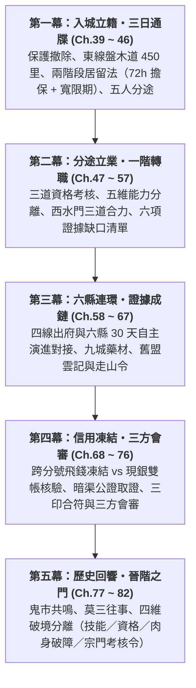

# 《遺忘的世界》第二卷：金石風雲・入城立籍篇 (Volume 2 Outline)

> **版本**：v1.0 跨系統正典審核修訂版（對齊 `world_setting.md` 與 `docs/` 全套規範）  
> **篇幅規模**：全 44 章（Ch.39 ~ Ch.82）  
> **主舞台**：金石府城 `/d/city/`（九大分區、45 間正典房間）＋ 六大次級縣城（青河・烈礬・盤木・鎮風・濁水・重石）＋ 黑石鋪 `/d/blackstone/`（離村後 30 天自主演進）  
> **階位**：Tier 1 初入道途（角色等級 Lv.10 → Lv.50，一階技能 Skill Lv.31 → 100；嚴格區分技能滿值、社會資格、肉身破障與二階宗門考核令）  
> **核心主題**：**「入城立籍、分途不分道、證據成鏈、信用為網」**  
> **對應 MUD 任務進程**：Tier 1 四條任務網匯流（生存環境／制度勢力／修行轉職／歷史謎題）＋ 三種跨區域模式（A 事件型・B 任務型・C 人物型）＋ 六縣 30 天無主角介入自主演進時間線  
> **依據權威文件**：
> - `01 Canon`：`world_setting.md`（§2.5、§3.14）、`narrative/character_profiles.md`、`narrative/characters/shen_ni.md`、`narrative/volume1.md`
> - `02 System Rules`：`docs/tier1_regional_network_and_career_spec.md` v2.1、`docs/tier1_npc_roster.md`、`docs/tier1_world_operating_model_v0_1.md`、`docs/forgotten_space_first_pass_audit.md`
> - `03 World State / Implementation`：`daemon/city_d.c`、`daemon/world_state_d.c`、`daemon/skill_d.c`

### 📌 權威層級與狀態標記說明 (`P0-1`)
為避免正典設定、系統規則與敘事提案混淆，本大綱全面採用四級狀態標記：
- **`[CANON]`（正典鎖定）**：已載於 `world_setting.md`、`tier1_regional_network_and_career_spec.md`、`tier1_npc_roster.md` 與卷一正典之不可違背設定。
- **`[RULE]`（世界運作規則）**：載於 `tier1_world_operating_model_v0_1.md` 之跨系統約束（唯一路網、三印合符、證據五欄模型、五維能力分離、兩階段居留法、信用凍結邊界、六縣 30 天自主演進）。
- **`[PROPOSAL]`（敘事裁定／提案落地）**：原 v0.1 待確認之戲劇安排，現經跨系統審核與正典規則調和後鎖定之具體敘事方案（詳見第九節總表）。
- **`[IMPLEMENTATION]`（MUD 引擎實裝對映）**：已於 `city_d.c`、`world_state_d.c`、`skill_d.c` 及 `/d/city/` 45 房、52 位 NPC 完成實裝並通過自動化測試之系統錨點。

---

## 卷前引言 (Volume Premise)

卷一的五個少年沒有打贏獸潮，也沒有打贏官軍，他們只是找到了一個槓桿。卷二要問的是：**槓桿之外，世界怎麼運轉？**

他們帶著證物與傷痕走進金石府城，以為會撞上一個藏著大反派的巢穴。實際上這是一座八到十二萬人的**區域共治自治城邦**（`[CANON]`）：前朝大乾崩解後，各方依《金石共治盟約》維持大乾律例與官印作為共同度量衡，金石府衙（府尹秦正明）、鎮武軍鎮与八方武館（總教頭霸山、左參將陳鎮山）、金石商會（正會長虛位平衡、副會長錢百川、大小姐蘇凝霜）、百工總會（匠首歐陽大師）與宣道司（道官玄機真人）五方共治，各有利益與底線。副會長錢百川不是孤立的惡人，而是一條「原礦盜採—本地除渣—官道走私—暗庫洗錢」利益鏈在府城的接口，血精的買家、軍械的簽領人、坩堝的鑄爐、毒藥的來源散落在六縣與城內各行會。

> **[!IMPORTANT] 世界規則 vs 主角劇情的「多起點原則」 (`P0-2` `[RULE]`)**
> 1. **世界規則（MUD 開放多起點）**：在金石府區域網中，金石府城**不是**一階轉職的唯一強制起點。六大次級縣城（青河藥圃、烈礬地火堡、盤木天工木作、鎮風邊關武館分舵、濁水黑水埗、重石穿山寨）皆設有分舵或地方師承，一般行者與 MUD 玩家可在任一縣城取得等效的初階資格認證（`[RULE]`）。
> 2. **主角劇情（五人集中入府城的敘事必然）**：五位主角之所以在第二卷集中前往金石府城，並非因為六縣無法習藝，而是因為他們背負著**必須在府城總堂、府衙案卷庫與三方會審庭交割的跨縣證據鏈**（趙德貴押解、蘇遠山暗帳、通寶總號一號密室、軍器局雷管批號），以及五人在黑石鋪立下的生死同盟約定。

同時，Tier 0 的新手保護已經撤除：沒有免費的客棧，沒有人認得「黑石鋪」三個字。外縣無憑證入城者，自過關起算**七十二小時（三日）內必須完成臨時居留擔保登錄**，否則列為無籍流民（`unregistered_vagrant`）。五人第一次要靠「專業資格（`qualification`）」而非同村情誼立足，而且為此**分途**：兩人入物道（顧玄入藥道分診、林鐵生入百工鍛造）、一人入力道（燕隼入軍陣開弦）、一人入法道（柳清虛入觀象道），沈泥則走無封閉道統的市井暗線（通寶當鋪掛名牙人）。卷一是「五象合流」，卷二是「**分途而不分道**」：三道互不隸屬、互相驗證，才拼得出一條足以在三方會審庭上撬動風險天平的證據鏈。

勝利不是揭發一個人。揭發會牽動血精價格崩盤、烈礬作坊減爐失業、濁水黑市反撲，每一環都有無辜者付代價，五人要學會承擔「揭開蓋子」的後果。

---

## 一、與卷一的銜接：未結線索與跨系統處理表

| 卷一懸念 | 卷二跨系統處理與制度邊界 | 證據／狀態編號 (`[IMPLEMENTATION]`) | 落點章節 |
| :--- | :--- | :--- | :--- |
| **趙德貴・胡百戶押赴府城聽審** | 押運重車與鐵檻囚車無法走重石河谷棧道（禁重車），必走東線盤木林道（450 里）。趙德貴於盤木前驛站遭「商會犒軍鹹肉」下毒未死，入府衙死牢（獄頭鐵鐐張看管）後成為可能翻供的不穩定人證；胡百戶另押候審，最終革職下獄。 | `miner_thumbprints`（二十二名礦工血手印與魯大山證言） | Ch.39、41、44、74、75、76 |
| **錢百川「金蓮環刀印」與「總堂交割正底單」** | 天字一號密室採**雙層結構**（`[RULE]`）：外層「商會共管一號保險鐵櫃」以蘇氏密鑰＋當鋪信印開啟取出正底單；內層「史前玄鐵重門」對天門引產生共鳴，但需認證栓與沈氏血親交叉驗證，本卷僅觸發共鳴不開啟。底單須由案牘主簿文承敬同行火漆公證確保保管鏈完整。 | `under_canal_deed`（保管鏈完整＋跨機構舊檔核對後升級 `conclusive`） | Ch.45、57、68、71、73、74、75 |
| **蘇遠山之死（地陰腐骨散）** | 驛站毒案樣本經採百草分堂堂主孫先生與杏林醫館白先生會診，證實與濁水黑水埗毒囊提純作坊同源；但僅憑毒理同源**不能單獨證明誰下毒或商會高層指使**（`corroborating`），須與調撥糧簽單及暗帳互鎖。 | `relay_poison_sample`（需宣道司＋百草堂雙重認證） | Ch.41、55、64、74、75 |
| **軍器局雷管批號（三個月前申領）** | 燕隼於披甲兵器庫（司庫典軍武守備）與官禁硝火作（火藥督造官焦烈）查出連號批號指向城防司軍需官。單方簽領簿不能排除盜印，必須取得「軍需簽領簿＋百工硝火作雙聯火印出庫存根」互鎖，军需官隨即被「調任」保護。 | `detonator_serial_ledger`（雙聯火印存根互鎖升級 `conclusive`） | Ch.57、72、74、75 |
| **金石內造・丙字柒號坩堝與耐火泥** | 林鐵生比對捲雲暗紋追至工坊街歇業私爐，並赴烈礬縣地火堡查獲商會內堂採辦特級耐火泥出貨單；由百工匠首歐陽大師／莫錘（工藝）與宣道司（地煞結晶）雙重鑑定。 | `crucible_bing_7` ＋ `liefan_clay_batch` | Ch.47、54、57、63、74、75 |
| **天門引（青金古令）與玉佩「沈雲妮」** | 統一正典外觀為「表面氧化呈黑鐵色、內蘊青金星紋之古令」（調和卷一黑鐵牌與青金古令之稱）。按身世六階段推進：階段二「名字初現」（Ch.51 死帳）→ 階段三「關係證實」（Ch.65 舊盟老帳房「雲記」名冊＋文承敬舊案）→ 階段四「莫三往事」（Ch.78）→ 階段五起點「舊約初現」（Ch.73、77、78），不提前揭開「更名與贏家」。 | 雙來源交叉驗證規則（`shen_ni.md` `[CANON]`） | Ch.51、65、73、77、78 |
| **燕隼的大伯燕山與「走山令」** | 於鎮風縣邊防衛所舊檔查出五年前「商會內堂出資」勘探隊持走山令入外荒、燕山任嚮導全隊未歸，並尋獲半枚殘牌；**嚴格區分「證明他曾受僱於商會」與「生死下落不明」**，人留後卷。 | 衛所舊檔＋走山令殘牌（`corroborating`） | Ch.61、62、80 |
| **逆星斷碑拓片、天羅牢籠、太古不融黑鐵、獵獸圖騰** | 五件太古殘片在宣道司（摘星台星淵、玄機真人）與百工總會（千錘地爐莫錘、歐陽大師）被專業視角檢視，卷末指向北方隱秘方位共鳴，絕不提前揭曉「大清洗」真相。 | 歷史謎題任務網（Tier 1 → Tier 2 伏筆） | Ch.50、53、54、77、79、81、82 |
| **引獸入落龍深澗的道德代價（虎跳峽斷道）** | 虎跳峽棧道崩塌造成押運兵丁死傷、盤木林道滑坡、重石條石徵調轉移。五人直面死傷兵丁家屬與林戶損失，不以「為了救黑石鋪」開脫，持續以行動償還至卷末便道通車。 | `seg_blackstone_panmu` 單向便道限制與重石條石修復鏈 | Ch.39、40、42、66、76、82 |
| **黑石鋪傷患與重建（30 天自主演進）** | 黑石鋪並非主角離村後靜止的背景：阿鐵與魯大山封北崖三號毒井改採南山青石、暫代巡檢抽「修路捐」、莫三開闢後巷山貨暗線；顧玄透過九城藥材鏈寄藥回村，卷末黑石鋪證人隊與莫三赴府城出庭。 | `WORLD_STATE_D` `blackstone` 四階段演進 | Ch.48、60、73、75、82 |
| **蘇凝霜的大掌櫃之位與都城代理** | 小說敘事中蘇凝霜隨行入城，由車馬大院蘇氏舊部大掌櫃**蘇忠**接應，守孝期內被錢百川架空、信用凍結時遭停職查賬，會審後折衷暫任大掌櫃；MUD 多人環境中玩家可透過車馬大院**蘇忠**核驗蘇氏信印（解決單一時間線耦合）。 | `/d/city/south/caravan_yard` 蘇忠（`[IMPLEMENTATION]`） | Ch.39、45、57、67、68、75、76 |

---

## 二、五大主角卷二五維能力分離與成長曲線 (`P1-6` `[RULE]`)

依據 `world_setting.md` §3.14 與 `tier1_world_operating_model_v0_1.md` 第五節，系統嚴格拆開**「修行道途 (`path`) ≠ 實質技能 (`skill`) ≠ 專業資格 (`qualification`) ≠ 組織隸屬 (`affiliation`) ≠ 設施與法網權限 (`access`)」**五個欄位，杜絕「學會技能就自動擁有合法特權」或「加入行會就綁死世界觀」：

| 主角 | 1. 修行道途 (`path`) | 2. 實質技能 (`skill` Lv.31→100) | 3. 社會專業資格 (`qualification`) | 4. 組織隸屬 (`affiliation`) | 5. 權限解鎖 (`access`) 與不可消除之限制 (`[CANON]`) |
| :--- | :--- | :--- | :--- | :--- | :--- |
| **顧玄** | **【物】** 藥道分診 （百草藥理／毒理） | `gong_analysis` (百工析理) `gong_xingzhen` (經絡行針) `gong_fengdu` (封毒配藥) | **緩衝期**：`clinic_token`（杏林試藥童 +10 天保條；懂辨藥行針但無權開官制猛藥） **正式**：`lic_apothecary`（杏林行醫與百草藥師資格） | 城心杏林醫館（白先生） 城北採百草分堂（孫先生） | **權限**：進入採百草堂藥爐 `north/gong_alchemy`、調配管制毒囊解劑、聯署官方毒理會診。 **限制**：醫療決策受藥材存量與生理極限束縛；絕不能與力修硬撼。卷末完成藥性淬鍊（Lv.50 破障）。 |
| **林鐵生** | **【物】** 百工鍛造 （金石應力／百鍛） | `gong_analysis` (百工析理) `gong_qiaojin` (敲金聽聲) `gong_yingli` / `gong_cuihuo` (應力／淬火) | **緩衝期**：`caravan_token`（車馬大院 +7 天修車驗軸臨時牌；無匠籍私造軍械或動用地爐屬違制） **正式**：`lic_master_artisan`（百工正式一階匠籍） | 城南車馬大院（修車匠徒） 城北百工千錘地爐坊（師承阿鐵，受莫錘、歐陽大師督導） | **權限**：動用千錘地爐坊 `north/gong_forge`、申領官管赤銅與烈礬特級耐火泥、查閱百工器物編號底冊。 **限制**：精密工具不能取代數十年火候經驗；不能僅靠力氣硬掰材料。卷末右腕痊癒、完成精金淬鍊。 |
| **燕隼** | **【力】** 軍陣開弦 （軍伍熬氣／披甲弓步） | `wu_cuigu` (淬骨功) `wu_fuhu` / `wu_panshi` (伏虎／磐石架) `wu_pijia` / `wu_gong_sheshi` (披甲／射石弓) | **緩衝期**：`caravan_token`（車馬大院 +7 天腳力腰牌） **正式**：`lic_escort_guard`（八方武館黑鐵腰牌，霸山核發、斷魂刀厲無咎見證） | 城南車馬大院（駱鎮遠） 城東八方武館／北關巡防營（霸山、趙猛、雷震） | **權限**：合法披甲持重兵過四關、登生死擂台 `east/wu_arena`、進披甲兵器庫 `east/wu_armory`、承接北關協防。 **限制**：裝備不能取代荒野決策與體能估算；不能憑直覺莽撞硬闖。卷末完成真氣逆沖，學會「等號令」。 |
| **柳清虛** | **【法】** 觀象道 （望氣觀星／符陣） | `dao_tuna` (清虛吐納) `dao_observing` (望氣觀星) `dao_fuling` / `dao_fuzhen` (符令／陣圖) | **緩衝期**：`academy_token`（蒙學塾 +14 天抄書保書；會借法印訣但在內城無照施法屬破法犯） **正式**：`lic_diviner`（大乾觀象受牒度牒，玄機真人核發） | 城心蒙學塾（陸夫子） 城西宣道司清虛外門（玄機真人、星淵） | **權限**：**內城絕靈法網下合法施法免遭反噬拘捕**、登摘星觀象台 `west/dao_observatory` 與屋頂 `dao_roof`、聯署靈煞勘驗。 **限制**：觀測器具不等同於掌握宇宙規律；道化恐懼需自省克服。卷末完成心魔叩問。 |
| **沈泥** | **自由身**（無封閉道統） （市井聽風／夢蝶暗線） | `dream_sleep` (夢蝶睡功) `market_appraisal` (鑑價核契) `canal_navigation` (暗渠識途) | **緩衝期**：`academy_token`（隨學塾掛名抄書待考 +14 天保書） **正式**：`lic_broker`（通寶當鋪掛名牙人信印，賈朝奉核發） | 城心通寶當鋪總號（賈朝奉） 府衙案牘庫／西水門（外聘暗渠勘驗嚮導） | **權限**：於六縣專材長街 `south/market_special` 議定大宗盤口、調閱通寶六縣分號底單、出入鬼市暗巷 `center/black_alley`。 **限制**：人脈與情報不能保證所有人守約；信用須靠履約代價維持。卷末保留自由身（持商會通行信印）。 |
| **蘇凝霜** *(核心配角)* | 商道／契約統御 | 帳目稽核、跨縣調度、商盟契印識別 | 金石商會少東印信（守孝期受內堂制約 → 會審後暫任總堂大掌櫃） | 金石商會總堂 `south/shanghui_hq` 蘇氏舊部（車馬大院蘇忠） | **權限**：簽發蘇氏私庫密鑰、對簽押運保管鏈。 **限制**：守孝期無直接調撥總堂準備金之權；正會長與內堂長老皆非純粹盟友。 |

---

## 三、全卷五幕架構 (Five-Act Blueprint)

**時間、等級、技能與世界狀態錨點 (`[RULE]`)**

| 幕 | 季節與時長 | 角色等級 | 技能熟練度 | 世界狀態與制度運作重點 |
| :--- | :--- | :--- | :--- | :--- |
| **第一幕** | 初冬，約 14 日 | Lv.10 → 12 | 基礎技能上限 30 | 東線盤木道（`seg_blackstone_panmu` 190 里 + `seg_city_panmu` 260 里 = 450 里）；虎跳峽單向便道；入城 72 小時臨時擔保通牒與三條寬限期緩衝路徑（+14/+10/+7 天） |
| **第二幕** | 深冬至立春，約 55 日 | Lv.12 → 25 | Skill 31 ~ 45 解鎖 | 三道正式資格考核（匠籍／行醫藥師／黑鐵腰牌／觀象度牒／牙人信印）；青河爭水與歉收餘波使藥價≥140；西水門渠首水閘初次故障 |
| **第三幕** | 早春，約 35 日 | Lv.25 → 34 | Skill 45 ~ 60 | 四線出府介入六縣 **30 天自主演進時間線（Stage 2~3）**：青河爭水與藥荒、鎮風欠餉與風蝕石英、烈礬助劑暴跌與深井火毒、濁水毒囊廢水與淘金火併、重石絞盤崩斷 |
| **第四幕** | 春末至初夏，約 55 日 | Lv.34 → 42 | Skill 60 ~ 80 | 錢百川凍結跨縣飛錢與遠期帳期（現銅現銀與常平倉平糶照常）；雙帳比對戳破謊言；文承敬公證暗渠取底單；三印合符與三方會審庭（府衙＋軍鎮＋百工／商會） |
| **第五幕** | 盛夏至初秋，約 70 日 | Lv.42 → 50 | Skill 80 ~ 100 | 血精價崩與失業餘波；鬼市史前信物共鳴；**嚴格分離 Skill Lv.100、社會資格、Lv.50 肉身／心神破障與 Tier 2 名山外門考核令**；虎跳峽便道通車 |

---

## 四、四大核心因果與制度模型 (`[RULE]`)

### 1. 唯一交通路網模型 (`ROUTE_SEGMENTS` & `P0-3`)
破除「概念方位、商貿里程、MUD 房間步數」混用，全卷行軍、押運與跑商嚴格綁定 `daemon/city_d.c` 之標準路段：
- **黑石鋪赴府城雙線抉擇（Ch.39–43）**：
  - **西線（重石河谷棧道線，共 420 里）**：`seg_blackstone_zhongshi`（黑石鋪 → 重石縣 180 里，峽谷吊橋與河谷棧道，**嚴禁重車通行**）＋ `seg_city_zhongshi`（重石縣 → 金石南關 240 里，條石馳道）。
  - **東線（盤木林道線，共 450 里，本卷實際路線）**：因押解趙德貴、胡百戶之鐵檻囚車與四輛證物礦車屬重車，**無法走西線棧道**，必須走東線：`seg_blackstone_panmu`（黑石鋪 → 盤木縣 190 里，重車約 4 天，受虎跳峽單向搶修便道與初冬凍融落石限制）＋ `seg_city_panmu`（盤木縣 → 金石南關 260 里，重車約 5.5~6 天，受連陰雨林道滑坡影響），合計 **450 里、十日行程**。（註：卷一角色口稱「八百里金石府」係指落龍古脈東西橫亙八百里之山脈總稱，實際官道里程以東線 450 里／西線 420 里為準 `[CANON]`）。
- **府城輻射六縣與暗渠路網（Ch.58–73）**：
  - **青河西線**：水路 `seg_city_qinghe_water`（西水門 → 青河蘆花渡 300 里，順流 3 天／逆流 5 天，冬枯水限載）與陸路 `seg_city_qinghe_land`（280 里，快馬 36 時辰／步 3 天）。
  - **鎮風北線**：`seg_city_zhenfeng`（北關 → 鎮風衛所 300 里，快馬 40 時辰／步 3.5~4 天，冬歲暴雪封關禁重車）。
  - **烈礬東北線**：`seg_city_liefan`（東關 → 烈礬地火堡 320 里，步 4 天／重車 6.5 天，陡坡多）。
  - **濁水東南線**：明道 `seg_city_zhuoshui_land`（南關 → 濁水黑水埗 350 里，沼澤浮橋步 4.5~5 天，禁重車）與暗道 `seg_city_zhuoshui_under`（地下溶洞暗河 → 府城暗渠樞紐 310 里，扁舟 3.5~4 天，法網盲區）。
  - **黑石鋪毒煙谷單向逃生線**：`seg_blackstone_escape_oneway`（北崖毒煙谷 → 落龍深澗，**`one_way: 1` 單向不可逆**）。

### 2. 證據狀態五欄模型與三階證明力 (`EVIDENCE_MODEL` & `P0-4`)
每件證據皆具備五個獨立屬性欄位（`supported_claims` 可證明事項、`unsupported_claims` 不可單獨證明事項、`source_independence` 來源獨立性、`chain_of_custody` 保管鏈、`certifier_authority` 法定認證機構），並依推進分為三階證明力（`lead_only` 調查線索 → `corroborating` 間接佐證 → `conclusive` 定罪鐵證）：
1. **驛站毒案樣本 (`relay_poison_sample`)**：證明與濁水毒囊提純工藝同源；**不能單獨證明誰下毒或商會高層指使**。須經**宣道司**（靈煞殘留）＋**採百草堂孫先生／杏林白先生**（毒理會診）雙重認證（`corroborating`）。
2. **烈礬耐火泥批次 (`liefan_clay_batch`)**：證明商會內堂出資採辦並經東關／南關入城；**不能單獨證明採辦簽名者知悉最終用於私鑄禁器**。須與東關督稅官**褚嚴**扣繳存根及私爐殘骸互鎖（`corroborating`）。
3. **軍器局雷管連號批號 (`detonator_serial_ledger`)**：在披甲兵器庫（**武守備**）與官禁硝火作（**焦烈**）查出連號批號指向城防司軍需官；單方簽領簿不能排除盜印，必須取得**「軍需簽領簿＋百工硝火作雙聯火印出庫存根」**跨機構互鎖，方升級為 `conclusive`。
4. **暗渠密室之總堂交割正底單 (`under_canal_deed`)**：Ch.73 必須憑案牘主簿**文承敬**簽發之暗渠水情勘驗手令、並由文承敬同行現場火漆封存，確保保管鏈（`chain_of_custody`）無暇疵；且底單本身須與**府衙案卷庫舊稅冊存根**、**通寶當鋪賈朝奉暗帳**、**東關督稅官褚嚴緝扣記錄**交叉核對，方構成 `conclusive`。
5. **丙字柒號坩堝 (`crucible_bing_7`)**：證明使用百工特規坩堝且殘留非法地煞結晶，須**百工匠首歐陽大師／莫錘**（銘文工藝）＋**宣道司玄機真人**（地煞純度）雙重認證；不能單獨證明原鑄造匠師知情（係報廢品遭分坊管事私調予工坊街私爐）。
6. **二十二名礦工血手印與魯大山證言 (`miner_thumbprints`)**：證明北崖礦坑現場反鎖與蓄意引爆事實；但礦工未見幕後主使真容，須於府衙正堂具結畫押並與上述物證、帳冊閉合（`conclusive`）。

### 3. 權力管轄、三印合符與三方會審 (`JURISDICTION_MODEL` & `P0-5`)
金石府城為前朝大乾崩解後依《金石共治盟約》運作的自治城邦（卷一提及之「巡撫、兵備道、按察使司」皆為前朝舊官制遺稱，在府城實質運作為「三方會審庭」）：
- **三印合符（內城調兵與查封商會大庫鐵律）**：關外邊防（如陳鎮山、雷震）憑「鎮武軍鎮虎符」即可單獨調兵；但**任何武裝力量調入內城，或強制查封金石商會三號大庫（`/d/city/south/warehouse_shang`，庫頭丁鐵鎖把守），必須集齊「府衙正堂官印（府尹秦正明）＋鎮武軍鎮虎符（霸山／陳鎮山）＋後勤餉票」三印合符**，缺一不可！
- **三方會審庭 (`Tripartite Tribunal`, Ch.75)**：面對跨行會重大刑案，由**法度方（府尹秦正明主審、案牘主簿文承敬掌卷，宣道司道官玄機真人提供法定靈煞技術鑑定意見，非直接行政長官）**、**軍武方（鎮武軍鎮霸山／陳鎮山／雷震）**、**工商方（百工總會匠首歐陽大師＋金石商會內堂代表）**共同會審。
- **裁決執行與罰沒分配**：人身收押由府衙獄頭**鐵鐐張**與武館執法教頭**鐵面雷**共同畫押鎖入 `center/yamen_prison`；查抄 `south/warehouse_shang` 之違禁資產依盟約**「三成充入常平倉（劉秉忠平糶）、四成折抵邊軍欠餉、三成移交百工總會回爐銷毀」**。沒有人因單純的正義感改變立場，只有在「保住錢百川的成本高於棄車保帥」時，風險天平才會翻轉。

### 4. 經濟與通寶分號信用凍結邊界 (`CREDIT_FREEZE_MODEL` & 壓力測試節點 3)
- **通寶信印的精確法律性質**：通寶信印**不是全府唯一法定貨幣**，而是金石商會與通寶錢莊聯保的**「跨縣異地匯兌飛錢（`inter_county_bill`）與行會大宗遠期帳期（`guild_credit_settlement`）清算憑證」**。
- **凍結影響邊界（Ch.68–75）**：錢百川以「六縣押銀鏢車在途遭劫、準備金不足」為由啟動臨時止付（依規約最長不得逾十日），導致**跨縣異地匯票拒兌、大宗礦木遠期帳期停止貼現、邊軍異地匯餉停擺**，引發恐慌性囤積；但**民間市井現銅／現銀買賣（`cash_copper_silver`）、通寶錢莊總號（大朝奉沈萬通）現銀存兌、以及府衙常平倉（大使劉秉忠）現銀銅錢平糶（`official_granary_relief`）照常運作**！
- **雙帳核驗戳破人為操控（Ch.74–75）**：沈泥串連六縣分號掌櫃與當鋪總號老掌櫃**賈朝奉**取出**【通寶總號準備金底冊】**，與案牘主簿**文承敬**及南關稅吏**宋算子**掌管的**【南關押銀重車入城稅單存根】**交叉比對，證實六縣現銀早已入城並鎖入商會三號大庫（`south/warehouse_shang`），當場證明「在途遭劫」純屬捏造，定性為「人為惡意操縱信用與囤積居奇」，賦予府尹秦正明動用《大乾荒政律》簽發三印合符查封令的合法性。物價依規範書「增量加權疊加、上下限 `0.5 ~ 2.5`」運算，突破 `2.5` 強制觸發常平倉開倉（乘數 `0.7 ~ 0.9`）與百工材料配給令。

---

## 五、逐章大綱 (Chapter Blueprint)

### 第一幕：入城立籍・三日通牒（第 39 ~ 46 章）
*Tier 0 的新手保護撤除，五人沿東線盤木道（450 里）押證入城，直面引獸入澗的下游代價、府城的錢糧規矩，以及「72 小時臨時擔保 vs 正式資格寬限期」的兩階段立籍鐵律。*

* [ ] **第 39 章：殘雪驛道・證物同行**（視角：沈泥｜路段：`seg_blackstone_panmu` 黑石鋪→盤木縣 190 里 `[CANON]`）
  - **路網與同行約束**：因押解趙德貴、胡百戶之鐵檻囚車與四輛證物礦車屬重車，無法通行西線重石河谷吊橋棧道（`seg_blackstone_zhongshi` 禁重車），全隊必須走東線盤木林道（`seg_blackstone_panmu` 190 里，重車 4 天，受虎跳峽單向搶修便道與初冬凍融落石限制）。
  - **核心事件**：五人與鎮武軍鎮左參將**陳鎮山**的押解隊同行。蘇凝霜將三類初始證物（丙字柒號坩堝、三個月前雷管批號殘殼、二十二名礦工血手印與半本暗帳）逐項列冊，每夜與陳鎮山的軍鎮副印對簽**保管鏈 (`chain_of_custody`)**。沈泥注意到押解隊後隨行一車「金石商會調撥的犒軍鹹肉」（毒案伏筆）。沿途官道驛站住宿計價收銅錢、草料按斤算帳，沒人認得「黑石鋪」三個字，五人第一次切身體會 Tier 0 保護撤除。
* [ ] **第 40 章：墜崖之家**（視角：燕隼｜路段：`seg_blackstone_panmu` 虎跳峽下游官道驛站 `[CANON]`）
  - **核心事件**：驛站收容了卷一虎跳峽棧道崩塌中死傷押運兵丁與腳夫的家屬。有人認出黑石鋪少年正是傳聞中「引獸入落龍深澗、炸毀棧道」的人。燕隼想起黑石鋪趙老獵的話，五人不作辯解，主動以抬傷員、修補馬廄車軸與具名畫押登記來償還一點眼前債。
  - **制度與主題邊界**：明確確立「拯救黑石鋪的功績不能自動抵消下游斷道傷亡的道德與經濟代價」，這筆帳將貫穿盤木林道與重石條石修復鏈，五人必須背著它走下去。
* [ ] **第 41 章：夜半鐵檻**（視角：顧玄｜路段：`seg_blackstone_panmu` 盤木縣前驛站 `[CANON]`）
  - **核心事件**：押解途中的趙德貴夜半七竅滲黑血，症狀與卷一暴斃的蘇遠山（地陰腐骨散）高度相似。顧玄在缺醫少藥下果斷催吐、以經絡行針（`gong_xingzhen`）封住心脈並動用僅存的解毒散，保住趙德貴性命，但其咽喉受損、神智驚懼，口供陷入殘缺。
  - **證據五欄狀態 (`relay_poison_sample`)**：毒源指向商會調撥的犒軍鹹肉批次，顧玄嚴格區分「已知（臨床症狀與腐心草生物鹼同源）」、「推論（有人欲滅口）」與「未知（無法單憑嘔吐物證明誰下毒或錢百川指使）」，當前證明力僅為 **`lead_only`（調查線索）**。陳鎮山將趙德貴與胡百戶隔離押送，內鬼留白。
* [ ] **第 42 章：盤木林道・木價之痕**（視角：林鐵生｜場景：盤木縣城、青松塢、天工木作工棚｜路段：`seg_city_panmu` 起點 `[CANON]`）
  - **地方 30 天自主演進對接（盤木 Stage 1~2）**：並非主角到了盤木才有事——盤木縣原本就因天工木作大棚越界砍伐古冷杉、踩毀青松塢獵戶防獸陷阱而爆發宗族爭端，加上卷一獸潮餘波引發林道滑坡，巨木價格飆漲、獵戶拒絕充當斥候。
  - **核心事件**：林鐵生右腕骨裂未癒，憑百工析理（`gong_analysis`）與應力判讀（`gong_yingli`）替天工木作工棚修復卡死的集材絞盤，換得一枚「盤木木作臨時工牌」與一份人情債。工棚把頭告知：「到了府城城北，可拿這工牌找天工木作總把頭**魯長生**。」隨後車隊踏上 `seg_city_panmu`（盤木→金石南關 260 里，重車 6 天）。
* [ ] **第 43 章：南關入城・濁氣初嚐**（視角：柳清虛｜場景：`/d/city/gate/gate_south`、`/d/city/south/inn_south` `[IMPLEMENTATION]`）
  - **出場正典 NPC**：南關稅吏**宋算子**、流民牙子**刁小七**、南關車馬小棧掌櫃**老劉**。
  - **核心事件**：歷經東線 450 里十日跋涉抵達金石府城南關（`gate_south`）。稅吏**宋算子**依南關稅則（木材課稅 10%、嚴查夾層私藏硝石與私鹽）要求撬開證物箱，與陳鎮山的軍封火漆產生管轄摩擦，最終憑陳鎮山軍鎮副印與府衙提審公文聯署放行。城門外流民牙子**刁小七**兜售假路引與黑工契，展現無籍流民的悲慘處境。
  - **法網與兩階段居留通牒啟動 (`[RULE]`)**：柳清虛踏入城門瞬間感受到**紅塵濁氣梯度**（南關外圍濁氣 +2/時辰，打坐吐納效率驟降）與宣道司**絕靈法網**壓制。五人入住南關車馬小棧（`south/inn_south`，老劉看在黑石鋪同鄉份上給予最低宿費，但無法替五人作保立籍）。**第一階段「72 小時臨時居留擔保通牒 (`initial_registration_72h`)」正式開始倒數**。
* [ ] **第 44 章：證物入庫・兩面主簿**（視角：沈泥｜場景：`/d/city/center/yamen`、`yamen_archive`、`yamen_prison` `[IMPLEMENTATION]`）
  - **出場正典 NPC**：金石府尹**秦正明**（側面威儀）、鐵面捕頭**周捕頭**（周鐵）、案牘主簿**文承敬**、死牢獄頭**鐵鐐張**。
  - **核心事件**：陳鎮山與蘇凝霜赴府衙正堂（`center/yamen`）交割人犯與證物。**周捕頭**清點封存，案牘主簿**文承敬**於案卷庫（`center/yamen_archive`）登錄保管鏈時，突然向隨行的沈泥問了一個過細的問題：要求登記她的「本名、籍貫與父祖商籍」。沈泥以孤女搪塞，卻察覺文承敬手邊壓著十五年前舊商盟卷宗，立場深不可測。趙德貴押入死牢（`center/yamen_prison`，由獄頭**鐵鐐張**看管），胡百戶另押候審；府尹**秦正明**以「涉案跨行會、證據尚待核驗」為由，未定三方會審日期。
* [ ] **第 45 章：總堂吊唁・金蓮微笑**（視角：沈泥｜場景：`/d/city/south/shanghui_hq`、`/d/city/south/caravan_yard` `[IMPLEMENTATION]`）
  - **出場正典 NPC**：商會副會長**錢百川**、總堂執事**錢算子**、車馬大院蘇氏舊部大掌櫃**蘇忠**。
  - **核心事件**：蘇凝霜在車馬大院蘇氏舊部大掌櫃**蘇忠**（`south/caravan_yard`）護持下返回金石商會總堂（`south/shanghui_hq`，修正舊稿誤標之 `center` 分區）。沈泥以隨行侍女身分近距離觀察副會長**錢百川**。錢百川神情哀戚溫厚，當眾宣布黑石鋪五人為「商會恩人與貴客」，願由商會內堂出資供養、直接替五人辦理商會附庸籍並引薦三道名師；同時總堂執事**錢算子**宣讀內堂決議：蘇凝霜守孝期內由錢百川全面代行大掌櫃職權。沈泥一眼看穿：**免費的供奉與擔保就是一條套在脖子上的繩子，一旦掛入錢百川名下，所有證據調閱都將受制於商會家規**。
* [ ] **第 46 章：三日通牒・兩階段立籍與分途之約**（視角：五人群像｜場景：`south/inn_south`、`center/academy`、`center/clinic`、`south/caravan_yard` `[RULE]` `[IMPLEMENTATION]`）
  - **出場正典 NPC**：蒙學塾塾師**陸夫子**、杏林醫館館主**白先生**、車馬大院總鏢頭**駱鎮遠**與大掌櫃**蘇忠**。
  - **兩階段居留法精確落地（壓力測試節點 1 `[RULE]`）**：五人婉拒錢百川的收買供奉，在入城 **72 小時大限屆滿前**，透過規範書 §4.6.3 的**三條零門檻緩衝路徑**完成第一階段「臨時居留擔保登錄」（解除 `unregistered_vagrant` 無籍流民夜間拘役風險），並取得第二階段「正式資格考核寬限期」：
    1. **蒙學塾抄書生員（`academy_token`，+14 天 / 336h 寬限期）**：柳清虛與沈泥赴 `center/academy` 找塾師**陸夫子**簽下抄書償債券，領【學塾白鹿青衿】，期間清虛備考宣道司度牒、沈泥接洽通寶當鋪牙人考核。
    2. **杏林醫館試藥童（`clinic_token`，+10 天 / 240h 寬限期）**：顧玄赴 `center/clinic` 找館主**白先生**應募試藥洗藥幫工，領【杏林藥囊腰牌】，備考正式行醫與採百草分堂資格。
    3. **車馬大院臨時腳力／修車匠徒（`caravan_token`，+7 天 / 168h 寬限期）**：燕隼與林鐵生赴 `south/caravan_yard` 找總鏢頭**駱鎮遠**與**蘇忠**簽下七日苦力契（燕隼扛百斤貨包、鐵生因右腕骨裂負責驗看車軸木楔），領【車馬行短褐腰牌】，在 7 天寬限期內分別報考城東八方武館與城北百工總會！（註：徹底取消舊稿「第四條緩衝特例」，統一納入兩階段居留法）。
  - **分途不分道之約**：夜裡五人於南關小棧立約——每旬初一、十五碰頭核帳；關鍵證物與信物分散保管；三道互不隸屬、彼此以專業互相驗證。

**對應 MUD (`[IMPLEMENTATION]`)**：`CITY_D->check_residency_mandate(who, hours)` 兩階段居留驗證（`academy_token` 336h / `clinic_token` 240h / `caravan_token` 168h）、南關稅則矩陣（`gate_south` 宋算子）、濁氣梯度初體驗。

---

### 第二幕：分途立業・一階轉職（第 47 ~ 57 章）
*五人在寬限期內分別考取正式社會資格（`qualification`），體現「道途 ≠ 技能 ≠ 資格 ≠ 組織 ≠ 權限」五維分離。幕末透過西水門三道合力與六項證據缺口清單，確立四線出府目標。*

* [ ] **第 47 章：學徒登記・阿鐵的記號**（視角：林鐵生｜場景：`/d/city/north/gong_gate`、`north/gong_forge`、`north/gong_bureau` `[IMPLEMENTATION]`）
  - **出場正典 NPC**：百工知事**鐵尺公**、鍛造大師**莫錘**、司匠簿吏**方矩**。
  - **核心事件**：鐵生在 7 天車馬行寬限期內赴百工總會外門（`north/gong_gate`），向知事**鐵尺公**與司匠簿吏**方矩**（`north/gong_bureau`）報考匠籍。千錘地爐坊（`north/gong_forge`）鍛造大師**莫錘**驗看鐵生左手小錘底部的鋼印，認出是黑石鋪師兄**阿鐵**（二十年前因北塞軍械炸膛案背鍋離城的百工天才匠師 `[PROPOSAL]`）之物，神色震動卻不給任何特例。
  - **五維能力邊界**：鐵生雖懂辨礦與敲金聽聲（`skill`），但未獲正式匠籍（`qualification`）前，**嚴禁私自動用千錘地爐或申領官管赤銅、烈礬耐火料**，且右腕骨裂未癒，莫錘僅准他先做看料、聽聲與卡尺校準。
* [ ] **第 48 章：杏林藥囊・城裡的病**（視角：顧玄｜場景：`/d/city/center/clinic`、`/d/city/center/post_office` `[IMPLEMENTATION]`）
  - **出場正典 NPC**：杏林醫館館主**白先生**、驛丞**馬千里**。
  - **核心事件与五維邊界**：顧玄在杏林醫館（`center/clinic`）幫診。他雖有山野行針與辨藥手藝（`skill`），但在取得正式行醫資格（`lic_apothecary`）前，**無權獨立開立官制猛藥處方或調配管制藥材**。白先生的診所有嚴格的官定藥價、診金與配給帳冊。顧玄察覺金創藥與麻沸散批發價比上月暴漲三成（青河爭水歉收＋濁水毒囊斷供前兆）。顧玄赴四海驛站總局（`center/post_office`）找驛丞**馬千里**寄藥回黑石鋪（此時黑石鋪已進入離村後演進 Stage 1：阿鐵與魯大山封閉北崖三號毒井改採南山青石，傷患急需金創藥），深刻體會跨縣驛遞運費與保費的沉重成本。
* [ ] **第 49 章：軍鎮轅門・鐵砂崩拳**（視角：燕隼｜場景：`/d/city/east/wu_gate`、`east/wu_plaza`、`east/wu_arena` `[IMPLEMENTATION]`）
  - **出場正典 NPC**：外轅門值役隊正**陳鐵甲**、大校場都尉**岳千軍**、外門教頭**趙猛**、總教頭**霸山**、擂台裁判「斷魂刀」**厲無咎**。
  - **核心事件**：燕隼在 7 天寬限期內赴鎮武軍鎮外轅門（`east/wu_gate`）向值役隊正**陳鐵甲**報名「擂台三合試」。於生死擂台（`east/wu_arena`）面對外門教頭**趙猛**的鐵砂崩拳，燕隼憑荒野孤狼直覺硬接兩記，第三記氣血失衡倒地落敗。總教頭**霸山**冷評：「荒野裡的弓是一個人活命，軍陣裡的弓是一群人活命。」裁判「斷魂刀」**厲無咎**向他剖析生死狀與軍鎮律例的意義，撕開燕隼單打獨鬥的盲點。
* [ ] **第 50 章：宣道司五殿・借鏡觀象**（視角：柳清虛｜場景：`/d/city/west/dao_gate`、`west/dao_hall`、`west/dao_observatory`、`west/dao_quiet` `[IMPLEMENTATION]`）
  - **出場正典 NPC**：執律道人**明鏡道人**、觀星道人**星淵**、司香道童**清風**、宣道司道官**玄機真人**。
  - **核心事件與五維邊界**：柳清虛赴宣道司山門（`west/dao_gate`），執律道人**明鏡道人**告誡：在取得觀象受牒度牒（`lic_diviner`）前，縱使具備借法吐納技能（`skill`），**凡在內城絕靈法網下私自施展引靈符法者一律以「破法犯」拘捕**。觀星道人**星淵**於摘星觀象台（`west/dao_observatory`）發給他基礎渾天黃銅鏡；司香道童**清風**於靜心閣（`west/dao_quiet`）示範焚香靜坐清滌紅塵濁氣（50 文銅錢清滌 50 點濁氣）。道官**玄機真人**於三清正殿（`west/dao_hall`）講授《周虛微茫》。清虛將逆星斷碑拓片貼身藏妥，敏銳意識到「假天道化／天羅牢籠」在宣道司是絕對禁題。
* [ ] **第 51 章：舊帳微塵・雲妮之名**（視角：沈泥｜場景：`/d/city/center/pawnshop`、`center/academy`、`/d/city/south/market_special` `[IMPLEMENTATION]`）
  - **出場正典 NPC**：通寶當鋪老掌櫃**賈朝奉**（賈富春）、六縣專材總採辦**程通四海**。
  - **核心事件**：沈泥白日於蒙學塾抄書維繫保書，午後入通寶當鋪總號（`center/pawnshop`）隨老掌櫃**賈朝奉**學鑑價核契，並隨跑六縣專材長街（`south/market_special`）觀察總採辦**程通四海**的大宗盤口。賈朝奉命她整理十五年前一批死當爛帳，名為「練眼」。沈泥在發霉帳頁中發現一筆「大乾舊曆某沈姓行商死當、隨行幼女名雲妮、息未清」的記錄，指尖觸及胸前殘缺玉佩。
  - **身世揭露邊界（階段二：名字初現 `[CANON]`）**：依 `shen_ni.md` 鐵律，單一來源（當鋪死帳常有化名與假帳）**證明力僅為 `lead_only`，絕不作為定論**，沈泥按下心緒等待第二獨立來源交叉驗證。同時沈泥通過賈朝奉核驗，取得正式【通寶掛名牙人信印】（`lic_broker`）。
* [ ] **第 52 章：擂台再試・磐石樁與黑鐵牌**（視角：燕隼｜場景：`/d/city/east/wu_plaza`、`east/wu_arena`、`east/wu_armory` `[IMPLEMENTATION]`）
  - **出場正典 NPC**：外門教頭**趙猛**、操練都尉**岳千軍**、總教頭**霸山**、裁判**厲無咎**、司庫典軍**武守備**、輪休老兵**石老兵**。
  - **核心事件**：燕隼在大校場（`east/wu_plaza`）跟隨**趙猛**與**岳千軍**苦修磐石樁功（`wu_panshi`）與披甲負重，並聽輪休老兵**石老兵**講述北關軍陣配合。二度登台挑戰「擂台三合試」，硬接趙猛三拳不退，並以百步穿楊的射石弓（`wu_gong_sheshi`）精準貫穿移動銅靶替代舉石鎖。**霸山**受其立誓，正式頒發【八方黑鐵腰牌】（`lic_escort_guard`），解鎖披甲持重兵過四關及進入披甲兵器庫（`east/wu_armory`，由司庫典軍**武守備**掌管）之權限（`access`）。燕隼首次編入十人弓手什隊演練，真正學會「等號令」。
* [ ] **第 53 章：屋頂觀風・假天道辯證**（視角：柳清虛｜場景：`/d/city/west/dao_roof`、`west/dao_observatory`、`west/dao_hall` `[IMPLEMENTATION]`）
  - **出場正典 NPC**：宣道司道官**玄機真人**、觀星道人**星淵**、執律道人**明鏡道人**。
  - **核心事件**：柳清虛攀上宣道司屋頂平台（`west/dao_roof`，規範書轉職任務專設房間）進行「觀象定風考」，連續三晝夜測繪府城西南水汽與地煞流向窗口。在最後的「假天道化」教義辯證考核中，清虛壓下心頭的天羅牢籠異象，嚴守實證底線回答：「弟子只信可觀測之星象證據與可重複之曆算推演，不妄言彼岸。」**玄機真人**深深看了他一眼，准予通過並核發【大乾觀象受牒度牒】（`lic_diviner`，解鎖內城合法施法與靈煞勘驗聯署權）。同日，一名外門法修私自在家施展引靈陣，遭絕靈法網感應，被**明鏡道人**當場鎖拿廢去修為，血淋淋示範法網鐵律。
* [ ] **第 54 章：榫楔承力・左手小錘與百工匠籍**（視角：林鐵生｜場景：`/d/city/north/gong_forge`、`north/gong_hall`、`north/gong_carpentry` `[IMPLEMENTATION]`）
  - **出場正典 NPC**：鍛造大師**莫錘**、百工總會匠首**歐陽大師**、天工木作把頭**魯長生**、司匠簿吏**方矩**。
  - **核心事件**：鐵生參加「百工格物試」。第一關閉目辨礦，憑黑石鋪九年摸礦手感與敲金聽聲（`gong_qiaojin`）滿分勝出；第二關因右腕未癒無法揮動三十斤大鍛錘，他憑盤木工牌向天工木作把頭**魯長生**（`north/gong_carpentry`）借來定滑輪組，結合左手小錘與應力結構計算（`gong_yingli`），精準完成高承重鐵木複合榫楔。**莫錘**冷評：「巧具可補氣力，補不了三十年火候！」但仍認可其格物天賦。匠首**歐陽大師**於百工正堂（`north/gong_hall`）批准，由**方矩**登錄核發【百工正式一階匠籍】（`lic_master_artisan`，解鎖地爐與官管礦料申領權）。鐵生趁機將太古不融黑鐵與丙字柒號坩堝殘片請莫錘過目。
* [ ] **第 55 章：辨症行針・毒囊與洗靈草**（視角：顧玄｜場景：`/d/city/north/gong_alchemy`、`center/clinic` `[IMPLEMENTATION]`）
  - **出場正典 NPC**：採百草分堂堂主**孫先生**、杏林醫館館主**白先生**。
  - **核心事件**：顧玄由**白先生**保薦，赴城北採百草分堂（`north/gong_alchemy`）接受堂主**孫先生**的「藥道分診與毒理考核」。顧玄在盲測十二味受污染靈草與礦毒樣本時，精準辨出其中一味「洗靈草」表面附著的微量生物鹼，與第 41 章盤木驛站趙德貴所中之毒完全同源——皆出自**濁水縣黑水埗特產之「水澤劇毒囊」二次提純工藝**！
  - **證據五欄狀態 (`relay_poison_sample`)**：經孫先生與白先生雙重簽章會診，該毒樣證明力由 `lead_only` 升級為 **`corroborating`（間接佐證：證實毒源工藝來自濁水提純作坊，但仍缺商會經手調撥人證物證，故嚴格保密暫不外洩）**。顧玄正式取得【杏林行醫與百草藥師資格】（`lic_apothecary`）。
* [ ] **第 56 章：西水門閘・三道合力**（視角：五人群像｜場景：`/d/city/gate/gate_west`、`/d/city/outer/irrigation`、`/d/city/south/canal_dock` `[IMPLEMENTATION]`）
  - **出場正典 NPC**：西水門守舵官**江平波**、水關緝私吏**盧緝私**、治水工丞**河伯孫**、漕幫碼頭把頭**曹鐵錨**、常平倉大使**劉秉忠**。
  - **核心事件（三道不互斥示範章）**：青河入城渠首水閘（`outer/irrigation`）巨型絞盤突發卡死，內城運河水位驟降，西水門水關（`gate_west`）與運河貨運碼頭（`south/canal_dock`）數十艘運糧運藥漕船嚴重擁堵，守舵官**江平波**與治水工丞**河伯孫**束手無策。五人首次以正式專業身分聯手：
    1. **法道（柳清虛）**：憑觀象度牒測算上游水頭峰值與半時辰無風窗口；
    2. **物道・百工（林鐵生）**：下水閘槽判讀絞盤齒輪應力，指揮魯長生門下木作學徒架設千斤頂卸力；
    3. **物道・醫道（顧玄）**：在碼頭設立臨時分診棚，救治被崩斷纜繩抽傷的漕工並投放石灰防疫；
    4. **力道（燕隼）**：持黑鐵腰牌協助水關緝私吏**盧緝私**以軍陣號令彈壓騷亂船夫；
    5. **市井暗線（沈泥）**：憑通寶牙人信印與漕幫把頭**曹鐵錨**談妥「生鮮藥材與官糧優先卸駁」的拆賬順序。
  - **伏筆與制度觀察**：**三道各司其職，沒有任何一道能包打天下**。鐵生在更換閘軸銷釘時，發現斷裂面塗有混入烈礬金剛砂的劣質牛油（人為加速磨損痕跡，但缺乏直接人證，屬 `lead_only`）。常平倉大使**劉秉忠**在岸邊目睹全程，對這五名少年留下深刻印象。
* [ ] **第 57 章：暗紋有主・六項證據缺口清單**（視角：全員｜場景：`north/gong_forge`、`north/gong_explosive`、`east/wu_armory`、`south/inn_south` `[IMPLEMENTATION]`）
  - **出場正典 NPC**：鍛造大師**莫錘**、火藥督造官**焦烈**、司庫典軍**武守備**、副會長**錢百川**。
  - **核心事件**：五人已完成一階正式立籍，在城內展開初步交叉查證：
    - 林鐵生在**莫錘**協助下比對「丙字柒號坩堝 (`crucible_bing_7`)」底部的捲雲暗紋，追查到外城工坊街一家半月前已歇業逃逸的私營鑄爐，且爐壁殘留唯有烈礬縣地火堡才出產的「特級耐火泥」；
    - 燕隼持黑鐵腰牌赴披甲兵器庫（`east/wu_armory`）與官禁硝火作（`north/gong_explosive`），向司庫典軍**武守備**與火藥督造官**焦烈**查詢卷一雷管批號，卻因涉及城防軍需機密被以「無三方會審調令不得查閱底冊」回絕；
    - 錢百川召見蘇凝霜，溫言規勸她「守孝期間勿聽外人挑撥翻查舊帳」，並切斷對蘇凝霜小院的額外經費。
  - **出府決策**：五人與蘇凝霜於南關小棧匯總，依**證據五欄模型**列出將線索升級為定罪鐵證（`conclusive`）必須補齊的**六項跨縣證據缺口**：①天字一號密室「總堂交割正底單 (`under_canal_deed`)」；②軍器局雷管申領簿與硝火作雙聯存根（`detonator_serial_ledger`）；③烈礬分舵特級耐火泥出貨單與採辦簽名（`liefan_clay_batch`）；④濁水毒囊提純作坊批次單（`relay_poison_sample` 補強）；⑤東關與六縣血精走私暗帳；⑥五年前外荒勘探隊「走山令」舊檔。眾人決定向各自行會請假，**四線分頭出府**！

**對應 MUD (`[IMPLEMENTATION]`)**：`SKILL_D->check_professional_action` 與 `SKILL_D->check_org_facility_access` 五維能力與權限檢查、三條轉職任務（觀象定風考／擂台三合試／百工格物試）、事件型小品「西水門水閘故障」、`CITY_D->evaluate_evidence_probative_value` 證據狀態演進。

---

### 第三幕：六縣連環・證據成鏈（第 58 ~ 67 章）
*四線出府。六縣並非等待主角按開關的靜態任務點，而是各自處於「30 天無主角介入自主演進時間線（Stage 2~3）」的利益風暴中。同一條九城藥材鏈與證據鏈在不同縣呈現截然不同的制度矛盾。*

| 出府路線 | 主角與同行 | 目標縣份與標準路段 (`ROUTE_SEGMENTS`) | 跨區域模式 | 介入時該縣所處 30 天自主演進階段 (`WORLD_STATE_D` `[RULE]`) | 核心任務與證據落點 |
| :--- | :--- | :--- | :--- | :--- | :--- |
| **西線** | 顧玄 | **青河縣** `seg_city_qinghe_water` (水路 300 里，順流 3 天／逆流 5 天) | A 事件型 | **Stage 2 惡化期**：上游靈植道觀截水濾沙＋商會重船搶閘，下游蘆花渡與百草坪農戶爭水械鬥，藥價上漲逾 `140` | 九城藥材調劑；黑石鋪傷患寄藥 |
| **北線** | 燕隼＋柳清虛 | **鎮風縣** `seg_city_zhenfeng` (北塞馳道 300 里，步 3.5~4 天) | B 任務型 | **Stage 2~3 爆發期**：北塞欠餉兩月、衛所強徵八成風蝕石英與散人對峙，外荒風煞狼群穿過防線缺口夜襲 | 天風谷採風蝕石英；查五年前「走山令」衛所舊檔（燕山線） |
| **東南線** | 沈泥 | **濁水縣** `seg_city_zhuoshui_land` (浮橋 350 里，步 4.5~5 天，禁重車) | C 人物型 | **Stage 2~3 爆發期**：淘金幫劇毒廢水滲入飲水井，亡命客與淘金幫於黑水浮橋火併，分號帳房攜底單失蹤 | 查證毒囊提純批次單（`relay_poison_sample`）；舊商盟老帳房核實「雲記」名冊 |
| **東北→西南線** | 林鐵生 | **烈礬縣 → 重石縣** `seg_city_liefan` (320 里) → 縣際支線 → `seg_city_zhongshi` (240 里) | A＋C 混合 | **烈礬 Stage 2~3**：血精停產致助劑暴跌、深井火毒疫與局部坍塌； **重石 Stage 2~3**：北崖產能轉嫁致三號巨型絞盤崩斷、石工堵路 | 查獲商會內堂特級耐火泥出貨單（`liefan_clay_batch`）；修復重石採石場絞盤、啟動虎跳峽條石供應 |

* [ ] **第 58 章：分頭啟程・路引、假條與信印**（視角：沈泥｜場景：`/d/city/center/pawnshop`、`south/caravan_yard`、`gate/gate_south`、`gate/gate_east` `[IMPLEMENTATION]`）
  - **出場正典 NPC**：老掌櫃**賈朝奉**、鍛造大師**莫錘**、杏林館主**白先生**、東關督稅官**褚嚴**、車馬大院**蘇忠**。
  - **核心事件**：五人向所屬機構請假出府，體現真實的**組織隸屬成本 (`affiliation`)**：**莫錘**限林鐵生二十日內返坊否則扣光匠籍工分；**白先生**命顧玄必須從青河帶回三簍道地洗靈草樣品；宣道司與八方武館則將柳清虛、燕隼編為「北關歲末風候勘驗與巡防協查使」。蘇凝霜因守孝期受內堂監視留守總堂（由車馬大院**蘇忠**暗中傳遞消息）。出東關時，督稅官**褚嚴**（`gate_east`）向鐵生出示近月生銅入城驟減、私硝夾帶激增的扣繳底冊。**賈朝奉**為沈泥開具通寶分號核驗信印並派一名老牙人帶路赴濁水，背後藏著藉機收攏濁水爛帳的算盤。
* [ ] **第 59 章：青河水霧・爭水與歉收之價**（視角：顧玄｜場景：青河縣城、蘆花渡、百草坪｜路段：`seg_city_qinghe_water` `[RULE]`）
  - **地方 30 天自主演進對接（青河 Stage 2~3）**：顧玄乘漕船沿 `seg_city_qinghe_water`（300 里）抵青河縣，發現青河並非單純因去年秋雨歉收——上游定神靈植道觀為保貢品靈草下閘截水濾沙，金石商會青河分號重船又霸佔船閘船期，導致下游蘆花渡糧農與百草坪藥農無水春灌，正爆發流血爭水械鬥，青河藥價指數突破 `140` 已逾三個大元日。
  - **核心事件**：顧玄在藥圃、洗藥作坊與道觀之間奔走，親見基層藥農在「官定收購牌價過低」與「商會高利貸預購折價契」之間的雙重擠壓。
* [ ] **第 60 章：九城藥材・四線書信與各有各的難**（視角：五人跨縣群像剪輯｜對應事件型任務「九城藥材」 `[CANON]` `[RULE]`）
  - **核心事件**：透過四海驛站加急信件、貨單與差價，五人在四條線上拼出金石府區域網的結構性困境：
    1. **烈礬線**：林鐵生親見紅砂坳礦工因深井火毒紅疹頻發，把清心散與甘草當救命防毒儲備，絕不外售；
    2. **盤木線**：盤木木行因古林獸潮退回次生林（Stage 4），只認百工硬木工分不收貶值銀票，鐵生用第 42 章獲得的「盤木木作工牌」幫顧玄換出急需的赤松茯苓；
    3. **濁水線**：沈泥親見黑水埗劇毒淘金廢水滲入蘆葦蕩飲水井（Stage 2），本地苦力腐骨爛瘡蔓延，自身難保；
    4. **青河線**：顧玄放棄「一次性低價買齊」的幻想，改擬「分批少量調劑＋次級苦參替代方」，並以採百草分堂孫先生親筆信說服青河靈植道觀開閘放水三個時辰、先行墊付三成藥材。寄往黑石鋪的救命藥箱終於發出；同時顧玄從四縣藥材流向異常中驚覺：**解毒主藥與濁水毒囊同步被神秘買家抽乾**。
* [ ] **第 61 章：天風谷口・頂風採石**（視角：柳清虛｜場景：鎮風縣城、天風谷、鷹嘴崖｜路段：`seg_city_zhenfeng` 300 里 `[CANON]` `[RULE]`）
  - **地方 30 天自主演進對接（鎮風 Stage 2）**：柳清虛與燕隼沿北塞馳道（`seg_city_zhenfeng`）抵鎮風縣。此時北塞冬季軍餉已拖欠兩月，鎮風邊防衛所強徵鷹嘴崖八成「風蝕石英」充作軍備抵餉，引發採石散人與八方武館邊關分舵營門對峙。
  - **核心事件與補足邊界**：清虛為精進觀象術需採集天風谷底的高純度風蝕石英打磨渾天鏡片（嚴守規範書 §7.2 邊界：**精密器具僅能減少觀測誤差，不等於對天道規律的領悟**）。谷口罡風如刀，力修燕隼欲趁體力充沛強行突入，法修清虛堅持測算「三息風眼間歇窗口」，兩人從爭執到以「風向竹籤試探＋軍陣分段鐵索錨定」完美配合採得石英，並與武館邊關分舵守軍切磋合練，化解散人與衛所的一場火併。
* [ ] **第 62 章：走山令・衛所舊檔與殘牌**（視角：燕隼｜場景：鎮風縣邊防衛所案卷室、北塞烽燧 `[CANON]` `[RULE]`）
  - **地方 30 天自主演進對接（鎮風 Stage 3）**：因散人斥候不滿強徵拒絕通報，外荒風煞雪狼群夜襲邊關軍屯糧站。燕隼與清虛協助北關巡防副將**雷震**麾下戍卒死守烽燧，獲准查閱衛所塵封五年的出關底檔。
  - **證據五欄與燕山線邊界**：舊檔記載五年前一支由「金石商會內堂出資」的秘密勘探隊持特批【走山令】深入外荒落龍古脈北麓，受僱首席嚮導正是燕隼失蹤的大伯**燕山**，全隊此後未歸；同年商會內堂重金買走北崖古礦脈水文圖——證實錢百川布局盜採血精早在五年前而非半年前！燕隼在廢棄烽燧拾獲半枚刻有大伯箭記的走山令殘牌。他強忍悲慟，嚴格分清事實邊界：**舊檔與殘牌只能證明「燕山五年前曾受僱於商會內堂（`corroborating`）」，既不能證明燕山已死，也不能證明他仍活著**，大伯下落留待後續卷次揭曉。
* [ ] **第 63 章：地火堡・耐火泥與減爐之痛**（視角：林鐵生｜場景：烈礬縣、地火堡、紅砂坳、銅駝嶺｜路段：`seg_city_liefan` 320 里 `[CANON]` `[RULE]`）
  - **地方 30 天自主演進對接（烈礬 Stage 2~3）**：林鐵生沿紅石山道（`seg_city_liefan`）抵烈礬縣。一方面，黑石鋪血精停產導致烈礬特產「赤礬熔煉助劑」失去最大買家而價格暴跌，紅砂坳中小作坊紛紛熄火減爐、礦工失業斷炊；另一方面，商會控制的銅駝嶺三號深井因超額催逼耐火泥與生銅，地火毒瘴引燃硫磺氣脈發生局部坍塌，礦工正圍堵分舵罷工。
  - **核心事件與證據 (`liefan_clay_batch`)**：鐵生在深井餘溫暴漲、毒煙外洩時，憑百工應力與通風結構計算（`gong_yingli`）指揮礦工鑿穿側風道疏散百餘人，贏得百工耐火料分舵老爐頭信任，查獲三個月前發往府城工坊街私爐的**【特級烈礬耐火泥出貨底單】**，上面赫然蓋著商會內堂採辦印記（證明力升為 `corroborating`：證實商會內堂出資採購私鑄坩堝原料，待與東關**褚嚴**稅單互鎖）。鐵生同時直面殘酷現實：**他們在卷一炸毀北崖血精礦，卻讓烈礬數百戶無辜礦工家庭在寒冬失去生計**。
* [ ] **第 64 章：浮橋濁水・金砂、廢水與毒囊**（視角：沈泥｜場景：濁水縣、泥螺灘、黑水埗高腳浮橋｜路段：`seg_city_zhuoshui_land` 350 里 `[CANON]` `[RULE]`）
  - **地方 30 天自主演進對接（濁水 Stage 2~3）**：沈泥踏上沼澤浮橋道（`seg_city_zhuoshui_land`）進入濁水縣。此時淘金幫大量使用水銀與綠礬洗砂，劇毒廢水滲入飲水井，憤怒的漁民鑿沉洗砂船，亡命客與淘金幫正在黑水浮橋火併，死屍堵塞暗河口導致瘴氣劇烈擴散；通寶當鋪濁水分號帳房攜底單失蹤。
  - **核心事件與證據 (`relay_poison_sample` 補強)**：賈朝奉派來的老牙人試圖將沈泥引向替死鬼藥販，沈泥運用「看出矛盾不等於知道誰說謊、理解動機不等於認同」的市井原則，從黑水埗毒囊提純作坊的廢渣暗帳中，截獲與蘇遠山之死、盤木驛站趙德貴毒案同批次的**【地陰腐骨散／水澤毒囊提純交割單】**，收貨方直指金石商會總堂後勤房（與第 41 章犒軍鹹肉批次閉合，升級為強 `corroborating`）。
* [ ] **第 65 章：舊盟殘部・「雲記」名冊與雙來源核實**（視角：沈泥｜場景：濁水縣黑水埗廢棄暗渠舊址 `[CANON]` `[PROPOSAL]`）
  - **核心事件（身世六階段之階段三：關係證實）**：沈泥在濁水暗渠深處找到隱姓埋名的前朝舊商盟老帳房。老帳房取出貼身保存的《舊商盟十三行手抄名冊》，對照沈泥胸前玉佩殘字與第 51 章通寶當鋪死帳，正式核實：**十五年前覆滅的沈氏旁支商號名為「雲記」**（`[PROPOSAL]` 已鎖定），玉佩主人「沈雲妮」確為雲記少東之女！
  - **嚴格驗證邊界**：結合第 44 章案牘主簿**文承敬**案卷庫中的舊案底檔與老帳房手抄名冊，達成 `shen_ni.md` 要求的**「兩個以上獨立來源交叉證實」**。老帳房警告沈泥：當年參與追索「雲記」商路與天門引的人，如今就坐在金石商會內堂之中，但老帳房當年僅管外圍算盤，不認得幕後主使真容（絕不越界直接指認最終大反派）。
* [ ] **第 66 章：重石台地・崩斷的絞盤與虎跳峽條石**（視角：林鐵生｜場景：重石縣、石碾坡、穿山寨採石場｜路段：`seg_city_zhongshi` 240 里 `[CANON]` `[RULE]`）
  - **地方 30 天自主演進對接（重石 Stage 2~4）**：鐵生由烈礬轉赴西南重石縣。自黑石鋪北崖塌方後，官防條石與生鐵配額全數轉嫁重石縣，穿山寨二號採石場因日夜趕工與連陰雨滲水，三號巨型絞盤主軸崩斷、壓傷數名石匠，石碾坡民夫因撫恤遭剋扣正封錘堵死西南馳道（`seg_city_zhongshi`）。
  - **核心事件（人物型跨區域模式 C）**：採石場少工頭正是通寶當鋪某分號掌櫃之子侄。鐵生同時亮出沈泥交託的【通寶牙人信印】與左手小錘的【阿鐵記號】，雙重信物觸發深層人脈！鐵生不靠蠻力，與魯長生派來的木作徒弟聯手重造雙齒棘輪絞盤並驗算岩層支護，化解封錘罷工。少工頭不僅解鎖烈礬—重石跨縣材料折扣，更將第一批千斤青條石發往虎跳峽正式修復斷道，並透露關鍵內情：**黑石鋪北崖礦難發生前兩個月，商會內堂曾強令重石工頭抽走北崖古礦三成支護鐵木**！同時，採石場深溝意外切穿一處太古石槨氣孔（歷史謎題伏筆）。
* [ ] **第 67 章：歸途匯流・證據成鏈與凍結反擊**（視角：五人群像｜場景：`/d/city/south/inn_south`、`/d/city/south/shanghui_hq` `[RULE]` `[IMPLEMENTATION]`）
  - **核心事件**：早春，四線人馬回抵金石府城南關小棧匯合。六項證據缺口已補齊四項（濁水毒源交割單、烈礬耐火泥出貨單、鎮風衛所走山令與北崖抽減支護證言、舊商盟雲記名冊），僅差最後兩塊定罪拼圖：①商會總堂地下天字一號密室的【總堂交割正底單 (`under_canal_deed`)】；②軍器局與硝火作的【雷管雙聯火印申領存根 (`detonator_serial_ledger`)】。
  - **坦誠與危機爆發**：沈泥向蘇凝霜與四位夥伴坦白自己與「雲記」沈氏的關聯，因為開啟地下密室必須明白外層保險櫃與內層玄鐵重門的區別。**就在同日傍晚，錢百川發動雷霆反擊**：金石商會內堂以「六縣押銀鏢車在途遭劫、準備金不足」為由，宣布**全面凍結六縣通寶分號異地匯兌飛錢與行會遠期帳期**，並張榜公告蘇凝霜「勾結外人、偽造亡父暗帳，即日起停職查辦」！

**對應 MUD (`[IMPLEMENTATION]`)**：`WORLD_STATE_D` 六縣 30 天自主演進（Stage 1~4）、`CITY_D->query_route_segment` 路網驗證、事件型「九城藥材」、任務型「天風谷採石」、人物型「通寶信印與阿鐵記號」。

---

### 第四幕：信用凍結・三方會審（第 68 ~ 76 章）
*區域公共危機爆發。嚴格界定「通寶跨縣飛錢凍結 vs 現銅現銀與常平倉照常流通」的制度邊界；透過雙帳核驗、暗渠公證取證、三印合符與三方會審庭，將風險天平徹底撬動。*

* [ ] **第 68 章：信用凍結・飛錢成紙與現銀擠兌**（視角：沈泥｜場景：`/d/city/center/pawnshop`、`/d/city/center/bank`、`/d/city/south/market_special` `[RULE]` `[IMPLEMENTATION]`）
  - **出場正典 NPC**：通寶錢莊大朝奉**沈萬通**、通寶當鋪老掌櫃**賈朝奉**、六縣專材總採辦**程通四海**、車馬大院**蘇忠**。
  - **信用凍結精確邊界（壓力測試節點 3 `[RULE]`）**：一夜之間，六縣通寶分號停止異地匯票兌付（`inter_county_bill` 凍結），六縣專材長街的大宗礦木遠期帳期停止貼現（`guild_credit_settlement` 凍結），跨縣大宗貿易瞬間停擺，引發商販恐慌性搶購現貨，糧、藥、生銅價格指數同步飆升！但**民間市井的現銅／現銀買賣（`cash_copper_silver`）與通寶錢莊總號（大朝奉沈萬通）的現銀存兌依舊合法運作**，只是人人惜售現銀。蘇凝霜被軟禁於總堂西跨院「停職查賬」，僅能透過**蘇忠**傳出密信。沈泥動用前兩幕累積的人情債串連六縣分號掌櫃，老掌櫃**賈朝奉**雖趁火開出高昂拆借息率，卻暗中向沈泥透露了一個致命破綻：**「總號準備金底冊上的現銀成色，與南關入城的押銀車隊對不上。」**
* [ ] **第 69 章：平糶之議・常平倉與誰來買單**（視角：顧玄｜場景：`/d/city/center/granary`、`/d/city/south/market_grain`、`center/yamen` `[RULE]` `[IMPLEMENTATION]`）
  - **出場正典 NPC**：常平倉大使**劉秉忠**、糧行會首**米萬倉**、斗秤官**方平斗**、金石府尹**秦正明**。
  - **核心事件**：受跨縣飛錢凍結與青河爭水延誤雙重衝擊，米糧行（`south/market_grain`）糧價指數逼近 `2.5` 警戒上限，糧行會首**米萬倉**囤糧惜售，斗秤官**方平斗**窮於應付搶糧市民。觸發規範書強制機制：**常平倉大使劉秉忠奏請開倉平糶（乘數 `0.7 ~ 0.9`，只收現銅現銀 `official_granary_relief`，不受通寶票據凍結影響）**！府尹**秦正明**與內堂士紳激烈爭論平糶虧空由誰買單。劉秉忠邀顧玄以杏林醫工視角參與擬定「平糶與防疫配給優先序」（重傷礦工、孕產婦、蒙學幼童與修閘苦力優先）。方案保住了底層性命，卻使中小米鋪與外城流民牙子利益受損，有人對顧玄心生怨懟——體現「非烏托邦」的真實代價。
* [ ] **第 70 章：瘴氣入城・西水門藥荒之夜**（視角：顧玄｜場景：`/d/city/gate/gate_west`、`south/canal_dock`、`center/clinic`、`north/gong_alchemy` `[IMPLEMENTATION]`）
  - **出場正典 NPC**：杏林館主**白先生**、採百草堂主**孫先生**、西水門守舵官**江平波**、漕幫把頭**曹鐵錨**。
  - **地方 30 天自主演進對接（濁水 Stage 4 外溢）**：濁水縣黑水浮橋火併後的腐屍與洗砂毒水順地下暗河倒灌，隨漕船滲入府城西水門（`gate_west`）與運河碼頭（`south/canal_dock`），數十名漕工與卸貨苦力爆發高熱腐瘡——這是真實的水澤化學與生物瘴癘，而非神話瘟疫。
  - **核心事件**：杏林醫館爆滿，官定平價藥材存量見底。卷一黑石鋪「最後一包麻沸散」的生死抉擇重現，但這一次顧玄不再孤身一人：**孫先生**開出採百草堂儲備的苦參洗靈散配方，**劉秉忠**撥付常平倉防疫補貼，**白先生**主持三班集體分診，顧玄在藥材存量硬限制下守住西水門防線。
* [ ] **第 71 章：閘渠斷流・金剛砂磨痕與淹庫倒數**（視角：林鐵生｜場景：`/d/city/outer/irrigation`、`north/gong_forge`、`north/gong_carpentry` `[IMPLEMENTATION]`）
  - **出場正典 NPC**：治水工丞**河伯孫**、鍛造大師**莫錘**、天工木作把頭**魯長生**、百工匠首**歐陽大師**。
  - **核心事件**：外城青河渠首水閘（`outer/irrigation`）二度失靈，且這一次是外閘落下後徹底斷流、內渠水位反常倒灌暴漲！林鐵生刮下齒輪軸承殘留油泥，回千錘地爐坊與**莫錘**進行酸洗比對，鐵證如山：**油泥中摻有四成烈礬特產高硬度金剛砂，與第 56 章磨痕同源，證實有人蓄意破壞水閘**！治水工丞**河伯孫**吐實：其幼子在商會賭坊欠下巨債，被迫在夜班放水。**歐陽大師**動用百工總會【戰時材料配給令】，莫錘與**魯長生**率百工匠徒連夜搶修。鐵生以精密螺紋鐵尺與雙滑輪組取代蠻力頂起千斤閘門，並瞬間看破錢百川的真正殺招：**倒灌的暗渠洪水將在三個時辰內淹沒商會總堂地下庫——徹底泡爛天字一號密室裡的紙質交割正底單**！
* [ ] **第 72 章：北關烽煙・雙聯火印與軍需鐵證**（視角：燕隼｜場景：`/d/city/gate/gate_north`、`east/wu_armory`、`north/gong_explosive` `[RULE]` `[IMPLEMENTATION]`）
  - **出場正典 NPC**：北關巡防副將**雷震**、左參將**陳鎮山**、披甲兵器庫司庫典軍**武守備**、官禁硝火作火藥督造官**焦烈**。
  - **核心事件**：初夏春旱加上鎮風縣防線缺口（鎮風 Stage 3~4），外荒兇獸群南壓試探金石府北關（`gate_north`），副將**雷震**鳴鐘戒備。燕隼隨八方武館協防什隊登城，以荒野獸群預判結合軍陣齊射號令，協助雷震無傷亡擊退前鋒獸群。
  - **證據五欄升級 (`detonator_serial_ledger` → `conclusive`)**：因北關戰時緊急調撥軍火，燕隼得以持**雷震**與**陳鎮山**聯署軍令，同時進入披甲兵器庫（`east/wu_armory`）與百工官禁硝火作（`north/gong_explosive`）。在司庫典軍**武守備**與火藥督造官**焦烈**當面對質核驗下，查獲三個月前與黑石鋪炸礦雷管完全連號的**【城防司軍需簽領簿】＋【百工硝火作雙聯火印出庫存根】**！兩份獨立機構底冊互鎖，徹底排除「盜印偽造」可能，簽領人直指城防司軍需官（錢百川妻弟）。儘管該軍需官當夜即被上級以「邊關調任」名義保護性調離，但雙聯實物鐵證已鎖死軍械走私鏈！
* [ ] **第 73 章：暗渠夜行・公證火漆與玄鐵重門**（視角：沈泥＋莫三｜場景：`/d/city/under/canal_hub`、`under/abandoned_lock`、`under/shang_secret` `[RULE]` `[IMPLEMENTATION]`）
  - **出場正典 NPC**：黑石鋪證人代表**莫三**與**魯大山**、案牘主簿**文承敬**、古暗渠擺渡人**擺渡盲叟**、廢棄水閘潛水賊**翻江鼠**、商會三號大庫庫頭**丁鐵鎖**。
  - **莫三進城與保管鏈合法化 (`under_canal_deed`)**：黑石鋪老礦工**魯大山**率證人隊（含後巷**莫三**）經搶修便道抵府城作證。蘇凝霜欲從地面進商會總堂取底單，被總堂執事**錢算子**與三號大庫庫頭**丁鐵鎖**以「非三方會審日、副會長封庫」擋回。為避免夜間破門淪為「非法盜取、證據作廢」，沈泥說服案牘主簿**文承敬**以「西水門水閘倒灌、緊急勘驗地下暗渠水情與稅冊安全」為名，簽發**【府衙案牘水情勘驗手令】**，並由文承敬親帶兩名書吏同行充當**法定公證人**！
  - **雙層密室與天門引共鳴 (`[CANON]` `[RULE]`)**：眾人在**擺渡盲叟**與**翻江鼠**引路下，經古暗渠樞紐（`under/canal_hub`）與廢棄水閘（`under/abandoned_lock`）涉水抵達商會地下天字一號密室（`under/shang_secret`）：
    1. **外層（商會共管一號保險鐵櫃）**：沈泥以蘇凝霜交託之【蘇氏少東密鑰】配合【通寶總號信印】，在暗渠洪水漫過膝蓋前打開外層鐵櫃，取出蓋有錢百川「金蓮環刀印」的**【總堂血精交割正底單】**，由**文承敬**當場核對編號、滴蠟加蓋府衙案牘火漆封存，確保**保管鏈 (`chain_of_custody`) 100% 合法完整**！
    2. **內層（史前玄鐵重門）**：密室深處的太古玄鐵重門感應到沈泥懷中的【天門引（黑鐵皮青金星紋古令）】，浮現微弱星紋共鳴。但內層重門需「史前認證栓＋沈氏直系血親信物＋名山秘鑰」三重驗證，絕非一夜可開；沈泥果斷放棄強開，隨眾人在洪水沒腰前撤離暗渠。
* [ ] **第 74 章：會審前夜・雙帳比對與籌碼分層**（視角：五人群像｜場景：`west/dao_hall`、`center/pawnshop`、`center/yamen_archive` `[RULE]` `[IMPLEMENTATION]`）
  - **出場正典 NPC**：宣道司道官**玄機真人**、老掌櫃**賈朝奉**、案牘主簿**文承敬**、南關稅吏**宋算子**、左參將**陳鎮山**。
  - **六大鐵證全數升級 `conclusive`**：
    1. **柳清虛**協助**玄機真人**於宣道司完成「丙字柒號坩堝 (`crucible_bing_7`)」與血精樣本的**法定靈煞技術鑑定**，並由**歐陽大師**聯署百工銘文鑑定；
    2. **顧玄**取得**孫先生**與**白先生**聯署的「驛站毒樣與濁水毒囊提純交割單 (`relay_poison_sample`)」官方毒理會診書；
    3. **林鐵生**將「烈礬特級耐火泥出貨單 (`liefan_clay_batch`)」與東關督稅官**褚嚴**的血精晶錠／生銅扣繳記錄互鎖；
    4. **燕隼**提交武守備與焦烈簽章的「軍需雷管雙聯火印存根 (`detonator_serial_ledger`)」；
    5. **魯大山**代表二十二名倖存礦工於府衙具結畫押「礦坑反鎖與蓄意引爆證言 (`miner_thumbprints`)」；
    6. **雙帳核驗戳破信用凍結謊言（壓力測試節點 3 `[RULE]`）**：**沈泥**說服六縣通寶分號掌櫃聯名，並由**賈朝奉**交出【通寶總號準備金底冊】，與**文承敬**、**宋算子**調出的【南關押銀重車入城稅單存根】當場比對——鐵證顯示六縣押解的十二萬兩現銀早在十日前便已入城，正鎖在商會三號大庫（`south/warehouse_shang`）內！錢百川「鏢車遭劫、準備金不足」的止付理由被徹底戳破！
* [ ] **第 75 章：三方會審・三印合符與風險天平**（視角：全員群像｜場景：`/d/city/center/yamen`、`/d/city/south/warehouse_shang` `[RULE]` `[IMPLEMENTATION]`）
  - **三方會審庭正式開庭 (`Tripartite Tribunal`, `P0-5` `[RULE]`)**：依《金石共治盟約》，於府衙正堂組成三方會審庭（沿用前朝「三司會審」舊稱，實質為自治城邦共治法庭）：
    - **法度方**：金石府尹**秦正明**主審，案牘主簿**文承敬**掌卷，宣道司道官**玄機真人**出庭宣讀「地煞禁物法定技術鑑定意見」；
    - **軍武方**：鎮武軍鎮總教頭**霸山**、左參將**陳鎮山**、北關副將**雷震**坐鎮；
    - **工商方**：百工總會匠首**歐陽大師**、金石商會內堂長老代表共同陪審。
  - **公堂交鋒與天平翻轉**：錢百川起初氣定神閒，指稱蘇遠山半本暗帳為孤證、並唆使死牢帶出的趙德貴當堂翻供。然而五人依序呈上**文承敬火漆公證之【總堂交割正底單】、東關褚嚴稅單、烈礬耐火泥底單、濁水毒囊交割單、硝火作雷管雙聯存根，以及南關現銀入城雙帳比對表**！趙德貴在顧玄出示的毒理殘症證據與魯大山對質下心理崩潰招供。當軍械走私鏈與惡意凍結信用引爆糧荒的鐵證擺上公堂，城防軍鎮、百工總會與商會內堂長老瞬間算清利弊：**「繼續保住錢百川的政治與經濟成本，已經遠高於將他棄車保帥！」**
  - **三印合符與裁決執行 (`[RULE]`)**：府尹**秦正明**（府衙正堂官印）、**霸山／陳鎮山**（鎮武軍鎮虎符）與常平倉／後勤代表（後勤餉票）當堂完成**「三印合符」**：
    1. 剥奪錢百川金石商會副會長與內堂席位，與革職的胡百戶一併由府衙獄頭**鐵鐐張**與武館執法教頭**鐵面雷**共同畫押，鎖入府衙死牢（`center/yamen_prison`）候審；
    2. 持三印合符強制破封商會三號大庫（`south/warehouse_shang`，庫頭**丁鐵鎖**交匙），起出囤積現銀與違禁血精，**依盟約三成充入常平倉（劉秉忠平糶）、四成折抵北關邊軍欠餉、三成違禁器物移交百工總會回爐銷毀**；
    3. **留白與上限**：軍器局更上層的都城／名山神秘買家被各方默契按下不表，錢百川亦未被判處極刑，而是作為各方制衡的活口關押。
* [ ] **第 76 章：餘波・非烏托邦的世界狀態**（視角：五人群像｜場景：`center/yamen_prison`、`south/shanghui_hq`、`south/market_special` `[RULE]` `[PROPOSAL]`）
  - **核心事件**：會審落幕前夜，趙德貴因早年長期接觸北崖血精原礦加上盤木驛站餘毒攻心，於死牢中暴斃（`[PROPOSAL]` 已鎖定：五人能贏下公堂，卻救不回每一個人的命）。
  - **世界狀態的永久痕跡 (`WORLD_STATE_D`)**：查封三號大庫現銀注入後，跨縣通寶票據恢復兌付，常平倉平糶使糧價與藥價自峰值回落，但**並未回到初始基準 `100`（穩定於 `115~125` 區間）**；血精晶錠徹底失去官道掩護而價格崩盤，烈礬縣與重石縣大批依附血精產業鏈的礦工與腳夫失業，六縣專材長街上甚至有失業礦戶對黑石鋪五人怒目相向——**世界不是烏托邦，揭開蓋子必然伴隨陣痛**。
  - **商會折衷新局**：一直稱病隱於幕後的**金石商會正會長**（一位年邁虛弱、只求各方派系平衡的守成老者 `[PROPOSAL]`）終於現身，裁定蘇凝霜在守孝期滿前「暫代總堂大掌櫃職，但大宗跨縣調撥須經內堂三老聯署」。同時，重石縣運出的第一批條石抵達虎跳峽，斷道正式啟動永久修復。

**對應 MUD (`[IMPLEMENTATION]`)**：`CITY_D->evaluate_credit_freeze_impact` 信用凍結邊界、`CITY_D->conduct_tripartite_tribunal` 三印合符與三方會審裁決、常平倉平糶乘數 `0.7~0.9`、百工材料配給令與世界狀態永久留痕。

---

### 第五幕：歷史回響・晉階之門（第 77 ~ 82 章）
*公堂風暴收束後，鏡頭拉回個人心性、史前商盟碎片與更廣闊的名山世界。嚴格執行「技能滿值 Lv.100 ≠ 社會資格 ≠ Lv.50 肉身破障 ≠ Tier 2 宗門考核令」四維分離。*

* [ ] **第 77 章：鬼市餘震・共鳴之物與無標記經生**（視角：沈泥｜場景：`/d/city/center/black_alley`、`/d/city/under/black_market` `[IMPLEMENTATION]`）
  - **出場正典 NPC**：鬼市暗巷守門人**疤臉刀**、地下鬼市牙商**鬼見愁**。
  - **核心事件**：血精價崩引發地下黑市洗牌。沈泥持牙人信印經鬼市暗巷（`center/black_alley`，守門人**疤臉刀**驗印放行）進入地下鬼市黑集（`under/black_market`）。在牙商**鬼見愁**拋售的流當古物中，沈泥發現一件與懷中【天門引】產生微弱溫熱共鳴的「史前商盟青銅契版殘片（刻有太古九大仙城星軌度量衡）」。她不靠偷搶，而是以通寶牙人規則與鬼見愁議定分期契約買下。鬼見愁在交割時低聲透露：過去半年在黑市高價收購提純血精晶錠的最終買家，是一批**衣襟無任何世俗門派標記、卻持有二階名山靈石的「採辦經生」**（指向 Tier 2 名山宗門的暗面需求，點到為止不指名）。
* [ ] **第 78 章：莫三往事・舊商盟之夜**（視角：沈泥｜場景：`/d/city/south/inn_south` `[CANON]` `[PROPOSAL]`）
  - **核心事件（身世六階段之階段四：莫三往事 → 階段五起點：舊約初現）**：莫三離城返鄉前夜，沈泥在南關小棧將第 51 章當鋪死帳、第 65 章「雲記」名冊與鬼市青銅契版擺在莫三面前。莫三沉默良久，終於吐露自己所知的有限真相：十五年前他只是舊商盟外圍跑腿的灰衣腳夫，曾在暴雪夜見過帶著幼女逃亡的「雲記」沈氏商販，卻因自身難保未能救下其父母，事後從雪地裡抱走發高熱的沈泥躲入黑石鋪後巷，既是愧疚也是同病相憐。
  - **情感與角色邊界**：沈泥既有被隱瞞的憤怒，也有對養育之恩的複雜牽掛——沒有廉價的抱頭痛哭，只有兩杯冷茶後的無言對坐。莫三告訴她：「雲記當年守的不是錢，是一份與天門引有關的**太古舊約**。」沈泥決定**暫時不恢復「沈雲妮」之名**（繼續做她的沈泥），但正式接下「查清舊約」的因果。
* [ ] **第 79 章：精金淬鍊・藥性逆行（物道雙傑破障）**（視角：林鐵生＋顧玄｜場景：`/d/city/north/gong_forge`、`north/gong_alchemy` `[RULE]` `[IMPLEMENTATION]`）
  - **出場正典 NPC**：鍛造大師**莫錘**、匠首**歐陽大師**、杏林館主**白先生**、採百草堂主**孫先生**。
  - **四維分離之物道破障（壓力測試節點 4 `[RULE]`）**：歷經入城以來近兩百日的千錘看火、修復水閘與六縣奔走，鐵生與顧玄的一階技藝熟練度已水到渠成臻至圓滿（`skill_mastery` Lv.100）。本章進行的是**生命層次破障（`realm_breakthrough` Lv.50）**：
    1. **林鐵生（精金淬鍊）**：右腕骨裂徹底痊癒。他在千錘地爐坊直面「精密工具能否取代數十年火候心眼」的終極瓶頸，藉由觀摩太古不融黑鐵那超越凡俗的微米級應力公差，在地火反哺中開「百工格物心眼」，一錘定音完成精金淬體！
    2. **顧玄（藥性淬鍊）**：在**白先生**與**孫先生**雙師共同護法監診下（嚴守「醫者絕不孤身過度試毒」的鐵律），以青河道地洗靈草引導百草藥性逆沖奇經八脈，褪去凡胎濁氣，完成藥道淬體！
* [ ] **第 80 章：氣血逆沖・心魔叩問（力法雙傑破障）**（視角：燕隼＋柳清虛｜場景：`/d/city/east/wu_plaza`、`/d/city/west/dao_quiet` `[RULE]` `[IMPLEMENTATION]`）
  - **出場正典 NPC**：總教頭**霸山**、外門教頭**趙猛**、觀星道人**星淵**、道官**玄機真人**。
  - **四維分離之力法破障（壓力測試節點 4 `[RULE]`）**：
    1. **燕隼（真氣逆沖）**：燕隼最大的心結是立刻衝進北方外荒尋找大伯燕山。在軍鎮重力樁房與大校場（`east/wu_plaza`）中，**霸山**以百鈞重戟壓迫他領悟：「連自己的氣血與呼吸都等不得的人，進了外荒只是一具白骨！」燕隼在極限負重下收束孤狼戾氣，氣血逆沖貫通大周天，突破力道脫胎之境，決定先修成二階戰力再入外荒尋人。
    2. **柳清虛（心魔叩問）**：於宣道司靜心閣（`west/dao_quiet`）閉關，直面識海中「天羅牢籠與假天道化（修道者終將化為天道養料）」的深層恐懼。在**星淵**的銅磬引導下，清虛不逃避恐懼，而是以「縱是牢籠，亦當先丈量每一寸鐵欄」的實證道心斬破心魔，神識蛻變晉入 Lv.50 凝神之境！
* [ ] **第 81 章：使者入城・四維分離與宗門考核令**（視角：五人群像｜場景：`west/dao_hall`、`east/wu_hall`、`north/gong_hall`、`south/shanghui_hq` `[RULE]` `[IMPLEMENTATION]`）
  - **出場正典 NPC**：道官**玄機真人**、總教頭**霸山**、匠首**歐陽大師**、館主**白先生**、大掌櫃**蘇凝霜**，以及零散入城的二階名山使者（遊歷道士、無標記採辦經生）。
  - **Tier 1 → Tier 2 四維成就嚴格分離結算（壓力測試節點 4 `[RULE]`）**：
    - 明確交代五人的**一階技能滿值（Skill Lv.100）**來自過去兩百天的日常行醫、鍛造、演武、測候與六縣實踐；**社會資格（`qualification`）**是他們在金石府安身立命的信用根基；前兩章的**Lv.50 破障**則是肉身與心神容器突破凡胎極限。
    - 盛夏至初秋，二階名山大派的零散使者（依規範書 §7.1：**大宗門絕不在 Tier 1 城市設正式據點**，僅有遊歷道士、採辦經生與暗線行者）抵城。基於五人的「Lv.50 破障表現＋三方會審與水閘防疫之社會實績」，由**玄機真人**（薦柳清虛）、**霸山**（薦燕隼）、**歐陽大師與白先生**（薦林鐵生與顧玄）正式核發**【Tier 2 名山外門考核令 (`tier2_admission_token`)】**——強調**拿到考核令僅代表取得前往名山參加「登天梯／問心谷」入門大考的報名資格，絕非自動成為宗門真傳弟子**！
    - **伏筆交錯**：一名無名遊歷道士瞥見清虛衣角的逆星斷碑拓片，瞳孔驟縮卻未點破；一名採辦經生對鐵生的太古不融黑鐵開出天價遭拒；**沈泥**不入任何封閉宗門、未領考核令，但**蘇凝霜**與**賈朝奉**為她核發【金石商會與通寶跨州特等通行信印】，讓她以自由身行走天下查訪舊約。同時，破入 Lv.50 的四人開始感受到金石府城的紅塵濁氣與絕靈法網對高階修士的本能排斥（濁氣驅離機制啟動）。
* [ ] **第 82 章：初秋城門・分途之前（第二卷終章）**（視角：五人群像｜場景：`/d/city/gate/gate_north`、`/d/city/south/inn_south` `[CANON]` `[IMPLEMENTATION]`）
  - **出場正典 NPC**：掌櫃**老劉**、驛丞**馬千里**、返鄉的**莫三**與**魯大山**。
  - **黑石鋪回音與閉環**：初秋，**莫三**與**魯大山**隨商隊返回黑石鋪（此時黑石鋪已走完離村後 30 天自主演進 Stage 4：虎跳峽永久條石便道正式通車，南山青石礦穩定產出，後巷成為連通盤木與重石的民間山貨中轉站）。驛丞**馬千里**送來黑石鋪的平安家書：阿鐵寄來一把新打的精鋼卡尺、葛半仙寄來山野草籽、趙老獵寄來狼牙箭簇，唯有枯木老道依舊雲遊無信。
  - **五件太古殘片共鳴與北望名山**：離城前夜，五人齊聚南關老劉小棧，將身上攜帶的五件太古遺物——**逆星斷碑拓片（清虛）、太古不融黑鐵（鐵生）、天門引與九城青銅契版（沈泥）、獵獸圖騰骨片（燕隼）、古礦地煞晶核殘片（顧玄）**——同時擺在同一張木桌上。五件器物竟在絕靈法網之下，同時朝著北方群山深處的某個未知方位微微發熱震顫！沒有人知道那裡藏著什麼，但五人相視一笑：初秋的金石府城北關城門在晨光中開啟，他們曾經在城內分途立業，如今將帶著各自的道途、資格與未竟之約，邁向二階名山與更遼闊的世界。（**第二卷完**）

**對應 MUD (`[IMPLEMENTATION]`)**：`SKILL_D->evaluate_tier1_completion_state` 四維結算分離（`skill_mastery` / `social_qualification` / `realm_breakthrough` / `tier2_admission_token`）、Tier 1 → Tier 2 破境任務（精金淬鍊／藥性淬鍊／真氣逆沖／心魔叩問）、濁氣驅離機制。

---

## 六、三種跨區域模式與「六縣＋黑石鋪 30 天無主角介入自主演進時間線」 (`[RULE]` `[IMPLEMENTATION]`)

為徹底落實「每個地方在主角抵達前就已經活著」（對應 `daemon/world_state_d.c` 實裝邏輯），六縣與黑石鋪各自擁有獨立運作的 30 天四階段演化時間線。主角在卷二的行動只是在特定階段切入，無法消除地方固有的結構性矛盾：

| 縣份／聚落 | 結構性矛盾 (`structural_conflict`) | Stage 1 (Day 1–7 初兆) | Stage 2 (Day 8–15 升級) | Stage 3 (Day 16–23 爆發) | Stage 4 (Day 24–30 地方自救妥協與後遺症) | 卷二介入模式與章節 |
| :--- | :--- | :--- | :--- | :--- | :--- | :--- |
| **青河縣** | 上游靈植道觀截水＋商會重船搶閘 vs 下游糧藥春灌 | 蘆花渡水位下降，商會重船優先過閘，春灌水渠乾涸。 | 碼頭水行與百草坪藥農爭水衝突，藥價上漲逾 `140`。 | 上游攔水壩局部潰口漫淹外圃，農戶私鑿河堤爆發械鬥。 | 縣令與老農會妥協「晝灌夜航」，商會趁機迫簽預購抵債契；古河床沖出史前石閘。 | **A 事件型**（九城藥材、水閘故障） Ch.56、59、60、71 |
| **烈礬縣** | 血精停產致助劑暴跌＋深井超載 vs 礦工火毒疫與生計 | 熔煉助劑滯銷，紅砂坳私爐摻三成廢礬渣降本，火毒紅疹頻發。 | 地火堡三座大窯熄火罷工，三號深井毒瘴翻倍，東關生銅減半。 | 銅駝嶺深井引燃硫磺氣脈局部坍塌，礦工圍堵分舵。 | 爐頭封閉深井改採淺層劣礦，分舵與礦主「明罰暗補」，百工廢品率倍增。 | **A＋B 混合**（耐火泥追溯、九城藥材） Ch.60、63、76 |
| **盤木縣** | 天工木作越界砍伐古冷杉 vs 青松塢獵戶山林防獸禁忌 | 伐木大棚越過界碑，重車踩毀獵戶防獸陷阱。 | 獵戶拒絕充當斥候，古林瘴氣外溢，運木車隊遭山魈夜襲。 | 連陰雨加劇無植被坡面滑坡，衝擊木排滑道，林道中斷。 | 木行立血契退回次生林並讓利一成，只收硬木工分；異獸改道壓迫虎跳峽。 | **A 事件型**（林道滑坡、木作工牌） Ch.42、60 |
| **鎮風縣** | 北塞欠餉兩月＋衛所強徵風蝕石英 vs 散人與邊防空虛 | 衛所封鎖天風谷入口強徵八成石英，基層百戶對私鹽放水。 | 採石散人與武館邊關分舵營門對峙，邊軍巡邏班次縮減。 | 散人斥候拒不通報，外荒風煞雪狼夜襲軍屯糧站，北塞軍管。 | 副將雷震斬涉案百戶、改「五五官買」，商會墊餉換取夜行車隊放水。 | **B 任務型**（天風谷採石、走山令舊檔） Ch.61、62、72 |
| **濁水縣** | 淘金幫劇毒洗砂廢水 vs 漁農生計與地下暗渠倒灌 | 礦難碎銅流入泥螺灘，淘金幫大量用汞礬洗砂，下游魚蝦暴斃。 | 劇毒廢水滲入飲水井引發腐骨瘡，亡命客與淘金幫於黑水浮橋火併。 | 死屍堵塞暗河口致瘴氣劇烈擴散，當鋪濁水分號帳房攜底單失蹤。 | 毒水順暗河倒灌府城西水門；淘金幫交出替死鬼賠赤金贖回信用。 | **A＋C 混合**（毒囊交割單、舊盟雲記、瘴氣入城） Ch.60、64、65、70 |
| **重石縣** | 北崖塌方產能全數轉嫁 vs 採石匠超載崩塌與撫恤抗爭 | 軍器局與商會雙重催討千斤條石，穿山寨與石碾坡爭水搶工。 | 連陰雨滲入岩層，主採石場三號巨型絞盤崩斷壓傷石工。 | 石碾坡民夫因撫恤遭剋扣，全體封錘堵死西南條石馳道。 | 魯長生派徒弟與鐵生修妥絞盤、通寶墊付撫恤；台地深溝切穿太古石槨氣孔。 | **C 人物型**（通寶信印、阿鐵記號、虎跳峽條石） Ch.66、76、82 |
| **黑石鋪** | 北崖封井轉型 vs 暫代官吏苛捐與後巷山貨暗線 | 阿鐵與魯大山封死北崖三號毒井，組織礦工轉採南山民用青石。 | 府城暫代巡檢巧立「邊山修路捐」抽稅一成五，鐵鋪生計吃緊。 | 初冬凍融致虎跳峽便道落石，巡檢強徵青壯無償修路引發對立。 | 莫三透過後巷暗線與盤木、重石腳夫開闢繞關山徑，轉型山貨秘密中轉站。 | **持續演進背景與證人閉環** Ch.48、60、73、75、82 |

---

## 七、寫作守則（卷二跨系統鐵律）

1. **府城不是單一反派巢穴 (`[CANON]`)**：府尹**秦正明**（求穩怕亂）、常平倉大使**劉秉忠**（守民生底線）、案牘主簿**文承敬**（暗查舊案、講究程序）、鍛造大師**莫錘**（嘴硬心正、重火候規矩）、老掌櫃**賈朝奉**（唯利是圖卻守當鋪底冊信譽）各有算盤與底線，沒有人天生是無條件盟友或臉譜化惡人。
2. **三道不互斥、五維嚴格分離 (`[RULE]`)**：任何公共危機至少由兩道以上合力化解（Ch.56 西水門水閘、Ch.70–72 瘴氣與北關、Ch.74–75 會審）；寫作時必須時刻區分「會某項手藝 (`skill`)」與「擁有合法執業資格 (`qualification`) 及場地法網權限 (`access`)」。
3. **制度與生活成本具體化 (`[CANON]`)**：入城 72 小時通牒與 +14/+10/+7 天寬限期腰牌、行會匠籍工分、官定藥價、清心散（一次清 20 點濁氣，日限三服）、宣道司靜心閣（50 文清 50 點濁氣）、南關 10% 木材稅與東關 20% 銅礦稅，均須化為角色口袋裡的文錢與人情壓力。
4. **補足短板不改專長 (`[CANON]` §7.2)**：林鐵生用滑輪與卡尺輔助右腕，但火候心眼仍靠千錘累積；顧玄用百草分診與針灸控毒，但藥材存量與體力仍是硬約束，絕不與力修硬拼；柳清虛用風蝕石英鏡片減少觀測誤差，但心魔與領悟仍須自行勘破。
5. **沈泥三條認知邊界與身世雙來源鐵律 (`[CANON]` `shen_ni.md`)**：①看出矛盾不等於知道誰說謊；②理解動機不等於認同；③協調利益不等於強迫合作。身世推進嚴格遵循「階段二：名字初現（Ch.51 單一死帳不採信）→ 階段三：關係證實（Ch.65 雲記名冊＋文承敬舊案雙來源交叉核實）→ 階段四：莫三往事（Ch.78）→ 階段五起點：舊約初現」，絕不改變六維屬性。
6. **大宗門不在 Tier 1 設據點 (`[CANON]` §7.1)**：二階名山使者僅以零散遊歷道士、無標記採辦經生現身（Ch.77、81），不提前展開名山宗門內部派系鬥爭。
7. **非烏托邦與永久留痕 (`[RULE]`)**：揭發錢百川會導致血精崩盤、烈礬礦工失業、平糶傷及小商販，世界物價在會審後穩定於 `115~125` 而非回到 `100`。
8. **不提前揭曉「大清洗」真相 (`[CANON]`)**：卷二僅讓五件太古殘片在專業視角下被檢視並在卷末指向北方共鳴，不給出終極歷史解答。

---

## 八、Tier 1 設計審核對照（規範書 §九 & `tier1_world_operating_model_v0_1.md`）

| 審核維度 | 卷二修訂版落實機制 | 對應系統實裝 (`[IMPLEMENTATION]`) |
| :--- | :--- | :--- |
| **1. 唯一交通路網** | 區分東線盤木林道（`seg_blackstone_panmu` 190 里 + `seg_city_panmu` 260 里 = 450 里，通重車）與西線重石河谷棧道（420 里，禁重車），四線出府全數綁定 12 條標準路段 ID。 | `daemon/city_d.c` (`ROUTE_SEGMENTS`) |
| **2. 權力與三印合符** | 明確前朝大乾遺制與《金石共治盟約》，內城調兵與查封商會三號大庫須集齊「府衙正堂官印＋鎮武軍鎮虎符＋後勤餉票」三印合符；三方會審由法度、軍武、工商共審，宣道司提供法定技術鑑定。 | `daemon/city_d.c` (`conduct_tripartite_tribunal`) |
| **3. 區域自主存在性** | 六縣與黑石鋪各自具備無主角介入之 30 天四階段自主演進時間線（Stage 1~4），主角於 Stage 2~3 切入，事件結束後保留結構性妥協與後遺症。 | `daemon/world_state_d.c` (`COUNTY_TIMELINES`) |
| **4. 證據五欄模型** | 六大核心證據皆定義可證事項、不可單獨證明事項、來源獨立性、保管鏈（如 Ch.73 文承敬現場火漆公證）與雙機構認證，逐步由 `lead_only` 升至 `conclusive`。 | `daemon/city_d.c` (`EVIDENCE_MODEL`) |
| **5. 角色五維與破境四維分離** | 嚴格拆開 `path / skill / qualification / affiliation / access`；卷尾嚴格拆開「技能滿值 Lv.100、社會資格、Lv.50 肉身／心神破障、Tier 2 名山外門考核令」。 | `daemon/skill_d.c` (`check_professional_action`, `evaluate_tier1_completion_state`) |

---

## 九、跨系統審核裁定與原待確認項目正式解決方案總表 (`Audit Rulings`)

原 v0.1 第九節所列之 9 項不一致與待確認提案，已依據 `world_setting.md`、`tier1_regional_network_and_career_spec.md`、`tier1_npc_roster.md` 與 `tier1_world_operating_model_v0_1.md` 完成跨系統裁定並全面寫入上述各章摘要：

| 編號 | 原待確認／不一致項目 | 正式跨系統裁定結果 (`Status`) | 落實章節與代碼錨點 |
| :--- | :--- | :--- | :--- |
| **1** | **路程矛盾**（卷一稱「八百里金石府」 vs 規範書盤木道 450 里／重石道 420 里） | **`[CANON]` 已調和鎖定**：「八百里」定調為落龍古脈東西橫亙全幅山脈之俗稱；實際行軍路線因押運重車與鐵檻囚車無法走西線重石棧道（420 里，禁重車），強制走**東線盤木林道（190 + 260 = 450 里，十日行程）**。 | 第四節 §1、Ch.39、Ch.42、Ch.43 (`city_d.c` `ROUTE_SEGMENTS`) |
| **2** | **官制矛盾**（卷一「巡撫、兵備道、按察使司」 vs 規範書「自治城邦共治」） | **`[RULE]` 已調和鎖定**：金石府為前朝大乾崩解後依《金石共治盟約》運作的自治城邦；民間與公文習慣沿用「三司會審」舊稱，實質運作為**「三方會審庭（法度方府尹秦正明＋軍武方鎮武軍鎮霸山／陳鎮山＋工商方百工歐陽大師／商會代表）」**，內城執法須「三印合符」。 | 卷前引言、第四節 §3、Ch.44、Ch.75 (`city_d.c` `JURISDICTION_MODEL`) |
| **3** | **空間分區與房間路徑對齊**（`shanghui_hq` 分區與 `dao_roof` 等） | **`[IMPLEMENTATION]` 已鎖定**：全面對齊 `/d/city/` 九大分區 45 間正典房間——商會總堂正名為 `/d/city/south/shanghui_hq`（修正原 Ch.45 誤寫之 `center`），宣道司屋頂平台為 `/d/city/west/dao_roof`，鬼市暗巷為 `center/black_alley` 通往 `under/black_market`。 | Ch.43 ~ Ch.82 全章場景標註 |
| **4** | **天字一號密室雙層機制**（卷一密鑰＋信印 vs 規範書天門引＋血親） | **`[RULE]` 已鎖定為雙層結構**：**外層「商會共管一號保險鐵櫃」**以蘇氏密鑰＋通寶信印開啟，取出紙質【總堂交割正底單】（Ch.73）；**內層「史前玄鐵重門」**需天門引＋認證栓＋沈氏血親三重驗證，本卷僅觸發星紋共鳴而不開啟，留待後卷。 | 第一節、Ch.67、Ch.73 (`/d/city/under/shang_secret`) |
| **5** | **天門引外觀統一**（青金古令 vs 黑色鐵牌） | **`[CANON]` 已統一**：定調為**「表面經歲月氧化呈黑鐵色、內裡暗蘊青金星紋之史前古令」**，平時看似黑色鐵牌，與史前遺物共鳴時透出青金微光。 | 第一節、Ch.73、Ch.77、Ch.82 |
| **6** | **城防司位置與軍需官定位** | **`[IMPLEMENTATION]` 已鎖定**：城防司與鎮武軍鎮合署駐於城東軍鎮區（`/d/city/east/`），左參將**陳鎮山**統轄關外巡防、副將**雷震**守北關、司庫典軍**武守備**掌披甲兵器庫（`east/wu_armory`），涉案軍需官為錢百川安插於城防後勤之姻親。 | Ch.39、Ch.52、Ch.57、Ch.72 |
| **7** | **入城 72 小時通牒 vs 緩衝路徑天數與第四條路問題** | **`[RULE]` 已鎖定為兩階段居留法**：第一階段 72 小時內須取得臨時擔保（否則成無籍流民）；第二階段憑三條正典緩衝路徑延長正式資格考取寬限期（學塾 `academy_token` +14 天、醫館 `clinic_token` +10 天、車馬大院 `caravan_token` +7 天）。林鐵生先領車馬大院 +7 天修車腰牌再考取百工匠籍，取消破壞規則的「第四條緩衝特例」。 | 第二節、Ch.43、Ch.46、Ch.47 (`city_d.c` `RESIDENCY_BUFFERS`) |
| **8** | **七項敘事提案裁定**（趙德貴獄中暴斃、錢百川活口、會長弱平衡者、莫三進城、商號「雲記」、阿鐵與莫錘舊怨、文承敬公證暗渠勘驗令） | **`[PROPOSAL]` 全數審核通過並補齊制度閉環**：①趙德貴餘毒攻心死於會審前夜（Ch.76）；②錢百川革職下獄留活口、上層名山買家留白（Ch.75）；③正會長為守成弱平衡老者（Ch.76）；④莫三隨魯大山證人隊進城並於卷末返鄉（Ch.73、78、82）；⑤沈氏旁支商號定名「雲記」（Ch.65）；⑥阿鐵為二十年前背鍋離城之百工師兄（Ch.47）；⑦Ch.73 由案牘主簿**文承敬**簽發水情勘驗令並同行火漆封存，徹底消除非法取證瑕疵。 | Ch.47、Ch.65、Ch.73、Ch.75、Ch.76、Ch.78、Ch.82 |
| **9** | **正典具名 NPC 全面實裝對接** | **`[IMPLEMENTATION]` 已鎖定**：廢除模糊代稱，全面對接 `docs/tier1_npc_roster.md` 52 位正典具名 NPC（宋算子、刁小七、褚嚴、江平波、盧緝私、雷震、秦正明、沈萬通、疤臉刀、清風、米萬倉、方平斗、河伯孫、焦烈、方矩、錢算子、程通四海、蘇忠、駱鎮遠、丁鐵鎖、陳鐵甲、岳千軍、鐵面雷、厲無咎、武守備、石老兵、鬼見愁、擺渡盲叟、翻江鼠等）。 | Ch.43 ~ Ch.82 全章出場人物標註 |
