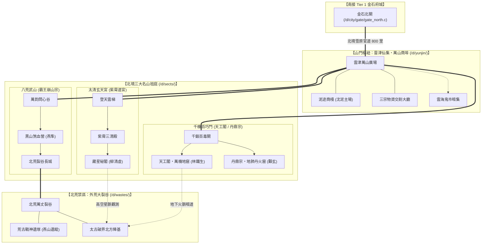
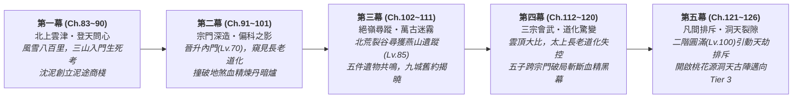

# 《遺忘的世界》第三卷：名山問道・脫俗爭鋒篇（修訂版 v2.0）

> **卷次定位**：Tier 2 名門名山大派與萬山商埠篇（角色等級 Lv.50 → Lv.100 ／ 技能等級 Lv.101 → Lv.200）  
> **章節規模**：全 44 章（第 83 章 ～ 第 126 章，五幕結構）  
> **文件狀態**：結構修訂版；作為後續正文寫作基準，章節場景與人物反應保留創作彈性。  
> **修訂原則**：保留原五幕主線，優先修正跨卷正典、證據強度、人物弧線、宗門社會層次與高潮節奏。  
> **關聯正典**：[世界觀與 Mudlib 架構設定集](file:///home/wade/src/github/mudscript/forgotten-space/narrative/world_setting.md) ｜ [小說總大綱](file:///home/wade/src/github/mudscript/forgotten-space/narrative/novel_outline.md) ｜ [第一卷大綱【黑石驚蟄】](file:///home/wade/src/github/mudscript/forgotten-space/narrative/volume1.md) ｜ [第二卷大綱【金石風雲】](file:///home/wade/src/github/mudscript/forgotten-space/narrative/volume2.md) ｜ [核心人物檔案](file:///home/wade/src/github/mudscript/forgotten-space/narrative/character_profiles.md)  
> **核心命題**：**當修行的代價不再只是凡俗的皮肉勞苦，而是「神魂結晶道化（法）」、「氣血如爐枯竭（力）」、「心為外物靈樞所役（物）」時，五位自黑石鋪泥塗走出的少年，如何在名山正統的偏科絕路中守住人性，並撕開名山高層收購「地煞血精」延命的萬古黑幕？**

---

## 一、第三卷核心定位與世界觀躍遷 (Core Positioning & Tier 2 World Transition)

### 1.1 從「紅塵入世（Tier 1）」到「名山問道（Tier 2）」的本質跨越
如果說第一卷【黑石驚蟄】是**「絕境求生」**，第二卷【金石風雲】是**「在世俗制度與城鄉網絡中立身破局」**，那麼第三卷【名山問道】則是五位主角真正踏入當世修行界最高殿堂——**北境三大名山大派**，直面三大道統正統傳承的輝煌與致命反噬：

1. **空間尺度的躍遷（三山一埠一裂谷）**：
   - 離開金石府城北關後，北行八百里跨越寒風呼嘯的北境雪原，進入由三大名山祖庭、山腳自由商埠與北荒大裂谷構成的 **Tier 2 名山疆域**：
     - **【法宗大派】太清玄天宮（古稱紫霄道宮）**：矗立於雲頂天柱峰，終年雲海環繞、星罡凜冽。下轄「周天星律院」與「太清雷符殿」，講求順天借法、代天行道（**柳清虛**持玄機真人與星淵保薦令入山）。
     - **【力宗大派】八荒武山／八荒武宗（古號霸王崩山宗）**：盤踞於北荒裂谷南沿的大黑山，直接鎮守外荒獸潮防線。下轄「煞血霸體營」與「破軍重弓塞」，講求血氣化罡、一力破萬法（**燕隼**持霸山總教頭保薦令入山）。
     - **【物宗大派】千機百巧門（下轄「天工閣」與「丹鼎宗」兩大主脈）**：依傍萬仞天工山龐大地肺火脈而建。分為專精重型機關獸、地火百煉與重樓陣圖的器道主脈**【天工閣】**（**林鐵生**持歐陽大師與莫錘保薦令入山），以及專司靈草百毒、地肺丹火與生機改造的藥道主脈**【丹鼎宗】**（**顧玄**持白鶴年與孫先生保薦令入山）。
     - **【山門樞紐】雲津仙集（萬山商埠）**：坐落於三大名山交匯處的雲海峽谷盆地。名山清高自持，不直接經營凡俗貨殖，一切外門丹藥、礦材、符紙、軍糧、靈石票據與黑市暗標皆在此集散。**沈泥**不入任何封閉宗門，持【金石商會與通寶跨州特等通行信印】於此創立**「泥途商棧」**，成為串聯三山四脈、調度跨宗門物資與情報的自由樞紐。
     - **【北荒禁區】北方外荒大裂谷與太古破界陣基**：大黑山以北的萬里凍土裂谷，地煞狂暴、荒獸橫行，深處掩埋著五年前「走山令」探險隊失蹤的遺骸與太古破界方舟的北方主陣基。

2. **三道偏科的極致反噬（The Price of Extreme Specialization）**：
   在 Tier 1 金石府城中，三道尚處於打基礎的「凡俗技藝延伸」階段；一旦踏入 Tier 2 名山深造，二階功法直接觸及天地法則與生命本源，太古大清洗後「三才割裂」的致命缺陷全面爆發：
   - **【法道反噬：清修道化（Crystallization）】**：
     太清玄天宮弟子引九天星力洗刷神魂，算力與術法威能暴漲；但借法越深，七情六慾越發冷漠，眼眸逐漸泛起無機質的淡青晶光。宮中歷代高階長老所謂「閉關坐化、白日飛升」，實則是神魂與肉身徹底玉化為冰冷的「道化晶石」，淪為修補「二十八宿天羅假天牢籠」的活體電池。
   - **【力道反噬：氣血枯竭（Vitality Burnout）】**：
     八荒武山武修引北荒煞氣入髓，氣血如烘爐般沸騰，肉身可硬撼神兵荒獸；但過度壓榨生機導致五臟六腑提前乾涸炭化，高階武師表面氣吞萬里，暗地裡卻長年咳出黑血、神智易陷狂躁嗜殺，壽元往往不過五十。
   - **【物道反噬：外物奴役（Material Enslavement）】**：
     千機百巧門（天工閣／丹鼎宗）追求「人巧奪天」，但二階重型機關傀儡與高階靈丹極度依賴罕見外物與**高純度地煞血精晶錠**；部分狂熱長老甚至將自身經絡改造成外物靈樞，或以活體試藥，一旦外物斷供或靈樞反噬便頃刻崩潰。

3. **制度性悲劇：名山高層為何收購「地煞血精」？**
   - 拒絕臉譜化的「邪惡反派」設定：三大名山的執事與高階長老之所以暗中透過無標記經生、向金石商會等世俗白手套大宗收購沾滿礦工鮮血的「地煞血精晶錠」，**並非為了修煉魔功毀滅世界，而是因為「地煞血精」中蘊含的狂暴大地濁氣與生靈血怨，是他們目前掌握、能夠暫時中和「假天清氣道化結晶」、替力宗長老「續接乾涸氣血」、以及替物宗「驅動鎮山古傀抵禦北荒獸潮」的救命禁藥！**
   - 為了延緩自身道化、為了維持名山鎮壓北荒的體面與統治，高高在上的名山仙長們默許了世俗商會的殘酷開採，而三十年前舊商盟遭清洗，與其拒絕交出契約網及血精開採資料的事件存在尚待查證的因果關係；究竟是哪些執事下令、哪些高層知情、哪些人只是默許，必須透過本卷證據鏈逐步釐清。這構成第三卷最重要的制度與人性衝突。

---

## 二、前兩卷未解伏筆回收與跨卷推進總表 (`FS-01 ~ FS-07` Continuity Ledger)

第三卷嚴格承接第一卷（Ch.1~38）與第二卷（Ch.39~82）埋下的七大核心伏筆，明確劃定本卷「回收揭曉」與「留待第四、五卷終局」的邊界：

| 伏筆編號 | 第一、二卷已建立之線索 | 第三卷（Ch.83 ~ Ch.126）核心推進與回收 | 留待第四、五卷（Tier 3 ~ 4）之終局懸念 |
| :--- | :--- | :--- | :--- |
| **`FS-01`** 逆星斷碑與周天歲差 | 黑石鋪溪灘拓片（Ch.1）、摘星台百年歲差與星淵北境手札（Ch.50, 81）。 | 柳清虛在太清玄天宮「藏星秘閣」比對歷代星圖，發現星軌紀錄在約三百年週期附近出現不自然的規則偏移；逆星斷碑拓片提供另一組可供比對的古老座標，但其完整含義仍待後續驗證。 | 誰在操控三百年一次的星軌校準？假天中樞位於何處？ |
| **`FS-02`** 太古不融黑鐵與機關城 | 鐵匠鋪黑鐵齒輪（Ch.2）、礦底太古機關城裂隙（Ch.17）、名山經生高價求購（Ch.81）。 | 林鐵生在天工閣「萬機地窟」發現【太古天工母機殘骸】，其部分傳動結構與手中的黑鐵齒輪同源；本卷進一步發現三大名山祖庭下方可能存在彼此連通的太古大型遺構，是否同屬一座破界方舟仍須由後續陣基資料確認。 | 如何重啟整座太古破界方舟，打破假天封鎖？ |
| **`FS-03`** 燕山走山令與戰神圖騰 | 東林戰神圖騰玄柱（Ch.3）、鎮風縣五年前「走山令」與燕山失蹤（Ch.62）。 | 燕隼於北荒尋獲走山隊遺址、燕山慣用箭記、護心鏡及殘缺血書；與第二卷衛所舊檔、雷烈的軍需副本互相印證，確認隊伍曾遭人為封谷與棄置。裂隙痕跡只顯示燕山可能進入異界，不能證明其生死。 | 燕山是否生還、身在何處，以及他當年是否知道勘探任務的真實目的？ |
| **`FS-04`** 假天牢籠與道化結晶 | 殘壇玉化晶骨（Ch.4）、枯木自剜雙目、靜心閣斬心魔（Ch.80）。 | 柳清虛與顧玄取得坐化遺蛻、晶絲與血丹樣本，建立道化與假天星力之間的關聯假說；Ch.100 的三元互濟只證明能在特定條件下處理早期晶絲，尚不能證明是唯一解法。 | 如何確認假天規則的作用機制，並在不造成更大傷亡的前提下解除道化？ |
| **`FS-05`** 天門引與九城古商盟舊約 | 廢柴房天門引（Ch.5）、當鋪死帳與雲記身世（Ch.51、65）、天字密室與九城青銅契版（Ch.73、77）。 | 沈泥於雲津及北荒舊址拼合契版，推進身世第五階段，確認九城商盟曾負責破界工程的後勤契約與物資調度；契約、資金流與命令殘頁指向部分名山執事及金石商會內堂，但完整決策鏈仍待查證。 | 第六階段的身分、總約權限與她是否接受或改寫這項使命？ |
| **`FS-06`** 地煞血精終端買家 | 黑石鋪盜採（Ch.13~18）、六縣提純暗網與三萬斤血精正底單（Ch.58~75）、無標記名山經生（Ch.77）。 | 本卷逐步確認主要買家、無標記經生與部分煉製場所，並取得能指向鶴壽、赤煉及玄冥相關網絡的帳冊、樣本與物證；第四幕公開質證後，仍須區分直接參與者、默許者與不知情者。 | 名山私盟之外，Tier 3 異界洞天是否也在收割二階圓滿修士？ |
| **`FS-07`** 五件遺物共鳴與破界古陣 | 小棧五器合鳴凝結星光指針直指北方（Ch.82）。 | 五件太古遺物於北荒陣基產生第二次共鳴，讓五人確認此地與桃花源古陣存在關聯；真正啟動傳送程序仍需在第五幕完成多重驗證，且無法保證返回。 | 洞天世界背後的「飛升收割」真相？ |

---

## 三、二階五維能力演進與名山制度邊界 (`Tier 2 Mechanics & Operating Rules`)

為確保第三卷不落入傳統修仙小說「進宗門就是打怪刷副本、換地圖重複套路」的窠臼，嚴格鎖定以下五項 **Tier 2 運作規則 (`[RULE]`)**：

### 3.1 二階五維能力分離模型 (`path / skill / qualification / affiliation / access`)
延續第二卷的五維分離架構，名山宗門內部同樣存在嚴格的制度與權限階梯：

| 維度 | Tier 2 定義與表現 | 顧玄 (丹鼎宗) | 林鐵生 (天工閣) | 燕隼 (八荒武山) | 柳清虛 (太清玄天宮) | 沈泥 (雲津仙集) |
| :--- | :--- | :--- | :--- | :--- | :--- | :--- |
| **`path`** (二階道途) | 突破 Lv.50 後的生命進化方向 | `gong_danding` (靈樞藥師) | `gong_tiangong` (天工機師) | `wu_bahuang` (煞血戰修) | `dao_taiqing` (太清星官) | `society_yunjin` (萬山大行商) |
| **`skill`** (Lv.101~200) | 二階高深功法與百工造詣 | 地肺控火、生機續脈、道化剝離 | 重機構造、地火百煉、陣基應力 | 煞血霸體、破軍穿雲、荒獸搏殺 | 周天星算、太清雷符、紫微破妄 | 跨山門匯兌、靈石期貨、古契破譯 |
| **`qualification`** (執業／品階) | 宗門與商埠認可之專業品階 | 三品靈丹師 (`cert_alchemist_t2`) | 三品天工匠師 (`cert_artificer_t2`) | 北荒破軍校尉 (`cert_vanguard_t2`) | 欽天司星執事 (`cert_astrologer_t2`) | 萬山商埠總牙首 (`cert_syndic_t2`) |
| **`affiliation`** (宗門編制) | 記名外門 $\to$ 內門入室 $\to$ 親傳／執事 | 丹鼎宗百草谷入室弟子 | 天工閣千機院入室弟子 | 八荒武山黑山營親傳銳士 | 太清玄天宮觀星院入室道士 | 雲津仙集「泥途商棧」東家（自由身） |
| **`access`** (禁地權限) | 憑宗門玉牌／功勳開啟之高危場域 | 地肺丹火窟、百毒藥園、廢丹崖 | 萬機地窟、地火鍛兵台、古傀庫 | 煞血池、大黑山長城、北荒前哨 | 藏星秘閣、天柱觀星台、雷罡崖 | 萬山靈石金庫、三宗交割廳、北荒暗集 |

### 3.2 雲津仙集（萬山商埠）與三大名山的共生與制衡
1. **為何三大名山需要雲津仙集？**
   - 三大名山雖掌握超凡武力與法術，但數千名外門弟子與雜役的米糧、禦寒皮毛、基礎藥材、精鐵碳石，乃至長老所需的世俗罕見礦物，皆須仰賴凡俗九州輸入。
   - 三宗彼此猜忌，誰也不願讓對方掌控補給咽喉，遂在三山交匯的雲津峽谷劃定中立區**【雲津仙集（萬山商埠）】**，由持「跨州行商總勘合」的民間大商號駐點經營。
2. **沈泥的「泥途商棧」核心機制**：
   - 四位同伴在三大名山中修行，受限於森嚴門規與宗門貢獻點（`sect_merit`）盤剝，初期連換取一爐高階丹藥或一塊百煉星鐵都極為艱難，更無法跨宗門互通有無。
   - 沈泥在雲津仙集建立「泥途商棧」，利用三宗外門物資價差、廢丹殘鐵回收改造（顧玄提純廢丹、鐵生修復殘器、燕隼獵取北荒獸材、清虛預判北境暴風雪物價週期），打造出一條**「五子跨山門自給自足與情報互鎖網絡」**！

### 3.3 「反噬度（Corrosion / Burnout Index）」與三元互濟破局
- 在二階修行中，單一門派功法練至深處（Skill Lv.150+）必會累積**「偏科反噬度」**（法修累積「晶化度」、力修累積「燥火度」、物修累積「外物依賴度」）。
- 名山正統長老依靠吞服「地煞血精禁丹」強行壓制，實則飲鴆止渴；而五位主角則因為彼此跨宗門的深厚羈絆，在沈泥的雲津商棧暗中聚首，摸索出**「以物道藥理調和力道燥火、以力道陽剛氣血震碎法道晶化、以法道清明神識錨定物道機巧」**的**三元互濟雛形**，為第五卷的「三元歸一」奠定堅實的科學與實踐基礎。

---

## 四、第三卷空間拓撲與 Mudlib 規劃藍圖（敘事分區與實作映射）

> **目錄正典說明**：`world_setting.md` 目前將 Tier 2 地理根目錄記為 `/d/mountain/`。本節的 `/d/sects/`、`/d/yunjin/`、`/d/wastes/` 是本卷敘事分區的建議映射，不應在尚未完成架構決策前視為已定案的 Mudlib 根目錄。若實作沿用 `/d/mountain/`，可將三者作為其下子區或邏輯區域；若改為獨立根目錄，須同步更新世界設定與實際路由。

---

## 五、人物弧線、社會層次與敘事原則（本卷新增核心規範）

### 5.1 五位主角不是五個任務職能

| 主角 | 本卷外在目標 | 必須面對的內在困境 | 本卷不可輕易得到的答案 |
|---|---|---|---|
| 柳清虛 | 查明星曆被改寫與法道道化 | 他相信可驗證的秩序，卻發現自己依賴的知識體系可能被操控；一位值得尊敬、但維護舊秩序的師長會使他難以簡單站隊 | 真理不能只靠推翻舊說成立；新模型也必須接受證據檢驗 |
| 燕隼 | 查找大伯燕山的下落 | 尋親的急切與守護同伴的責任衝突；他必須面對大伯可能曾知情、妥協或做過不符合自己期待的選擇 | 找到遺物不等於找到人；線索不等於生還證明 |
| 林鐵生 | 理解黑鐵、巨靈神機與方舟結構 | 一位技術高超的天工師相信「機關比人可靠」，並願意把自身改造成機關的一部分；鐵生必須判斷工具與人的界線 | 技術可以延伸人的能力，卻不能替人承擔倫理責任 |
| 顧玄 | 查明血精、道化與血丹的病理關係 | 面對能救一人卻傷害另一群人的藥物，以及病患在絕境中自願承擔風險的選擇 | 醫者不能只以「救活」作為唯一指標，還要考慮知情、代價與替代方案 |
| 沈泥 | 建立跨宗門商路、揭開舊商盟契約 | 她以信用對抗宗門壟斷，卻可能讓商戶依賴自己的網絡，形成新的權力中心 | 自由市場不會自動公平；契約的價值在於限制強者，而非只讓自己獲利 |

### 5.2 三大名山必須同時呈現價值與代價

- **太清玄天宮**確實保存天文、曆法、觀測與符算知識，曾以星律預警災變；其問題是把「可計算的秩序」逐漸等同於「不可質疑的天道」。安排一位真正關心弟子、曾救過凡民的師長，讓柳清虛的反抗帶有情感代價。
- **八荒武山**確實長年守住北荒防線，許多武修知道氣血會受損仍選擇留下；其問題是把犧牲視為理所當然，並以戰功掩蓋制度對傷兵、退役者與家屬的照顧不足。
- **千機百巧門**確實改善民生、製造器具、保存藥理與工藝；其問題是把效率與成果置於人的知情權之上，容許活體試藥、外物改造與資源壟斷。
- **雲津仙集**不應只是主角的安全基地。它有倉租、貨損、信用、行會、工價、債務、黑市與自治規則；商人、腳夫、工匠、退門弟子及家屬都應有自己的利益與選擇。

### 5.3 普通人生活線

本卷至少持續追蹤三組非主角人物：

1. **退門者家庭**：第 83 章遇見的退門武師或藥師，後續在雲津以手藝謀生；讀者看見宗門淘汰後的真實生活，而非只聽傳聞。
2. **工匠與供應者**：為天工閣製作零件、替八荒武山運送軍糧的普通工匠與腳夫，讓讀者知道名山的光鮮由誰支撐。
3. **受害者與家屬**：血精採掘者、試藥者、走山隊家屬及獸潮撤離居民；他們不能只在揭露真相時充當背景群眾。

至少安排一名配角在改革後仍然失去工作或親人，避免以簽約、立碑或反派伏誅抹平所有損失。

### 5.4 章節敘事規則

每章正文至少具備以下四項中的三項，重要轉折章則四項俱全：

1. **具體場景**：人物正在做什麼，環境如何限制他們，而非先用大段設定介紹地點。
2. **當下衝突**：人物想得到什麼，誰或什麼阻止他，雙方各自掌握哪些資訊。
3. **選擇與代價**：人物不是只執行任務，而是必須在兩個以上不完美選項中作決定。
4. **後續影響**：選擇改變了人物關係、資源、制度或下一章的局勢。

章末懸念不必每次都是敵人現身或突然遇襲，也可以是承諾無法履行、證據互相矛盾、信任破裂或某個人做出令人意外但合理的選擇。

### 5.5 真相揭露採分層遞進

| 階段 | 讀者可確認的內容 | 尚不可提前定論的內容 |
|---|---|---|
| 第一幕 | 名山制度的光鮮與代價並存 | 三宗高層是否共同策劃全部黑幕 |
| 第二幕 | 三道反噬、血精用途及部分交易線索 | 血精的太古來源、所有掌門的知情程度 |
| 第三幕 | 血精母脈與方舟陣基有關；燕山隊遭人為棄置 | 燕山生死、三十年前滅門完整決策鏈、假天全貌 |
| 第四幕 | 私盟主要成員及部分證據接受公開質證；危機暴露制度失靈 | 三宗已完成改革、所有受害者獲得補償 |
| 第五幕 | 桃花源是可進入的避險空間，且存在風險 | 洞天真正性質、能否返回、燕山所在及飛升收割全貌 |

**禁止在第 99 章一次性拼完所有真相。**五人可以確認「存在跨宗門的血精交易網」，但北荒母脈、方舟用途、舊商盟滅門責任鏈與假天的真正目的，必須分別在第三、四、五幕逐步揭露。

---

## 六、第三卷五幕 44 章（Ch.83 ~ Ch.126）詳細章節大綱

---

### 【第一幕：北上雲津・登天問心】（第 83 ～ 90 章，共 8 章）
> **幕核心目標**：完成從 Tier 1 世俗府城到 Tier 2 名山仙集的空間與制度過渡；展現名山大派對凡俗修士的傲慢篩選與殘酷入門大考；建立沈泥在「雲津仙集（萬山商埠）」的跨宗門樞紐地位。  
> **等級推進**：`Lv.50 → Lv.55`（完成二階外門立籍與初階洗禮）

* **第 83 章：風雪北境・八百里寒原**
  * **主視角**：群像（燕隼、顧玄主導）
  * **劇情大綱**：五子與莫三辭別金石府城北關，踏上八百里北境官道。旅程不以連續遭遇戰填滿，而以補給、天候、路況與同行者的選擇呈現 Tier 1 到 Tier 2 的生活落差。途中遇見被名山退回的武師與藥師：他們並非只因能力不足而落選，有人是拒絕以同伴作為考核代價，有人則因無力負擔後續歲貢而自行離山。燕隼發現雪豹蹤跡，卻選擇先保護車隊而非追獵；顧玄以葛半仙所贈野菊草籽配製抗寒湯劑，救下一名凍傷的腳夫。五人第一次看見名山制度如何把「淘汰」的代價轉嫁給山外普通人。
* **第 84 章：雲津仙集・萬山商埠的規矩**
  * **主視角**：沈泥
  * **劇情大綱**：抵達三大名山腳下的雲海峽谷樞紐【雲津仙集（萬山商埠）】。此地通用的不再僅是凡俗銀兩，而是按靈氣純度折算的「萬山靈石票」與「三宗外門供奉額」。沈泥持蘇凝霜與賈朝奉聯署的【跨州行商總勘合／特等通行信印】前往商埠總公所登記，遭萬寶閣掌櫃以保證金、倉儲規格與既有供應商排他條款刁難。她沒有立即靠一筆大單翻身，而是先查清商埠的交割規則、倉租、貨損責任與信用擔保制度，再以金石府六縣的烈礬耐火炭、青河藥材等可追溯供貨紀錄爭取小額試單。她以承擔貨損風險換取第一批客戶，盤下一座規模有限的舊貨棧，掛牌**【泥途商棧】**；開張並不代表站穩腳跟。
* **第 85 章：三山開門・仙凡分界線**
  * **主視角**：群像
  * **劇情大綱**：本次三大名山依既定三年甄選週期舉行外門考核；編寫正文前須先以第二卷結尾的初秋日期、八百里行程與既定甄選週期核算抵達日。若時間不吻合，五人先在雲津仙集等待下一次正式甄選，不得為遷就章節而任意改動週期。五子在泥途商棧後院吃下離別前的團圓飯，約定以朔望貨單暗語互通消息。四人持第二卷取得的【Tier 2 名山外門考核令】報名，該令只代表參試資格，並非保薦入門或保證錄取。沈泥留在雲津，首次獨自承擔商棧的租金、貨損與信用責任。
* **第 86 章：千丈登天梯・太清問心鏡（柳清虛線）**
  * **主視角**：柳清虛
  * **劇情大綱**：柳清虛攀登太清玄天宮的「千丈登天雲梯」。雲梯設有引動九天星煞的「太清問心陣」，強迫考核者放棄凡塵牽掛、順從天道威壓；同批世家修士紛紛磕頭臣服以求減輕威壓，唯獨柳清虛謹記枯木老道「別信這片天」之訓，以實證心算看破問心陣的星力節點公差，背脊挺直踏上雲頂，被「周天星律院」執事破格錄為外門上等經生。
* **第 87 章：萬鈞問心谷・煞血試煉場（燕隼線）**
  * **主視角**：燕隼
  * **劇情大綱**：燕隼進入八荒武山的「萬鈞問心裂谷」。考核並非單純比武，而是要在狂暴北荒地煞沖刷下，赤手空拳穿過棲息著二階「鐵背荒狼」的百里黑石峽。許多武師因強行催動氣血導致經脈爆裂或淪為嗜血狂徒；燕隼憑藉獵戶的隱忍直覺、盤石步法與對獸群領頭習性的預判，不浪費一分氣血，一人一弓精準射殺頭狼通過考核，並引起鎮守黑山營的獨臂老將「狂刀雷烈」（當年曾與燕山並肩作戰）的注意。
* **第 88 章：千鍛地火廊・萬機拆解考（林鐵生線）**
  * **主視角**：林鐵生
  * **劇情大綱**：林鐵生踏入千機百巧門器道主脈【天工閣】的「千鍛地火廊」。主考官要求眾匠師在兩個時辰內修復一具損壞的二階「青銅搬山傀儡」關節。世家匠師紛紛堆砌昂貴秘銀與符文，卻因不識內部剪切應力而炸膛；鐵生不看花俏符紋，以阿鐵精鋼卡尺與百工格物心眼量出核心傳動軸半厘偏角，以最樸素的雙契榫與地火重鍛將其完美復原，獲天工閣外門執事魯班門人收錄。
* **第 89 章：百毒試藥谷・生機辨偽考（顧玄線）**
  * **主視角**：顧玄
  * **劇情大綱**：顧玄進入千機百巧門藥道主脈【丹鼎宗】的「百毒試藥谷」。考核要求在十株受高濃度地煞侵蝕而變異的二階靈草中，煉製出不傷經脈的辟煞散。多數丹師習慣以霸道丹火強行焚毀雜質，導致藥性盡失或殘留火毒；顧玄以大荒草醫的微觀病理視角，發現變異靈草根部寄生的「雪線苔」恰是中和地煞的天然引子，以溫火冷萃法成藥，技驚四座，入丹鼎宗百草谷。
* **第 90 章：泥途立契・五子暗網初成**
  * **主視角**：沈泥
  * **劇情大綱**：四子雖通過大考進入三山外門，卻立即面臨名山外門嚴苛的「歲貢與功勳考核」——外門弟子須完成歲貢、勞役與功勳要求；欠額可能導致降籍、延長役期或被派往高危差事，不把「礦奴／試藥童」設定成所有宗門一律採用的單一懲罰。沈泥接待首批採買管事，發現貨單、實際交割量與弟子個人貢獻紀錄存在落差。她先以小額代購建立信用，卻因一批藥材延誤而承受第一筆賠償，最後才以公開帳目和可追溯貨單打通四子傳遞物資與密信的合法暗線。

---

### 【第二幕：宗門深造・偏科之影】（第 91 ～ 101 章，共 11 章）
> **幕核心目標**：四子在各自宗門修習二階核心功法，實力大幅躍升（`Lv.55 → Lv.70`）；同時親眼目睹三大道統高階修士「道化結晶」、「氣血枯竭」、「外物奴役」的恐怖真相，並分別從觀星、邊塞、古傀、煉丹四個維度撞破名山高層收購「地煞血精」的黑幕。  
> **等級推進**：`Lv.55 → Lv.70`（晉升三山內門入室弟子／萬山商埠二等總牙）

* **第 91 章：藏星秘閣・被篡改的星曆**
  * **主視角**：柳清虛
  * **劇情大綱**：柳清虛因心算歲差精準，獲准進入太清玄天宮內門「藏星秘閣」整理歷代星圖。他在核對三百年前與六百年前的《紫微星官錄》時，駭然發現每逢三百年甲子大劫，漫天星宿的運行軌跡都會出現一次整齊劃一的「人工修正偏移」，而口袋中的黑石鋪【逆星斷碑拓片】微熱共鳴——原來當世法修所借的「天道星力」，竟是一座每隔三百年自動收緊的巨型法陣！
* **第 92 章：坐化真相・紫霄殿後的玉雕長老**
  * **主視角**：柳清虛
  * **劇情大綱**：太清玄天宮一位修為高達 Lv.92 的內門傳功長老「鶴鳴真人」宣告功德圓滿、閉關坐化飛升。柳清虛奉命隨執事前往後山「升仙台」奉香，卻在罡風吹開帷幕的一瞬，看見所謂「白日飛升」的鶴鳴真人並未羽化登仙，而是全身骨骼血肉徹底化作一尊沒有呼吸、卻仍在源源不斷向天幕輸送靈力的淡青色人形晶石！清虛道心劇震，取得一項足以支持「道化」假說的重要觀察，但清虛尚不能單憑一具遺蛻判定所有坐化者的狀態與成因。
* **第 93 章：煞血霸體・黑山長城的咳血宿將**
  * **主視角**：燕隼
  * **劇情大綱**：燕隼在八荒武山修習二階《煞血霸體訣》與《破軍開山弓》，隨黑山營開赴北荒裂谷長城防線獵殺二階荒獸。他在營帳中目睹威震北荒的雷烈將軍與數位 Lv.85+ 的武山長老，每逢子夜便因「氣血如爐焚燒五臟」而痛苦不堪，必須吞服一種散發著熟悉腥甜硫磺味的暗紅丹丸方能止痛——那氣味，竟與黑石鋪和濁水縣提煉的「地煞血精」一模一樣！
* **第 94 章：斷崖骨箭・五年前的走山血痕**
  * **主視角**：燕隼
  * **劇情大綱**：燕隼藉巡防裂谷外圍之機，按鎮風縣所得【玄鐵走山令殘牌】上的方位，冒險深入黑山東側的「鬼哭冰澗」。在一處被冰層封凍的岩縫中，他發現了一支刻著燕家老鷹記號的斷折狼牙重箭，以及半塊染血的八方武館舊皮甲。雷烈將軍暗中現身，承認自己當年曾替該隊安排過外圍接應，但他只知道燕隼的大伯燕山受金石商會內堂出資的勘探隊聘為首席嚮導，隊伍後來失聯；他沒有親眼看見背叛，也無法證明燕山的生死。雷烈交出一份被刪改過的軍需調度副本，指出當年有人在撤離名單中刻意抹去整支隊伍。
* **第 95 章：萬機地窟・同源的太古黑鐵**
  * **主視角**：林鐵生
  * **劇情大綱**：林鐵生憑藉精湛鍛藝晉升天工閣內門「萬機地窟」，參與維護天工閣鎮山重器——高約十丈的太古遺留機關巨像【巨靈神機】。在清理巨像胸腔主傳動軸時，鐵生懷中的【太古不融黑鐵齒輪構件】產生強烈磁吸震顫！他驚愕地發現，這尊被天工閣奉為神物的巨像，實則是太古某座超巨型工程方舟的「右翼推進錨機」，而天工閣赤煉長老正試圖以高純度「地煞血精晶柱」強行塞入動力槽催動巨像。
* **第 96 章：地肺丹火・逆道延命的血爐**
  * **主視角**：顧玄
  * **劇情大綱**：顧玄因精通毒理生剋，被丹鼎宗內門大長老「鶴壽真人」調入地底三百丈的「地肺丹火窟」擔任控火藥童。在一次深夜輪值中，顧玄透過通風石隙聞到濃烈的「丙字柒號坩堝」提純血精氣息，親眼撞見鶴壽真人與太清玄天宮、天工閣的密使交割成箱的【地煞血精晶錠】，並以活體荒獸心頭血配伍血精，煉製專門用來壓制長老「道化結晶」與「氣血乾涸」的禁藥——**【逆道延命血丹】**！
* **第 97 章：廢丹崖下・道化與血毒的病理實驗**
  * **主視角**：顧玄
  * **劇情大綱**：顧玄冒險在丹鼎宗後山「廢丹崖」收集鶴壽真人廢棄的丹渣與試藥白猿屍骸，秘密解剖化驗。他運用「從自然與病理理解世界」的本領，得出驚人結論：地煞血精雖然能以狂暴濁氣暫時腐蝕道化晶簇，但同時會在修士臟腑內種下不可逆的「血煞癌變」，一旦停藥，修士會在三日內全身結晶爆裂而亡！名山高層早已淪為地煞血精的成癮囚徒。
* **第 98 章：萬山匯兌・無標記經生的尾巴**
  * **主視角**：沈泥
  * **劇情大綱**：雲津仙集的「泥途商棧」生意日隆，沈泥與莫三透過追蹤商埠內大宗「無瑕二階靈石」與「金石府私運血精」的暗市交割，鎖定了當年在金石府鬼市收購血精的那批「無標記灰袍經生」。沈泥利用「萬寶閣」與三宗外門管事的帳目矛盾設局，截獲了一份灰袍經生遺落的【北境三宗延命私盟密帳索引】，發現金石商會錢百川不過是他們在南方十三府培養的七個白手套之一。
* **第 99 章：風雪夜聚・泥途商棧的五方對帳**
  * **主視角**：群像
  * **劇情大綱**：大雪封山之夜，四子藉宗門採買與換防假期，秘密齊聚雲津仙集「泥途商棧」地窖。五人將藏星秘閣星曆、燕山走山血箭、巨靈神機黑鐵、地肺血丹病理與延命私盟密帳攤在桌上——五條線索只在「血精確實流入部分名山高層」這一點上互相支持，卻對交易規模、各宗知情範圍、血精來源及最終用途仍有缺口。五人第一次確認存在跨宗門的延命交易網，但對方舟、假天與舊商盟滅門的完整關係仍無答案。柳清虛不願把推論寫成定論，沈泥則要求所有證據分開編號、保留來源與取得過程。
* **第 100 章：三元互濟・初試剝離道化晶絲**
  * **主視角**：群像
  * **劇情大綱**：柳清虛在連月推演《太清周天星訣》突破 Lv.70 後，左腕經絡竟浮現出一縷細微的淡青色「道化晶絲」，指尖漸失知覺。五子不願清虛重蹈枯木老道自殘或名山長老吞服血精禁丹的覆轍，由顧玄施展九轉銀針引導青河靈草生機，林鐵生以不融黑鐵高頻震波共振晶絲結構，燕隼度入精純陽剛氣血，沈泥在旁精準計時控溫，竟成功將那縷道化晶絲完整剝離排出！五子只證明三元互濟能在特定條件下暫時減緩並剝離一縷早期晶絲；樣本有限，無法證明這是唯一方法，更不能直接套用於高階長老或整座假天牢籠。成功之後，清虛仍有麻木與短暫失憶，顧玄也記錄到藥物與震波的副作用。
* **第 101 章：暗流反撲・延命私盟的警覺**
  * **主視角**：沈泥、柳清虛
  * **劇情大綱**：金石府錢百川倒台導致南方血精斷供三成，丹鼎宗鶴壽長老與太清宮執法長老震怒，派人徹查雲津仙集與新晉弟子底細。萬寶閣聯合執法堂以「私通外州違禁藥材」為名突擊查封泥途商棧外庫；沈泥以部分合法代購紅契與莫三保存的副帳證明商棧並非單純走私；但她為保護供應商而主動承擔一筆罰款與信用損失，且商棧一名夥計被帶走問訊，但五子深知：被動防守無法破局，必須主動深入北荒裂谷，拿到足以引爆三宗正統根基的終極鐵證與太古陣基力量！

---

### 【第三幕：絕嶺尋蹤・萬古迷霧】（第 102 ～ 111 章，共 10 章）
> **幕核心目標**：五子藉由三大名山聯合發起的「北荒裂谷冬獵與礦脈勘探」任務，深入北方外荒大裂谷（`Lv.70 → Lv.85`）；尋獲燕山與五年前走山隊的遺留真相，觸發五件太古遺物在「北方破界主陣基」的第二次高階共鳴，並揭開沈泥【九城古商盟銅券】第五階段舊約。  
> **等級推進**：`Lv.70 → Lv.85`（晉升名山真傳候選／北荒破軍校尉）

* **第 102 章：北荒冬獵・三宗聯合勘探隊**
  * **主視角**：燕隼、林鐵生
  * **劇情大綱**：因南方金石府血精斷供，名山高層以「北荒裂谷地脈異動、加固長城陣基」為名，組建三宗內門精銳聯合勘探隊深入外荒裂谷（實則企圖重啟五年前未竟的「北荒血精母脈」開採）。燕隼、林鐵生、顧玄、柳清虛憑內門優異表現入選隨行，沈泥則以「泥途商棧隨軍輜重總辦」身分攜莫三押運後勤雪橇同行。
* **第 103 章：萬丈凍土・大荒凶獸之威**
  * **主視角**：燕隼、顧玄
  * **劇情大綱**：勘探隊踏入北荒大裂谷第二層「永凍血原」。地煞濃烈如紫霧，棲息於此的荒獸已具二階頂峰（Lv.80+）戰力。隊伍遭遇「雙頭霜甲地龍」伏擊，世家內門弟子陣型大亂；燕隼立於雪橇高處連開五石鐵胎重弓，以狼牙破甲箭貫穿地龍逆鱗，顧玄甩出特製「沸血雄黃煙」封鎖地龍毒息，林鐵生以飛爪滑輪鎖死地龍巨尾，五子默契配合成為全隊支柱。
* **第 104 章：走山絕谷・五年前的背叛現場**
  * **主視角**：燕隼
  * **劇情大綱**：深入裂谷三百里後，燕隼依據大伯燕山骨箭上的獵戶暗記，在暴風雪夜脫離大營，帶領四位夥伴尋至一處被人工爆破坍塌封死的「黑冰斷谷」。谷內發現多具被冰封的遺骸、八方武館舊物、燕山慣用的箭記，以及刻痕殘缺的血書與走山令碎片。這些材料與第二卷衛所舊檔、雷烈提供的軍需副本互相印證，足以證明勘探隊曾遭人為封谷與棄置；但血書的部分內容已被冰裂破壞，尚不能單憑現場指認所有下令者。燕隼必須克制立即復仇的衝動，先把遺骸、物證與倖存者口述分開保存。
* **第 105 章：荒古戰神遺塚・不屈的血脈共鳴**
  * **主視角**：燕隼
  * **劇情大綱**：在黑冰斷谷最深處，矗立著一座高逾三十丈的【荒古戰神巨石遺塚】，遺塚旁留有燕山可能重傷後爬向一道幽暗空間裂隙的血跡與隨身護心鏡；裂隙通往何處、燕山是否活著，仍無法由現場證明。燕隼手握【獵獸圖騰骨片】按上遺塚，遺塚沒有直接灌輸力量，而是留下殘缺的戰鬥記錄與一套需要以自身氣血驗證的古老呼吸節律。燕隼在保護同伴撤離時第一次主動放棄追擊，改以控制節奏、分配氣血完成突破；他只掌握《八荒破天弓》的關鍵一式，距離完整極境仍有差距，修為提升至約 Lv.80。
* **第 106 章：地底方舟艙段・北荒破界主陣基**
  * **主視角**：林鐵生、柳清虛
  * **劇情大綱**：穿過戰神遺塚後的裂隙，五子駭然望見永凍冰層下方掩埋著一座方圓數十里的太古巨型金屬遺構——**【太古破界方舟・北荒主引擎陣基】**！所謂的「北荒地煞血精母脈」，根本不是天然礦藏，而是太古破界方舟被「大清洗」擊落時，引擎冷卻管線破裂洩漏出的高能生物質與地脈結晶！名山長老私掘血精母脈，無異於在拆毀整座北境大陸的地脈安全閥。
* **第 107 章：五件遺物再鳴・太古影像殘篇**
  * **主視角**：柳清虛、群像
  * **劇情大綱**：五子在方舟主陣基核心圓台之上，分別取出【逆星斷碑拓片】、【太古不融黑鐵齒輪構件】、【獵獸圖騰骨片】、【古礦地煞晶核殘片】與【天門引及九城青銅契版】。五件遺物產生共鳴，依序提供不同的識別訊號，啟動了部分沉寂萬載的太古光影紀錄：影像顯示太古時代曾有人族工程試圖突破二十八宿天羅結構，並建造大型破界方舟；三大道統的早期職能可能分別對應導航演算、護衛與造物工程。影像遭到破壞，不能回答方舟是否成功、假天是否為單一意志，也不能證明現存三宗完整承襲了太古職能。
* **第 108 章：九城銅券合璧・舊約第五階段揭曉**
  * **主視角**：沈泥
  * **劇情大綱**：在方舟後勤主控室內，沈泥以【天門引】與金石府所得【九城青銅契版殘片】，成功喚醒嵌於控台上的北荒半塊【九城古商盟總契銅版】。兩塊契版嚴絲合縫，推進**沈泥身世第五階段「舊約核心內容」**：太古「九城萬物商盟」立下的萬古舊約，是在破界方舟重啟之日，負責統合凡間九州萬民物資、開啟安全避難通道的「人間總調度使」；而三十年前沈家所屬的舊商盟，正是因為發現名山延命私盟企圖抽乾方舟冷卻血精、可能引爆北境地脈陸沉，死守舊約不肯交出開採圖紙，其後舊商盟遭到有組織的清洗；目前取得的契約記錄、資金流與命令殘頁指向部分名山執事及金石商會內堂，但完整決策鏈與各宗掌門是否知情仍待查證。
* **第 109 章：母脈危機・赤煉長老的瘋狂盜掘**
  * **主視角**：林鐵生、顧玄
  * **劇情大綱**：此時，隨勘探隊潛入裂谷另一側的天工閣赤煉長老與丹鼎宗執事，已動用三十具二階重型鑽山傀儡，強行鑽穿方舟冷卻外殼盜取「萬年血精母液」，導致陣基壓力暴增、地脈毒煞狂噴，數千頭北荒荒獸受驚形成恐怖的二階獸潮！林鐵生與顧玄臨危不亂，顧玄以冷凍丹火凝結洩漏毒液，鐵生將【太古不融黑鐵齒輪構件】嵌入主閥門，順應太古應力結構強行鎖死七成洩漏口。
* **第 110 章：冰谷伏擊・斬殺滅口私盟執事**
  * **主視角**：群像
  * **劇情大綱**：赤煉長老的心腹大執事（Lv.88）發現五子竟開啟了內層陣基並掌握了五年前殺害燕山小隊與今日盜掘母脈的鐵證，率領死士與重型機關獸封鎖冰谷，企圖奪回樣本並控制目擊者；其命令來源與赤煉長老的直接關係必須透過令牌、通信記錄及後續證詞建立，不以敵人一句自白代替證據。五子依託太古陣基地形展開生死反擊，並優先保護物證與同行者：清虛以紫微星陣扭曲敵方術法彈道，鐵生精準敲碎機關獸應力關節，顧玄以腐金毒煙癱瘓死士護甲，沈泥算準冰崖雪崩延遲，燕隼於百步外張滿五石重弓，一箭貫穿大執事咽喉！
* **第 111 章：攜證歸山・暴風雨前的寧靜**
  * **主視角**：沈泥、柳清虛
  * **劇情大綱**：五子將盜掘現場的【名山內造鑽頭殘件】、【血精母液封裝玉瓶】與【走山隊遺址物證】分別封存，隨大隊返回雲津仙集。此時五人修為皆已臻至二階高階（Lv.85），沈泥開始透過「泥途商棧」聯絡三大名山內部反對血精私盟的正義宿老（如八荒武山雷烈將軍、天工閣魯長老、太清宮苦修派），將反擊舞台鎖定在預定舉行的三宗十年一度盛會——**【雲頂三宗論道會武】**！

---

### 【第四幕：三宗會武・道化驚變】（第 112 ～ 120 章，共 9 章）
> **幕核心目標**：在三大名山十年一度的「雲頂論道會武」與萬山商埠靈石清算中，五子分別從武技、丹器、陣算與金融四條戰線揭露私盟利益網；當私盟太上長老因強壓道化失控引發「半山結晶異變與獸王叩關」時，五子跨宗門力挽狂瀾，迫使三宗啟動公開調查，為三十年前舊商盟與五年前走山隊取得初步平反。  
> **等級推進**：`Lv.85 → Lv.95`（二階巔峰，威震北境三山）

* **第 112 章：雲頂盛會・十年一度的三宗會武**
  * **主視角**：群像
  * **劇情大綱**：三大名山十年一度的「雲頂論道會武」於雲津仙集上方的「問道天台」盛大開啟，旨在透過三宗年輕一代的比試，重新劃分未來十年北境靈脈與萬山商埠的稅賦份額。延命私盟的三大長老（太清宮執法長老玄冥、丹鼎宗鶴壽長老、天工閣赤煉長老）企圖讓各自培養、暗中服用微量血精催谷修為的嫡傳弟子奪魁，藉機獨攬北荒裂谷的封鎖開採權。
* **第 113 章：百工丹器試・不融黑鐵與無瑕清丹**
  * **主視角**：林鐵生、顧玄
  * **劇情大綱**：會武第一場為「百工器丹雙絕試」。赤煉長老首徒祭出以血精催動的二階巔峰「煞火魔偶」，霸道無匹；林鐵生手持六十斤烏金錘登台，不靠半點邪異血精，純憑「百工格物心眼」與太古公差應力，三錘震斷魔偶內部受血精腐蝕變脆的傳動主軸！同場丹試中，顧玄當眾以銀針與試藥靈草驗出鶴壽長老首徒所煉「九轉增元丹」中暗藏地煞血毒，並以一爐純淨無瑕的「三元生機丹」奪下丹器雙魁。
* **第 114 章：雲頂演武・破軍重弓對決紫霄神雷**
  * **主視角**：燕隼、柳清虛
  * **劇情大綱**：會武第二場為「力法演武大比」。燕隼對陣八荒武山私盟一脈的狂暴武師，在對方燃燒血精化作血魔之際，燕隼以磐石千斤墜與荒古戰神血脈正面硬撼，一箭震碎其護心血甲；壓軸戰中，柳清虛對決太清玄天宮執法長老首徒，面對漫天紫霄雷網，清虛以「逆星歲差算」提前半息踏入雷網死角，並以三元互濟之純淨靈力一指點破對方眉心暗藏的道化晶斑，震驚三山觀禮弟子。
* **第 115 章：萬山商戰・靈石期貨與血精斷供**
  * **主視角**：沈泥
  * **劇情大綱**：會武台下，沈泥在雲津仙集「三宗交割大廳」發動總攻。延命私盟因北荒母脈被鐵生鎖死七成、南方金石府斷供，導致庫存血精徹底見底，私盟控制的「萬寶閣」挪用三宗外門五百萬靈石準備金試圖高價強購黑市存貨；沈泥聯合賈朝奉北上傳來的跨州匯票與三宗外門管事，依契約要求萬寶閣分批交割並公開準備金用途。萬寶閣無法按期交付，只能啟動延期與抵押程序；沈泥利用其帳冊、倉單與交割紀錄的矛盾，迫使監管方凍結部分資產並公開查帳。這是一場信用危機與法律程序，不是喊出現貨交割便令商號瞬間破產。
* **第 116 章：當眾質證・三十年血債與走山鐵證**
  * **主視角**：群像
  * **劇情大綱**：在萬山交割大廳與問道天台數千名三宗弟子面前，沈泥、燕隼、柳清虛、林鐵生、顧玄與雷烈將軍同時呈上【九城契版及舊商盟資金往來副本】、【燕山走山隊遺址物證與軍需調度副本】、【地肺丹火窟血丹病理】與【北荒方舟陣基盜掘鐵證】。三宗掌門宣布暫停相關採掘與丹爐運作，成立跨宗門查核席，要求鶴壽、赤煉、玄冥停權並交出帳冊；現場證據仍須經交叉查驗，不能以公開展示取代審理。
* **第 117 章：道化驚變・半山晶簇的活體地獄**
  * **主視角**：柳清虛、顧玄
  * **劇情大綱**：眼看罪證確鑿、且斷絕血丹超過七日的鶴壽長老在停權與斷藥壓力下，私自吞服高濃度「北荒血精母液」試圖壓制體內反噬；玄冥長老則企圖啟動封存陣法掩蓋證據。兩人的選擇不同，避免把延命私盟寫成毫無差異的同一張反派面孔。然而正如顧玄病理推演所料，血精與兩人體內積壓百年的「假天道化晶種」發生劇烈逆反——鶴壽長老的身軀先出現晶簇與血煞組織交錯的崩解，玄冥長老則在試圖操控封存陣時被失控陣力反噬；兩人都不是單純變成怪物，而是各自以不同方式承受長年隱瞞的代價，使問道天台周邊形成持續擴大的「結晶毒域」，迫使弟子撤離、醫者分區隔離；救援與封鎖本身成為新的道德難題。
* **第 118 章：北荒破關・內外夾擊的滅頂之災**
  * **主視角**：燕隼、林鐵生
  * **劇情大綱**：問道天台大陣因長老道化異變而崩潰，北荒大裂谷方向失去陣法壓制，長城陣基失去部分協同後，北荒獸群趁勢南下；其中一頭接近二階極限、疑似觸及三階門檻的【冰獄骨龍】成為獸群核心。它不是無故出現的終極魔王，而是長期受血精母脈異動、地脈震盪與人類侵入驅趕而遷徙的獸王。三大名山瞬間陷入「內有道化結晶長老肆虐、外有北荒獸王破關」的滅頂之災，無數單一偏科的內門弟子在道化晶霧與獸潮雙重打擊下潰不成軍。
* **第 119 章：五子合擊・三元大陣鎮山河**
  * **主視角**：群像
  * **劇情大綱**：生死存亡之際，沈泥坐鎮雲津仙集泥途商棧，以跨州總勘合緊急調動全埠民間商隊的火油、精鐵、解毒散與床弩運上山門；顧玄調配百草中和藥霧阻隔道化孢子擴散；林鐵生重啟天工閣【巨靈神機】並以黑鐵齒輪校準應力，死死頂住崩塌的長城關門；柳清虛於天柱峰頂主持周天逆星陣鎖定失控長老與骨龍氣機；燕隼不以吸收全營氣血的方式獲得超規格力量，而是與雷烈及武山守軍分段輪替，承擔最後一次高風險射擊。五人以沈泥調度的物資與撤離路線、顧玄的隔離藥霧、林鐵生的機械支撐、柳清虛的陣位校準及燕隼的精準破核共同完成「三元鎮脈陣」；成功遏止晶簇擴散並迫退冰獄骨龍，但長城局部失守、守軍與平民均有傷亡。
* **第 120 章：名山重整・雲津新約與舊案昭雪**
  * **主視角**：沈泥、群像
  * **劇情大綱**：危機受控不等於問題解決。鶴壽在隔離醫療與看守下候審，赤煉趁混亂經天工閣地下維修通道逃離，去向不明；玄冥交出部分帳冊但否認知情範圍；三宗宣布暫停北荒血精開採、封存相關丹爐與機關，成立跨宗門調查及受害者補償機制。舊商盟與走山隊獲得初步平反，但責任鏈尚未完全釐清。沈泥促成《雲津萬山臨時互市與救濟協約》，取得商埠參與補給、查帳與爭議仲裁的制度席位；這是改革的起點，不是名山與商盟已完全平起平坐。

---

### 【第五幕：凡間排斥・洞天裂隙】（第 121 ～ 126 章，共 6 章）
> **幕核心目標**：歷經三宗大劫與三元合擊，五子各自突破至 **Tier 2 圓滿（Lv.100，技能 Lv.200）**；隨即觸發凡間殘缺天道的「天道排斥」與滅世雷劫鎖定；五子啟動三大名山祖庭地底的「桃花源／異界洞天」單向古傳送陣，踏入第四卷【洞天避難（Tier 3）】。  
> **等級推進**：`Lv.95 → Lv.100`（Tier 2 脫俗大圓滿，邁向 Tier 3 異界洞天）

* **第 121 章：百草通玄与天工開物（顧玄、林鐵生破境 Lv.100）**
  * **主視角**：顧玄、林鐵生
  * **劇情大綱**：戰後休整並非立即升級。顧玄必須先面對救治傷患時藥材不足、藥性副作用與部分傷者拒絕再接受宗門試藥的困境；他整理道化晶簇樣本與北荒靈草，完成《三元本草祛道錄》的初稿，將病理知識轉化為可重複驗證的療法。林鐵生修復巨靈神機時拒絕把自己的神識永久接入主機，改以可拆卸的機械回授結構完成測試。兩人各自補足最後一項技術缺口，才接近 Lv.100；突破不是戰後獎勵，而是長期研究與承擔責任的結果。
* **第 122 章：八荒不滅與紫微破妄（燕隼、柳清虛破境 Lv.100）**
  * **主視角**：燕隼、柳清虛
  * **劇情大綱**：燕隼在長城傷亡名冊前重新衡量力量與責任：他不再把尋親等同於復仇，也不以燃燒氣血換取短暫勝利；他以輪替、呼吸節律與藥理調養降低焚腑風險，達到二階圓滿門檻，但仍保留舊傷。柳清虛則拒絕把星曆修正結果當成新的絕對真理，將《逆星歲差》與《太清星律》視為可被反覆檢驗的模型；他看見假天規則的更多破綻，神識臻至二階圓滿。兩人都不獲得全知或無代價的完美能力。
* **第 123 章：萬山執牛耳・不入仙門的Lv.100（沈泥破境 Lv.100）**
  * **主視角**：沈泥
  * **劇情大綱**：沈泥主持戰後物資調度、難民安置、商戶索賠與跨州清算，卻發現自己建立的供應網也可能形成新的依賴與壟斷。她主動公開部分帳目、引入多家商號共同承運，並接受商戶代表對泥途商棧的查核。她以【天門引】與九城契版重新理解「總約」不是控制所有交易，而是讓各方有能力拒絕不公平契約。她以自由行商之身觸及二階圓滿（Lv.100）的門檻；泥途商棧升格為**【萬山泥途總號】**，但治理權須分散，不成為另一個萬寶閣。
* **第 124 章：天道排斥・滅世劫雲的鎖定**
  * **主視角**：柳清虛、群像
  * **劇情大綱**：當五人陸續觸及二階上限（Lv.100）並同時啟動太古遺物時，九天之上的「二十八宿天羅假天」出現異常回應，北境上空形成持續擴大的紫黑色排斥雲層。這不是所有人一到 Lv.100 就必然立即降下的普通天劫，而是五人同時觸發假天監測、太古陣基回應與凡間脆弱法則後形成的複合危機。太清玄天宮掌門向五子吐露最高機密：歷代達到 Lv.100 的二階圓滿修士，若不甘心留在凡間化為道化晶石或被天劫劈成飛灰，已知可行的避險路徑，是進入名山祖庭地底的「桃花源單向古陣」，前往與凡間隔離的 **Tier 3【桃花源／異界洞天】**；但掌門也承認，歷代記錄只證明有人進入，沒有可靠證據證明所有人都成功抵達或能夠返回。
* **第 125 章：泥途託付・莫三與故人們的守望**
  * **主視角**：沈泥、群像
  * **劇情大綱**：出發前夕，五子齊聚雲津仙集。沈泥將「萬山泥途總號」交由莫三、商戶議事代表與各地合作商號共同維持，雷烈只負責北境安全協調，蘇凝霜商隊代表負責南北貨運，不把所有權交給單一代理人。她立下三十年尋人與聯絡約定，但不承諾一定能重開雙向通道；對燕隼而言，尋回大伯是目標，不是可以保證的結果。五子亦收到來自黑石鋪與金石府師長們的平安家書，人間煙火成為他們踏入未知異界最堅實的錨點。
* **第 126 章：五件遺物開門・踏入桃花源洞天（第三卷終）**
  * **主視角**：群像
  * **劇情大綱**：在三大名山祖庭地底交匯的「太古破界方舟主傳送室」內，頭頂九天滅世雷劫轟然劈落；五子並肩而立，依序啟動五件太古遺物與【九城青銅契版】所對應的驗證程序；五件遺物並非單純作為五把鑰匙，而是分別提供座標、結構、生命訊號、能源樣本與後勤契約認證。璀璨的青金星芒沖天而起，撕開凡間與異界洞天的空間壁壘——在雷光淹沒大殿的最後一息，五道身影踏入光門，望見門後並非傳說中安穩的仙境，而是一片看似靜止、遠處卻有燈火與煙塵的廣袤世界；【太虛神宮】、【戰祖魔殿】與【萬物主機城】三座巨構在地平線上彼此對峙。五人尚不知道那裡是避難所、囚籠，還是另一套更嚴密的秩序。第三卷【名山問道】正式完結，邁向第四卷【洞天避難】！

---

## 七、跨卷正典核對表（寫作前必查）

| 項目 | 正典基準 | 第三卷處理方式 |
|---|---|---|
| 燕山親屬關係 | 第二卷明確記載為**燕隼的大伯燕山** | 全卷統一稱「大伯」；不得改為二叔 |
| 燕山生死 | 第二卷舊檔與半枚走山令只能證明曾受僱、後失聯 | 第三卷只能增加相互印證的線索；不得在未取得可靠證據前宣告生還或死亡 |
| 五件太古遺物 | 柳清虛：逆星斷碑拓片；林鐵生：太古不融黑鐵齒輪構件；燕隼：獵獸圖騰骨片；顧玄：古礦地煞晶核殘片；沈泥：天門引與九城青銅契版（同一商盟遺物線） | 第 107、126 章依此清單；不得用「道化晶石殘片」替換顧玄持有物 |
| Tier 1 → Tier 2 門檻 | Lv.50 破障、社會資格、考核令與通過入門考核彼此分離 | 第 85 章考核令只代表報名資格；四人通過考核後才取得外門身分 |
| 三道宗門結構 | 太清玄天宮、八荒武山、千機百巧門（天工閣／丹鼎宗兩主脈） | 名稱與隸屬關係全卷一致 |
| 地理目錄 | `world_setting.md` Tier 2 根目錄目前記為 `/d/mountain/` | 本卷提出的分區目錄只作規劃映射，待程式架構決策後同步正典 |
| 時間 | 第二卷第五幕為盛夏至初秋，約 70 日，卷末由金石府北關啟程 | 第 83 章起須交代八百里路程、季節推移與抵達日期；三年一次的外門甄選必須符合既定週期，不得為劇情方便臨時改期 |
| 沈泥身世 | 第二卷已取得天門引與青銅契版殘片，舊約內容尚未完整揭露 | 第三卷推進第五階段；不得把第五階段和第六階段混寫成已完成 |

---

## 八、第三卷雙軌驗收判準與創作紅線 (Verification Criteria & Guardrails)

未來展開第三卷（Ch.83 ~ Ch.126）章節正文與 Tier 2 Mudlib 實作時，必須嚴格遵守以下六條鐵律：

1. **嚴禁傳統修仙境界詞彙 (`[CANON]`)**：
   - 絕對禁止出現「築基、金丹、元嬰、化神、渡劫」等傳統仙俠套路詞彙；統一使用本專案正典之**「二階（Tier 2）外門／入室／真傳」、「法道凝神／周天星官」、「力道脫胎／煞血戰修」、「物道百工心眼／靈樞機師」**與等級標記（`Lv.50 ~ Lv.100`）。
2. **反派動機的制度性與悲劇性 (`[QUALITY]`)**：
   - 名山高層（鶴壽、赤煉、玄冥等）不是為了作惡而作惡的臉譜反派，而是困在「道化結晶」與「氣血乾涸」死局中、為延命與護山而飲鴆止渴的體制既得利益者。
3. **沈泥「自由身與契約樞紐」定位不可動搖 (`[CANON]`)**：
   - 沈泥絕不拜入三大名山當弟子，亦不改修飛劍或重錘；她的主戰場始終是**雲津仙集（萬山商埠）**的金融清算、物資調度、契約博弈與九城舊約破譯。
4. **三元互濟必須具備具體物理／藥理／算理邏輯 (`[RULE]`)**：
   - 破除道化晶絲或修復太古陣基時，必須具體描寫顧玄的生機藥理、林鐵生的應力頻率、燕隼的氣血陽火、柳清虛的星算節點與沈泥的時序資源調配，拒絕喊口號式的「五人合體爆種」。
5. **與前兩卷空間及人物的持續連動 (`[WORLD]`)**：
   - 雲津仙集的物價與物資供應，必須持續與第二卷的**金石府城、六大外縣（青河藥草、烈礬耐火炭、盤木鐵力木、鎮風硬弓、濁水黑市、重石條石）及黑石鋪**保持真實的貿易與書信連動。
6. **雙軌測試全綠防線 (`[MAINT]`)**：
   - 未來每完成一幕小說與對應 Tier 2 房間及任務鏈，均須通過 `make test` 與 `quest_audit.py` 自動化驗證；測試目錄依最終 Mudlib 路由決策，並與 `world_setting.md` 保持一致。

---

## 附錄：第三卷 Tier 2 世界素材庫索引（第一階段）

第三卷正文不得只依賴本大綱。人物、勢力、地圖、事件與物品的共同資料，依下列文件維護：

| 素材類別 | 正典／設計文件 | 用途 |
|---|---|---|
| 人物 | [`characters/tier2/`](characters/tier2/)；[`docs/tier2_npc_roster.md`](docs/tier2_npc_roster.md) | Tier 2 NPC 身分、知情界線、人物弧線與出場狀態 |
| 勢力 | [`docs/tier2_faction_structure.md`](docs/tier2_faction_structure.md) | 三宗組織、派系、雲津治理、北荒防線 |
| 地圖 | [`docs/maps/tier2/`](docs/maps/tier2/) | 宏觀拓撲、區域房間、通行限制與危險 |
| 事件 | [`events/volume3_events.md`](events/volume3_events.md) | EV301–EV327 世界事件、證據與狀態變化 |
| 物品 | [`items/tier2_item_catalog.md`](items/tier2_item_catalog.md) | 太古遺物、材料、丹藥、工具、證物與資格 |
| 時間軸 | [`docs/tier2_timeline.md`](docs/tier2_timeline.md) | 北行、季節、大考、北荒勘探與會武時間校準 |

**資料狀態規則**：`canon` 為既有文件已明載；`proposed` 為本次新增提案；`derived` 為合理推導；`open` 為待作者裁定。提案不得在正文中被悄悄升格為既定正典。地圖 room ID 與 LPC 路徑目前均為草案，尚未代表程式已實裝或通過可達性測試。
