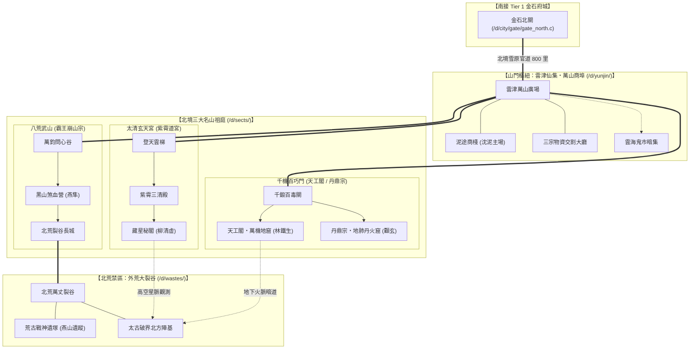
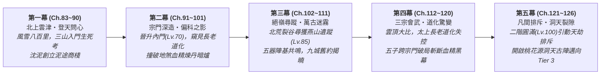

# 《遺忘的世界》第三卷：名山問道・脫俗爭鋒篇 (Volume 3 Outline)

> **卷次定位**：Tier 2 名門名山大派與萬山商埠篇（角色等級 Lv.50 → Lv.100 ／ 技能等級 Lv.101 → Lv.200）  
> **章節規模**：全 44 章（第 83 章 ～ 第 126 章，五幕結構）  
> **關聯正典**：[世界觀與 Mudlib 架構設定集](file:///home/wade/src/github/mudscript/forgotten-space/narrative/world_setting.md) ｜ [小說總大綱](file:///home/wade/src/github/mudscript/forgotten-space/narrative/novel_outline.md) ｜ [第一卷大綱【黑石驚蟄】](file:///home/wade/src/github/mudscript/forgotten-space/narrative/volume1.md) ｜ [第二卷大綱【金石風雲】](file:///home/wade/src/github/mudscript/forgotten-space/narrative/volume2.md) ｜ [核心人物檔案](file:///home/wade/src/github/mudscript/forgotten-space/narrative/character_profiles.md)  
> **核心命題**：**當修行的代價不再只是凡俗的皮肉勞苦，而是「神魂結晶道化（法）」、「氣血如爐枯竭（力）」、「心為外物靈樞所役（物）」時，五位自黑石鋪泥塗走出的少年，如何在名山正統的偏科絕路中守住人性，並撕開名山高層收購「地煞血精」延命的萬古黑幕？**

---

## 一、第三卷核心定位與世界觀躍遷 (Core Positioning & Tier 2 World Transition)

### 1.1 從「紅塵入世（Tier 1）」到「名山問道（Tier 2）」的本質跨越
如果說第一卷【黑石驚蟄】是**「絕境求生」**，第二卷【金石風雲】是**「在世俗制度與城鄉網絡中立身破局」**，那麼第三卷【名山問道】則是五位主角真正踏入當世修行界最高殿堂——**北境三大名山大派**，直面三大道統正統傳承的輝煌與致命反噬：

1. **空間尺度的躍遷（三山一埠一裂谷）**：
   - 離開金石府城北關後，北行八百里跨越寒風呼嘯的北境雪原，進入由三大名山祖庭、山腳自由商埠與北荒大裂谷構成的 **Tier 2 名山疆域**：
     - **【法宗大派】太清玄天宮（古稱紫霄道宮）**：矗立於雲頂天柱峰，終年雲海環繞、星罡凜冽。下轄「周天星律院」與「太清雷符殿」，講求順天借法、代天行道（**柳清虛**持玄機真人與星淵保薦令入山）。
     - **【力宗大派】八荒武山／八荒武宗（古號霸王崩山宗）**：盤踞於北荒裂谷南沿的大黑山，直接鎮守外荒獸潮防線。下轄「煞血霸體營」與「破軍重弓塞」，講求血氣化罡、一力破萬法（**燕隼**持霸山總教頭保薦令入山）。
     - **【物宗大派】千機百巧門（下轄「天工閣」與「丹鼎宗」兩大主脈）**：依傍萬仞天工山龐大地肺火脈而建。分為專精重型機關獸、地火百煉與重樓陣圖的器道主脈**【天工閣】**（**林鐵生**持歐陽大師與莫錘保薦令入山），以及專司靈草百毒、地肺丹火與生機改造的藥道主脈**【丹鼎宗】**（**顧玄**持白鶴年與孫先生保薦令入山）。
     - **【山門樞紐】雲津仙集（萬山商埠）**：坐落於三大名山交匯處的雲海峽谷盆地。名山清高自持，不直接經營凡俗貨殖，一切外門丹藥、礦材、符紙、軍糧、靈石票據與黑市暗標皆在此集散。**沈泥**不入任何封閉宗門，持【金石商會與通寶跨州特等通行信印】於此創立**「泥途商棧」**，成為串聯三山四脈、調度跨宗門物資與情報的自由樞紐。
     - **【北荒禁區】北方外荒大裂谷与太古破界陣基**：大黑山以北的萬里凍土裂谷，地煞狂暴、荒獸橫行，深處掩埋著五年前「走山令」探險隊失蹤的遺骸與太古破界方舟的北方主陣基。

2. **三道偏科的極致反噬（The Price of Extreme Specialization）**：
   在 Tier 1 金石府城中，三道尚處於打基礎的「凡俗技藝延伸」階段；一旦踏入 Tier 2 名山深造，二階功法直接觸及天地法則與生命本源，太古大清洗後「三才割裂」的致命缺陷全面爆發：
   - **【法道反噬：清修道化（Crystallization）】**：
     太清玄天宮弟子引九天星力洗刷神魂，算力與術法威能暴漲；但借法越深，七情六慾越發冷漠，眼眸逐漸泛起無機質的淡青晶光。宮中歷代高階長老所謂「閉關坐化、白日飛升」，實則是神魂與肉身徹底玉化為冰冷的「道化晶石」，淪為修補「二十八宿天羅假天牢籠」的活體電池。
   - **【力道反噬：氣血枯竭（Vitality Burnout）】**：
     八荒武山武修引北荒煞氣入髓，氣血如烘爐般沸騰，肉身可硬撼神兵荒獸；但過度壓榨生機導致五臟六腑提前乾涸炭化，高階武師表面氣吞萬里，暗地裡卻長年咳出黑血、神智易陷狂躁嗜殺，壽元往往不過五十。
   - **【物道反噬：外物奴役（Material Enslavement）】**：
     千機百巧門（天工閣／丹鼎宗）追求「人巧奪天」，但二階重型機關傀儡與高階靈丹極度依賴罕見外物與**高純度地煞血精晶錠**；部分狂熱長老甚至將自身經絡改造成外物靈樞，或以活體試藥，一旦外物斷供或靈樞反噬便頃刻崩潰。

3. **制度性悲劇：名山高層為何收購「地煞血精」？**
   - 拒絕臉譜化的「邪惡反派」設定：三大名山的執事與高階長老之所以暗中透過無標記經生、向金石商會等世俗白手套大宗收購沾滿礦工鮮血的「地煞血精晶錠」，**並非為了修煉魔功毀滅世界，而是因為「地煞血精」中蘊含的狂暴大地濁氣與生靈血怨，竟是唯一能暫時中和「假天清氣道化結晶」、替力宗長老「續接乾涸氣血」、以及替物宗「驅動鎮山古傀抵禦北荒獸潮」的救命禁藥！**
   - 為了延緩自身道化、為了維持名山鎮壓北荒的体面與統治，高高在上的名山仙長們默許了世俗商會的殘酷開採，甚至在三十年前「舊商盟」拒絕配合大規模血精提煉時，降下旨意抹除了舊商盟。這構成了第三卷最震撼的制度與人性衝突。

---

## 二、前兩卷未解伏筆回收與跨卷推進總表 (`FS-01 ~ FS-07` Continuity Ledger)

第三卷嚴格承接第一卷（Ch.1~38）與第二卷（Ch.39~82）埋下的七大核心伏筆，明確劃定本卷「回收揭曉」與「留待第四、五卷終局」的邊界：

| 伏筆編號 | 第一、二卷已建立之線索 | 第三卷（Ch.83 ~ Ch.126）核心推進與回收 | 留待第四、五卷（Tier 3 ~ 4）之終局懸念 |
| :--- | :--- | :--- | :--- |
| **`FS-01`** 逆星斷碑與周天歲差 | 黑石鋪溪灘拓片（Ch.1）、摘星台百年歲差與星淵北境手札（Ch.50, 81）。 | 柳清虛在太清玄天宮「藏星秘閣」比對歷代星圖，證實天幕星軌每三百年被強行「人工校準」一次；逆星斷碑記載的才是太古大清洗前的**真實星空座標**。 | 誰在操控三百年一次的星軌校準？假天中樞位於何處？ |
| **`FS-02`** 太古不融黑鐵與機關城 | 鐵匠鋪黑鐵齒輪（Ch.2）、礦底太古機關城裂隙（Ch.17）、名山經生高價求購（Ch.81）。 | 林鐵生在天工閣「萬機地窟」發現鎮派之寶【太古天工母機殘骸】，其核心缺失的傳動構件正與鐵生手中的黑鐵齒輪同源；揭開三大名山腳下實為同一座太古巨型破界方舟的三大艙段。 | 如何重啟整座太古破界方舟，打破假天封鎖？ |
| **`FS-03`** 燕山走山令與戰神圖騰 | 東林戰神圖騰玄柱（Ch.3）、鎮風縣五年前「走山令」與燕山失蹤（Ch.62）。 | 燕隼在北荒大裂谷深處尋獲五年前「走山令」探險隊覆滅遺址與【荒古戰神遺塚】，找到二叔燕山留下的絕筆骨箭與護心鏡，查明探險隊因撞破名山長老私掘北荒血精主脈而遭獸潮圍困；燕山重傷未死，被吸入裂谷底層的異界洞天裂隙。 | 燕山在 Tier 3 異界洞天（戰祖魔殿／桃花源）的生死現況？ |
| **`FS-04`** 假天牢籠與道化結晶 | 殘壇玉化晶骨（Ch.4）、枯木自剜雙目、靜心閣斬心魔（Ch.80）。 | 柳清虛與顧玄聯手解剖名山「坐化長老」遺蛻與道化病理，證實假天靈氣中摻有「同化神魂孢子」；單修一脈必死，唯有引【物道百草地脈】與【力道氣血陽火】三元互濟，方能剝離道化晶簇。 | 如何徹底淨化九天靈氣中的道化法則？ |
| **`FS-05`** 天門引與九城古商盟舊約 | 廢柴房天門引（Ch.5）、當鋪死帳與雲記身世（Ch.51, 65）、天字密室與九城青銅契版（Ch.73, 77）。 | 沈泥於雲津仙集尋獲舊商盟北方總號遺址，拼合第二塊青銅契版，完成**身世揭露第五階段（舊約內容）**：太古九城商盟並非普通商會，而是負責為「太古破界工程」調配九州萬物的後勤契約總盟；三十年前舊商盟拒絕將契約網轉為名山開採血精的奴工網，遂遭三大名山外門執事聯手金石商會血洗。 | 第六階段：如何在 Tier 4 重啟九城萬物總約，成為重構人間秩序的「最後贏家」？ |
| **`FS-06`** 地煞血精終端買家 | 黑石鋪盜採（Ch.13~18）、六縣提純暗網與三萬斤血精正底單（Ch.58~75）、無標記名山經生（Ch.77）。 | **本卷完全回收閉環**：查明丹鼎宗鶴壽長老、天工閣赤煉長老與太清宮執法長老暗中結成「延命私盟」，以無標記經生收購世俗血精，在丹鼎宗地肺暗爐煉製【逆道延命血丹】；於第四幕三宗會武當眾揭破並徹底斬斷血精黑幕。 | 名山長老之上，Tier 3 異界洞天是否也在收割二階圓滿修士？ |
| **`FS-07`** 五器共鳴與破界古陣 | 小棧五器合鳴凝結星光指針直指北方（Ch.82）。 | 五子集齊五件太古遺物，於北荒裂谷陣基與名山祖庭地底引發第二次高階共鳴，解鎖通往 Tier 3【桃花源／異界洞天】的單向太古傳送陣。 | 洞天世界背後的「飛升收割」真相？ |

---

## 三、二階五維能力演進與名山制度邊界 (`Tier 2 Mechanics & Operating Rules`)

為確保第三卷不落入傳統修仙小說「進宗門就是打怪刷副本、換地圖重複套路」的窠臼，嚴格鎖定以下五項 **Tier 2 運作規則 (`[RULE]`)**：

### 3.1 二階五維能力分離模型 (`path / skill / qualification / affiliation / access`)
延續第二卷的五維分離架構，名山宗門內部同樣存在嚴格的制度與權限階梯：

| 維度 | Tier 2 定義與表現 | 顧玄 (丹鼎宗) | 林鐵生 (天工閣) | 燕隼 (八荒武山) | 柳清虛 (太清玄天宮) | 沈泥 (雲津仙集) |
| :--- | :--- | :--- | :--- | :--- | :--- | :--- |
| **`path`** (二階道途) | 突破 Lv.50 後的生命進化方向 | `gong_danding` (靈樞藥師) | `gong_tiangong` (天工機師) | `wu_bahuang` (煞血戰修) | `dao_taiqing` (太清星官) | `society_yunjin` (萬山大行商) |
| **`skill`** (Lv.101~200) | 二階高深功法與百工造詣 | 地肺控火、生機續脈、道化剝離 | 重機構造、地火百煉、陣基應力 | 煞血霸體、破軍穿雲、荒獸搏殺 | 周天星算、太清雷符、紫微破妄 | 跨山門匯兌、靈石期貨、古契破譯 |
| **`qualification`** (執業／品階) | 宗門與商埠認可之專業品階 | 三品靈丹師 (`cert_alchemist_t2`) | 三品天工匠師 (`cert_artificer_t2`) | 北荒破軍校尉 (`cert_vanguard_t2`) | 欽天司星執事 (`cert_astrologer_t2`) | 萬山商埠總牙首 (`cert_syndic_t2`) |
| **`affiliation`** (宗門編制) | 記名外門 $\to$ 內門入室 $\to$ 親傳／執事 | 丹鼎宗百草谷入室弟子 | 天工閣千機院入室弟子 | 八荒武山黑山營親傳銳士 | 太清玄天宮觀星院入室道士 | 雲津仙集「泥途商棧」東家（自由身） |
| **`access`** (禁地權限) | 憑宗門玉牌／功勳開啟之高危場域 | 地肺丹火窟、百毒藥園、廢丹崖 | 萬機地窟、地火鍛兵台、古傀庫 | 煞血池、大黑山長城、北荒前哨 | 藏星秘閣、天柱觀星台、雷罡崖 | 萬山靈石金庫、三宗交割廳、北荒暗集 |

### 3.2 雲津仙集（萬山商埠）與三大名山的共生與制衡
1. **為何三大名山需要雲津仙集？**
   - 三大名山雖掌握超凡武力與法術，但數千名外門弟子與雜役的米糧、禦寒皮毛、基礎藥材、精鐵碳石，乃至長老所需的世俗罕見礦物，皆須仰賴凡俗九州輸入。
   - 三宗彼此猜忌，誰也不願讓對方掌控補給咽喉，遂在三山交匯的雲津峽谷劃定中立區**【雲津仙集（萬山商埠）】**，由持「跨州行商總勘合」的民間大商號駐點經營。
2. **沈泥的「泥途商棧」核心機制**：
   - 四位同伴在三大名山中修行，受限於森嚴門規與宗門貢獻點（`sect_merit`）盤剝，初期連換取一爐高階丹藥或一塊百煉星鐵都極為艱難，更無法跨宗門互通有無。
   - 沈泥在雲津仙集建立「泥途商棧」，利用三宗外門物資價差、廢丹殘鐵回收改造（顧玄提純廢丹、鐵生修復殘器、燕隼獵取北荒獸材、清虛預判北境暴風雪物價週期），打造出一條**「五子跨山門自給自足與情報互鎖網絡」**！

### 3.3 「反噬度（Corrosion / Burnout Index）」與三元互濟破局
- 在二階修行中，單一門派功法練至深處（Skill Lv.150+）必會累積**「偏科反噬度」**（法修累積「晶化度」、力修累積「燥火度」、物修累積「外物依賴度」）。
- 名山正統長老依靠吞服「地煞血精禁丹」強行壓制，實則飲鴆止渴；而五位主角則因為彼此跨宗門的深厚羈絆，在沈泥的雲津商棧暗中聚首，摸索出**「以物道藥理調和力道燥火、以力道陽剛氣血震碎法道晶化、以法道清明神識錨定物道機巧」**的**三元互濟雛形**，為第五卷的「三元歸一」奠定堅實的科學與實踐基礎。

---

## 四、第三卷空間拓撲與 Mudlib 規劃藍圖 (`/d/yunjin/`, `/d/sects/`, `/d/wastes/`)

---

## 五、第三卷五幕 44 章（Ch.83 ~ Ch.126）詳細章節大綱

---

### 【第一幕：北上雲津・登天問心】（第 83 ～ 90 章，共 8 章）
> **幕核心目標**：完成從 Tier 1 世俗府城到 Tier 2 名山仙集的空間與制度過渡；展現名山大派對凡俗修士的傲慢篩選與殘酷入門大考；建立沈泥在「雲津仙集（萬山商埠）」的跨宗門樞紐地位。  
> **等級推進**：`Lv.50 → Lv.55`（完成二階外門立籍與初階洗禮）

* **第 83 章：風雪北境・八百里寒原**
  * **主視角**：群像（燕隼、顧玄主導）
  * **劇情大綱**：五子與莫三辭別金石府城北關，踏上前往北境名山的八百里雪原古道。越往北行，天地靈氣越發凜冽刺骨，尋常凡人吸入肺中如吞刀割（展現 Tier 2 環境門檻）。途中遭遇自名山外門被淘汰遣返、經脈半廢的世俗武師與藥師，初次聽聞「名山視凡人如草芥、外門十不存一」的殘酷現實；燕隼於風雪中發現北荒異種雪豹蹤跡，顧玄以葛半仙所贈野菊草籽配製抗寒湯劑護持車隊。
* **第 84 章：雲津仙集・萬山商埠的規矩**
  * **主視角**：沈泥
  * **劇情大綱**：抵達三大名山腳下的雲海峽谷樞紐【雲津仙集（萬山商埠）】。此地通用的不再僅是凡俗銀兩，而是按靈氣純度折算的「萬山靈石票」與「三宗外門供奉額」。沈泥持蘇凝霜與賈朝奉聯署的【跨州特等通行信印】前往商埠總公所登記，遭依附名山的北境大商號「萬寶閣」掌櫃刁難，要求繳納天價保證金；沈泥敏銳抓住三宗外門冬季急需大宗烈礬耐火炭與青河凍瘡膏的供需缺口，以金石府六縣直供契約反客為主，成功在商埠西街盤下一座廢棄貨棧，掛牌**【泥途商棧】**。
* **第 85 章：三山開門・仙凡分界線**
  * **主視角**：群像
  * **劇情大綱**：三年一度的三大名山外門開山大考將啟，各地持保薦令的世家子弟與寒門修士雲集雲津廣場。五子在泥途商棧後院吃下離別前的團圓火鍋，約定每逢朔望以商棧貨單暗語互通消息。次日清晨，柳清虛、燕隼、林鐵生、顧玄各自持【Tier 2 名山外門考核令】，分別踏上太清玄天宮、八荒武山、千機百巧門（天工閣／丹鼎宗）的山門考場。
* **第 86 章：千丈登天梯・太清問心鏡（柳清虛線）**
  * **主視角**：柳清虛
  * **劇情大綱**：柳清虛攀登太清玄天宮的「千丈登天雲梯」。雲梯設有引動九天星煞的「太清問心陣」，強迫考核者放棄凡塵牽掛、順從天道威壓；同批世家修士紛紛磕頭臣服以求減輕威壓，唯獨柳清虛謹記枯木老道「別信這片天」之訓，以實證心算看破問心陣的星力節點公差，背脊挺直踏上雲頂，被「周天星律院」執事破格錄為外門上等經生。
* **第 87 章：萬鈞問心谷・煞血試煉場（燕隼線）**
  * **主視角**：燕隼
  * **劇情大綱**：燕隼進入八荒武山的「萬鈞問心裂谷」。考核並非單純比武，而是要在狂暴北荒地煞沖刷下，赤手空拳穿過棲息著二階「鐵背荒狼」的百里黑石峽。許多武師因強行催動氣血導致經脈爆裂或淪為嗜血狂徒；燕隼憑藉獵戶的隱忍直覺、盤石步法與對獸群領頭習性的預判，不浪費一分氣血，一人一弓精準射殺頭狼通過考核，並引起鎮守黑山營的獨臂老將「狂刀雷烈」（當年曾與燕山並肩作戰）的注意。
* **第 88 章：千鍛地火廊・萬機拆解考（林鐵生線）**
  * **主視角**：林鐵生
  * **劇情大綱**：林鐵生踏入千機百巧門器道主脈【天工閣】的「千鍛地火廊」。主考官要求眾匠師在兩個時辰內修復一具損壞的二階「青銅搬山傀儡」關節。世家匠師紛紛堆砌昂貴秘銀與符文，卻因不識內部剪切應力而炸膛；鐵生不看花俏符紋，以阿鐵精鋼卡尺與百工格物心眼量出核心傳動軸半厘偏角，以最樸素的雙契榫與地火重鍛將其完美復原，獲天工閣外門執事魯班門人收錄。
* **第 89 章：百毒試藥谷・生機辨偽考（顧玄線）**
  * **主視角**：顧玄
  * **劇情大綱**：顧玄進入千機百巧門藥道主脈【丹鼎宗】的「百毒試藥谷」。考核要求在十株受高濃度地煞侵蝕而變異的二階靈草中，煉製出不傷經脈的辟煞散。多數丹師習慣以霸道丹火強行焚毀雜質，導致藥性盡失或殘留火毒；顧玄以大荒草醫的微觀病理視角，發現變異靈草根部寄生的「雪線苔」恰是中和地煞的天然引子，以溫火冷萃法成藥，技驚四座，入丹鼎宗百草谷。
* **第 90 章：泥途立契・五子暗網初成**
  * **主視角**：沈泥
  * **劇情大綱**：四子雖通過大考進入三山外門，卻立即面臨名山外門嚴苛的「歲貢與功勳考核」——外門弟子每月須上繳定額靈草、精鐵或獸核，否則將被貶為礦奴或試藥童。沈泥在雲津仙集接待首批下山採買的外門管事，敏銳洞悉三宗外門管事中飽私囊的灰色帳目，以「泥途商棧代辦大宗平價交割」切入，正式打通與四子傳遞物資與密信的暗線。

---

### 【第二幕：宗門深造・偏科之影】（第 91 ～ 101 章，共 11 章）
> **幕核心目標**：四子在各自宗門修習二階核心功法，實力大幅躍升（`Lv.55 → Lv.70`）；同時親眼目睹三大道統高階修士「道化結晶」、「氣血枯竭」、「外物奴役」的恐怖真相，並分別從觀星、邊塞、古傀、煉丹四個維度撞破名山高層收購「地煞血精」的黑幕。  
> **等級推進**：`Lv.55 → Lv.70`（晉升三山內門入室弟子／萬山商埠二等總牙）

* **第 91 章：藏星秘閣・被篡改的星曆**
  * **主視角**：柳清虛
  * **劇情大綱**：柳清虛因心算歲差精準，獲准進入太清玄天宮內門「藏星秘閣」整理歷代星圖。他在核對三百年前與六百年前的《紫微星官錄》時，駭然發現每逢三百年甲子大劫，漫天星宿的運行軌跡都會出現一次整齊劃一的「人工修正偏移」，而口袋中的黑石鋪【逆星斷碑拓片】微熱共鳴——原來當世法修所借的「天道星力」，竟是一座每隔三百年自動收緊的巨型法陣！
* **第 92 章：坐化真相・紫霄殿後的玉雕長老**
  * **主視角**：柳清虛
  * **劇情大綱**：太清玄天宮一位修為高達 Lv.92 的內門傳功長老「鶴鳴真人」宣告功德圓滿、閉關坐化飛升。柳清虛奉命隨執事前往後山「升仙台」奉香，卻在罡風吹開帷幕的一瞬，看見所謂「白日飛升」的鶴鳴真人並未羽化登仙，而是全身骨骼血肉徹底化作一尊沒有呼吸、卻仍在源源不斷向天幕輸送靈力的淡青色人形晶石！清虛道心劇震，徹底印證了第一卷殘壇晶骨的「道化」真相。
* **第 93 章：煞血霸體・黑山長城的咳血宿將**
  * **主視角**：燕隼
  * **劇情大綱**：燕隼在八荒武山修習二階《煞血霸體訣》與《破軍開山弓》，隨黑山營開赴北荒裂谷長城防線獵殺二階荒獸。他在營帳中目睹威震北荒的雷烈將軍與數位 Lv.85+ 的武山長老，每逢子夜便因「氣血如爐焚烧五臟」而痛苦不堪，必須吞服一種散發著熟悉腥甜硫磺味的暗紅丹丸方能止痛——那氣味，竟與黑石鋪和濁水縣提煉的「地煞血精」一模一樣！
* **第 94 章：斷崖骨箭・五年前的走山血痕**
  * **主視角**：燕隼
  * **劇情大綱**：燕隼藉巡防裂谷外圍之機，按鎮風縣所得【玄鐵走山令殘牌】上的方位，冒險深入黑山東側的「鬼哭冰澗」。在一處被冰層封凍的岩縫中，他發現了一支刻著燕家老鷹記號的斷折狼牙重箭，以及半塊染血的八方武館舊皮甲。雷烈將軍暗中現身，沉痛告知燕隼：五年前其二叔燕山受金石商會與名山密使重金聘請，作為嚮導護送一隊名山內門執事進入北荒裂谷深處勘探「太古血精母脈」，結果全隊遭背叛遺棄於裂谷深淵。
* **第 95 章：萬機地窟・同源的太古黑鐵**
  * **主視角**：林鐵生
  * **劇情大綱**：林鐵生憑藉精湛鍛藝晉升天工閣內門「萬機地窟」，參與維護天工閣鎮山重器——高約十丈的太古遺留機關巨像【巨靈神機】。在清理巨像胸腔主傳動軸時，鐵生懷中的【太古不融黑鐵齒輪構件】產生強烈磁吸震顫！他驚愕地發現，這尊被天工閣奉為神物的巨像，實則是太古某座超巨型工程方舟的「右翼推進錨機」，而天工閣赤煉長老正試圖以高純度「地煞血精晶柱」強行塞入動力槽催動巨像。
* **第 96 章：地肺丹火・逆道延命的血爐**
  * **主視角**：顧玄
  * **劇情大綱**：顧玄因精通毒理生剋，被丹鼎宗內門大長老「鶴壽真人」調入地底三百丈的「地肺丹火窟」擔任控火藥童。在一次深夜輪值中，顧玄透過通風石隙聞到濃烈的「丙字柒號坩堝」提純血精氣息，親眼撞見鶴壽真人與太清玄天宮、天工閣的密使交割成箱的【地煞血精晶錠】，並以活體荒獸心頭血配伍血精，煉製專門用來壓制長老「道化結晶」與「氣血乾涸」的禁藥——**【逆道延命血丹】**！
* **第 97 章：廢丹崖下・道化與血毒的病理實驗**
  * **主視角**：顧玄
  * **劇情大綱**：顧玄冒險在丹鼎宗後山「廢丹崖」收集鶴壽真人廢棄的丹渣與試藥白猿屍骸，秘密解剖化驗。他運用「從自然與病理理解世界」的本領，得出驚人結論：地煞血精雖然能以狂暴濁氣暫時腐蝕道化晶簇，但同時會在修士臟腑內種下不可逆的「血煞癌變」，一旦停藥，修士會在三日內全身結晶爆裂而亡！名山高層早已淪為地煞血精的成癮囚徒。
* **第 98 章：萬山匯兌・無標記經生的尾巴**
  * **主視角**：沈泥
  * **劇情大綱**：雲津仙集的「泥途商棧」生意日隆，沈泥與莫三透過追蹤商埠內大宗「無瑕二階靈石」與「金石府私運血精」的暗市交割，鎖定了當年在金石府鬼市收購血精的那批「無標記灰袍經生」。沈泥利用「萬寶閣」與三宗外門管事的帳目矛盾設局，截獲了一份灰袍經生遺落的【北境三宗延命私盟密帳索引】，發現金石商會錢百川不過是他們在南方十三府培養的七個白手套之一。
* **第 99 章：風雪夜聚・泥途商棧的五方對帳**
  * **主視角**：群像
  * **劇情大綱**：大雪封山之夜，四子藉宗門採買與換防假期，秘密齊聚雲津仙集「泥途商棧」地窖。五人將藏星秘閣星曆、燕山走山血箭、巨靈神機黑鐵、地肺血丹病理與延命私盟密帳攤在桌上——五條跨越法、力、物、商的線索完美閉合！五人震駭地意識到：三大名山並非超然物外的聖地，其部分頂層長老為苟延殘喘，早已與地煞血精黑網深度綁定。
* **第 100 章：三元互濟・初試剝離道化晶絲**
  * **主視角**：群像
  * **劇情大綱**：柳清虛在連月推演《太清周天星訣》突破 Lv.70 後，左腕經絡竟浮現出一縷細微的淡青色「道化晶絲」，指尖漸失知覺。五子不願清虛重蹈枯木老道自殘或名山長老吞服血精禁丹的覆轍，由顧玄施展九轉銀針引導青河靈草生機，林鐵生以不融黑鐵高頻震波共振晶絲結構，燕隼度入精純陽剛氣血，沈泥在旁精準計時控溫，竟成功將那縷道化晶絲完整剝離排出！五子首次以實踐驗證：**三元互濟，方是破解假天道化的唯一正途！**
* **第 101 章：暗流反撲・延命私盟的警覺**
  * **主視角**：沈泥、柳清虛
  * **劇情大綱**：金石府錢百川倒台導致南方血精斷供三成，丹鼎宗鶴壽長老與太清宮執法長老震怒，派人徹查雲津仙集與新晉弟子底細。萬寶閣聯合執法堂以「私通外州違禁藥材」為名突擊查封泥途商棧外庫；沈泥早有防備，憑藉三宗外門管事親筆簽署的代購紅契與莫三轉移暗帳，讓執法堂無功而返，但五子深知：被動防守無法破局，必須主動深入北荒裂谷，拿到足以引爆三宗正統根基的終極鐵證與太古陣基力量！

---

### 【第三幕：絕嶺尋蹤・萬古迷霧】（第 102 ～ 111 章，共 10 章）
> **幕核心目標**：五子藉由三大名山聯合發起的「北荒裂谷冬獵與礦脈勘探」任務，深入北方外荒大裂谷（`Lv.70 → Lv.85`）；尋獲燕山與五年前走山隊的遺留真相，觸發五件太古遺物在「北方破界主陣基」的第二次高階共鳴，並揭開沈泥【九城古商盟銅券】第五階段舊約。  
> **等級推進**：`Lv.70 → Lv.85`（晉升名山真傳候選／北荒破軍校尉）

* **第 102 章：北荒冬獵・三宗聯合勘探隊**
  * **主視角**：燕隼、林鐵生
  * **劇情大綱**：因南方金石府血精斷供，名山高層以「北荒裂谷地脈異動、加固長城陣基」為名，組建三宗內門精銳聯合勘探隊深入外荒裂谷（實則企圖重啟五年前未竟的「北荒血精母脈」開採）。燕隼、林鐵生、顧玄、柳清虛憑內門優異表現入選隨行，沈泥則以「泥途商棧隨軍輜重總辦」身分攜莫三押運後勤雪橇同行。
* **第 103 章：萬丈凍土・大荒三階凶獸之威**
  * **主視角**：燕隼、顧玄
  * **劇情大綱**：勘探隊踏入北荒大裂谷第二層「永凍血原」。地煞濃烈如紫霧，棲息於此的荒獸已具二階頂峰（Lv.80+）戰力。隊伍遭遇「雙頭霜甲地龍」伏擊，世家內門弟子陣型大亂；燕隼立於雪橇高處連開五石鐵胎重弓，以狼牙破甲箭貫穿地龍逆鱗，顧玄甩出特製「沸血雄黃煙」封鎖地龍毒息，林鐵生以飛爪滑輪鎖死地龍巨尾，五子默契配合成為全隊支柱。
* **第 104 章：走山絕谷・五年前的背叛現場**
  * **主視角**：燕隼
  * **劇情大綱**：深入裂谷三百里後，燕隼依據二叔燕山骨箭上的猎戶暗記，在暴風雪夜脫離大營，帶領四位夥伴尋至一處被人工爆破坍塌封死的「黑冰斷谷」。谷內保存著五年前二十餘名八方武館好手與走山獵戶的凍屍，石壁上留有燕山以短刀刻下的血書與【下半塊玄鐵走山令】——證實五年前正是天工閣赤煉長老與丹鼎宗鶴壽長老的親信，在利用燕山尋得太古陣基與血精母脈後，引爆山崖殺人滅口！
* **第 105 章：荒古戰神遺塚・不屈的血脈共鳴**
  * **主視角**：燕隼
  * **劇情大綱**：在黑冰斷谷最深處，矗立著一座高逾三十丈的【荒古戰神巨石遺塚】，遺塚旁留有燕山重傷瀕死時爬入一道幽暗空間裂隙（通往 Tier 3 異界洞天之不穩定裂縫）的血跡與隨身護心鏡——證明二叔燕山當年並未斃命於此，而是墜入了更高階的異界洞天！燕隼手握【太古戰神獵獸圖騰骨片】按上遺塚，太古戰神不屈戰意灌入四肢百骸，領悟二階極境《八荒破天弓》與《不滅戰體》，修為破入 Lv.80！
* **第 106 章：地底方舟艙段・北荒破界主陣基**
  * **主視角**：林鐵生、柳清虛
  * **劇情大綱**：穿過戰神遺塚後的裂隙，五子駭然望見永凍冰層下方掩埋著一座方圓數十里的太古巨型金屬遺構——**【太古破界方舟・北荒主引擎陣基】**！所謂的「北荒地煞血精母脈」，根本不是天然礦藏，而是太古破界方舟被「大清洗」擊落時，引擎冷卻管線破裂洩漏出的高能生物質與地脈結晶！名山長老私掘血精母脈，無異於在拆毀整座北境大陸的地脈安全閥。
* **第 107 章：五器再鳴・太古全息星圖開啓**
  * **主視角**：柳清虛、群像
  * **劇情大綱**：五子在方舟主陣基核心圓台之上，同時取出【逆星斷碑拓片】、【太古不融黑鐵】、【戰神圖騰骨片】、【道化晶石殘片】與【萬物行商・天門引】。五器懸空合鳴，嵌合進主陣基的五處凹槽，啟動了沉寂萬載的太古光影紀錄：原來太古時代人族先賢為打破「天外收割者（假天）」布下的二十八宿囚籠，傾九州之力建造破界方舟，三大道統本是方舟上的「導航演算官（法）」、「護衛戰團（力）」與「造物工程師（物）」，三元同心方能運轉方舟；大清洗後，假天篡改記憶、割裂三道，將方舟殘骸鎮壓於三大名山之下！
* **第 108 章：九城銅券合璧・舊約第五階段揭曉**
  * **主視角**：沈泥
  * **劇情大綱**：在方舟後勤主控室內，沈泥以【天門引】與金石府所得【青銅契版殘片】，成功喚醒嵌於控台上的北荒半塊【九城古商盟總契銅版】。兩塊契版嚴絲合縫，正式揭開**沈泥身世第六階段前奏與第五階段「舊約核心內容」**：太古「九城萬物商盟」立下的萬古舊約，是在破界方舟重啟之日，負責統合凡間九州萬民物資、開啟安全避難通道的「人間總調度使」；而三十年前沈家所屬的舊商盟，正是因為發現名山延命私盟企圖抽乾方舟冷卻血精、可能引爆北境地脈陸沉，死守舊約不肯交出開採圖紙，才遭三大名山執法堂聯手金石商會滅門清洗！
* **第 109 章：母脈危機・赤煉長老的瘋狂盜掘**
  * **主視角**：林鐵生、顧玄
  * **劇情大綱**：此時，隨勘探隊潛入裂谷另一側的天工閣赤煉長老與丹鼎宗執事，已動用三十具二階重型鑽山傀儡，強行鑽穿方舟冷卻外殼盜取「萬年血精母液」，導致陣基壓力暴增、地脈毒煞狂噴，數千頭北荒荒獸受驚形成恐怖的二階獸潮！林鐵生與顧玄臨危不亂，顧玄以冷凍丹火凝結洩漏毒液，鐵生將【太古不融黑鐵】嵌入主閥門，順應太古應力結構強行鎖死七成洩漏口。
* **第 110 章：冰谷伏擊・斬殺滅口私盟執事**
  * **主視角**：群像
  * **劇情大綱**：赤煉長老的心腹大執事（Lv.88）發現五子竟開啟了內層陣基並掌握了五年前殺害燕山小隊與今日盜掘母脈的鐵證，率領十二名死士與重型機關獸封鎖冰谷企圖重演五年前的滅口慘劇。五子依託太古陣基地形展開生死反擊：清虛以紫微星陣扭曲敵方術法彈道，鐵生精準敲碎機關獸應力關節，顧玄以腐金毒煙癱瘓死士護甲，沈泥算準冰崖雪崩延遲，燕隼於百步外張滿五石重弓，一箭貫穿大執事咽喉！
* **第 111 章：攜證歸山・暴風雨前的寧靜**
  * **主視角**：沈泥、柳清虛
  * **劇情大綱**：五子將盜掘現場的【名山內造鑽頭殘件】、【血精母液封裝玉瓶】與【五年前燕山走山血書】嚴密封存，隨大隊返回雲津仙集。此時五人修為皆已臻至二階高階（Lv.85），沈泥開始透過「泥途商棧」聯絡三大名山內部反對血精私盟的正義宿老（如八荒武山雷烈將軍、天工閣魯長老、太清宮苦修派），將反擊舞台鎖定在一個月後三宗十年一度的盛會——**【雲頂三宗論道會武】**！

---

### 【第四幕：三宗會武・道化驚變】（第 112 ～ 120 章，共 9 章）
> **幕核心目標**：在三大名山十年一度的「雲頂論道會武」與萬山商埠靈石清算中，五子從武技、丹器、陣算與金融四條戰線全面壓制私盟嫡系；當私盟太上長老因強壓道化失控引發「半山結晶異變與獸王叩關」時，五子跨宗門力挽狂瀾，當眾審判延命私盟，完成三十年前舊商盟與五年前走山隊的昭雪。  
> **等級推進**：`Lv.85 → Lv.95`（二階巔峰，威震北境三山）

* **第 112 章：雲頂盛會・十年一度的三宗會武**
  * **主視角**：群像
  * **劇情大綱**：三大名山十年一度的「雲頂論道會武」於雲津仙集上方的「問道天台」盛大開啟，旨在透過三宗年輕一代的比試，重新劃分未來十年北境靈脈與萬山商埠的稅賦份額。延命私盟的三大長老（太清宮執法長老玄冥、丹鼎宗鶴壽長老、天工閣赤煉長老）企圖讓各自培養、暗中服用微量血精催谷修為的嫡傳弟子奪魁，藉機獨攬北荒裂谷的封鎖開採權。
* **第 113 章：百工丹器試・不融黑鐵與無瑕清丹**
  * **主視角**：林鐵生、顧玄
  * **劇情大綱**：會武第一場為「百工器丹雙絕試」。赤煉長老首徒祭出以血精催動的二階巔峰「煞火魔偶」，霸道無匹；林鐵生手持六十斤烏金錘登台，不靠半點邪異血精，純憑「百工格物心眼」與太古公差應力，三錘震斷魔偶內部受血精腐蝕變脆的傳動主軸！同場丹試中，顧玄當眾以銀針與試藥靈草驗出鶴壽長老首徒所煉「九轉增元丹」中暗藏地煞血毒，並以一爐純淨無瑕的「三元生機丹」奪下丹器雙魁。
* **第 114 章：雲頂演武・破軍重弓對決紫霄神雷**
  * **主視角**：燕隼、柳清虛
  * **劇情大綱**：會武第二場為「力法演武大比」。燕隼對陣八荒武山私盟一脈的狂暴武師，在對方燃燒血精化作血魔之際，燕隼以磐石千斤墜與荒古戰神血脈正面硬撼，一箭震碎其護心血甲；壓軸戰中，柳清虛對決太清玄天宮執法長老首徒，面對漫天紫霄雷網，清虛以「逆星歲差算」提前半息踏入雷網死角，並以三元互濟之純淨靈力一指點破對方眉心暗藏的道化晶斑，震驚三山觀禮弟子。
* **第 115 章：萬山商戰・靈石期貨與血精斷供**
  * **主視角**：沈泥
  * **劇情大綱**：會武台下，沈泥在雲津仙集「三宗交割大廳」發動總攻。延命私盟因北荒母脈被鐵生鎖死七成、南方金石府斷供，導致庫存血精徹底見底，私盟控制的「萬寶閣」挪用三宗外門五百萬靈石準備金試圖高價強購黑市存貨；沈泥聯合賈朝奉北上傳來的跨州匯票與三宗外門管事，當眾要求萬寶閣現貨交割，瞬間引爆萬寶閣虧空破產，將延命私盟的資金鏈與地下密帳徹底攤在陽光之下！
* **第 116 章：當眾質證・三十年血債與走山鐵證**
  * **主視角**：群像
  * **劇情大綱**：在萬山交割大廳與問道天台數千名三宗弟子面前，沈泥、燕隼、柳清虛、林鐵生、顧玄與雷烈將軍同時呈上【三十年前舊商盟滅門密令與九城銅券】、【五年前燕山走山血書與走山令】、【地肺丹火窟血丹病理】與【北荒方舟陣基盜掘鐵證】。三宗掌門與不知情的宿老震怒，責令鶴壽、赤煉、玄冥三位長老當場自辯。
* **第 117 章：道化驚變・半山晶簇的活體地獄**
  * **主視角**：柳清虛、顧玄
  * **劇情大綱**：眼看罪證確鑿、且斷絕血丹超過七日的鶴壽長老與玄冥長老走投無路，竟在問道天台上當眾捏碎最後一瓶高濃度「北荒血精母液」強行吞下，企圖晉入三階強行鎮壓全場！然而正如顧玄病理推演所料，血精與兩人體內積壓百年的「假天道化晶種」發生劇烈逆反——兩位高高在上的名山長老在數千弟子驚恐的目光中，半邊身軀瘋狂長出刺穿血肉的淡青色道化晶簇，另半邊身軀則化為腐爛流膿的血煞怪物，神智徹底喪失，將整座問道天台半邊山峰同化為致命的「結晶毒域」！
* **第 118 章：北荒破關・內外夾擊的滅頂之災**
  * **主視角**：燕隼、林鐵生
  * **劇情大綱**：問道天台大陣因長老道化異變而崩潰，北荒大裂谷方向失去陣法壓制，一頭接近三階（Lv.98）的【北荒裂谷獸王・冰獄骨龍】率領萬千荒獸趁勢衝擊大黑山長城！三大名山瞬間陷入「內有道化結晶長老肆虐、外有北荒獸王破關」的滅頂之災，無數單一偏科的內門弟子在道化晶霧與獸潮雙重打擊下潰不成軍。
* **第 119 章：五子合擊・三元大陣鎮山河**
  * **主視角**：群像
  * **劇情大綱**：生死存亡之際，沈泥坐鎮雲津仙集泥途商棧，以跨州總勘合緊急調動全埠民間商隊的火油、精鐵、解毒散與床弩運上山門；顧玄調配百草中和藥霧阻隔道化孢子擴散；林鐵生重啟天工閣【巨靈神機】並以黑鐵齒輪校準應力，死死頂住崩塌的長城關門；柳清虛於天柱峰頂主持周天逆星陣鎖定失控長老與骨龍氣機；燕隼立於巨靈神機肩頭，匯聚全營武修氣血與雷符之力，射出驚天動地的「三元破界箭」，一舉貫穿道化怪物的晶核並重創冰獄骨龍！
* **第 120 章：名山重整・雲津新約與舊案昭雪**
  * **主視角**：沈泥、群像
  * **劇情大綱**：大劫平息，鶴壽、玄冥、赤煉等延命私盟首惡伏誅。三大名山掌門與宿老面對滿目瘡痍的結晶山峰，不得不承認「單修一脈終致道化或枯竭」的殘酷真相，正式廢除血精私採，公開為三十年前舊商盟與五年前燕山走山隊立碑昭雪。沈泥代表「雲記」舊盟後人，與三大名山及雲津眾商號簽署全新的**《雲津萬山互市公約》**，確立民間商盟與名山平起平坐的契約地位。

---

### 【第五幕：凡間排斥・洞天裂隙】（第 121 ～ 126 章，共 6 章）
> **幕核心目標**：歷經三宗大劫與三元合擊，五子各自突破至 **Tier 2 圓滿（Lv.100，技能 Lv.200）**；隨即觸發凡間殘缺天道的「天道排斥」與滅世雷劫鎖定；五子啟動三大名山祖庭地底的「桃花源／異界洞天」單向古傳送陣，踏入第四卷【洞天避難（Tier 3）】。  
> **等級推進**：`Lv.95 → Lv.100`（Tier 2 脫俗大圓滿，邁向 Tier 3 異界洞天）

* **第 121 章：百草通玄与天工開物（顧玄、林鐵生破境 Lv.100）**
  * **主視角**：顧玄、林鐵生
  * **劇情大綱**：戰後休整中，顧玄結合道化晶簇樣本與北荒靈草，撰成《三元本草祛道錄》，雙手生機與毒理臻至化境，突破至二階圓滿（Lv.100）；林鐵生將【太古不融黑鐵】與巨靈神機應力核心完全參透，鍛造出可承受三元靈力流轉的「百煉天工護具」，百工造詣同步臻至二階圓滿（Lv.100）。
* **第 122 章：八荒不滅與紫微破妄（燕隼、柳清虛破境 Lv.100）**
  * **主視角**：燕隼、柳清虛
  * **劇情大綱**：燕隼於大黑山長城之巔，融合荒古戰神遺塚戰意與氣血回溯之法，解決了力修「氣血焚腑」的隱患，晉入二階圓滿（Lv.100），接任黑山名譽破軍統領；柳清虛於藏星秘閣將《逆星歲差》與《太清星律》徹底融會，眉心青蓮化作洞穿虛妄的「紫微星瞳」，神識修為臻至二階圓滿（Lv.100）。
* **第 123 章：萬山執牛耳・不入仙門的Lv.100（沈泥破境 Lv.100）**
  * **主視角**：沈泥
  * **劇情大綱**：沈泥在雲津仙集主持三宗戰後重建物資調度與跨州清算，以【天門引】與【九城古商盟總契銅版】重塑北境商道信用。雖不修三宗狹隘法門，卻在萬千因果、人心算度與太古契約共鳴中，心神與感知洗盡鉛華，以一介自由行商之身臻至二階圓滿（Lv.100），泥途商棧正式升格為橫跨南北的**【萬山泥途總號】**。
* **第 124 章：天道排斥・滅世劫雲的鎖定**
  * **主視角**：柳清虛、群像
  * **劇情大綱**：當五人相繼達到二階圓滿（Lv.100）之際，九天之上的「二十八宿天羅假天」驟然生出感應！凡間天道法則殘缺，容不下突破 Lv.100 且身懷三元氣機與太古遺物的異數——紫黑色的「滅世排斥雷雲」在北境上空緩緩凝聚。太清玄天宮掌門向五子吐露最高機密：歷代達到 Lv.100 的二階圓滿修士，若不甘心留在凡間化為道化晶石或被天劫劈成飛灰，唯一的生路便是進入名山祖庭地底的「上古避難通道」，前往與凡間空間隔離的 **Tier 3【桃花源／異界洞天】**！
* **第 125 章：泥途託付・莫三與故人們的守望**
  * **主視角**：沈泥、群像
  * **劇情大綱**：出發前夕，五子齊聚雲津仙集。沈泥將「萬山泥途總號」的日常營運與南北商道交託給莫三、雷烈將軍與北上的蘇凝霜商隊代表，並立下三十年契約——待他們在異界洞天查明「太古大清洗」與「飛升收割」的終極真相、尋回二叔燕山後，必將重開雙向通道返回人間。五子亦收到來自黑石鋪與金石府師長們的平安家書，人間煙火成為他們踏入未知異界最堅實的錨點。
* **第 126 章：五器開門・踏入桃花源洞天（第三卷終）**
  * **主視角**：群像
  * **劇情大綱**：在三大名山祖庭地底交匯的「太古破界方舟主傳送室」內，頭頂九天滅世雷劫轟然劈落；五子並肩而立，將五件太古遺物與【九城銅券】同時按入單向跨界古陣。璀璨的青金星芒沖天而起，撕開凡間與異界洞天的空間壁壘——在雷光淹沒大殿的最後一息，五道身影踏入光門，望見門後那片靈氣濃郁如液、卻矗立著【太虛神宮】、【戰祖魔殿】與【萬物主機城】三極巨城、彷彿永恆靜止的詭異「桃花源仙境」。第三卷【名山問道】正式完結，邁向第四卷【洞天避難】！

---

## 六、第三卷雙軌驗收判準與創作紅線 (Verification Criteria & Guardrails)

未來展開第三卷（Ch.83 ~ Ch.126）章節正文與 Tier 2 Mudlib 實作時，必須嚴格遵守以下六條鐵律：

1. **嚴禁傳統修仙境界詞彙 (`[CANON]`)**：
   - 絕對禁止出現「築基、金丹、元嬰、化神、渡劫」等傳統仙俠套路詞彙；統一使用本專案正典之**「二階（Tier 2）外門／入室／真傳」、「法道凝神／周天星官」、「力道脫胎／煞血戰修」、「物道百工心眼／靈樞機師」**與等級標記（`Lv.50 ~ Lv.100`）。
2. **反派動機的制度性與悲劇性 (`[QUALITY]`)**：
   - 名山高層（鶴壽、赤煉、玄冥等）不是為了作惡而作惡的臉譜反派，而是困在「道化結晶」與「氣血乾涸」死局中、為延命與護山而飲鴆止渴的體制既得利益者。
3. **沈泥「自由身與契約樞紐」定位不可動搖 (`[CANON]`)**：
   - 沈泥絕不拜入三大名山當弟子，亦不改修飛劍或重錘；她的主戰場始終是**雲津仙集（萬山商埠）**的金融清算、物資調度、契約博弈與九城舊約破譯。
4. **三元互濟必須具備具體物理／藥理／算理邏輯 (`[RULE]`)**：
   - 破除道化晶絲或修復太古陣基時，必須具體描寫顧玄的生機藥理、林鐵生的應力頻率、燕隼的氣血陽火、柳清虛的星算節點與沈泥的時序資源調配，拒絕喊口號式的「五人合體爆種」。
5. **與前兩卷空間及人物的持續連動 (`[WORLD]`)**：
   - 雲津仙集的物價與物資供應，必須持續與第二卷的**金石府城、六大外縣（青河藥草、烈礬耐火炭、盤木鐵力木、鎮風硬弓、濁水黑市、重石條石）及黑石鋪**保持真實的貿易與書信連動。
6. **雙軌測試全綠防線 (`[MAINT]`)**：
   - 未來每完成一幕小說與對應 `/d/yunjin/`、`/d/sects/`、`/d/wastes/` 房間及任務鏈，均須通過 `make test` 與 `quest_audit.py` 100% 自動化驗證。
