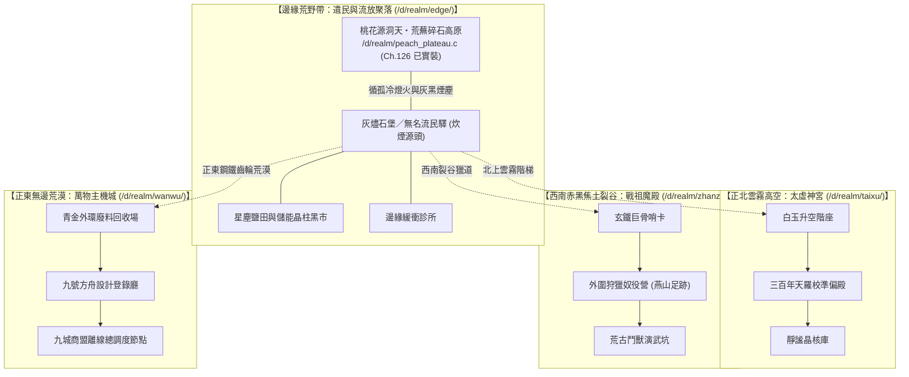

# 《遺忘的世界》第四卷：洞天避難・異界問真篇 (Volume 4 Planning v1.0)

> **卷次定位**：Tier 3 桃花源／異界洞天篇（世界階位 `Lv.101 → Lv.150` ／ 技藝造詣 `Lv.201 → Lv.300`；核心躍遷依循 `world_setting.md` §3.13 **`K`（認知）× `U`（運用）**，而非純數值膨脹）  
> **預計篇幅**：全 44 章（第 127 章 ～ 第 170 章，五幕結構）  
> **文件狀態**：第四卷規劃基準版（比照第三卷規劃規範編製；章節正文尚待後續撰寫，MUD 先行落地起點 `/d/realm/peach_plateau.c`）  
> **關聯正典**：[世界觀與 Mudlib 架構設定集](world_setting.md) ｜ [小說總大綱](novel_outline.md) ｜ [第三卷大綱【名山問道】](volume3.md) ｜ [核心人物檔案](character_profiles.md)  
> **核心命題**：**當五位少年在滅世排斥雷劫前闖入沒有十里桃花的【桃花源洞天】，發現這片被二十八宿天羅供奉了一千年的「避難聖地」實質上是三大太古巨構進行「飛升收割」的封閉場域時，他們如何靠資源制衡、契約網絡與「認知改寫運用」，撕開返鄉之門並守住人間三十年之約？**

---

## 一、第四卷核心定位與世界觀躍遷 (Tier 3 Transition & Reality Shock)

### 1.1 打破「入界＝仙境觀光與換圖打怪」的三大幻覺
第三卷第 126 章結尾已經在正典中鎖定：五子經三大名山祖庭地底【太古破界方舟・主傳送室】踏出單向光門後，落腳於 `/d/realm/peach_plateau.c`（**荒蕪碎石高原**），頭頂是停格於黎明前壓抑灰青色的無星無日天穹，地平線三端巍然對峙著【太虛神宮】、【戰祖魔殿】與【萬物主機城】，荒野邊緣則飄著數點冷清炊煙。

第四卷嚴格執行以下三條轉折設定：
1. **不是仙境，是「高壓資源孤島」**：歷代進入此界的 Lv.100 先輩（《祖師密錄》載至少十七批，實含更古老波次）多數並未成仙做祖，而是因孤立無援、不懂異界運行成本（`world_setting.md` §3.12），被迫拆解或交出核心道基與遺物換取居留權，少數不服者則蜷縮於無名荒野聚落靠殘存儲能晶柱維生。
2. **不靠數值膨脹，改為 `K`（認知）與 `U`（運用）重塑機制（§3.13）**：進入 Tier 3 後，空氣幾何律壓迫極重。舊有 Tier 2 依賴「靈氣存量硬灌」的招式能耗瞬間暴增至三倍且威力折半；唯有當角色親手拆解異界規律（`K`），並將法／力／物三脈轉化為低消耗、順應底層幾何與力場結構的新運用方式（`U`），才算真正跨過三階門檻。
3. **揭開 `FS-06 / FS-07` 謎底卻不驟然進入 Tier 4 結局**：本卷查明「飛升收割」的跨界抽吸迴路——為何天羅假天會排斥 Lv.100 並將修士「驅趕」入洞天；但關於「史前大清洗究竟為何爆發」、「三元歸一能否真正終結天羅機制」，留待第五卷 **Tier 4【歸墟古淵／三元歸一】** 揭示與決斷。

---

## 二、接棒第三卷未決懸念與正典推進總表 (`FS-01 ~ FS-07` Continuity Handoff)

| 伏筆編號 | 第三卷 Ch. 126 結束時已確立事實 | 第四卷（Ch. 127 ～ Ch. 170）核心推進與真相回收 | 留待第五卷（Tier 4）之終局懸念 |
|---|---|---|---|
| **`FS-01`** 逆星歲差與天羅中樞 | 柳清虛破境 Lv.100 看穿「每三百年校準一次之二十八宿天羅假天」幾何網存在隱晦裂縫。 | 柳清虛潛入【太虛神宮】外圍觀測座，證實神宮正是監控並定期觸發凡間三百年校準脈衝之主調控站；學得偏折天羅讀數的向量運用（`U`）。 | 二十八宿天羅當年係由何人／何種意志建造？完全關閉會否令凡間崩塌？ |
| **`FS-02`** 方舟全構與萬物主機 | 確認巨靈神機原為破界方舟右翼輔助推進錨機；祖庭主傳送室已被排斥雷劫震塌。 | 林鐵生在【萬物主機城】核對完整太古船塢登錄冊，發現墜落北境者僅係「九號離艦救生艙段」，主機城本體正依據殘破舊指令試圖回收全境材料自修。 | 如何於歸墟古淵奪回主機與方舟最終設計權限，而不被主機清算規則當成冗餘零件拆解？ |
| **`FS-03`** 燕山五年失蹤線 | 黑冰斷谷見「山」字殘頁與「雷……非……」斷字；戰神遺塚裂隙留有凹損「燕」字護心鏡與凍血跡。 | 燕隼循裂谷煙火與獵戶左撇刻痕在西南荒原追至【戰祖魔殿】外圍狩獵奴役隊，證實大伯**燕山**五年前為保護隊友孤身引敵墜入裂隙，斷左目、被迫為魔殿守獵換取保命，絕非無痛成仙亦非叛徒。 | 大伯與五年前暗中與 Tier 3 中介交易的凡間最高簽署者如何當面對質？（接赤煉線） |
| **`FS-04`** 道化實質與禁忌醫道 | 顧玄編定《三元本草祛道錄》，確認雪線苔僅緩早期、不救五年老病灶；元青／陸觀瀾皆有不可逆殘傷。 | 顧玄面對跨界修士身上浮現的「異界律排斥結晶毒」與三宮活體晶簇標本，揭示「道化」本質是外來法則強行覆寫凡人肉身的「異律同化」，單靠壓制只會引爆排斥；成功研製多體適應的過渡調和液，但仍有無法逆轉的器官損耗代價。 | 三元歸一的完整調和法是否須徹底重構天地本身規則？ |
| **`FS-05`** 天門引與雲記第六階段 | 第 108 章確認第五階段「九城總盟・萬物總調度使（沈雲妮）」之禁毀母脈與避難後勤責任；第 125 章與莫三立三十年約，蘇凝霜亦傳信以紫金雙龍對牌協查金石內堂三十年前舊約簽字人。 | **第六階段身世暨使命抉擇**：沈泥在萬物主機城舊商盟封存樞紐查清三十年前「玄木」密款流向與「沈雲妮」法理授權，自主宣告**「名返雲記，行仍沈泥」**——拒絕獨攬九城最高裁決席，轉將舊約轉化為【跨界互保議事規約】，在三巨構夾縫中重起信用市集，並與凡間蘇凝霜、莫三遙相呼應。 | 最終戰歸返凡間時，如何重組歷劫後的新九州貿易與制度共治？ |
| **`FS-06`** 地煞血精與飛升收割 | 第 116–120 章封停北荒採掘與丹爐，但赤煉潛逃、玄冥閉口，三十年前與五年前高層簽字責任鏈留白；蘇凝霜於凡間追查內堂舊檔與萬仞山西側私道。 | 徹底揭發**「飛升收割（Ascension Harvest）」循環**：三極高層默許並誘導凡間通過天羅篩選「有潛力之極境孤狼」，太虛抽神識結晶、戰祖抽血氣戰魂、萬物拆器胚；赤煉當年潛逃目標極可能試圖藉舊暗道私聯下層中介，並與凡間蘇凝霜查獲之金石內堂舊簽名錄形成跨界互鎖。 | 幕後與赤煉、玄冥上線接頭的跨界利益代理人最終落網與追責。 |
| **`FS-07`** 單向古陣與三十年之約 | 第 126 章傳送室崩碎為廢墟，無任何現成歸返通道。 | 第五幕憑萬物主機備用信標、太虛星象導引與九城後勤符印，首次架設消耗極巨、僅容輕量書信暨小型樣本穿行的**【高代價雙向信標通道】**，遞回首封報平安家書與雲記茶牌拓印給雲津守望的莫三及南方蘇凝霜，鎖定回歸倒數。 | 修復或徹底打開雙向破界門，帶領凡間與洞天遺民迎來終局對決。 |

---

## 三、三階規則架構：認知與運用 (`K × U`)、三極巨構與社會邊界

### 3.1 「資源有帳」與「三階能力重塑」映射表（依 `world_setting.md` §3.12–3.13）
進入 Tier 3 後，人物面板數值維持 `Lv.100+` 平緩成長，真正決定戰力與生存的是**「對新法則之理解（`K`）」**與**「低耗重塑手段（`U`）」**：

| 主角／道途 | Tier 2 原有方法（高耗失靈） | 關鍵認知破口（`K`） | Tier 3 新運用方式（`U`） | 代價與限制（不免除成本） |
|---|---|---|---|---|
| **柳清虛**（法道） | 順應二十八宿星律借法，每施展高階符陣消耗三倍神識 | 洞悉洞天大氣不存在二十八宿中繼網，實為幾何張量直接壓縮場 | 【無星向量牽引】：不再召星落雷，直接沿環境已有幾何張力紋路做千分之一偏移借力 | 推算過載會導致短暫雙目雪盲與左側指節持續發麻（沿用舊傷） |
| **燕隼**（力道） | 靠百斤鐵胎弓剛猛貫穿＋煞血爆發 | 理解戰祖裂谷「重力井脈動與荒獸息差」共鳴律 | 【無聲截息穿貫】：捨棄強行爆發全身氣血，將重箭與長呼吸鎖死在環境重力衰減半拍內出手 | 箭矢素材磨損劇烈，右肩舊傷受高重力陰寒影響仍無法連射過十箭 |
| **林鐵生**（物道／器） | 地火高溫捶打與手動齒輪機械卡榫 | 識破萬物主機城以「標準構件活榫替換＋應力分散格」構建萬物 | 【可拆換多向活榫鍛法】：不造無法替換的死件，將太古黑鐵與異界殘鋼鍛成可現場拆裝的三元咬合節點 | 受限於高純度太古焊料存量，大型重構每次須停爐散熱兩時辰 |
| **顧玄**（物道／藥） | 草藥熬湯、雪線苔冷萃（純草石藥性中和） | 發現「異界結晶」實為環境法則對生靈血肉的強行異律同化 | 【環境相容緩衝針法】：用本地苦苔、礦灰與三元微脈溫流替病人建立臨時緩衝層，不強殺結晶而改為排異降溫 | 對徹底石化或遭戰祖狂血改造過半之軀依舊無效 |
| **沈泥**（人間秩序／商道） | 雙聯帳冊、靈石準備金、跨州特等信印 | 看破三極巨構看似無敵、實則嚴重依賴底層奴工與維護物資的致命短板 | 【跨極資源槓桿與停工制裁網】：用透明帳本串聯邊緣聚落、失意匠師與補給隊，以「斷供維護配件」迫使高階勢力上談判桌 | 任何談判失誤都可能招致巨構直接武力清剿，必須先築撤退地道 |

---

## 四、第四卷空間拓撲藍圖 (`/d/realm/` 四大分區)

---

## 五、五幕四十四章節奏大綱（Ch. 127 ～ Ch. 170 規劃基準）

> **編排原則**：每幕嚴格延續第三卷「人物分進合擊、平民生活線並重、真相階梯揭露、拒絕免費勝利」準則。本章節大綱預埋 `EV401`–`EV422` 事件接口與未來 `/d/realm/*` 實裝清單。

### 【第一幕：碎石寒原・遺民餘燼】（第 127 ～ 134 章，共 8 章）
> **目標**：確立 Tier 3 的殘酷真實地貌與民生生態；五子首次體感 `K`/`U` 認知落差與舊招式三倍高耗；與十七批前輩後裔接軌並確立第一個落腳錨點。

* **Ch. 127 — 黑夜荒原與灰燼炊煙**：五子自碎石高原迎風循那幾點孤零幽燈前行，發現燈火所在並非仙山瓊閣，而是一座半埋於玄武岩溝壑的貧瘠避難驛【灰燼石堡】（`/d/realm/edge/ash_watch_post`）；領頭的老守衛**戚老頭**看清他們攜帶整套鍛具藥囊與商契而非空手「飛升」，第一反應不是行禮，而是趕緊拉熄外頭油燈防被「巡檢機隼」記帳。
* **Ch. 128 — 失靈的舊招與三倍代價**：燕隼欲獵殺一頭闖近營地的「灰甲砂蜥」，舊有長弓勁氣卻因洞天空間阻尼瞬間折損大半且反震右肩舊傷；柳清虛試放太清小法術，神識消耗暴漲三倍！五人從戚老頭與失聰老嫗口中得知《祖師密錄》中那 **17 批先輩** 多半已戰死、凍餓或被徵召拆骨為奴，沒有一人活著見過返鄉路。
* **Ch. 129 — 殘晶黑市與天門引微光**：沈泥查閱石堡僅存的「熱源配給木牌」與儲能晶柱交易，發現原本每季固定向萬物外環繳納的鹽晶配額本季無預警遭預扣三成「戰備折抵」、報廢晶柱回購價亦驟跌，中盤更抽成七成；戚老頭只當作又一輪收緊冬糧，並不知背後是校準預熱徵收。【萬物行商・天門引】與【九城古商盟總契銅版】在觸及一枚殘破舊標鐵塊時微熱，顯示這座碎石高原古代實為「方舟離地前外圍補給營」。
* **Ch. 130 — 失明的舊日同門與第一例排斥毒**：一名三百年前入界、渾身半結晶卻未斷氣的太清先輩遺孤前來求助，因吸入荒漠「幾何晶塵」而全身臟腑經絡漸次僵化；顧玄以《三元本草祛道錄》基礎做對照查驗，驚覺這不是凡間單純的火毒或濁毒，而是低階體質無法適應高階環境規則的**【律令排異症】**。
* **Ch. 131 — 幾何向量與第一道 `U` 的契機**：柳清虛撫過陸觀瀾所贈的裂紋紫銅鏡，不再強召並不存在的「二十八宿」，而是徹夜伏地畫下風向、塵軌與戚老頭手中那塊太古測量銅尺的振動紋路（`K`），既意外測出**底層幾何頻率每夜微幅上飄**的暗兆（暫疑為洞天季節變化），也終於算出此地不靠召喚、只靠「順著空氣張力切線微撥」的新施法節律（`U`），以一成神識完成舊法三倍效果的護幕。
* **Ch. 132 — 鍛造活榫接口與防寒爐**：林鐵生拆開石堡兩具報廢熱源晶柱，與阿鐵精鋼分寸卡尺核對後指出原本焊點全是防私拆鎖死結構；他用石爐粗鐵替居民改出一批**【可拆換芯暖爐】**（`§3.12` 可維修設計），讓石堡在寒冬多撐一季，賺取第一筆真正實物信任與金屬廢料換購權。
* **Ch. 133 — 裂谷邊緣的鷹記刻痕**：燕隼自石堡換得一張殘缺的西南獵區獸皮圖，外出採肉時發現荒原低階異獸異常提前向邊界躁動、戰祖獵隊近日加倍強徵心核；他於赤黑焦土邊緣岩石底面意外撫見一處熟悉到令指尖顫抖的刻痕——**「左撇收腕・雙羽隱括」的燕家獵戶暗記**，且刀痕僅有三至五年風化！大伯**燕山**確曾活著抵此，且活動範圍就在【戰祖魔殿】西南獵道一帶。
* **Ch. 134 — 第一封死契與分兵三極決議**：五子於石堡地窖完成進入異界後的第一次全盤風險核算（不把全部籌碼押在衝進魔殿救親）：沈泥主張由顧玄留鎮石堡醫站兼控給養、林鐵生入正東外環廢料市集摸清主機規律、柳清虛隨行商運物隊北探太虛外階、燕隼則壓住急躁與兩名熟路獵人沿西南邊道潛查燕山蹤跡，自己坐鎮中樞建立**【三極情報與物料對帳網】**。

---

### 【第二幕：三極分探・洞天規則】（第 135 ～ 144 章，共 10 章）
> **目標**：以多重視角實地滲透三大太古巨構外圍組織與日常運行（`K` 的完整建立），確認「飛升收割」真相與燕山現況，並讓沈泥接通【九城商盟】封存遺址。

* **Ch. 135–136 — 正北太虛・活體晶核的階梯**：柳清虛隨向神宮輸送淨鹽結晶的石堡搬運隊抵【白玉升空階座】（`/d/realm/taixu/white_jade_steps`），藉觀察星位測量差異得外院雜役觀測士【衡真道人】容許查閱公開維修日誌（並須避開執律閣主簿**嚴平**對鹽晶耗損帳的盤查）。清虛親眼看見新一批剛被強光送來的異域極境散修，在喝下標榜「洗去凡塵」的瓊漿後神識漸冷、被排上高塔成為維持【二十八宿天羅】運轉脈流的替換晶核；衡真僅能交出半枚**鎖死的太古讀數銅匣**，條件是清虛須請外環工匠回補三枚穩壓銅芯。
* **Ch. 137–138 — 正東主機・九號離艦救生艙檔案**：林鐵生深入【青金外環廢料回收場】（`/d/realm/wanwu/scrap_ring`），通過低階構件分寸實測贏得機房維修工頭【齊九軸】的試工牌，也結識只看帳面自修達成率的外環稽核司主事**陳楷**。進入登錄庫後，鐵生一邊替清虛拆解讀數銅匣還債、一邊核對出震驚真相：北境埋著的破界方舟僅是太古時代被天羅擊落的【九號離艦救生艙】；主機城更將「不在當年離艦名冊內的十七批石堡遺民與其後裔」一律判為**「無主可回收材料」**，並翻出一批高純鹽晶粉被改帳轉記為「戰祖獵營耗損」的冒領單據。
* **Ch. 139–140 — 西南戰祖・斷目獵頭與血債重逢**：燕隼循西南赤黑焦土獵道潛至【玄鐵巨骨哨卡】（`/d/realm/zhanzu/bone_gate`）外，經歷生死一線的重力脈動狩獵考驗，並查核冒領鹽晶去向。當一頭三階【熔岩骨鬣獸】撲向年輕獵奴時，燕隼於環境重力衰減半拍內連射無聲兩箭貫穿其頸椎；從煙塵中走出的帶傷老獵頭左眼罩著黑皮、右眉梢猶帶箭疤——正是五年前失聯的大伯**【燕山】**！燕山冷面警告外甥「這裡誰也救不了誰的菩薩心腸」，他必須應付外獵監軍**韓石**每季九具荒獸心核的死線與假帳剋扣，方能保住同批獵奴喘息之機，且透露冒領晶粉實暗存於萬物城外廢棄暗倉。
* **Ch. 141 — 顧玄的「異律排異」病理實證**：顧玄攜石堡年輕醫師在灰燼醫療點對比太虛玉屑、萬物浸液與戰祖獸血樣本，確立「三元緩衝針藥」第一版，成功替三名早期【律令排異症】患者保住四肢觸覺，但面對一名已在主機城外環徹底金鐵化骨的老工匠束手無策，忍痛立下「溫養止痛而非強行刮骨」的醫案分際，並從戰祖血樣名錄反推暗倉座標。
* **Ch. 142–143 — 九城封存樞紐與沈雲妮真帳（身世第六階段啟動）**：沈泥依燕山與顧玄反推之暗倉座標追蹤至被私商掩埋的古鋼庫房，以【萬物行商・天門引】與【九城古商盟總契銅版】打開封塵千年的**【九城商盟・異界補給封存樞紐】**。帳庫顯示當年【雲記】先輩並非叛逃者，而是太古離艦計劃中最後一批拒絕交出「平民避難配額總帳」、寧可留守凡間善後的後勤調度使；為推翻主機城把遺民當成「無主材料」的裁決，沈泥在舊約名額上限與石堡實物抵扣維護工時的沉重代價下，**憑總帳一戶一戶補登石堡遺民名冊**，並親眼看見曾祖手諭寫著「若九城重現人間錨點，後人可依『沈雲妮』之名核銷配額，但須謹防新權力再成收割工具」。
* **Ch. 144 — 三極陰影匯總・算準九十日倒數**：五人冒險再次於灰燼地窖秘密會合。將第一幕「鹽晶預扣三成、頻率夜飄、心核加徵」與第二幕「太虛誤差表、主機自修檔、戰祖獵令」拼合對帳後，終於實證算清：**三極其實是一條故障卻按殘留利益邏輯運轉的封閉收割產業鏈，而新一輪「三百年天羅校準暨肅清期」確已預熱，距離正式發動只剩最後九十日！**

---

### 【第三幕：真假飛升・三極暗戰】（第 145 ～ 154 章，共 10 章）
> **目標**：反制「三百年預熱清剿」；五人徹底運用 `K`×`U` 重塑力量，同時沈泥聯合三極內部的被壓迫工匠、觀測徒與獵奴發動制度與供應鏈反制；赤煉舊線殘響在 Tier 3 浮現。

* **Ch. 145–146 — 供應鏈的逆鱗**：五人清醒判斷「正面單挑三大巨構等於送死」。沈泥聯合顧玄、鐵生統計發現：太虛宮高塔每日須消耗萬斤純淨導流鹽晶，主機城維護班長期苦於「外環工傷配件不補發」而怠工，戰祖殿獵隊亦早已不滿長老剋扣獸髓配給。沈泥利用封存總調度權限與石堡實物產出，秘密與三極底層代表簽下**《三極維護工役互助密約》**。
* **Ch. 147 — 赤煉舊線與跨界掮客**：林鐵生與齊九軸在萬物主機城三號拆解線，竟查獲一批**印有凡間天工閣「赤火」篆印與近十年雲津商單編號的走私半成品晶柱箱**！鐵生與燕隼夜襲外圍交割點，捉住一名與之接頭的跨界掮客，審出**凡間部分延命私盟高層與太虛外階執事之間根本存在「定期走私暗道」**——他們將凡間挖掘出的方舟洩漏血精偷送進來抵充配額，換取延壽晶丹返銷雲津，這也是為何赤煉急著封口並逃入萬仞山西側深處的謎底！
* **Ch. 148–149 — 天羅預檢與雙向量對沖**：太虛執律主簿**嚴平**偵測到下層出現不明調度網且恐誤差帳洩漏，藉執律閣權限降下【星鎖檢索】，將灰燼石堡外五里化作強制搜魂領域。柳清虛攜衡真道人偷出之殘缺校正表，首度全力施展 `U` 級【無星向量偏折網】，配合林鐵生現場組裝的三組可拆卸頻率盾牌，硬生生把太虛掃描光束偏折錯拍三息，保住石堡五十多名老弱遺民名單未洩；清虛亦因此傷及雙目神識，留下雪盲殘影。
* **Ch. 150–151 — 燕山與戰祖殿內的血色博弈**：戰祖西南監軍**韓石**懼怕剋扣獸髓假帳曝光，擬藉「血祭獵群」踏平異端聚集點並將送訊的燕山鎖入【荒古鬥獸演武坑】（`/d/realm/zhanzu/arena_pit`）。燕隼放棄個人英雄突擊，改按燕山昔年手勢與顧玄預留之降壓煙彈配合，聯手林鐵生用主機外環搶來的可拆卸力場扣具拆解牢籠插銷，硬從三階頭獸嘴裡救出殘軀血染的燕山與九名礦奴，代價是燕隼左肋骨裂、一名熟路老獵為斷後永久喪命（保留真實犧牲）。
* **Ch. 152 — 第六階段身世告白與《萬物不毀條約》**：面對主機城稽核司主事**陳楷**下達「灰燼區違規改造熱源爐・強制清零執行令」，沈泥親持【萬物行商・天門引】與【九城古商盟總契銅版】踏上鋼鐵談判橋，憑 Ch.142–143 逐戶補登且以石堡實物抵扣維護工時的**「平民避難配額總帳」**，證明石堡遺民屬受離艦總約第七條保護之在籍人類而非無主材料，正式喚出**『第一優先序：保全人類火種』**條款對質仲裁中樞與陳楷，成功壓低對方的「自修達成率」考核威脅，換取十日緩衝期。
* **Ch. 153–154 — 三元並聚・不滅錨點雛形**：退返石堡後，五人將燕山、齊九軸、衡真與石堡遺民聚作一堂，坦白「三十年人間約」與三個月後之「三百年大校準」雙重危機。五子首次把各自的三階新理解（向量星算 `K/U`、可拆換活榫、重力截息、病理緩衝、分散信用規約）併入同一張藍圖——不僅為了逃回人間，更要在校準日動搖太虛校準塔本身！

---

### 【第四幕：鼎足破局・三元共鳴】（第 155 ～ 164 章，共 10 章）
> **目標**：決戰「三百年大校準日」（對應世界事件 `EVENT_TIER3_CALIBRATION`）；不靠個人無敵打爆三個古老勢力，而靠三線並進之**工程癱瘓 + 罷工斷供 + 三元和諧干擾**打破收割鎖定；完成沈泥第六階段定名。

* **Ch. 155–156 — 校準倒數與萬山罷工潮**：校準前七日，【萬物主機城】外環二十四座零件供應站與【太虛】十二處鹽晶採集寮依沈泥密約集體按章停工核查安全分寸；戰祖殿因燕山聯同被救獵奴公開魔殿剋扣獸髓假帳，多支外圍部落拒絕應召出征。三極巨構龐大體系在數千年來首次陷入後勤與正當性雙重泥淖。
* **Ch. 157–158 — 北塔偏星・清虛與衡真的觀測反叛**：校準夜子時，紫黑色強光再次自【太虛神宮・三百年校準偏殿】（`/d/realm/taixu/calibration_hall`）直貫地脈準備同時抽乾洞天邊民與重創人間雲頂天柱。柳清虛與衡真道人正面戳破主簿**嚴平**私挪鹽晶與隱匿誤差的假帳、在覺醒觀星士支援下強行插入預埋之黑鐵分流針，以精純法道神識篡改了主陣脈**「一度半核心角位」**（歷史回響 Vol 3 Ch. 91！）——不炸塔（免震塌地脈），而是將校準脈衝強行導向無人的高空玄武岩空域；代價是清虛左目長駐雪盲殘影、右手食中指定期微顫。
* **Ch. 159–160 — 魔殿阻斷與血脈證言**：監軍**韓石**帶同狂獸督戰隊試圖強行接管地脈掩蓋虧空，遭燕隼、燕山率領邊緣獵隊於【玄鐵巨骨哨卡】狹道層層阻擊；燕隼藉環境重力衰減節拍與大伯燕山配合出箭，射斷戰騎雙脛兼逼退督戰隊，燕山也當眾交出五年前與赤煉代理交接的原始密牌（把責任鏈直接鎖向跨界黑幕）。
* **Ch. 161–162 — 顧玄護陣與鐵生換栓**：陳楷仍企圖放任鎮壓機群與高階晶塵清場以維持帳面修復率，顧玄率邊緣醫站點燃三十座改良「三元緩衝中和爐」，以藥煙與晶塵排異霧遮蔽後方千餘遺民肺腑，代價是耗盡凡間帶來的《三元本草》珍稀藥母且雙掌留下不可逆的「晶灰硬斑」；林鐵生頂著高熱與焊料幾近枯竭的極限鑽入主機城地下一級匯流井，在右臂嚴重灼傷下完成帶壓活榫操作，拔掉維持「強制收割迴路」的關鍵黑鐵死栓並嵌入**【三元分流總栓】**！
* **Ch. 163 — 第六階段定名：「我歸沈雲妮於舊約，行沈泥於人間」**：校準脈衝偏轉落空，三極巨構承受巨大反震與中樞檢核強制停擺百年校準。在萬物主機城裁決光幕與三方遺民代表面前，沈泥親手以【萬物行商・天門引】與【九城古商盟總契銅版】登錄第六階段身世終章：**她正式承認並登記先祖「沈雲妮」法理名分以徹底廢除九城總約中的「少數獨裁緊急調度條款」，將遺產權永遠均分給人間萬山總號與洞天灰燼互助議會；但面對眾人稱呼時，依舊平靜笑言：「叫我沈泥就好。」**
* **Ch. 164 — 劫後廢墟與「大清洗後門」的線索**：危機暫時止血，三極達成「互不侵擾邊緣自治區暨公開材料交易清單」之停戰協定；然而從太虛神宮崩裂的核心碑座內，柳清虛與林鐵生赫然讀取到一段超越太虛本身的古老警報——**【太古三元總樞・歸墟古淵深層盟約：當三極均衡遭外力長期停擺，深淵守門禁制將於十個歲象後自行啟動強制清剿】**！

---

### 【第五幕：雙向初通・返鄉前夜】（第 165 ～ 170 章，共 6 章）
> **目標**：實作高代價「雙向微光信標」（不把返鄉寫成零成本任意傳送）；完成莫三、蘇凝霜與雲津故土的第一聲跨界回響；明確鋪開第五卷（Tier 4 【歸墟古淵／三元歸一】）終極格局。

* **Ch. 165–166 — 高代價雙向信標的代價估算**：五子與齊九軸、衡真、顧玄合作搭建【跨界微光共鳴站】，嚴格受限於能源與空間裂隙狹縫寬度——每次啟動需消耗三百斤高純鹽晶儲柱與一具特鍛黑鐵導波環，僅能維持三息、傳遞不超半斤重之實物與書信（人仍無法直接肉身強渡）。
* **Ch. 167 — 雲津茶館裡的三十息星火（人間群像回望）**：鏡頭短暫切回凡間雲津【萬山泥途總號】：距當夜子夜啟門已過整整**三年**（三十年約尚餘二十七載）。邱禾、顧蘭舟、羅九秤已將共治分權推進至六縣直連；**蘇凝霜**親自北上雲津與總號對帳，不僅已徹底坐穩金石商會總掌櫃之席、查出三十年前金石內堂參與簽署「玄木／雲記」清洗令的兩名退隱元老名單，更與獨臂老將雷烈、宋知微、魯長老（兼攜退隱養傷之陸觀瀾、元青）合力封鎖了萬仞山西側私道。就在爐火邊，老莫三守著的那半塊「雲記棗木茶牌」與蘇凝霜手中的「紫金雙龍對牌」同時微溫震顫——另一半帶著熟悉炭筆簽押的【雲記茶牌、沈泥手書家報暨燕山親筆鷹記箭羽】與顧玄《跨界病理補遺三章》穿透微光落上桌案！
* **Ch. 168 — 遺民的去留抉擇**：石堡眾人舉行第一次自主大會。戚老頭與多數老遺民因身體早已習慣洞天法則，決定留守建立長久自治城邦，代五子照管邊界供應；而左目斷盲、額角留疤的燕山主動要求檢查戰祖殿殘圖，確認能否找到徹底拔除「血脈枷鎖」回黑石鋪看一眼趙老獵哨亭的方法。
* **Ch. 169 — 五人三元初試：「法力物非不能合，是舊器難載新道」**：行前最後整理時，五子在安全試驗陣盤上首次無外物壓制地嘗試讓三階 `U` 運用同頻共鳴——顧玄藥氣護脈、鐵生黑鐵定軸、燕隼長息鎖力、清虛向量引導、沈泥定序控時，短暫凝聚出半縷微弱卻安定不爆裂的**【純淨混沌三元流】**，隨即耗盡手邊三枚儲能晶柱自動消散。這證明了 Tier 4「三元歸一」既真實可行，又距離真正推翻舊天羅尚有漫長道路。
* **Ch. 170 — 歸墟古淵之召喚與第四卷終**：萬物主機城與太虛深碑同時指向碎石高原正下方萬丈極深處——那座早於三極巨構、連三大宮殿都畏懼靠近的禁忌深淵入口**【歸墟古淵（`/d/secret/`）】**竟在三元流共鳴瞬間悄然亮起一線微光！五子整頓行囊、帶上莫三與蘇凝霜透過信標逆傳回來的凡間回音（包含蘇凝霜鎖定的三十年前內堂簽字底單，以及赤煉曾在萬仞山西麓舊礦道現身接頭的線索），朝著真正終結大清洗千古謎案的終極舞台邁出第一步——**（第四卷：洞天避難・異界問真篇・全卷完）**！

---

## 六、第四卷正典紅線與創作驗收規約 (`Vol 4 Guardrails`)

1. **嚴格禁絕現代科幻／資訊／工業術語，回歸古代工藝語彙 (`[CANON]`)**：第四卷正文（`ch0127.md`–`ch0170.md`）**嚴禁出現 `電池`、`電源`、`電流`、`熱插拔`、`格式化`、`代碼`、`數據`、`AI`、`BUFF` 等現代科幻、電子資訊或網遊英文詞彙**（對照表見 [`docs/vol4_prewriting_decisions.md`](docs/vol4_prewriting_decisions.md)；一律改寫為儲能晶柱、玉化晶核、帶壓活榫換栓、異律晶化、緩衝爐霧等古代工藝與丹陣說法）；武俠、修仙行當及既有遊戲機制用語則適度保留，以免割裂前三卷語感。
2. **禁止「升仙即無代價 / 一招秒三極」(`§3.12–3.13`)**：任何法術、裝備、鍛造、傳送與療癒行為皆須寫出明確代價（耗損晶柱、散熱時間、舊傷發作、資源讓渡，包含柳清虛左目雪盲殘影與顧玄掌心晶灰硬斑）。雙向信標最多傳輕物書信，五子尚未能帶大軍自由往返兩界。
3. **燕山與十七批先輩的「真實代價」(`FS-03`)**：燕山生還但斷左目且曾為保下屬妥協獵殺，重逢伴隨理念衝突與犧牲；十七批先輩僅少數存活或困於高塔與荒野中，不得「全員無事完美大團圓」。
4. **沈泥之「總調度使」非個人獨裁 (`FS-05` Stage 6)**：她的突破關鍵在於主動放棄九城獨斷權、轉化為分散共治與公開帳本，絕不寫成掌握古代主機控制權便成為萬界女皇。
5. **Mudlib 實裝雙軌一致性與 `CROSS-05` 區隔 (`[MAINT]`)**：`/d/realm/peach_plateau.c` 已於 Tier 2 Act 5 實裝為全卷唯一起點；`EVENT_TIER3_CALIBRATION` 為週期性全服階段事件，玩家通關僅晉升三階洞天宗師並見證歸墟微光與雙向信標，**絕不自動解鎖 Tier 4（`/d/secret/`）**（須另行滿足 `traceability_and_scope_baseline.md §4.2` 三要件）。

---

## 附錄：第四卷 Tier 3 世界素材庫索引

| 素材類別 | 設計規劃文件 | 用途 |
|---|---|---|
| 前置決策包 | [`docs/vol4_prewriting_decisions.md`](docs/vol4_prewriting_decisions.md) | Step 1 六項拍板、古代工藝對照表、三極具名反派與五人代價帳 |
| 逐章故事設計 | [`volume4_story_design.md`](volume4_story_design.md) | 第四卷 44 章逐章場景、事件、任務、衝突與代價帳設計 |
| 勢力 | [`docs/tier3_faction_structure.md`](docs/tier3_faction_structure.md) | 太虛神宮、戰祖魔殿、萬物主機城、灰燼石堡與舊商盟離線節點結構 |
| 人物名冊 | [`docs/tier3_npc_roster.md`](docs/tier3_npc_roster.md) | Tier 3 首發人物（含十七先輩／遺民／燕山／三極具名官吏與異見者）規劃名單 |
| 入門人物檔 | [`characters/tier3/`](characters/tier3/) | `ash_warden_qi`、`taixu_observer_heng`、`zhanzu_packmaster_tuo`、`wanwu_auditor_qi` 等知情界線 |
| 時間軸 | [`docs/tier3_timeline.md`](docs/tier3_timeline.md) | 靜止天穹日夜、三百年天羅校準期與人間「三十年約」雙線校時 |
| 地圖藍圖 | [`docs/maps/tier3/`](docs/maps/tier3/README.md) | 接軌 `/d/realm/peach_plateau.c` 之碎石荒原與三極巨構房間拓撲規劃 |
| 事件綱領 | [`events/volume4_events.md`](events/volume4_events.md) | `EV401–EV422` 世界事件、三百年收割危機與停工制衡機制 |
| 道具目錄 | [`items/tier3_item_catalog.md`](items/tier3_item_catalog.md) | Tier 3 儲能晶柱、向量羅盤、緩衝針藥與第六階段總契文書 |
| 任務網絡 | [`docs/tier3_quest_network.md`](docs/tier3_quest_network.md)；[`docs/tier3_quest_json_index.md`](docs/tier3_quest_json_index.md) | `v4_*` 任務圖譜與未來 `/d/realm/` 實裝 JSON 接口規劃 |
