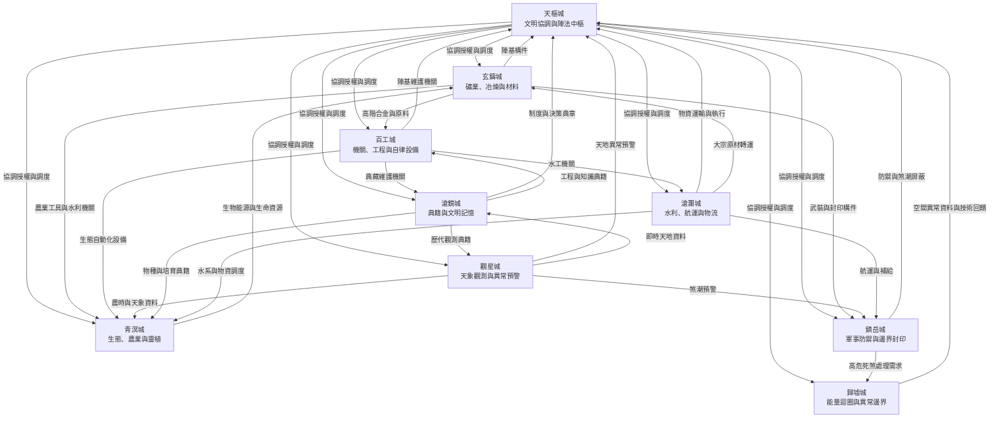

# 《遺忘的世界》太古九城宏觀輿圖與空間拓撲
## Macro Atlas of the Nine Ancient Cities

**文件路徑：** `forgotten-space/narrative/docs/maps/macro_nine_cities_atlas.md`  
**文件版本：** v1.0  
**所屬階段：** Phase 1 — 正典對齊與四維拓撲規範  
**文件狀態：** 初版，待九城空間配置與既有 Mudlib 場景交叉審核  
**適用範圍：** 《遺忘的世界》小說、Mudlib、世界事件、NPC、城市建設與後續世界擴建  
**上位正典：** `forgotten-space/world/lore/nine_cities_canon.md`

---

# 第一章：文件定位

## 1.1 文件目的

本文件負責建立太古九城的宏觀空間架構。

它不是完整地理地圖，也不是九座城市的詳細建築清單，而是定義：

1. 九座城市作為文明節點的空間關係。
2. 九城之間的宏觀拓撲與功能依存。
3. 太古文明依存網絡與現代地理交通網絡的區別。
4. 九城各自的城市空間建構方向。
5. 從九城向外擴展現代城市與生活世界的原則。
6. 未來 Region、Zone、Site 的空間資料組織方式。

本文件不重新定義九城的歷史與文明職能。

九城的名稱、歷史、核心機能與大清洗背景，以 `nine_cities_canon.md` 為準。

## 1.2 核心建構方向：先建城，再建縣

《遺忘的世界》的小說與 Mudlib，採取不同的建構順序。

**小說採取由小到大的敘事揭露方式：**

```text
人物
  ↓
村鎮與縣城
  ↓
府城與宗門
  ↓
區域地理
  ↓
太古九城
  ↓
完整文明體系
```

小說先讓讀者認識人物生活的世界，再逐步揭露這個世界背後的歷史與文明。

**Mudlib 採取由大到小的世界建構方式：**

```text
太古九城文明骨架
  ↓
九座城市的空間結構
  ↓
城市周邊自然與地理環境
  ↓
現代城市與聚落
  ↓
縣級行政區
  ↓
村鎮、道路、商業與生活場景
```

Mudlib 需要先有足夠穩定的宏觀世界模型，才能讓後續城市、人口、交通、資源與事件自然落在其中。

這不代表九城必須先全部建成可探索的遊戲場景。

**先建立城市的世界定義與空間骨架，不等於先建造九座空城。**

## 1.3 核心原則

### 一、文明節點優先於行政區

九城是太古文明的機能中樞，不是現代行政區。

現代的府、州、縣、宗門領地與九城之間，不預設一對一對應關係。

### 二、城市存在不代表城市已經開放

一座城市可以先存在於世界資料中，尚未具備完整地圖、NPC、交通或玩家入口。

### 三、空間關係不等於精確座標

目前只建立必要的宏觀關係，不提前決定九城的精確經緯度、距離、方向與完整路線。

### 四、太古依存網與現代交通網分離

兩張網絡分別記錄，不可將文明功能上的依存關係直接轉換成地理相鄰或現代道路。

### 五、世界建構不以小說出場順序為準

小說尚未提及的城市，也可以先在 Mudlib 世界模型中存在。

---

# 第二章：宏觀空間模型

## 2.1 空間層級

本階段採用以下空間層級：

```text
World
 └── Region
      └── Zone
           └── Site
```

| 層級 | 定義 | 主要內容 |
|---|---|---|
| World | 完整世界 | 世界規則、天地環境、文明體系 |
| Region | 宏觀區域 | 城市、山川、水系、區域勢力 |
| Zone | 實際活動場域 | 城區、山谷、港口、地下區域 |
| Site | 特定地點或設施 | 遺跡、機關、洞府、陣基、建築 |

Tier 不屬於空間層級，而是 Zone 或 Site 的危險與挑戰屬性。

例如：

- 一座城市可以包含多個 Zone。
- 一個 Zone 可以包含多個 Site。
- 同一座城市內可以同時存在不同 Tier 的區域。
- 城市的文明地位不由 Tier 決定。

## 2.2 九城在空間模型中的定位

九城是宏觀文明節點。

每座城市都應具備獨立的城市識別、文明機能、空間定義與後續擴建能力。

但在目前階段，不強制將九城全部指定為已知 Region 座標。

建議資料結構：

```text
World
 └── Ancient Civilization
      ├── Tianshu City
      ├── Xuanzhu City
      ├── Qingming City
      ├── Guanxing City
      ├── Cangnao City
      ├── Canglan City
      ├── Baigong City
      ├── Zhenyue City
      └── Guixu City
```

上述是文明節點關係，不是地理位置排列。

## 2.3 空間資訊可信度標記

後續地圖與世界資料應區分不同證據狀態。

| 標記 | 名稱 | 定義 |
|---|---|---|
| CONFIRMED | 已確認 | 已有正典或既有場景明確支持 |
| INFERRED | 合理推定 | 根據既有資料推導，但尚未正式定案 |
| RUMORED | 傳聞 | 世界人物或文獻中的說法 |
| UNKNOWN | 未知 | 尚未設定或刻意保留 |
| DISPUTED | 有爭議 | 存在不同版本或互相矛盾的資料 |

這些標記描述的是資料可信度，不是玩家角色的認知等級。

同一地點可以同時具有：

- 世界真實位置已知。
- 現代人物不知道。
- 某些宗門持有不完整線索。
- 小說角色只知道傳聞。

世界資料與人物認知必須分開保存。

---

# 第三章：太古九城宏觀節點

本章只定義九城的城市定位、空間建構方向與可確認的文明功能。

不指定精確座標，也不建立完整道路網。

## 3.1 九城總表

| 城市 | 文明定位 | 城市空間建構方向 | 空間狀態 |
|---|---|---|---|
| 天樞城 | 陣法與文明協調中樞 | 核心中樞、外圍陣基、地脈設施 | 核心受損或隔離 |
| 玄鑄城 | 礦業、冶煉與高階製造 | 地火工坊、礦區、熔煉設施 | 部分地下設施殘存 |
| 青溟城 | 生態、農業與靈植 | 靈植培育區、生態圈、水土設施 | 部分封閉生態區可能存續 |
| 觀星城 | 天象觀測與異常預警 | 高地觀測區、星象設施、測繪建築 | 部分觀測設施可能殘存 |
| 滄鏡城 | 文明典籍與知識保存 | 典藏區、分類書庫、封存設施 | 地下典藏設施可能殘存 |
| 滄瀾城 | 水運、商業與跨區物流 | 港區、河道、水利與船塢 | 部分水利及港口設施殘存 |
| 百工城 | 工程、機關與自律設備 | 工坊區、機關製造區、維護設施 | 部分自律機關可能運作 |
| 鎮岳城 | 軍事、防禦與邊界封印 | 城防、要塞、封印設施 | 部分防禦系統可能仍運作 |
| 歸墟城 | 空間、能量迴圈與異常邊界 | 特殊空間、能量處理與封印設施 | 空間狀態未明 |

## 3.2 天樞城

**文明定位：** 九城總體協調中樞。

天樞城不只是行政中心，而是九城文明體系的協調節點。

城市空間應包含：

- 總陣協調中樞。
- 地脈總調度設施。
- 跨城陣法控制設施。
- 外圍陣基。
- 各類監察與秩序維護設施。

目前已確認的現代連結，是金石府城地下的天樞城南域外圍陣基。

這不代表金石府城就是天樞城本體。

**建構原則：**

天樞城應先建立為一個完整的文明節點，但其本體位置、完整範圍與核心空間狀態保持未知。

## 3.3 玄鑄城

**文明定位：** 材料與製造中樞。

城市空間應包含：

- 礦產開採區。
- 地火與冶煉區。
- 高階合金製造區。
- 精密鑄造工坊。
- 材料儲存與運輸設施。

其城市結構應能反映大量原料進入、加工、精煉與成品輸出的生產流程。

不預設現代礦區、宗門或城鎮與玄鑄城的精確地理關係。

## 3.4 青溟城

**文明定位：** 生態與生命資源中樞。

城市空間應包含：

- 靈植培育區。
- 物種保存區。
- 農業生產區。
- 生態循環設施。
- 水土與環境調節設施。

青溟城不應被設計成單純的大型藥園。

其核心是完整的生態管理能力，靈植、糧食、物種保存與環境維護都是城市功能的一部分。

各地仍可存在獨立的自然物種與地方生態。

## 3.5 觀星城

**文明定位：** 天象測繪與天地異常預警中樞。

城市空間應包含：

- 天象觀測設施。
- 高地觀測平台。
- 星圖與測繪資料保存區。
- 天地異常監測設施。
- 長期觀測與推演場所。

觀星城的設施可能分布於不同高度與環境，不應只將它建成一座山頂觀星台。

## 3.6 滄鏡城

**文明定位：** 文明記憶、典籍與知識管理中樞。

城市空間應包含：

- 大型典藏區。
- 分類與檢索設施。
- 封存典籍區。
- 古代文字與符文研究區。
- 知識授權與存取設施。

滄鏡城不是單純的藏書城市，而是太古文明的知識管理系統。

其保存對象包括功法、工程、制度、歷史、陣法、醫藥、天文與各類技術資料。

## 3.7 滄瀾城

**文明定位：** 水利、航運與跨區物流中樞。

城市空間應包含：

- 大型港口。
- 河道與水系調度設施。
- 船塢與船舶維護區。
- 水利工程。
- 大宗物資轉運設施。

滄瀾城的城市結構應能呈現水路交通與商業物流的規模。

現代河道、港口與太古水系不預設完全重合。

## 3.8 百工城

**文明定位：** 工程、自律機關與器物製造中樞。

城市空間應包含：

- 機關設計區。
- 傀儡製造區。
- 工程建造區。
- 自律維護設施。
- 標準器物生產設施。

百工城的特色是城市本身具有高度自律化能力。

部分設施可能在文明解體後仍然依照既定程序持續運作。

但自律機關不代表具有完整自主意識或理解能力。

## 3.9 鎮岳城

**文明定位：** 軍事防禦與邊界封印中樞。

城市空間應包含：

- 大型城防設施。
- 邊界防禦陣列。
- 軍事調度設施。
- 封印節點。
- 防禦性能源設施。

鎮岳城不應被簡化為普通軍事城市。

其城市空間應具有明確的防禦縱深與封鎖結構。

## 3.10 歸墟城

**文明定位：** 空間異常、能量迴圈終端與高危邊界處理節點。

城市空間應包含：

- 特殊空間設施。
- 能量迴圈處理設施。
- 高危廢料處理區。
- 界隙消解設施。
- 封印與隔離區。

歸墟城不預設符合一般城市的平面地理結構。

其入口、內部空間、外部位置與一般地理的關係，都必須保留彈性。

歸墟城與大清洗的關係亦不得提前定案。

---

# 第四章：九城文明依存網絡

## 4.1 網絡定義

九城的文明依存關係，是太古人道文明得以持續運作的核心。

各城雖然有獨立專業職能，但大型文明工程需要不同城市提供資源、知識、技術、能源與協調能力。

因此，九城必須視為一個互相依存的文明網絡。

本章的依存圖描述：

- 哪座城市提供什麼功能。
- 哪座城市接收這項功能。
- 哪些城市之間存在重要的功能依賴。
- 哪些依存關係可能形成系統性瓶頸。

**本章的箭頭代表功能、資源、資訊或服務的供給方向，不代表地理方向、道路方向或城市相鄰關係。**

## 4.2 九城文明依存總圖

以下為依照 `nine_cities_canon.md` 所列依存關係整理的功能網絡。



這張圖是文明功能依存圖，不是地理圖。

特別注意：

1. 天樞城是協調中樞，不代表所有物資都必須經過天樞城。
2. 滄瀾城是物流中樞，不代表所有城市都與滄瀾城直接相鄰。
3. 玄鑄城與青溟城的依存關係，不代表兩城之間存在直接道路。
4. 歸墟城的特殊空間性質，不代表其與其他城市之間存在一般交通路線。
5. 圖中的箭頭是功能關係，不是現代交通設施的存在證明。

## 4.3 依存關係分類

為了避免依存圖變成難以維護的單一網絡，將依存關係分為六類。

| 分類 | 主要供給節點 | 主要接收節點 | 依存內容 |
|---|---|---|---|
| 協調與治理 | 天樞 | 全體八城 | 陣法協調、資源調度、緊急指令 |
| 材料與製造 | 玄鑄、百工 | 天樞、鎮岳、青溟、滄瀾等 | 合金、構件、機關、工程設備 |
| 生態與生命 | 青溟 | 全體八城 | 糧食、靈植、藥材、物種與生態技術 |
| 知識與觀測 | 觀星、滄鏡 | 天樞、青溟、百工等 | 天象資料、歷史典籍、技術文件 |
| 物流與水利 | 滄瀾 | 玄鑄、青溟、鎮岳、天樞等 | 水運、物資轉運、補給與水利工程 |
| 防禦與異常處理 | 鎮岳、歸墟 | 全體文明系統 | 防禦、封印、死煞處理、空間異常資訊 |

這六類是功能分類，不是六個互相獨立的子系統。

例如，一項大型防禦工程可能同時需要：

- 觀星城提供預警。
- 天樞城提供協調。
- 玄鑄城提供材料。
- 百工城提供機關。
- 滄瀾城提供物資運輸。
- 鎮岳城執行防禦。
- 歸墟城處理高危異常。

## 4.4 三條關鍵依存鏈

### A. 防禦與存續鏈

```text
觀星城
  │ 天地異常預警
  ▼
天樞城
  │ 全域協調與動員
  ▼
鎮岳城
  │ 防禦與封印執行
  ▼
歸墟城
  │ 高危能量與異常處理
  └──────────────
```

這條鏈負責文明面對外部威脅時的整體應變。

任一環節失效，都可能使防禦體系退化。

但這不代表四座城市之間一定存在直接物理管線。

### B. 材料與工程鏈

```text
玄鑄城
  │ 材料與高階合金
  ▼
百工城
  │ 機關與工程設備
  ▼
九城各項設施
  │
  └── 維護、修復與擴建
```

青溟城可提供部分生物能源及生命資源，滄瀾城則協助大宗原料運輸。

玄鑄與百工是這條鏈的主要製造節點。

### C. 知識與決策鏈

```text
觀星城
  │ 天象與天地實測資料
  ▼
滄鏡城
  │ 典籍整理、保存與知識管理
  ▼
天樞城、百工城、青溟城等
  │
  └── 決策、工程與生態管理
```

這條鏈不一定是單向的。

滄鏡城保存歷史觀測資料，觀星城持續提供新的觀測結果，兩者形成長期知識更新關係。

## 4.5 依存關係與依存強度

`nine_cities_canon.md` 已建立 S、A、B、C 四級依存強度。

本文件沿用該定義，但不將依存強度轉換為地理距離或交通難度。

| 等級 | 定義 | 系統意義 |
|---|---|---|
| S | 關鍵依存 | 斷裂將直接造成核心功能失效 |
| A | 強依存 | 斷裂造成重大效能下降，短期難以替代 |
| B | 中度依存 | 造成局部缺口，可透過高成本方式替代 |
| C | 弱依存 | 造成不便或效率損失，不影響主要功能 |

必要性則另外記錄：

- Necessary：文明系統不可缺少。
- Important：對完整能力十分重要。
- Supporting：提供額外支援。

依存強度與必要性是兩種不同的屬性，不可混為一談。

## 4.6 依存圖的正典限制

目前依存圖以正典文件第四章所列的依存關係為基礎。

但在正式實作前，仍應檢查：

1. 供給方向是否正確。
2. 雙向依存是否需要拆成兩條不同功能的邊。
3. 全體八城的協調關係是否應視為群組關係，而非八條完全相同的直接依存邊。
4. 依存強度是否有足夠的文明運作依據。
5. 是否有未列出的重要依存關係。
6. 是否有重複或相互矛盾的條目。

尤其要避免將「所有城市都需要天樞協調」解釋為「所有城市的每一項功能都必須經由天樞才能運作」。

九城可以在文明協調中樞失效後，繼續維持部分地方性功能。

---

# 第五章：九城的地理拓撲與空間關係

## 5.1 不先決定九城的排列

目前不建立九城的固定方位圖。

不採用以下未經確認的假設：

- 九城呈九宮格排列。
- 九城圍繞天樞城等距分布。
- 九城必定位於九個不同方向。
- 九城之間存在固定的直線道路。
- 九城與現代九個行政區一一對應。

九城的文明分工已經確立，但其地理排列仍待後續地圖設計與小說線索交叉驗證。

## 5.2 地理拓撲的建立方式

九城的地理關係採逐步建立。

每個城市之間的空間關係，可以先記錄為：

| 關係類型 | 定義 |
|---|---|
| ADJACENT | 已確認相鄰 |
| CONNECTED | 已確認存在交通連接 |
| INDIRECT | 只能透過其他節點間接抵達 |
| OVERLAPPED | 現代空間與太古設施存在上下或範圍重疊 |
| DISCONNECTED | 已確認原有連接中斷 |
| SPATIAL_ANOMALY | 存在特殊空間關係 |
| UNKNOWN | 尚未確認 |

目前不為九城兩兩指定上述關係，除非有正典或實際場景證據。

## 5.3 太古交通網絡與現代交通網絡

太古文明可能具備：

- 遠距傳送設施。
- 地脈能源管道。
- 專用物資運輸系統。
- 水運與陸路交通。
- 特殊空間通道。

大清洗之後，這些系統可能已經中斷、損毀或改變用途。

因此必須分開記錄：

**太古交通網絡：**

描述九城文明時期的交通、能源與物資運輸設施。

**現代交通網絡：**

描述遺忘曆現代世界中，實際可以使用的道路、水路、渡口、關隘與其他交通方式。

兩者可以在同一地點重疊，但不代表兩者相同。

---

# 第六章：金石府城的空間示範

## 6.1 金石府城的定位

金石府城是目前已知與九城直接連結的重要現代城市。

其地下存在太古天樞城南域外圍陣基。

因此金石府城是九城宏觀空間模型的第一個具體示範案例。

但金石府城不是天樞城本體，也不是天樞城完整遺址。

## 6.2 已確認的空間關係

```text
金石府城地表
  │
  ├── 市井與街巷
  │
  ├── 護城河
  │
  └── 地下空間
        │
        ├── 地下五室一閘
        │
        ├── 太古暗渠
        │
        ├── 黑市與暗巷活動空間
        │
        ├── 十二丈人面神像
        │
        └── 天樞城南域外圍陣基
```

此圖只描述已確認的上下層關係與功能連結，不代表完整地下地圖。

詳細地下房間連線仍以：

`forgotten-space/narrative/docs/maps/underground_map.md`

為準。

## 6.3 金石府城的特殊空間機制

| 設施 | 太古用途 | 現代認知或用途 |
|---|---|---|
| 絕靈法網 | 天樞陣基殘留秩序機制 | 官府控制與壓制修士的特殊法網 |
| 太古暗渠 | 冷卻、排煞、地脈回流與檢修通道 | 廢棄暗渠、地下暗河、黑市通道 |
| 十二丈人面神像 | 南域巡天監察靈位機關 | 避煞石神或未知古代神像 |
| 外圍陣基 | 天樞城南域陣基的一部分 | 尚未被現代人完整理解的地下設施 |

## 6.4 探索階段與危險 Tier

金石府城的探索開放節奏，採三階段：

| Stage | 探索內容 | 說明 |
|---|---|---|
| Stage 1 | 地表日常 | 現代城市、官府、商業與一般生活 |
| Stage 2 | 地下暗渠與外圍遺跡 | 黑市、神像、地下設施與局部異常 |
| Stage 3 | 深層陣基與沉睡中樞 | 高階探索與特殊主線 |

Stage 是探索與劇情開放節奏。

Tier 是 Zone 或 Site 的客觀危險與挑戰層次。

兩者必須分開管理。

---

# 第七章：城市建構與現代世界擴展

## 7.1 第一階段：建立九城城市骨架

Phase 1 不要求九城全部具備可遊玩內容。

每座城市先建立以下資料：

1. 城市唯一識別碼。
2. 正式名稱與別名。
3. 太古文明機能。
4. 城市空間類型。
5. 主要功能區分類。
6. 可能存在的遺留設施類型。
7. 文明依存關係。
8. 已確認的空間關係。
9. 未知事項。
10. 後續擴建狀態。

這些資料先形成城市的基本世界定義。

## 7.2 第二階段：建立城市內部空間

在城市骨架完成後，逐步定義城市內部的 Zone。

例如玄鑄城可以逐步建立：

```text
玄鑄城
 ├── 礦業區
 ├── 冶煉區
 ├── 精煉區
 ├── 鑄造工坊區
 └── 材料儲存區
```

以上是功能區分類示意，不代表已確立的完整城市配置。

每個 Zone 再依實際需要建立 Site。

不要求所有城市都使用相同的區域數量或相同的空間結構。

## 7.3 第三階段：建立現代城市與聚落

太古九城的空間骨架建立後，再依據小說與世界設定逐步建立現代城市。

現代城市可能有不同來源：

- 建立在太古遺址之上。
- 位於太古設施影響範圍。
- 因古代交通與資源條件而形成。
- 由宗門、商業或軍事勢力發展而來。
- 與太古九城沒有直接關係，純粹因自然地理與人口活動形成。

不應強迫每座現代城市都與九城產生直接關聯。

## 7.4 第四階段：建立縣級行政區

縣級行政區留待後續階段。

待城市與區域空間確立後，再決定：

- 哪些城市屬於府、州或其他行政體系。
- 哪些縣圍繞城市形成。
- 縣與縣之間的邊界。
- 行政中心與地方聚落。
- 人口、商業、農業與交通的分布。

縣級行政區應該反映自然地理、歷史形成與現代治理需求，而不是為了填滿地圖而平均切割。

---

# 第八章：現代交通與因果傳播

## 8.1 交通網絡

現代交通網絡描述實際的人員、貨物與商隊移動。

可能的交通類型包括：

- ROAD：道路。
- RIVER：河運。
- SEA：海運。
- PASS：山道與關隘。
- FERRY：渡口。
- SPECIAL：特殊交通方式。

目前只將已有正典依據的交通關係標記為已確認。

未經確認的九城之間道路，不得自行建立。

## 8.2 因果傳播網絡

資訊與事件的傳播不一定依賴人員實際移動。

例如：

- 商業消息可能先於貨物抵達。
- 官府命令可能透過行政系統傳遞。
- 宗門消息可能透過門人與專用通信方式傳播。
- 某地發生的災害可能透過市場價格與資源供應影響遠方城市。

未來可支援的傳播類型包括：

| 類型 | 說明 |
|---|---|
| PHYSICAL | 人員或物資實際移動 |
| INFORMATION | 消息、情報與傳聞 |
| ADMINISTRATIVE | 政令、命令與行政通知 |
| COMMERCIAL | 價格、供需與商業影響 |
| SPECIAL | 陣法、特殊通信或空間傳播 |

以上是未來模型可支援的類型，不代表目前世界中每一種方式都已經存在。

## 8.3 交通與因果必須分開運算

交通網絡與因果傳播網絡可以互相影響，但不能合併成單一路線系統。

例如：

```text
某地礦區發生事故
       │
       ├── 情報傳播
       │     └── 周邊商人提前調整價格
       │
       └── 物資運輸
             └── 礦石供應延遲
                    └── 遠方工坊產能下降
```

消息可能先抵達，貨物可能延後抵達。

因此，世界事件的影響應依傳播類型與實際延遲計算。

---

# 第九章：Mudlib 資料模型建議

本章提供未來實作方向，不代表現有程式碼已經完成。

## 9.1 靜態定義與動態狀態分離

建議分為兩類資料。

**靜態世界定義：**

```text
/world/
 ├── cities/
 │    ├── tianshu.json
 │    ├── xuanzhu.json
 │    ├── qingming.json
 │    ├── guanxing.json
 │    ├── cangnao.json
 │    ├── canglan.json
 │    ├── baigong.json
 │    ├── zhenyue.json
 │    └── guixu.json
 │
 ├── dependencies/
 │    └── nine_cities_graph.json
 │
 └── topology/
      └── macro_topology.json
```

**動態世界狀態：**

```text
/data/
 ├── regions/
 ├── cities/
 ├── zones/
 ├── routes/
 ├── events/
 └── economy/
```

靜態定義描述世界原本的結構。

動態狀態描述世界隨時間發生的變化。

## 9.2 城市定義欄位

建議城市資料至少支援：

| 欄位 | 說明 |
|---|---|
| id | 唯一識別碼 |
| name | 正式名稱 |
| aliases | 別名 |
| civilization_role | 文明機能 |
| spatial_type | 空間類型 |
| status | 城市存續狀態 |
| known_by | 已知此資訊的對象或群體 |
| evidence | 正典或場景證據 |
| confidence | 資料可信度 |
| zones | 已建立的功能區 |
| dependencies | 文明依存關係 |
| topology | 已確認的空間關係 |

## 9.3 文明依存邊資料

每一條依存關係應獨立記錄。

建議欄位：

| 欄位 | 說明 |
|---|---|
| source | 供給城市 |
| target | 接收城市 |
| dependency_type | 依存類型 |
| direction | 供給方向 |
| strength | S/A/B/C |
| necessity | 必要性 |
| description | 供給內容 |
| failure_impact | 斷裂後果 |
| evidence | 正典依據 |
| confidence | 確認程度 |

依存邊不能直接拿來當作 Route。

## 9.4 空間拓撲資料

地理關係應獨立於文明依存關係。

例如：

```json
{
  "source": "city_a",
  "target": "city_b",
  "relation": "CONNECTED",
  "evidence": "confirmed_source",
  "confidence": "CONFIRMED"
}
```

以上僅為資料結構示意。

實際座標、距離與交通方式，必須在取得正典依據後才補入。

## 9.5 Lazy Evaluation

九城及其周邊世界不應因為已經存在於資料中，就持續進行完整模擬。

建議：

- 靜態城市資料可先建立。
- 未啟用的城市不需要建立全部 NPC。
- 未被活動影響的區域不需要高頻 Tick。
- 城市狀態在被查詢、事件觸發或需要更新時才計算。
- 長時間未活動的區域可採 Batched Tick。
- 跨區事件只更新真正受到影響的節點。

這樣可以先建立完整世界骨架，又不會讓 Mudlib 承擔不必要的運算負擔。

---

# 第十章：未定地理與正典保護

## 10.1 目前不補的事項

以下內容刻意保留未知：

1. 九城精確座標。
2. 九城之間的精確距離。
3. 九城的完整方位排列。
4. 九城之間的完整太古道路。
5. 九城之間的現代直接交通路線。
6. 各城完整遺跡清單。
7. 各城所有功能區的實際數量。
8. 歸墟城的完整空間結構。
9. 天樞城總陣中樞的完整位置。
10. 大清洗前九城的完整交通與能源管線。

這些項目可以在後續世界建構中逐步確定，但不得為了讓地圖看起來完整而提前填滿。

## 10.2 不預建九座空城

九城先建立世界定義，不要求立即完成所有場景。

城市的實際開放應由以下條件逐步推進：

- 已有正典依據。
- 已有可用場景。
- 已有探索入口。
- 已有合理的世界事件。
- 已有足夠的內容支撐玩家活動。

不能為了完成九城清單而一次建立九座沒有生活、沒有事件、沒有功能的空城。

## 10.3 特殊空間規則

九城可能存在太古空間技術與現代地理不一致的情況。

因此，玩家便利機制不能任意突破特殊空間規則。

例如：

- 回城捲軸不能自動突破特殊空間封鎖。
- 普通傳送不能直接進入未開放的核心區。
- 空間異常區域不能視為一般道路。
- 特殊入口必須遵守對應的啟動條件。

這些限制應由世界規則決定，而不是單純以玩家等級判斷。

---

# 第十一章：建構階段與驗收標準

## 11.1 Phase 1 — 宏觀骨架

本階段完成：

- 九城名稱與文明定位統一。
- 九城城市基本定義。
- 九城文明依存圖。
- 太古依存網與現代交通網分離。
- Region → Zone → Site 空間層級確立。
- 金石府城與天樞南域陣基的既有關係納入模型。
- 未知空間資料明確保留。

## 11.2 Phase 2 — 城市空間建構

後續逐城建立：

- 城市基本空間。
- 功能區 Zone。
- 重要設施 Site。
- 城市內部交通。
- 城市人口與活動。
- 城市事件與資源循環。

不要求九城同步完成。

可以依照現有程式與小說需求，逐座城市推進。

## 11.3 Phase 3 — 現代世界擴展

在城市骨架建立後，再擴展：

- 現代城鎮。
- 府州與縣級行政區。
- 村落與聚落。
- 山川、水系與自然區域。
- 現代道路與交通。
- 商業與物流網絡。
- 宗門、勢力與人口活動。

縣級行政區不列入本文件的第一階段建構範圍。

## 11.4 Phase 1 驗收清單

- [ ] 九城名稱全部統一為正式正典名稱。
- [ ] 滄鏡城已取代舊稱。
- [ ] 九城文明定位與正典一致。
- [ ] 九城文明依存圖已建立。
- [ ] 依存圖箭頭代表功能供給方向。
- [ ] 依存圖未被誤用為地理交通圖。
- [ ] 未擅自補充九城精確座標。
- [ ] 未擅自補充九城完整道路網。
- [ ] 未建立未經確認的九城相鄰關係。
- [ ] 金石府城與天樞南域陣基的連結一致。
- [ ] Stage 與 Tier 定義分離。
- [ ] 城市與縣級行政區的建構順序已明確區分。
- [ ] 靜態世界定義與動態狀態分離。
- [ ] 未要求九城同時開放或同時完成。

---

# 文件結語

太古九城是《遺忘的世界》宏觀世界的第一層城市骨架。

它們不是九個等待玩家探索的地圖副本，而是曾經共同維持一個龐大文明運作的九個核心節點。

先建立九城，不是要讓玩家一開始就知道九城的存在。

而是讓 Mudlib 的世界先具備足夠完整的結構，讓後續城市、縣鎮、道路、人口、經濟、宗門與歷史事件，都能在同一個世界模型中自然發展。

小說可以從一座小城開始。

Mudlib 則可以從整個文明開始。

**先有世界，才有城市；先有城市，才有縣鎮；而小說，只需要讓讀者從一個人的生活開始，看見這個世界。**

---

**End of Macro Atlas of the Nine Ancient Cities v1.0**
