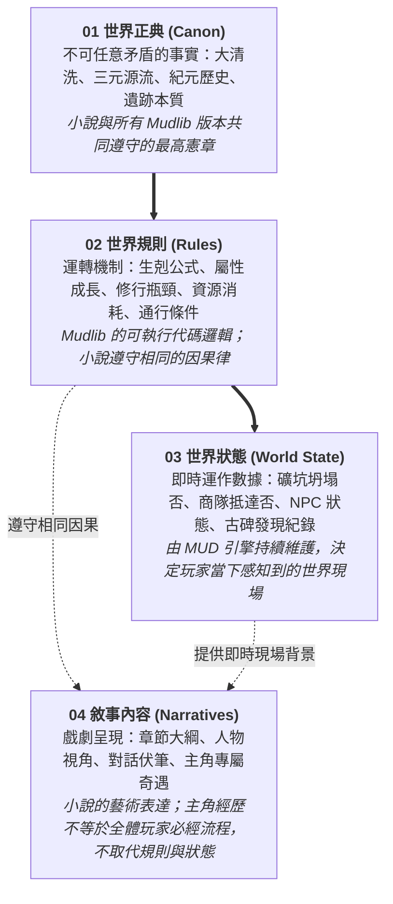
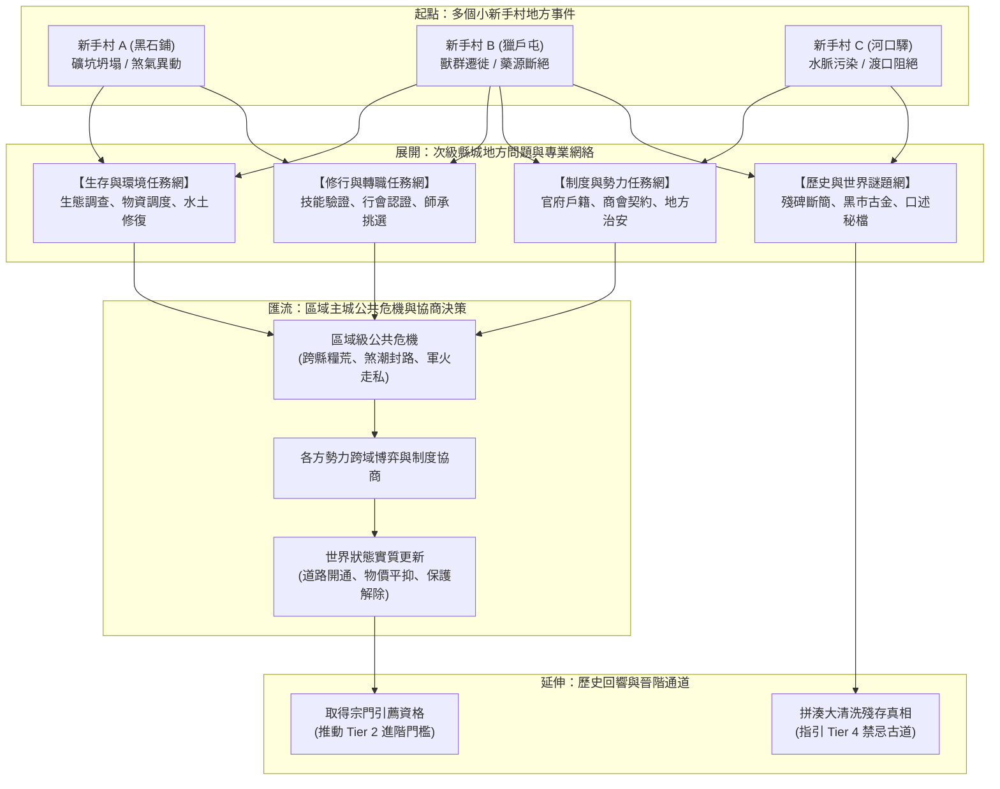
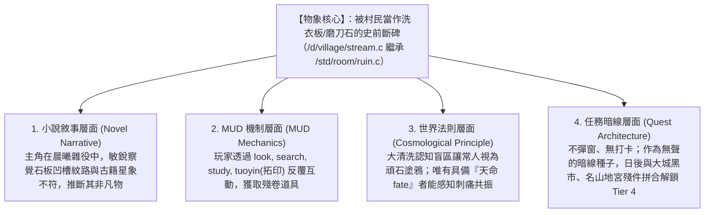

# 《世界觀與 Mudlib 架構設定集》(World Setting & Mudlib Bible)

> **版本**：v1.0.0 (正典分離與架構成熟版)  
> **更新時間**：2026-10-19  
> **目標**：作為小說創作的核心設定集，並同步作為 `./mudscript/` (LPC Mudlib) 的設計開發規格書。

---

## 目錄 (Table of Contents)
1. [基本資訊與雙軌規劃 (Overview & Dual Roadmap)](#1-基本資訊與雙軌規劃-overview--dual-roadmap)
2. [宇宙觀與歷史背景 (Cosmology & History)](#2-宇宙觀與歷史背景-cosmology--history)
3. [力量體系與修煉法則 (Power System & Mechanics)](#3-力量體系與修煉法則-power-system--mechanics)
   * [3.10 身世驗證矩陣與雙軌成長](#310-角色起步與成長哲學身世驗證矩陣與雙軌成長-background-matrix--dual-track-growth)
   * [3.12 資源、運作與不朽法則](#312-資源運作與不朽法則能力不是免費的-resource-operation--persistence-laws)
   * [3.13 Tier 3 入界：認知、運用與戰力尺度改變](#313-tier-3-入界認知運用與戰力尺度改變-realm-entry--changed-capability)
   * [3.14 Tier 1 初入道途：地方生活世界、三道哲學根基與任務社會網絡](#314-tier-1-初入道途地方生活世界三道哲學根基與任務社會網絡-tier-1-architecture-regional-society-three-paths--quest-networks)
4. [地理地圖與城鎮分區 (Geography & World Map)](#4-地理地圖與城鎮分區-geography--world-map)
5. [勢力宗門與陣營設定 (Factions & Sects)](#5-勢力宗門與陣營設定-factions--sects)
* **[延伸文檔]** [核心人物檔案 (Character Profiles)](file:///home/wade/src/github/mudscript/forgotten-space/narrative/character_profiles.md)
* **[延伸文檔]** [小說大綱與章節規劃 (Novel Outline)](file:///home/wade/src/github/mudscript/forgotten-space/narrative/novel_outline.md)
* **[延伸文檔]** [Mudlib LPC 機制映射 (Mudlib LPC Mapping)](file:///home/wade/src/github/mudscript/forgotten-space/narrative/mudlib_lpc_mapping.md)

---

## 1. 基本資訊與雙軌規劃 (Overview & Dual Roadmap)

### 1.1 作品元資訊
* **作品正式名稱**：**《遺忘的世界》(THE FORGOTTEN SPACE)**
* **官方封面 (暫定)**：`[fs.jpeg](file:///home/wade/src/github/mudscript/forgotten-space/img/fs.jpeg)`
* **專案 Mudlib 根目錄**：`/home/wade/src/github/mudscript/forgotten-space/`
* **題材風格**：東方玄幻 / 仙俠異道 / 史前失落文明探索 / 嚴謹數值設定流。
* **核心基調 (Tone)**：蒼茫大氣、微觀苦修、人間煙火生活感、撥開全民失憶迷霧的懸疑與壯烈。
* **核心衝突 (The Core Conflict)**：
  * 太古大清洗後文明斷代，當代法、力、物三道割裂偏科，修行至高深處面臨「道化、氣竭、物役」的末路；
  * 天道法則殘缺，脆弱的凡間容不下高階大能（滅世天劫逼迫飛升）；
  * 當世三大道統封鎖真相，唯有極少數身具天命者，從被世人視為塗鴉與頑石的遺跡中拼湊失落歷史，摸索三元歸一的禁忌超脫古道。

### 1.2 小說與 MUD 雙軌規劃藍圖 (The Dual Blueprint)
* **【小說軌道（Novel Track）】**：
  * [x] 作品正式書名定案：《遺忘的世界》(THE FORGOTTEN SPACE)
  * [x] 五重視角主角人物小傳（顧玄、林鐵生、燕隼、柳清虛、沈泥，見 `/narrative/characters/`）
  * [x] 第一卷「黑石驚蟄」全 38 章宏觀五幕架構確立（見 `/narrative/volume1.md` 與 `/narrative/novel_outline.md`）
  * [x] 第一卷第 1 ~ 32 章正文完全實作與前後邏輯校驗完畢（見 `/narrative/chapters/ch0001.md ~ ch0032.md`）
  * [ ] 第一卷第 33 ~ 38 章（第五幕：關前博弈・破局遠行）正文推進與全卷收官
  * [x] 第二卷「金石風雲」整體架構重規劃（大荒官道、三層空間拓撲、非帝國官僚地方治理、三道哲學深化、五花八門組織解耦、四階段轉職與多起點匯流任務網，見第 3.14 節）
* **【MUD 規格軌道（Mudlib Track）】**：
  * [x] 三元力量生剋與修煉/戰鬥心跳機制（第 3.1 ~ 3.3, 3.6 ~ 3.8 節）
  * [x] 統一數值階梯（T0~T3）與四重進階/天道排斥模型（第 3.9 節）
  * [x] 先天六維、狀態三柱 (`kee/sen/sp`)、天命隱藏屬性底層規格（第 3.10 ~ 3.11 節）
  * [x] 新手聚落立體地形（黑石鋪五方微生態）與三大鏈式 NPC 任務循環（第 4.3 節）
  * [x] 宣告式 JSON 任務架構與狀態機引擎 (`QUEST_ENGINE_D` + `/quests/*.json`) 全面實裝
  * [x] 新手村 `/d/village/` 房間地圖集 (10間核心房間) 與具體 LPC 腳本實作
  * [x] 世界動態狀態守護進程 (`WORLD_STATE_D`)、史前奇遇守護 (`MYSTERY_D`)、新手初級心法與三元動態恢復
  * [ ] **近期規劃**：五大身世「世界驗證」任務分歧實作（同一任務依身世不同，開放不同解題線索與 NPC 互動）
  * [ ] **近期規劃**：戰鬥守護進程 (`COMBAT_D`) 實裝（三角生剋公式、氣血狂潮打斷、機關消耗與佈陣邏輯）
  * [ ] **中遠期規劃**：Tier 1 區域城鄉網絡地圖集 (`/d/city/`)、專業資格認證轉職與五大任務模組實裝
  * [ ] **架構演進**：Web 端現代化 IDE（整合 Monaco Editor，以 `edit_file` / `save_file` 協定連動 Driver 熱重載）

### 1.3 核心架構四層模型 (The Four-Layer Architecture)

為確保小說創作與 Mudlib 引擎開發在宏觀與微觀上彼此契合、各司其職，確立四大分層職責邊界：



1. **01 世界正典 (Canon)**：
   * **定義**：世界中不可任意矛盾的底層客觀事實——大清洗確實發生過、法力物的源流、各個歷史紀元、古代遺跡的真實用途，以及已確定的重大歷史事件。
   * **用途**：小說創作與所有 Mudlib 版本的最高公約數，雙方共同嚴格遵守。
2. **02 世界規則 (Rules)**：
   * **定義**：法／力／物的生剋、屬性成長、修行瓶頸、資源消耗、地理通行條件與 NPC 行為規則。
   * **用途**：Mudlib 的可執行底層邏輯與代碼；小說則嚴格遵守相同的因果邏輯，拒絕機械降神。
3. **03 世界狀態 (World State)**：
   * **定義**：某一時刻實際發生的動態事件——如黑石礦坑是否坍塌、商隊是否抵達、NPC 是否受傷、某段古碑是否已被玩家發現、以及區域資源是否已耗盡。
   * **用途**：由 MUD 伺服器持續維護與運算，決定玩家當下連線時所看到的即時世界。
4. **04 敘事內容 (Narratives)**：
   * **定義**：小說章節、人物視角、情節順序、對話、伏筆與真相揭露方式。小說主角可以經歷 MUD 不會強制要求每位玩家經歷的專屬事件。
   * **用途**：創作具備戲劇張力的文學故事，但不取代客觀世界規則與 MUD 的實際運行狀態。

### 1.4 持續世界與小說主線的共存模型：三級事件範疇 (The Tri-Scope Event Model)

持續運行的 MUD 世界與具備明確情節線的小說，透過**「持續世界 ＋ 固定歷史事件 ＋ 可變局部狀態」**的混合模型實現無縫共存：

| 事件範疇 | 核心範例 | 存儲與處理層級 | 建議處理方式與規則 |
| :--- | :--- | :--- | :--- |
| **【世界級事件】**<br>*(World-Level)* | 史前大清洗、天地法則殘缺、紀元更迭、三道分流 | **01 世界正典 (Canon)** | **固定正典**。<br>不因普通玩家或個別主角的行動而被抹除或竄改，作為全宇宙共同背負的歷史基石。 |
| **【區域級事件】**<br>*(Regional-Level)* | 黑石鋪礦坑坍塌、商道中斷、外圍獸潮、某勢力暫管驛站 | **03 世界狀態 (World State)** | **可變動態狀態**。<br>由 MUD 引擎的 World Daemon 驅動，可依世界時間週期、天候地脈潮汐與全體玩家的共同行為（如全服修復進度）改變環境狀態。 |
| **【個人級事件】**<br>*(Personal-Level)* | 玩家拜師、NPC 對玩家產生信任好感、玩家發現古碑拓印 | **玩家存檔 (User Save)** | **個人進度保存**。<br>保存在個人角色數據中（如 `user->set("quest/...")`），記錄個人的道途歷程與獨特機緣。 |

#### 多人世界同步與解耦哲學 (Decoupled State Synchronization)
* **持續運行不等於全域僵化**：持續運行不代表每件事都必須全域永久固化，也不代表每個玩家在同一瞬間看到的環境狀態永遠相同。
* **分層狀態範例演繹**：
  * **玩家 A（或小說主角）**：深入塌方的三號深井救出 23 名老礦工（草廬分診中老李頭主動推拒吊命藥而安詳離世，倖存 22 名老礦工按手印證言成為破局核心籌碼） $\rightarrow$ 該事件在玩家 A 的個人任務日誌中永久記錄完成，聚落長輩與老礦工對其深信不疑，小說第一卷主線順利推進。
  * **區域環境狀態**：黑石礦坑由「緊急事故中」切換為「坑道修復加固中 (`mine_status = REPAIRING`)」。
  * **新進玩家 B**：可能仍在經歷事故前的調查委託，或者直接加入全村「運送木料加固坑道」的後續修復任務。
* **最終效益**：小說主角擁有獨立且精彩的英雄命運軌跡，而 MUD 玩家則在相同的因果律下探索各自的人生，**兩者共享同一個世界，卻完全不需要為了遊戲平衡去削足適履地重寫小說情節**！

---

## 2. 宇宙觀與歷史背景 (Cosmology & History)

### 2.1 天地起源：三才三態 (The Tri-Aspect Reality)
世界本源並非單純的靈氣或元素，而是由「理、形、質」三者鼎足而立所交織成的天地。人因秉賦與心性之異，各有所偏，遂分三途：
* **【理】演化為「法」**：宇宙的秩序、天道與法則。
* **【形】演化為「力」**：生命的內景、氣血與肉身小宇宙。
* **【質】演化為「物」**：世間的物質、金石地脈與客觀規律。

### 2.2 歷史紀元：大清洗與文明斷代 (Timeline & The Great Reset)
* **太古・失落黃金時代 (Pre-Reset Era)**：
  * 在極其久遠的史前歲月，曾存在一個無法想像的璀璨文明。那時三元一體、造化通天，並無如今狹隘的法、力、物宗派門戶之見。
* **劫難・史前大清洗 (The Great Reset / 歷史斷代)**：
  * **世界曾被徹底「重洗」過**。一場無可考據的天地浩劫或法則反撲，降下了不可逆的大清洗。
  * **全民遺忘與認知斷層**：文明遭到近乎徹底的湮滅，更可怕的是全體生靈被強制抹去了那段歷史與知識記憶。古老文明的殘骸化為散落天地的荒古遺跡，後人卻已完全遺忘它的來歷。
* **中古・斷裂修補與三道分立 (Fractured Age)**：
  * 荒原上的後繼生靈在蒙昧中重新摸索，拾取史前遺跡中飄散的零星殘片。
  * 偏愛意念律令者，從中參透出「法」；偏愛氣血體魄者，自殘篇中悟出「力」；偏愛器具機關者，借殘破造物研發出「物」。
  * 原本同源的體系分崩離析，形成互不相讓、長達千百年的道統門閥紛爭。
* **當代・失衡與真相重現 (Contemporary Era)**：
  * 三大偏科道統相繼走向瓶頸，各自面臨極致代價（道化、氣竭、物役）。
  * 與此同時，世界邊界出現裂隙，那些被當作神蹟膜拜、或是被當成塗鴉棄置的荒古遺跡，其沉睡的禁制與線索正逐漸甦醒。

---

## 3. 力量體系與修煉法則 (Power System & Mechanics)

> 💡 **Mudlib 連動設計**：此處每個層級、屬性與流派，直接對應 Mudscript 的屬性（Attributes）、心法技能（Skills）與戰鬥系統（Combat Daemon）。

### 3.1 三位一體核心理念 (The Three Paths)

| 核心修道 | 核心哲學 | 力量本質 | 修行追求 | 極致代價 (修行風險) | Mudlib 核心屬性 |
| :--- | :--- | :--- | :--- | :--- | :--- |
| **【法】** | **意念即世界** (Mind as World) | 溝通天地法則、共鳴天道、引動律令 | 洞悉規律、言出法隨、元神長存 | **道化危機**：神性日盛而人性泯滅，最終同化於無形虛無 | `int` (悟性), `spi` (靈性), `sen` (神識), `mana/sp` |
| **【力】** | **人即世界** (Body as World) | 內景宇宙、肉身烘爐、氣血引力場 | 自給自足、一力破萬法、肉身成聖 | **崩解危機**：氣血如狂熔爐，反噬生機，極易壽元暴竭 | `str` (臂力), `con` (體質), `kee` (氣血), `damage` |
| **【物】** | **世界即我** (World as Self) | 析理造化、地脈陣圖、金石靈植重塑 | 巧奪天工、萬物為用、器鎮乾坤 | **外物奴役**：依賴外器，心為物役，極度渴求稀世資源 | `dex` (靈巧), `per` (感知), 裝備耐久, 藥毒耐性 |

### 3.2 三角生剋博弈 (The Triangular Counters)
在小說對決與 MUD 戰鬥中，三者存在鮮明的哲學與戰術剋制：
1. **【力 克 法】（氣血狂潮，震散神識）**
   * 力修近身爆發純陽氣血與引力場，強行震碎虛空頻率，使法修「感應中斷」、吟唱潰散。
2. **【法 克 物】（重塑法則，點鐵成灰）**
   * 法修藉由天地律令直接改寫物質底層結構，抽離陣法靈樞、消融法器神金、逆轉藥效為毒。
3. **【物 克 力】（精密設局，機巧磨損）**
   * 物修以重弩陷阱、鎖骨奇毒、封元大陣與機關傀儡層層阻擊，將純肉身強者活活消耗至氣血衰竭。

### 3.3 交叉與偏鋒流派 (Hybrid & Specialized Paths)
世人多偏修其一，但驚才絕豔者或隱世強者常涉足兩道之交：
* **法 ＋ 力 ＝【戰仙 / 煞體】**：以身刻符，肉身即施法媒介，拳罡呼嘯挾帶天雷地火。（高爆發、攻守俱佳，但氣血與神識雙重內耗極大）
* **力 ＋ 物 ＝【兵人 / 人器合一】**：以肉身為鐵砧，熔煉神鐵靈礦入骨髓經絡，人身化神兵。（極限物理抗性，肉搏撕裂法寶）
* **物 ＋ 法 ＝【天工造物 / 陣道神師】**：神念分化入機關靈偶，一人成軍；或拋旗改換方圓百里地貌天象。（擅長領域陣地戰與群體壓制，本體極需保護）
* **法 ＋ 力 ＋ 物 ＝【三元大圓滿】**：**小說核心終極謎題**。相傳自混沌開闢以來未有人能完美同修三道，三道並聚究竟是通往超脫，還是引發天崩？

### 3.4 空間晉升與修煉階梯鏈 (Spatial-Progression Ladder)

修煉境界與空間地理緊密綁定，形成「**出村 $\rightarrow$ 入城 $\rightarrow$ 入山 $\rightarrow$ 入界 $\rightarrow$ 禁忌古道**」的層級推進：

| 階梯層級 | 空間場景類型 | 修煉階段 | 小說敘事功能 | Mudlib LPC 目錄映射 | 核心玩法與機制 |
| :--- | :--- | :--- | :--- | :--- | :--- |
| **Tier 0** | **出村** (鄉野/採礦聚落/邊陲驛鎮) | 凡胎啟蒙 | 主角出身背景、底層生活疾苦、初露鋒芒、被迫或主動離鄉 | `/d/village/` | 基礎共通拳腳、粗淺吐納、採礦/採藥導引、新手引導任務 |
| **Tier 1** | **進城・城鄉網絡** (區域主城/次級縣城/村落廊道) | **一階初入道途** (確立修行專業) | 見識世面、市井百態、地方治理、生活生計與社會關係網絡、確立修行專業 | `/d/city/` | 城鎮生活、四階段轉職、三道技能網絡解鎖、地方勢力協商、公共事件處置、黑市與失落記錄探索 |
| **Tier 2** | **入山** (名山大川/宗門祖庭/深谷秘境) | **二階升級** (宗門深造/脫俗) | 脫離凡塵煙火、宗門殘酷考核、內外門晉升、同門爭端、尋求更高能量與資源 | `/d/mountain/` | 守山弟子阻擋、宗門拜師、各派專屬絕學、門派心法突破、宗門日常貢獻任務 |
| **Tier 3** | **入界** (單向通道/桃花源/異界洞天) | **三階升級** (超凡入聖) | 凡間天地無法容納頂級大能；經由單向隱密通道（桃花源/古石洞/天穹裂隙）遁入，太古遺民與真正巨擘盤踞 | `/d/realm/` | 單向傳送門 (One-way Portal)、獨立天地法則、高危險高回報、大宗師爭鋒 |
| **Tier 4** | **禁忌奇遇** (失落古道/歷史盲區) | **禁忌交叉 / 三元歸一** | 被主流三大派合力封殺抹除的失傳古道；世間僅主角與少數宿命宿敵或瘋癲古人探索，撼動世界底層根基 | `/d/secret/` | 隱藏轉職 (Hidden Class)、極度嚴苛的解謎前置 Quest、自廢武功/九死一生、專屬奇遇技能 |

### 3.5 任務推進雙軌架構：主線與隱藏任務並行 (Dual-Track Quest Architecture)

小說情節與 MUD 玩家冒險均採取「**主線明軌**」與「**奇遇暗軌**」並行架構：

```mermaid
flowchart TD
    subgraph 明軌：主線任務 (Main Quests)
        T0[Tier 0: 出村啟蒙] --> T1[Tier 1: 進城入道]
        T1 --> T2[Tier 2: 入山深造]
        T2 --> T3[Tier 3: 桃花源 / 異界洞天]
    end

    subgraph 暗軌：隱藏奇遇與歷史拼圖 (Hidden Quests & Lore)
        H1[民間神蹟 / 頑石塗鴉 / 廢墟傳聞] -. 零散線索 .-> H2[跨域解謎 / 史前殘件收集]
        H2 -.-> H3[豐富厚實 Tier 3 異界背後真相]
        H3 ==>|拼湊大清洗真相 / 破除盲區| T4[Tier 4: 史前遺跡 / 禁忌古道]
    end

    T0 -. 偶遇奇異塗鴉/傳聞 .-> H1
    T1 -. 黑市流通古物/古碑 .-> H1
    T2 -. 宗門封印禁地/古籍盲區 .-> H2
    T3 -. 探索洞天本質（避難所還是囚籠？） .-> H3
```

1. **主線任務（明軌・社會晉升路徑）**：
   * **目標**：帶領修士/玩家體驗當代主流修真世界的運轉法則，從凡間小民成長為一方巨擘。
   * **終點**：最終引導主角與玩家達成 **Tier 3 (入界・桃花源 / 異界洞天)**，完成當代修煉體系認可的大圓滿或飛升。
   * **敘事與 MUD 功能**：目標明確、進階考核標準、聲望與陣營貢獻明確，推動世界表層勢力格局演變。

2. **隱藏任務 / 奇遇線（暗軌・探尋失落真相）**：
   * **目標**：拼湊「史前大清洗 (The Great Reset)」被抹除的歷史真相。
   * **加深 Tier 3 的厚度與份量**：
     * 隱藏任務不只給予高額獎勵，更重要是**揭開 Tier 3 的本質**。當世人以為「桃花源 / 異界」是超凡飛升的天堂時，隱藏線卻揭示出它可能只是史前大清洗時期殘存的「封閉避難所」、「觀測站」或是「古老放逐之地」，大幅增加 Tier 3 的劇情張力與探索深度。
   * **鋪設通往 Tier 4 的隱秘路徑**：
     * Tier 4 沒有明面上的引路 NPC 或官方宗門。唯一觸碰 Tier 4 的途徑，是透過串聯散落人間的隱藏線索（村頭破碑、懸崖無名古畫、黑市古金、禁地殘陣），逐步解開失落的太古三元歸一古道。
   * **機制特點**：無強制指引 (No Quest Marker)、重在環境觀察與細節互動 (`look`, `search`, `push`)、古語解讀、天候地利配合。

### 3.6 三系修煉與練功循環機制 (Cultivation Loops & Progression)

在小說與 Mudlib 引擎中，三大體系有截然不同的日常練功循環與突破瓶頸：

| 流派 | 修煉方式 (MUD 指令動作) | 核心消耗資源 | 升級與修煉邏輯 | 突破瓶頸 (Bottleneck & Breakthrough) |
| :--- | :--- | :--- | :--- | :--- |
| **【法】**<br>*(意念即世界)* | **觀想冥想** (`meditate` / `guanxiang`)<br>**研讀道經** (`study <scroll>`)<br>**感悟天象** (`commune`) | **神識 / 精力 (`sen/sp`)**<br>靜室環境靈氣值 | **以「悟」為主**。<br>打坐與閱卷累積「靈性」，戰鬥只提供微量印證，靠高悟性 (`int`) 快速拉升心法熟練度。 | **知見障與心魔劫**：<br>苦修無法強衝，瓶頸時必須「頓悟」——需要遊歷名山、破解古陣、或在特定天象時辰（雷暴/朔月）心境相契方能破關。 |
| **【力】**<br>*(人即世界)* | **氣血打熬** (`exercise` / `quanfa`)<br>**極限負重** (`train` 瀑布/重力場)<br>**淬體藥浴** (`bath` 吸收藥力) | **氣血 / 體力 (`kee/fp`)**<br>大量肉食、活血藥散 | **以「熬」為主**。<br>依靠極限自虐式淬體與生死搏殺。越在瀕死或極限重壓下，氣血激盪越快，熟練度漲幅越高。 | **肉身桎梏與氣血逆流**：<br>肉體有生理硬上限，突破需要「引極端外力衝穴」——如深入地煞火海、接承受高階強者掌力、或尋覓地脈靈泉淬骨換血。 |
| **【物】**<br>*(世界即我)* | **解析物性** (`analyze <item>`)<br>**鍛造打鐵** (`forge`)<br>**煉丹製藥** (`brew/refine`)<br>**機巧組裝** (`tinker/assemble`) | **金石材料、藥草、圖紙**<br>大量金錢/貨幣 (極度燒錢) | **以「造」為主**。<br>物修**無法憑空打坐升級**！必須不斷採集、拆解、製造、改良裝備與機關，技藝隨成品的數量與品質提升。 | **工藝圖譜與天材地寶**：<br>缺乏相應品階的材料與古代圖紙，技術寸步難行。突破往往依賴於獲得古籍殘篇或挖掘到稀有史前合金礦脈。 |

### 3.7 戰鬥節奏與心跳機制 (Combat Rhythm & Tick-Based Mechanics)

在 MUD 的 Heartbeat（心跳回合戰鬥）中，三系的戰鬥手感與動態生剋如下：

```
【法修】：拉開身位 ──> 蓄力吟唱 (cast) ──> 範圍/毀滅爆發 (AoE/Burst) ──> 身板極脆需防斷招
【力修】：近身貼臉 (charge) ──> 霸體狂攻 (punch/slash) ──> 氣血狂潮打斷對手 ──> 越殘血越狂暴
【物修】：戰前佈陣 (trap/deploy) ──> 召喚傀儡嘲諷 ──> 遠程重弩/毒藥削弱 ──> 磨損消耗對手
```

1. **【法】（爆發控場型 / Artillery & Crowd Control）**：
   * **特色**：傷害上限最高、射程最遠、附帶大範圍控場（冰凍、雷殛麻痺、神識迷亂）。
   * **操作**：輸入 `cast <spell> on <target>`。高階法術需要 1~2 回合的吟唱延遲 (Chanting delay)。
   * **致命弱點**：吟唱中一旦遭受重擊，施法會被打斷 (Interrupt)，並引發「真元反噬」（反噬自扣神識與氣血）。
2. **【力】（近戰肉盾突進 / Juggernaut & Disruptor）**：
   * **特色**：高氣血生命池 (`kee`)、自帶物理霸體與減傷、極速貼身。
   * **操作**：主動技多為 `exert roar`（戰吼震懾斷招）、`perform strike`（破防重擊）、`charge`（高速突進）。
   * **被動機制**：自帶「氣血狂潮 (Blood Aura)」，貼身後使周遭虛空頻率動盪，直接延長對手施法吟唱時間並大幅提升其施法失敗率。
3. **【物】（戰術陣地型 / Tactician & Buffer）**：
   * **特色**：戰術極度靈活、自保手段最多、擅長持久消耗戰與越級挑戰。
   * **操作**：
     * 戰前/戰中：`deploy puppet`（放出機關傀儡代為分擔傷害/吸引仇恨）、`set trap`（埋設連環地釘毒霧陣）。
     * 戰中：`use crossbow`（上弦射出破甲穿甲彈）、`toss poison_vial`（丟出腐蝕氣血的化骨粉）。
   * **代價**：每場戰鬥都在「消耗」彈藥道具與裝備耐久，未備足物資時戰力大幅滑落。

#### 三角生剋的戰鬥判定實現：
* **力剋法（近身打斷壓制）**：力修高速突進貼身，釋放純陽氣血狂潮，法修頻繁遭遇 `[你的心神被對手雄渾的氣血狂潮震散，法術中斷反噬！]`，防禦脆弱直接被連擊重創。
* **法剋物（微觀法則分解）**：物修的機關傀儡與金屬鎧甲皆為客觀物質，法修直接施展律令法術，無視物理抗性熔斷傀儡靈樞核心，將機關造物過載引爆。
* **物克力（陷阱風箏消耗）**：力修直來直往猛衝，撞入物修層層佈置的引力黏膠陷阱與蝕骨毒煙，機關傀儡在前頂住正面衝擊，物修在遠程以破甲弩連續射擊，將力修狂暴氣血磨損殆盡。

### 3.8 數值平衡與生態槓桿 (Balance & Resource Economics)

為避免某一系在 MUD 遊戲生態中過於泛濫或全能，透過「**開局門檻、經濟成本、團隊不可替代性**」三維度進行宏觀槓桿平衡：

1. **白手起家門檻 (Early Game)**：
   * **力修平滑順暢**：赤手空拳或隨便撿根木棍即可打熬筋骨，初期單刷練級最順，是平民散人首選。
   * **法修極需資質**：對悟性要求苛刻，前期缺乏護身道袍與高階符法時極度脆弱，極需同伴護衛或特定靜室。
   * **物修前置漫長**：開局需採礦採藥、收集圖紙，未成型前戰力最弱且極其依賴啟動資金，但成型後安全係數最高。
2. **越級挑戰與上限能力 (End Game)**：
   * 力修受限於自身肉體數值硬上限，極難跨大境界逆伐大能。
   * 法修擁有極端爆發力與神識控場，配合良好時能創造逆境秒殺奇蹟。
   * 物修能靠針對性準備（特定抗性防具、針對 BOSS 弱點的特調奇毒、預先佈設百里大陣）實現「凡人智殺仙佛」。

### 3.9 層級進階判定：數值階梯、允入條件與天道強制驅離 (Tier Advancement: Caps, Admission & Eviction)

為兼顧小說合理性與 Mudlib 引擎實作，摒棄難以跨系量化的傳統修仙境界詞（如築基、金丹等無法通用於物修與純體修），全面採用**統一數值階梯**與**四重進階判定模型**：

```
【數值上限 (Cap)】 ──> 【瓶頸考驗 (Breakthrough)】 ──> 【社會/通道允入 (Access)】 ──> 【低階排斥/強制離去 (Eviction)】
   (修為練滿封頂)            (完成質變衝穴/頓悟)             (拿到路引/考試合格)            (舊天地容不下你了)
```

#### 1. 統一數值階梯劃分 (Universal Numerical Scaling)
* **Tier 0（凡胎啟蒙・鄉村）**：角色等級 `Level 0 ~ 10`，技能上限 `Skill Lv. 1 ~ 30`
* **Tier 1（初入道途・城鎮）**：角色等級 `Level 11 ~ 50`，技能上限 `Skill Lv. 31 ~ 100`
* **Tier 2（宗門深造・名山）**：角色等級 `Level 51 ~ 100`，技能上限 `Skill Lv. 101 ~ 200`
* **Tier 3（超凡入聖・異界）**：角色等級 `Level 101 ~ 200+`，技能上限 `Skill Lv. 201 ~ 300+`

#### 2. 各層級進階「允入」與「強制離去」機制

| 跨階晉升 | 數值瓶頸與破階要求 (Breakthrough) | 允入條件與憑證 (Admission & Access) | 強制進級 / 驅離理由 (Eviction & World Tribulation) |
| :--- | :--- | :--- | :--- |
| **Tier 0 $\rightarrow$ Tier 1**<br>*(出村進城)* | 基礎拳腳/吐納/採掘達 30 級滿值。需消耗初階資源完成一次「淬體/聚氣/開竅」。 | 村中長老/教頭認可已無可傳授，完成成人禮或驅匪任務，獲發**「出鄉文牒 / 鏢局路引」**方可通過城防盤查進城。 | **資源枯竭與保護解除**：<br>1. 村莊野獸不再提供收益 (`exp = 0`)；<br>2. 鄉間無進階活血藥、靈炭；<br>3. 新手村保護撤除，客棧不再提供免費休養。 |
| **Tier 1 $\rightarrow$ Tier 2**<br>*(進城入山)* | 一階職業技能達 100 級滿值。輸入 `breakthrough` 需經歷心魔叩問、真氣逆沖或精金淬鍊。 | 城中武館/道壇/行會館主推薦，參加宗門定期選拔比武，取得**「宗門考核令」**，通過登天梯或問心谷考核上山。 | **紅塵濁氣侵蝕與法網壓制**：<br>1. **修行窒息**：大城人口稠密、凡俗七情沉澱為「紅塵濁氣」，二階以上在城中修煉會神識蒙塵、氣血淤滯，修為不進反退；<br>2. **法網壓制**：朝廷與城主立有絕靈大陣，嚴禁二階以上真元私鬥，違者遭大軍圍剿。 |
| **Tier 2 $\rightarrow$ Tier 3**<br>*(入山入界)* | 二階名門絕學達 200 級大圓滿。凡間功法已無寸進可能。 | 尋獲古籍指引、等待天象時機（如千年日食/地脈潮汐），手持太古遺留物解開**桃花源單向古陣**。 | **大清洗後脆弱天地的滅世天劫**：<br>1. 太古大清洗後，凡間空間壁障極度脆弱，無法容納三階大能走動，否則引發地脈開裂；<br>2. 天道降下「化道神雷/天劫」抹除；<br>3. **大能要麼遁入異界（Tier 3），要麼自封棺木長眠**，絕無法常駐凡間。 |

### 3.10 角色起步與成長哲學：身世驗證矩陣與雙軌成長 (Background Matrix & Dual-Track Growth)

摒棄傳統 MUD 繁複無趣的「反覆洗點/隨機搖點」機制，確立「身世非枷鎖，行止塑自身，全方位滿屬性自由」的沉浸式成長法則：

#### 1. 身世設計三大核心原則 (Three Core Principles)
1. **六維反映出身帶來的先天條件，不直接等同於職業**：
   - 先天六維數值體現的是少年在原生環境中摸爬滾打所奠定的身體底子與觀察習慣，而非直接鎖定職業類別。
2. **成長加速權重反映長期修行的優勢，避免雙重偏袒**：
   - 成長倍率（親和度）代表角色在特定修煉行為上的感悟速度，不能只把初始高屬性再乘上高倍率，否則容易造成單一屬性的極端失衡。
3. **五種身世具備鮮明辨識度，但在玩法機制上保持動態平衡**：
   - 任何一種身世都有其獨特且不可替代的「觀察視角」與「問題切入點」，但在整體探索、生存與解謎中，不存在全方位碾壓其他身世的「最優解」。

#### 2. 三層身世架構 (The Three-Tier Background Architecture)
五大身世的設計由內而外貫徹三層立體結構：
* **第一層：先天道基 (Innate Aptitude)**：
  - 基礎六維屬性點數（全員基準總分 18 點）與動態三柱池（`kee/sen/sp`）的天然偏向。
* **第二層：身世背景知識與視角 (Background Knowledge & Lens)**：
  - 各自在底層社會積累的行業常識、生活經驗、人脈起點與面對危機時的直覺認知模式。
* **第三層：世界驗證路徑 (World Verification Paths)**：
  - 如何進入世界、如何與 NPC 建立信任、如何解讀現場線索，以及在同一危機事件中如何以不同專業手段驗證世界規律。

#### 3. 五重視角理解世界維度 (Five Ways of Understanding the World)
五種身世分別代表觀察、驗證這個失落世界五種不同維度的「鏡頭」：
* **顧玄（採藥孤兒）｜【從自然現象理解世界】**：
  - 核心關注：地形地勢、氣候風向、地煞擴散、草木物性、動植物病理生剋。
  - 思考習慣：看到異常現場，第一反應是探究自然環境、土壤濕度、空氣流動與毒煞滲透的生態因果鏈。
* **林鐵生（打鐵學徒）｜【從物質與實作理解世界】**：
  - 核心關注：原料礦石、金屬配比、鍛造公差、受力結構、工程機械、工具脆性與應力極限。
  - 思考習慣：面對危崖、機關或防禦工事，第一反應是評估岩層結構、滑輪導輪拉力極限與百工操作施工時限。
* **燕隼（獵戶之子）｜【從行為與痕跡理解世界】**：
  - 核心關注：生物習性、爪痕糞便、受驚逃竄動線、狩獵陷阱、要害破綻與搏殺預判。
  - 思考習慣：發現林中動靜，第一反應是推測動物受驚方向、遷徙規模、捕食與逃亡本能，以及前排頭獸的盲從慣性。
* **柳清虛（破落道童）｜【從知識與超自然現象理解世界】**：
  - 核心關注：道藏經卷、古文字符文、周天星軌、超常靈性異象、天地禁制牢籠與道化代價。
  - 思考習慣：仰望天幕或古碑，第一反應是聯想古籍註解、星宿逆行、天地氣息逆轉與上古牢籠封印的底層法則。
* **沈泥（流浪乞兒）｜【從人與人之間的關係理解世界】**：
  - 核心關注：市井人情世故、利益動機推演、交易網絡、制度漏洞、各方訴求衝突與避險本能。
  - 思考習慣：聽到眾人爭執或說詞矛盾，第一反應是盤算消息來源、背後有何利益牽扯、誰有理由隱瞞、恐慌蔓延會推動哪方逃跑。

#### 4. 沈泥角色設計邊界：防全知、防聖母、防降智 (Shen Ni Design Boundaries)
沈泥的優勢在於察言觀色、理解利益、連結人物與運用有限資源。她具備高感知（PER 5）與高悟性（INT 4），但絕非無所不知的「天眼偵探」或靠言語感化萬物的「聖母」：
* **看出矛盾，不等於知道誰在說謊**：她能察覺兩造說詞兜不攏，但究竟誰真誰假、背後有何隱情，仍需具體物證與邏輯交叉檢驗。
* **理解動機，不等於認同立場**：她能體會富戶私逃、官軍推諉、底層苟活的自私盤算，但不會盲目同情，更不會因此放棄原則。
* **協調利益，不等於強迫合作**：她能提出雙方各退一步的交易方案，但面對根深蒂固的階層衝突與生死恐慌，方案隨時可能因人性貪婪而破局。
* **成長的本質**：學會理解他人，同時**約束自己對他人的主觀判斷**（「克己復禮為仁」），在街頭狡黠中逐漸昇華出克制、誠信與擔當。

#### 5. 五大身世世界驗證與先天道基矩陣 (The Background & World Verification Matrix)

| 身世背景 | 故事切入點 | 優先驗證的世界系統 | 先天六維分配 (總點數 18) | 修行親和度 (成長加速權重) |
| :--- | :--- | :--- | :--- | :--- |
| **採藥孤兒**<br>(顧玄) | 靠採藥維生，在山林與絕壁間討生活 | 山地地形、藥草分布、採集機制、藥鋪、草藥物性知識 | STR 1, CON 3, **DEX 5**<br>INT 2, SPI 2, **PER 5** | 身法 (DEX) 200%, 感知 (PER) 200%<br>次要 根骨 (CON) 130%, 其餘 100% |
| **打鐵學徒**<br>(林鐵生) | 從鐵匠鋪的工作與人際關係開始 | 原料礦石、燃料配比、鍛造公差、工具、百工造物與工匠生活 | **STR 5**, **CON 5**, DEX 3<br>INT 1, SPI 1, PER 3 | 臂力 (STR) 200%, 根骨 (CON) 200%<br>次要 靈巧 (DEX) 130%, 其餘 100% |
| **獵戶之子**<br>(燕隼) | 從狩獵、追蹤與荒山山林生活開始 | 動物習性、足跡追蹤、機巧陷阱、獵物分布、剝皮與獵獲交易 | STR 3, CON 3, **DEX 4**<br>INT 1, SPI 2, **PER 5** | 感知 (PER) 200%, 身法 (DEX) 180%<br>次要 根骨 (CON) 140%, 臂力 130%, 其餘 100% |
| **破落道童**<br>(柳清虛) | 從殘破道觀、經卷與殘缺符文開始 | 孤岩道壇、道藏古籍、知識傳承、殘缺符文、歷史謎團與道化之影 | STR 1, CON 2, DEX 2<br>**INT 5**, **SPI 6**, PER 2 | 靈性 (SPI) 200%, 悟性 (INT) 200%<br>次要 根骨 (CON) 120%, 其餘 100% |
| **流浪乞兒**<br>(沈泥) | 從街市、客棧與市井人情世故開始 | NPC 關係網絡、暗巷交易、八方情報、黑市路引、地方勢力與社會規則 | STR 2, CON 2, **DEX 3**<br>**INT 4**, SPI 2, **PER 5** | 悟性 (INT) 200%, 感知 (PER) 180%<br>次要 身法 (DEX) 130%, 根骨 (CON) 120%, 其餘 100% |

#### 6. 雙軌成長模型與「十里坡劍神」哲學 (Dual-Track Progression & Infinite Grinding)

如何做到「有身世優勢，卻不鎖死未來，每個人都能成為全方位滿屬性大能」？

* **軌道 A（等級通用基底）**：
  * 每升一級，**六圍屬性全員各 +1**（象徵生命層級躍遷的普適積累，人人不落下）。
* **軌道 B（行為修行親和度 / 邊做邊學）**：
  * 在環境中透過具體動作（拉風箱、掄鐵錘、攀岩採藥、跳瀑布淬體、調校陷阱、孤壇觀星、後巷聽風）修煉時：
    * **本行親和**：享有 **130% ~ 200%** 的快速感悟成長速率。
    * **跨界苦修**：以 **100%** 基準速率持續增長。
* **終極自由（不設枷鎖）**：
  * **所有屬性上限對所有身世完全一致**。打鐵學徒若有心長年於孤岩殘壇打坐，一樣能把悟性與靈性頂到天道極限；破落道童若日日掄動重錘，同樣能煉成千斤巨力的金剛身軀。
  * 玩家若硬要在新手村把所有屬性磨滿才踏入大都府城，系統完全允許並嘉獎這種「十里坡劍神」般的苦行毅力！

#### 7. Tier 0 探索至 Tier 1 正式封道 (Exploration to Dedication)
* **Tier 0（Level 0 ~ 10）**：屬於無門無派的自由體驗期。玩家可隨心所欲打獵、摸魚、讀碑、打鐵，邊玩邊發現自己的風格喜好與屬性傾向。
* **Tier 1 城門登記儀式**：抵達 Level 10 進入府城時，經由城門典吏審核骨骼氣色，玩家正式選定前往武館（力）、道壇（法）或行會（物）進行一階轉職。在新手村累積的所有屬性，均轉化為修行底蘊。

### 3.11 屬性體系全景：先天六維、狀態三柱與終極天命 (Attribute Matrix)

三道體系與人體機能具備嚴謹的數學與哲學對稱性，劃分為「先天六維」、「動態狀態三柱」與「史前終極天命」：

```mermaid
graph TD
    subgraph 先天核心六維 (Primary Attributes, 基礎全 1 起步)
        STR[臂力 str: 力之本]
        CON[根骨 con: 力之體]
        SPI[靈性 spi: 法之神]
        INT[悟性 int: 法之理]
        DEX[靈巧 dex: 物之手]
        PER[感知 per: 物之心]
    end

    subgraph 動態狀態三柱 (Secondary Vitals, 戰鬥動態池)
        KEE[【氣血池 kee】: 人體生機 / 氣血狂潮]
        SEN[【神識池 sen】: 靈台心智 / 感悟威壓]
        SP[【精力/真元池 sp】: 心靈手巧 / 造化驅動]
    end

    STR & CON ==>|支撐人即世界| KEE
    SPI & INT ==>|支撐意念即世界| SEN
    DEX & PER ==>|支撐世界即我| SP

    subgraph 終極隱藏屬性 (Meta Attributes, 直指 Tier 4)
        KAR[【福緣 kar】: 外在運氣 / 撿漏 / 絕處逢生]
        FATE[【天命 fate】: 內在宿命 / 破除大清洗盲區 / 三元共鳴]
    end
```

#### 1. 先天核心六維（Primary Attributes，行為鍛鍊，上限隨階提升）
* **【力道雙柱】**：
  * **臂力 (`str`)**：肌肉爆發力、物理傷害、負重、擊退壓制力。
  * **根骨 (`con`)**：骨骼韌性、物理抗性、氣血自我修復速度、挨打耐力。
* **【法道雙柱】**：
  * **靈性 (`spi`)**：與天地法則共振的敏感度、心神純淨度、抵禦精神侵蝕的能力。
  * **悟性 (`int`)**：解析萬物秩序的思考速度、心法修煉效率、破解法陣道經的能力。
* **【物道雙柱】**：
  * **靈巧 (`dex`)**：指掌微操、機關裝配與觸發速度、身法精準度、暗器飛針彈道。
  * **感知 (`per`)**：對物質微觀紋理的洞察、破綻看破、環境探索搜查 (`search`)、毒石辨別。

#### 2. 動態狀態三柱（Secondary Vitals，完全對稱映射三大流派）

| 狀態柱 | LPC 變量 | 支撐先天屬性 | 核心哲學與體現 | 戰鬥消耗與代價 |
| :--- | :--- | :--- | :--- | :--- |
| **【氣血池】** | `kee` (HP) | **`str + con`** | **「人即世界，力之顯現」**<br>氣血差表現就是沒力、臉色蒼白、骨肉萎靡。 | 遭受肉身打擊時扣減；力修燃燒氣血釋放狂暴霸體；歸零則重傷昏迷或死亡。 |
| **【神識池】** | `sen` (MP/SAN) | **`spi + int`** | **「意念即世界，法之顯現」**<br>沒悟性靈性，學什麼法？感悟什麼天地？ | 施法吟唱負荷、承受精神威壓時扣減；法修核心生命線，被打散則法術反噬昏厥。 |
| **【精力/真元】** | `sp` / `mana` (Energy) | **`dex + per`** | **「世界即我，物之顯現」**<br>心靈手巧、感知物性、調度外物天地氣機。 | 操作精密機關、連環殺陣展開、製造鍛造、戰術輕功位移之消耗能量。 |

#### 3. 終極隱藏屬性（Meta Attributes，決定奇遇與 Tier 4 資格）

這兩項屬性不顯示於常規面板，是解開世界真相的關鍵暗鎖：

1. **【福緣 / 運氣】(`kar` / Karma / Luck)**：
   * **外在的偶然性機緣**：決定採礦是否挖出罕見伴生金屬、擊敗強敵是否爆出極品遺留物、逃跑跳崖是否掛在古松上不死、在黑市古董攤是否能撿漏古殘件。
2. **【天命 / 宿命共鳴】(`fate` / Destiny / Ancient Resonance)**：
   * **破除「大清洗認知盲區」的唯一鑰匙**：
     * 普通凡人受史前認知抹除影響，看到古代遺跡壁畫本能地當成荒誕塗鴉、視若無睹。
     * 唯有高【天命】者，靠近太古遺跡時會產生**「神經突觸刺痛與血脈共鳴」**，能解讀已失落的太古銘文殘響。
   * **承載三元融匯的唯一根基**：
     * 當世之人強行兼修法、力、物，極易引發三元衝突而爆體走火入魔；唯有天命覺醒之人，體內天地才具備包容「三才歸一」的混沌大圓滿潛質（通往 Tier 4 的門票）。
   * **增長途徑**：無法藉由常規打怪升級獲得。採用【天命五象分形・五火破封】機制：所有身世初始天命均為 1，各身世在新手村完成屬於自身命運軌跡的首次太古奇遇時（如鍛造出太古不融黑鐵、荒古戰神圖騰共鳴、孤壇仰窺天網偽籠、暗巷發掘天門引），天命藉由 `MYSTERY_D` 覺醒 +1（達到 2），從而破除更高階的史前殘碑（`stream.c` 需天命 2）認知鋼印。此後透過重大命運抉擇與歷史拼圖持續成長。

#### 4. 度量衡法則：時間流速與重量負重 (Time & Metric Encumbrance System)

為確保小說文字細節與 MUD 數值體驗高度統一，全專案確立以下度量衡規範：

1. **太古曆法與時間流速機制 (`nature_d.c`)**：
   * **遺忘曆法紀年（太古異星公轉法則・一季即一歲）**：
     * 大清洗浩劫撕裂天地星軌，遺忘世界之星體繞恆星公轉極速，**凡人世俗三個月（一季），在遺忘世界的天道公轉中便是完整的一歲（一年）！**
     * 紀年公式：$\text{Calendar Year} = (\text{Real Year} \times 4) + \text{Quarter} - 3$（其中 1~3月 Quarter=0，4~6月 Quarter=1，7~9月 Quarter=2，10~12月 Quarter=3）。
     * **四歲輪轉歲象**：
       - 現實 10~12月（如 2026 年底）：遺忘曆 **8104 年【玄冥冬歲】**
       - 現實 01~03月（如 2027 年春）：遺忘曆 **8105 年【一元春歲】**
       - 現實 04~06月（如 2027 年夏）：遺忘曆 **8106 年【品物夏歲】**
       - 現實 07~09月（如 2027 年秋）：遺忘曆 **8107 年【金石秋歲】**
       - 現實 10~12月（如 2027 年冬）：遺忘曆 **8108 年【玄冥冬歲】**……依此連綿不絕，年年連續！
   * **周天四序・元亨利貞四十八時辰（4:1 流速比例）**：
     * **微觀流速**：現實 15 秒 = 遊戲 1 分鐘；現實 30 分鐘 = 遊戲 2 小時（1 個時辰）；現實 6 小時 = 遊戲整整 1 個日夜（12 個時辰 / 24 小時）。
     * **現實 24 小時完整演繹四大輪元（共 48 時辰）**：
       - **【元】`00:00 - 05:59`**：一元復始，胚萌破曉（元子時 ~ 元亥時）。
       - **【亨】`06:00 - 11:59`**：晨曦通暢，品物流形（亨子時 ~ 亨亥時）。
       - **【利】`12:00 - 17:59`**：日斜金風，各正性命（利子時 ~ 利亥時）。
       - **【貞】`18:00 - 23:59`**：暮夜歸根，太和守正（貞子時 ~ 貞亥時）。
   * **奇遇天象連動（以第一章顧玄・星圖拓片為例）**：
     * 每日有四次破曉辰時視窗（**元辰、亨辰、利辰、貞辰**），使各生活作息之玩家皆有機會在枯水晴晨遇見旭日初升貼地橫掃（掠射角 $< 15^\circ$）、借火星人面像陰影成像顯化浩瀚星圖！
2. **統一重量體系 (Unified Metric Weight)**：
   * **公制基準**：全專案嚴格以「克 (g)」為底層標準單位（`weight = 1000` 即代表 1 公斤 / 1kg）。
   * **輕如鴻毛之物**：帶露晨露草 (20g)、宣紙拓片 (30g)、通關路引 (50g)、重羽竹箭 (50g)、魔法戒指 (15g)。
   * **隨身裝備與兵刃**：厚背剔骨砍刀 (1.2kg)、大荒開山柴刀 (1.5kg)、打鐵舊鐵錘 (1.0kg)、鐵胎柘木重獸弓 (2.0kg)、熟皮輕甲 (2.0kg)。
   * **沉重素材與坑木**：北崖粗鐵原礦 (3.0kg)、加固鐵硬坑木 (6.0kg)、不可拿取之千斤巨石像 (1000kg)。
3. **角色負重與臂力公式 (`std/living.c`)**：
   * **承重上限公式**：$\text{Max Weight} = 20,000\text{g} + \text{STR} \times 3,000\text{g}$（基礎 20kg + 每點臂力 3kg）。
   * 凡人道童（STR 10）基本負重為 50kg (50,000g)；體修強者（STR 20）負重可達 80kg (80,000g)。
   * **容量保護**：普通容器預設 50kg 30件；戰死遺骸 (`corpse.c`) 設定 200kg / 100件保護，確保掉落物資不因超重遺失。

---

### 3.12 資源、運作與不朽法則：能力不是免費的 (Resource, Operation & Persistence Laws)

> **設定狀態：世界規則提案，供小說與 Mudlib 後續共同驗證。** 本節確立因果原則，不先規定所有境界的固定數值；具體消耗量、回復速率與物品耐久，應依場景、能力規模與測試結果另行量化。

本世界不採用「境界提高後，能力便自然免除成本」的隱含假設。修行者、法術、法寶、陣法與古代造物，都必須區分**存在、維持、啟動、運作、修復與成長**。能夠做到某件事，不代表做這件事沒有代價；沒有達成目標，也不代表過程沒有消耗。

#### 1. 基本比喻：從台灣走到美國，與搭飛機到新北

人通常不會選擇走路從台灣前往美國，也不會為了台北到新北的短程移動而搭飛機。這不是因為步行或飛行在物理上絕對做不到，而是距離、時間、工具規模、啟動成本與實際效益必須匹配。

飛機即使只飛很短的距離，甚至最後沒有完成有意義的旅程，仍然會消耗燃料、啟動與維持系統、承受起降負荷，並產生檢修需求。修仙也遵守同一種因果直覺：**能力的使用成本取決於所採用的手段、作用規模、持續時間與環境條件，不只取決於最後移動了多遠或取得多少成果。**

因此，御劍飛行、瞬移、施法、煉器、啟動法寶或維持洞天，不得僅因使用者境界高，就被默認為零成本。高境界可以提高效率、擴大可用能力、改變能源來源，或降低單位成本；但除非設定明確交代其機制，不應直接推導出所有消耗都消失。

#### 2. 六種不同的資源帳目

| 資源帳目 | 定義 | 世界中的例子 |
| --- | --- | --- |
| **存在成本** | 維持生命、神識、道基或某種存在狀態的持續成本 | 生機、神識穩定、道基維持 |
| **運作成本** | 啟動並持續使用能力所需的支出 | 御劍、飛行、施法、傳送、陣法運轉 |
| **成長成本** | 改變自身結構、突破境界或提升能力的額外投入 | 靈氣、丹藥、特殊環境、悟道時間 |
| **材料成本** | 製造、消耗或替換實體物件所需的物資 | 礦石、靈材、藥草、符紙、零件 |
| **磨損與維護成本** | 使用造成的耗損、故障、污染，以及恢復原狀所需投入 | 法器受損、陣紋失準、經脈創傷、機關更換零件 |
| **機會與後勤成本** | 資源被一項用途佔用後，無法同時用於其他用途所造成的代價 | 靈石拿去維持護山大陣，就不能同時用於療傷或突破 |

以上成本不必全部以靈石或靈氣計價。它們可以表現為時間、材料、勞動、風險、維護知識、地點限制，或其他可辨識的代價。小說不必每次列出數值，但同類行為必須遵循一致的因果邏輯；Mudlib 則應將可量化的部分實作為消耗、冷卻、耐久、負重、材料需求或世界狀態。

#### 3. 靈氣不是只為了升級而存在

靈氣至少可能扮演四種角色，世界設定不得把它們混為一談：

1. **生存或存在維持**：維持某種特殊生命形態、神識或道基所需的資源。
2. **能力運作**：施法、飛行、傳送、啟動法寶等行為所需的即時能源。
3. **成長與轉化**：突破境界、重塑身體、改變生命結構或提升能力上限的投入。
4. **儲備與媒介**：靈石、丹藥、陣眼或法寶內部保存的可用資源，供日後釋放或轉換。

「辟穀」只表示不再依賴一般食物，不能自動推導為不需要任何資源；「不再進級」也不能自動推導為不再消耗靈氣。反過來說，世界亦可設定某些高階存在的基礎維持成本極低，甚至在特定條件下暫停，但必須說明條件、限制與代價，而不是讓升級成為一次付費、永久免費的通行證。

修行的合理模型應區分**維持現狀**與**改變現狀**：前者可能需要持續但很低的成本，後者通常需要額外投入。境界提升可以改善能量利用效率，卻不等於所有能力都不再消耗資源。

#### 4. 不朽、待機與永續運作不是同一回事

神兵靈寶與史前遺物必須區分下列狀態：

| 狀態 | 含義 | 可否推論為永遠有效？ |
| --- | --- | --- |
| **材料耐久** | 材料不易腐蝕、分解或老化 | 否；只能說物件較不易毀壞 |
| **結構保存** | 物件長期維持形狀與內部構造 | 否；仍可能失去能源、校準或功能 |
| **靜置保存** | 不啟動主要功能時，能長期留存 | 否；靜置與運作的成本不同 |
| **啟動與運作** | 法寶、陣法或造物實際執行功能 | 必須交代能源來源、使用限制與運作代價 |
| **自我修復** | 受損後能恢復部分或全部功能 | 必須交代修復能源、材料來源及修復上限 |
| **永續運作** | 無人維護且不補充外部資源，仍永久發揮功能 | 屬於極強的世界設定主張，不能由「不朽」一詞直接推出 |

星艦是理解此差異的參照：船體可以長期保存，不代表推進器、電力、導航、生命維持與戰鬥系統可以無限運作。停放數萬年的星艦與連續航行數萬年的星艦，不是同一個維護問題。神兵也一樣：能保存十萬年，不代表能連續施展十萬年；能自行運轉，也不代表不需要能源或材料循環。

#### 5. 創造者為何不能直接把自己變成不朽法寶？

如果某種不朽技術可以改善生命的維護方式，創造者理應能研究並嘗試將其應用於自身。世界設定不能只因劇情需要，就禁止這種推論。但物件與生命的差異可以成立，前提是其機制清楚：

- **載體差異**：器物的結構較單純；生命還涉及代謝、意識、記憶、神魂或持續變化的身體。
- **運作差異**：器物可以長期靜置；生命若要保持清醒、行動與思考，可能需要持續支出。
- **修復差異**：器物可更換部件，不代表人格、記憶或神魂受損後能無損重建。
- **資源差異**：延長壽命的技術可能存在，但維持成本過高、材料稀缺，或需要特定環境，因而無法普及。
- **知識差異**：古代文明可能掌握部分技術，後世只保存了成品，卻遺失製造、維護或補充能源的方法。

這些是可選的因果機制，而不是預先宣布的唯一答案。若作品後續確定生命與法寶遵循不同法則，應交代差異在哪裡；若兩者遵循相同法則，則必須接受其推論後果，例如創造者可能延壽、生命可能被器物化，或社會因此形成新的資源壟斷。

#### 6. 果位、天道與規則的來源

「只有取得果位才能長生」本身不是完整解釋。果位必須是以下其中一種機制，或是幾種機制的組合：

1. **自然條件**：某種生命結構或存在狀態只有在特定條件下才能穩定維持。
2. **資源門檻**：長生需要稀有能源、材料、環境或持續維護，果位代表取得這些條件的能力或權限。
3. **制度與壟斷**：某個勢力或存在控制資源、傳承、名額或授予程序，果位因而成為權力制度的一部分。
4. **世界級約束**：天地法則會對某些行為產生反作用，例如高階存在在脆弱凡間運作時會造成地脈與空間損傷。

這些解釋不能互相偷換。若果位是自然條件，便應能探究其成因；若是資源門檻，便存在替代資源、效率改良或爭奪；若是權力制度，就應有控制者、受益者與挑戰者。若說某位天道制定規則，仍須回答制定者是否也受更底層條件限制。單純再加一個更高的制定者，只會把問題不斷往上推，並沒有解釋規則本身。

因此，本設定暫不把「果位」當成免除成本的通用豁免權，也不預設存在一個可以任意頒布限制、卻不受任何因果約束的全能管理者。果位的具體本體論，保留給史前真相與三元歸一主線逐步揭露。

#### 7. 資源循環與世界崩毀的因果鏈

若力量、壽命、法寶與資源可以無限累積，卻缺乏損耗、退出、回收或替代機制，世界可能逐漸被既得優勢鎖死：

1. 修士為了成長而投入資源，突破後取得更強的能力與更長的壽命。
2. 更強的能力使其能控制更多靈脈、材料、遺跡與生產工具。
3. 為守住資源，修士投入更多力量於防禦、部屬、法寶與陣法。
4. 這些能力與資產又需要能源、材料、維護和後勤，形成新的持續需求。
5. 若既有強者可以永久保留優勢，而新資源供應不足，後來者只能爭奪存量，合作空間逐步縮小。
6. 世界於是走向資源競爭、軍備擴張與戰爭不休；它未必在物理上消失，卻可能在文明與生存秩序上「毀滅」。

這與本作「三元歸一」的核心危機相容：危機不必只是力量不足或外敵毀滅世界，也可能是力量、資產與壽命過度累積，卻沒有相應的循環、退出與協調機制。這是目前的因果假說，不應提前簡化成「天道為了平衡，所以定期清除強者」；後者若要成立，仍須解釋天道本身的運作規則與代價。

#### 8. 世界規則與 Mudlib 的實作原則

- **動作必須有帳目**：能力使用至少要能辨識能源、時間、材料、耐久、風險或其他成本中的一項；低成本行為可以很便宜，但不能因未成功就自動視為零成本。
- **規模影響支出**：距離、負載、作用範圍、持續時間、精度與環境阻力，應影響消耗或風險。跨越萬里與短程移動不應只按「是否移動」二分。
- **效率可以提升，成本不必歸零**：高境界可以用更少資源完成同一件事，也可以動用低階者無法使用的能源，但要有可說明的轉換機制。
- **物件要有狀態差異**：保存、待機、啟動、持續運作、過載、損壞、修復應是不同狀態；古代遺物可以保存完好卻能源耗盡，或能運作卻無法再製造。
- **消耗要連回世界經濟**：靈石、藥物、材料、器材、維護者與知識都會形成供應鏈。稀缺資源被某項用途佔用，就不能同時無限制地支援其他用途。
- **小說與 MUD 共用因果、不必共用表格數值**：小說可用情節呈現成本與限制；MUD 將適合量化的部分落實為資源池、材料需求、耐久、冷卻、修復成本與區域資源狀態。

本節的核心判準是：**任何持續存在或持續運作的優勢，都必須說清楚它如何維持；任何可以永久累積的優勢，都必須考慮它對資源分配、社會結構與世界長期穩定的影響。**

### 3.13 Tier 3 入界：認知、運用與戰力尺度改變 (Realm Entry & Changed Capability)

> **設定狀態：核心設計方向，具體機制仍待小說與 Mudlib 驗證。** 本節不新增築基、金丹、元嬰等境界，也不把「聖力」簡化成另一條可累積的普通能量槽。

#### 1. 入界不是單純升級

Tier 3 的「入界」不只是進入更高等級的地圖、遇見更強的敵人，或把角色數值整體乘上一個倍率。玩家在 Tier 0～2 累積的屬性、技能、裝備、戰鬥經驗與綜合戰力，仍然是其過往成長的結果；但進入 Tier 3 後，這些能力能如何發揮，可能不再完全受原有理解與運用方式限制。

因此，**入界前的綜合戰力，不足以單獨預測入界後的實際能力**。Tier 3 的變化不必表現為力量存量暴增，也可能表現為原本做不到的事變得可行、原本昂貴的動作改以另一種方式完成，或原本被視為固定的限制不再以同樣方式成立。

#### 2. 聖力、運用與認知的暫定關係

本設定在概念討論中使用「聖力」作為稱呼，但不要求小說角色把它當成正式學理名詞，也不要求每次變化都以數值或公式解釋。暫時區分以下概念：

- **入界前綜合戰力**：玩家既有的屬性、技能、裝備、經驗與可用手段的總體表現。為方便溝通，討論時可以暫以「靈力」代稱；此處的「靈力」不是聖力，也不是宣告世界存在一種正式名為靈力的統一能源。
- **`K`（認知）**：角色對所處世界及其運作方式的理解。理解不等於單純知道更多名詞，也不保證理解必然正確；真正有作用的是認知是否觸及實際規則。
- **`U`（運用）**：角色能否實際運用所接觸到的規則或力量。知道某件事與能把它用出來是兩回事。
- **聖力**：在目前模型中，`U = 0` 時聖力為零。故不能把入界前綜合戰力直接稱作聖力，也不能因角色具有高戰力或高認知，就直接判定他已能運用聖力。

`K`、`U` 與聖力之間的精確函數關係尚未定案。先保留可觀察的現象，不急著編定公式；只有當後續推論出現矛盾或 Mudlib 需要執行判定時，才進一步拆解機制。

#### 3. 以既有武學呈現規則理解的差異

例如，一名角色原本施展乾坤大挪移，受限於既有功力與運功方式，最多只能挪移對手三成功力，且必須消耗自身靈力。當他對世界的運作有了新的體會後，可能只需一個動作便將對手甩出，卻不再消耗原本那份靈力。

這個例子的重點不是替乾坤大挪移建立正式數值，也不是宣告所有高階能力都能免費使用，而是讓讀者看見：**改變的不一定是力量有多少，也可能是力量如何發生作用。** 同一個結果，可能由不同的運用方式達成；原先認為不可避免的限制，也可能只是舊有理解與方法所造成的限制。

小說可以只用一句話、一場交手或一次日常操作呈現前後差異，不必停下情節解釋整套理論。此處是世界設計的理解範例，不要求每位角色都使用同一種方式，也不預先指定它在正典中唯一的物理機制。

#### 4. 成本仍須依實際機制判斷

本節與第 3.12 節的資源法則並不衝突。認知突破可以改變完成某件事的方法，也可能讓某項原有消耗不再必要；但不能因此推論所有高階能力都沒有成本。對某個動作而言，原本由自身靈力支付的成本可能被省去、轉移、由環境承擔，或因採用不同機制而根本不再需要；具體屬於哪一種，留待該能力與場景的實際設定決定。

判斷原則不是「境界越高，所有事越免費」，而是：**不要預先假設原有做法是唯一做法，也不要在尚未理解機制時，先替所有新做法規定同一種成本。** 若後續故事需要交代代價，再依作用規模、持續時間、環境條件及實際結果補足即可。

#### 5. Tier 3 的探索動力：親身體會前後差異

玩家繼續向前，不應只因下一階有更高等級、更強敵人或更稀有裝備，也可以因為他親自體會到：自己對世界的理解改變後，原本的能力出現了新的可能性。

這種動力不需要系統通知「戰力提升」，也不必由 NPC 宣告某個境界名稱。玩家只要在一次實際運用中發現，原本必須耗費大量力量才能做到的事，如今可以用另一種方式完成；或者原本認定絕不可能的事，竟然有了可行途徑，就會自然想知道前方還有哪些自己尚未理解的規則。

因此 Tier 3 的成長回饋可以包括：

- **效果改變**：同樣的既有能力，產生過去無法達成的結果。
- **限制改變**：原本受制於的條件，在理解或運用改變後不再以原方式限制角色。
- **成本改變**：某項行為的原有消耗降低、轉移，或因不同的實現方式而不再需要原先的支出；不代表所有成本普遍消失。
- **理解深化**：角色由一次具體經驗察覺，世界比自己原先理解的更廣，進而產生繼續探索的動機。

這些是可能的敘事表現，不是每次突破都必須發放的固定獎勵，也不要求每次變化都增加直接戰鬥力。

#### 6. 與 Tier 3 異界真相的關係

入界後，角色接觸到的規則、現象與古代遺留物，可以逐步讓他懷疑：當代法、力、物三道是否只是太古同源體系分裂後的局部理解。異界中的遺跡、書籍、洞窟與秘境可以提供描述與驗證這些現象的材料，但不應變成一次性講完所有真相的設定說明書。

主線讓角色實際經歷入界後的生活、衝突與成長；隱藏線則透過環境細節、古代記錄與可重複驗證的異常，慢慢揭開 Tier 3 的本質。桃花源究竟是避難所、觀測站、放逐之地，或兼具多種用途，仍可保留為待探索的謎題。角色在 Tier 3 得到的每個新理解，也不應自動等同於已經理解三元歸一，更不代表已經抵達 Tier 4。

#### 7. 小說與 Mudlib 的表現原則

- **小說呈現結果，不必講授論文**：優先用動作、對比、失敗與成功呈現認知改變帶來的效果；除非情節需要，不解說完整公式。
- **MUD 讓玩家親自發現**：以場景互動、能力試用、遺跡線索與前後結果差異，讓玩家自己察覺新規則；不必把所有發現都做成任務標記或系統彈窗。
- **不把 `K` 當成單純知識點數**：知道一段文字、背下功法名稱，不等於理解其指向的規則。
- **不把 `U` 當成自動隨等級增加的數值**：角色必須在故事或玩法中實際接觸、理解並運用，才有理由呈現運用方式的變化。
- **不預先鎖死數學模型**：目前的公式與倍率例子皆屬於探索思路，不是已確認的世界正典；除非後續推論需要，否則不必為了形式完整而增加參數。
- **不混淆既有戰力與聖力**：角色入界前的綜合戰力是既有能力的總體表現；在 `U = 0` 時，聖力仍為零。兩者不可直接互換。

本節的核心判準是：**Tier 3 不只是讓角色擁有更多力量，而是讓角色逐步發現，自己原本用來理解和運用力量的方式，並不是世界唯一可能的方式。**

### 3.14 Tier 1 初入道途：地方生活世界、三道哲學根基與任務社會網絡 (Tier 1 Architecture: Regional Society, Three Paths & Quest Networks)

> **設定狀態：核心設計正典，同時指導小說第二卷與 Mudlib Tier 1 架構開發。** 本節將 Tier 1 定位為一個具備多起點、多層地方治理、多元生活傳承與交錯任務網絡的完整區域生活世界，徹底摒棄傳統網遊「一座主城周邊附帶幾個練級副本」或「封閉職業樹」的扁平架構。

#### 1. 核心定位與 Tier 1 / Tier 2 的真正分界 (The True Boundary of Tier 1 & Tier 2)

Tier 1 不是「Tier 0 的高等級版」，也不是升級換皮的數值灌水區。兩者的本質區隔在於**「地方生活世界」與「正式勢力世界」**的社會維度躍遷：

| 面向 | Tier 1（地方生活世界） | Tier 2（正式勢力世界） |
| :--- | :--- | :--- |
| **社會結構** | 區域主城、次級縣城、村落廊道與地方自治網絡 | 名山宗門祖庭、龐大教派及其嚴密階級制度 |
| **權力來源** | 地方治理公信力、公共職能、鄉里慣例與現實利益協商 | 體系化道統傳承、宗門規章、組織資源與大陣法網 |
| **技藝取得** | 日常生活實踐、師徒傳承、地方人物點撥、偶發機緣 | 宗門正式傳承、系統化修煉階梯、門派專屬絕學與考核認證 |
| **大勢力存在方式** | 傳聞、遊歷者、隱性管道、零散委託（無公開正式據點） | 正式山門總壇、常設堂口、公開招募、勢力間生死競合 |
| **玩家/讀者體驗** | **先理解世界如何生活與運作**，建立立足根基與社會人脈 | **才真正理解大勢力如何組織世界**，面對道統衝突與終極代價 |

##### 🔒 Tier 1 三大鎖定原則：
1. **不採用「皇帝—帝國」的垂直政治體系**：區域城鎮存在城主與官方組織，但其權威源於公共職能、地方慣例與利益協商，而非君臨天下的封建皇權。
2. **三大勢力不在 Tier 1 建立正式組織據點**：不設公開分部、不壟斷地方資源、不提前揭露 Tier 2 宗門內幕；但個人傳承者、遊歷者、商人與暗線依然活躍。
3. **多樣性源自地方社會本身（五花八門）**：豐富的內容來自城鎮百態、行會、醫館、武館與地方網絡，而非大型宗門「縮小版」的機械分散。

#### 2. 空間拓撲與權力治理模型 (Spatial Topology & Regional Governance)

空間先於地名。Tier 1 由三層空間拓撲構成立體網絡，而非單一孤島：

```
       【區域主城】（跨縣城治理、公共協調、大宗交易、流派交會、區域危機）
            │
      ┌─────┴────────────────────────┐
      │                              │
【次級縣城 A】                 【次級縣城 B】……
（生活生產節點、地方治理、     （產業專業、交通樞紐、
  武館藥堂、門派分支）           市井利益衝突）
      │                              │
 ┌────┴────────┐                ┌────┴────────┐
 │             │                │             │
小新手村 A  小新手村 B……     小新手村 C   小新手村 D……
（黑石鋪等：生存生態、       （不同地貌、生活身世與
  基礎生計與身世入口）         地方規矩）
```

* **三層空間職能**：
  * **區域主城**：承擔跨縣城協調、主要大宗交易、流派交流與區域公共事件。有城主但非皇帝；官方組織負責公共設施、治安與秩序維持，受地方勢力與居民利益實質制約。
  * **多座次級縣城**：生活與生產的核心節點。各自具備獨特的地方傳統、產業分工（如採集、鍛冶、織造、商港）、民間利益衝突與治理慣例，不必每座都齊備所有功能，亦不必完全服從主城指令。
  * **多個小新手村（如黑石鋪）**：具有自身生態的生活世界，承擔生存、生計與身世切入。村民有自己的生存智慧與鄉土規矩，不必依附大城亦能運轉。
* **三類連接與交通成本**：
  * **日常連接**：村落與所屬縣城間的採購、工作、就醫、探親與初級委託。
  * **區域連接**：縣城與主城、縣城與縣城間的官道、商道、渡口、山路與驛站（具備路況與通行風險）。
  * **特殊連接**：古遺跡、大凶禁區、隱密工坊、山中道場等不服從世俗區劃的隱蔽節點。

#### 3. 法、力、物：Tier 1 所有系統的共同哲學根基 (The Philosophical Foundation)

三道是理解、介入與運用世界的根本路徑，絕非傳統 RPG 扁平的「法師、戰士、工匠」職業換皮：

* **【法】｜宇宙即我（理：以我之心神，理解與運用宇宙之理）**：
  * **起點**：觀察、靜心、微氣候感知、星位推演。
  * **發展**：神識延伸、假說推演、術法符籙、陣理結界、天道法則共振。
  * **深層扣問**：理解規律是否就代表能正確運用規律？
* **【力】｜我即宇宙（形：以自身為根本，將自身鍛鍊成完整力量體系）**：
  * **起點**：飲食、作息、重度勞動、耐力抗打、肢體本能控制。
  * **發展**：氣血如爐、筋骨硬化、極限爆發、身法走位、肉身引力場搏殺。
  * **深層扣問**：當肉身成為力量的根本，如何面對人體生理極限的脆弱邊界？
* **【物】｜世界即我（質：理解萬物、利用萬物、組合萬物）**：
  * **起點**：辨材析理、採集淘選、加工修繕、藥性配伍、工具公差。
  * **發展**：藥道、陣道、器械機關、工程建造、資源調度與系統整合（墨家實效精神）。
  * **深層扣問**：能夠高效利用萬物，是否代表真正洞悉了萬物本質？

##### 📐 三道必須嚴格遵守的五項設計規則：
1. **三道不是職業分類**：三道是底層修道哲學；職業只是道路上的專業社會實踐。
2. **三道不是互斥陣營**：玩家與修士可跨道學習、合作、借助其他道路的研發成果。
3. **三道不是固定解法**：法修可研究器物符文，力修可通曉跌打藥理，物修亦能演算天地幾何；差別在於手段、成本與重心。
4. **三道不預設高下**：Tier 1 嚴禁裁定何者最優，亦不提前宣判三元合一的最終答案。
5. **技能必須反映哲學**：機制的資源消耗（`kee/sen/sp`）、施放前置、風險與代價必須嚴格對應哲學本質，杜絕數值同質化。

#### 4. 「五花八門」真義與組織獨立建模 (Decoupled Modeling & Local Diverse Networks)

在 Tier 1，「五花八門」指代地方社會自然生長出的多元傳承與利益網絡，而非宗門大派的分舵：

* **三者獨立建模核心原則**：
  $$\text{修行道路 (How to Gain Power)} \neq \text{專業資格 (What You Can Do)} \neq \text{門派組織 (Who You Relate With)}$$
  * **修行道路**：決定獲取與運作力量的根本法則（法、力、物）。
  * **專業資格**：決定角色能從事何種專業服務（如官方檢驗師、註冊鏢師、客座醫師、鑄造師）。
  * **門派組織**：決定角色向誰學習、受何種行規約束、享有何種人脈信任與資源配額。
  * *例*：一名物修可以是民間草藥學徒，同時考取官府藥材檢驗路引，並私下向隱世藥師拜師。三種身分並存而不互相綁定。
* **Tier 1 勢力骨架八大功能類型**：
  1. **地方治理機構**：管理戶籍、稅賦、司法審判、土地與公共工程（治理效率 vs 地方自主）。
  2. **防衛治安組織**：駐防兵勇、巡捕、城門檢覈、商道護衛（安全管制 vs 市井生計）。
  3. **法修傳承組織**：民間道壇、觀星台、藏經閣、儀式諮詢（知識壟斷 vs 異象處置）。
  4. **力修傳承組織**：八方武館、鏢局行伍、擂台校場、鐵砂武棚（武力準入 vs 訓練資源）。
  5. **物修傳承組織**：天工行會、百工工坊、採百草堂、窯爐冶坊（技術產權 vs 資源配額）。
  6. **商旅工業網絡**：商會、貨棧、商隊、車馬行、礦行（商業利潤 vs 民生供應）。
  7. **地方宗族互助**：鄉里長老、宗族祠堂、行善社、遺民互助（傳統習俗 vs 正式法規）。
  8. **非正式情報網絡**：暗巷黑市、茶樓聽風、拾荒乞兒、私梟走私（資訊流通 vs 秩序封鎖）。

#### 5. 轉職四階段與三道技能網絡 (Four-Stage Progression & Skill Domains)

角色轉職非進城後的「一鍵轉職」，而是由生活實踐逐步提煉為修行專業的自然過程：

```
【階段 A：生活能力】──>【階段 B：修行入門】──>【階段 C：專業資格】──>【階段 D：複合專業】
(地方生計與基礎技能)   (確立主要修行偏向)   (縣城/行會正式傳承認證) (跨道協作與特殊技藝)
```

* **階段 A（生活能力）**：採藥、打鐵、追蹤、射箭、辨物、交涉、警戒等新手村日常活動。
* **階段 B（修行入門）**：開始體會法、力、物之差異，經由導師指點或特定事件（如北崖救災）確立主修偏向。
* **階段 C（專業資格）**：在縣城或區域行會通過能力實證，取得正式職業稱號、一階技能樹（Skill Lv. 31~100）與師承資格。
* **階段 D（複合專業）**：透過跨道協作、特殊材料或古代知識，融合不同體系之解題長處。

##### 🌐 三道技能網絡領域 (Skill Domains)
* **法修技能域**：
  * **神識與感應**：觀測氣脈、天象預警、微氣候感知、破除障眼法。
  * **悟道與推演**：規律辨析、星象推演、事件條件預測。
  * **術法與符儀**：借法印訣、攻擊/封印符籙繪製、定神辟邪。
  * **法則與結界**：區域重力干涉、虛空律令定式、神識防禦壁障。
* **力修技能域**：
  * **筋骨與氣血**：耐力抗打、氣血自愈、高溫/酷寒抗性、重物搬運。
  * **身法與控制**：步法走位、近身貼面、失衡平衡、神速反應。
  * **搏擊與武技**：伏虎拳/鐵砂掌、軍中槍刀弓專精、破甲重擊。
  * **自身極限**：氣血如爐、霸體爆發、打斷法術吟唱、瀕死狂怒。
* **物修技能域**：
  * **藥修**：草藥辨識、毒理分析、火候配伍、膏丹提純、解毒回生。
  * **陣修**：地脈節點勘測、方位八卦排布、簡易連環殺陣、陷阱隱匿。
  * **器修**：礦石金相分析、鍛造形變控制、機巧榫卯組裝、耐久維護。
  * **萬物應用**：環境道具即興調度、工程引流、炸藥配比、機關傀儡驅動。

##### 🤝 三道交會與互補實踐（以「封鎖煞化山道」為例）：
* **法修**：勘測地脈氣息異常規律，預測煞毒爆發的時辰視窗與擴散邊界；
* **力修**：身先士卒頂住狂暴煞化獸群衝擊，負重清障並護衛撤離路徑；
* **物修**：利用現地頁岩與草木搭建阻煞煙障，埋設引火陷阱並調製中和毒煞之藥劑。
* *結論*：三道各司其職完成任務，杜絕單一職業包打天下的枯燥公式。

#### 6. Tier 1 主線任務網絡：多起點、多支線、多層匯流 (Multi-Origin Convergent Networks)

主線拒絕「全體玩家出生即前往同一主城登記」的生硬線性流程，而是由多個小新手村的地方生活事件出發，逐步匯流為區域級大事件：



##### 📋 主線五階段進程：
* **階段 I（地方立足）**：小新手村內解決生存生計，熟悉地方生態，結識人物與觸發身世線索。
* **階段 II（初入縣城）**：前往次級縣城接觸專業行會、地方官署，確定職業修煉方向，領取正式委託。
* **階段 III（跨域牽連）**：發現不同村鎮的問題互為因果（如礦山停產導致縣城鐵價暴漲、草藥斷供引發疫病）。
* **階段 IV（區域危機）**：各方力量匯聚區域主城，五子/玩家協調資源、動用技藝與軍政法規化解大危機，引發世界狀態改變。
* **階段 V（歷史回響）**：交叉比對事件中起獲之古物檔案（如血精坩堝、逆星碑文），叩響更高階道途大門。

##### 🧩 五大可組合任務模組 (Combinable Quest Modules)
Mudlib 任務引擎實裝全面採用五大模組拼接，杜絕為每個 NPC 重複硬編碼：
1. **事件模組 (`event`)**：定義現場危機（藥材短缺、暗渠坍塌、野獸夜襲）。
2. **調查模組 (`investigation`)**：如何取證（解剖採樣、足跡追蹤、密件查驗、神識探測）。
3. **解決模組 (`resolution`)**：如何變更狀態（工程修復、調和藥劑、武力驅離、合約談判）。
4. **社會模組 (`social`)**：涉及哪些階層利益（官府考績、商人利潤、村民生死、行會面子）。
5. **後果模組 (`consequence`)**：世界狀態與個人日誌如何更新（商道重開、好感度變更、物價波動、解鎖新任務）。

##### 💾 任務資料與世界狀態解耦原則：
* `任務完成標記` $\neq$ `證據已驗證` $\neq$ `世界環境狀態更新` $\neq$ `角色掌握技能`。
* *例*：玩家完成水源調查任務，不等於全縣水源已恢復；將走私證據呈交官府，不代表商會立刻倒閉。每項狀態獨立維護，確保多人世界的客觀合理性。

#### 7. 現階段範圍界線與推進順序 (Scope & Specification Roadmap)

為避免企劃無序發散，嚴格劃定正典範圍界線：

| 現階段正式確立（正典鎖定） | 現階段保留假設（留白後續補齊） |
| :--- | :--- |
| 1. 主城、次級縣城、小新手村的三層拓撲模型 | 1. 各縣城、新手村的具體名稱、數量與精確方位 |
| 2. 法、力、物三道之原始哲學與五項設計規則 | 2. 各地工坊、藥堂、店鋪 NPC 姓名與詳細對白 |
| 3. 「五花八門」作為地方社會網絡之定義 | 3. 八大勢力之正式組織全名與內部派系譜系 |
| 4. 身世、道基、技能、職業與門派分離原則 | 4. 各職業完整數十個技能之精確數值公式與冷卻時間 |
| 5. 非皇帝帝國架構、大勢力在 Tier 1 不設正式據點 | 5. 所有主線任務的逐章逐節標準 JSON 代碼實作 |
| 6. 主線由四條任務網匯流、狀態與任務解耦 | 6. 史前大清洗與三元歸一之終極大結局謎底 |

##### 🚀 推薦依序推進的五份規格文件：
1. 《Tier 1 空間拓撲規範》：確立區域主城、次級縣城、小新手村、交通廊道與特殊地點關係。
2. 《法力物與五花八門組織規範》：固定三道定義、組織類型、師承與地方勢力架構。
3. 《身世、道基、轉職與技能架構》：將五大身世接回法力物，定義職業資格與成長條件。
4. 《Tier 1 任務網與世界狀態規範》：定義五大任務模組、跨域依賴、證據狀態與世界變化。
5. 《Tier 1 最小可玩切片 (Vertical Slice)》：選定黑石鋪、一個次級縣城與一項公共事件完成原型驗證。

---

## 4. 地理地圖與城鎮分區 (Geography & World Map)

> 💡 **Mudlib 連動設計**：此處每個層級的區域，直接對應 Mudlib `d/<domain_name>/` 下的房間網絡。

### 4.1 宏觀空間分層
1. **世俗人間表層 (Tier 0 & Tier 1)**：
   * **鄉野農莊 / 邊陲礦村 (`/d/village/`)**：主角起始點（如黑石鋪），具有自身生態的生活世界，承擔生存生計與身世切入，不依附大城亦能運轉。
   * **城鄉拓撲網絡 (`/d/city/`)**：區域主城（跨縣協調、公共交易與區域決策） ── 多座次級縣城（生活生產節點、地方治理、專業行會與門派分支） ── 新手村廊道。城主受地方社會制約，官方組織承擔公共職能，非垂直帝國官僚體系；三大勢力不建正式公開分部，多樣性源自地方社會（五花八門）。
2. **名山靈川中層 (Tier 2)**：
   * **凌霄仙峰**：法宗山門，雲封霧鎖，懸空石階。
   * **鎮嶽狂峰 / 萬兵峽**：力宗祖庭，狂風煞氣，巨石重力場。
   * **地火千機熔爐**：物宗機關要塞，引地脈地火，金屬機械轟鳴。
3. **桃花源異界裏層 (Tier 3)**：
   * **太古洞天 / 幽冥裂土 (`/d/realm/`)**：初極狹才通人，通過單向古陣進入。其內部環境、時間與凡間的關係仍待逐步揭露；「無日月更迭」是可採用的場景表現，不應直接等同於沒有資源消耗或沒有運作成本。
   * **能力體系的轉折**：入界不是單純把 Tier 2 數值放大，而是角色可能開始接觸、理解並運用不同於凡間既有功法的世界規則。入界前的綜合戰力仍有參考價值，卻不足以單獨預測入界後的實際能力；相關原則見第 3.13 節。
   * **探索雙軌**：明軌呈現異界生活、勢力衝突與新能力的實際效果；暗軌透過古籍、遺跡與可驗證的異常，逐步追查此地究竟是避難所、觀測站、放逐之地，或是具有其他用途的太古遺構。
4. **禁忌秘境深層 (Tier 4)**：
   * **歸墟古淵 / 萬道殘塚 (`/d/secret/`)**：三元未分的太古遺跡，埋藏著被抹除的歷史真相。

### 4.2 史前遺跡網絡與當代世人百態 (Prehistoric Ruins & Mortal Attitudes)

史前大清洗後，無數太古文明的遺構散落在世界的各個角落。它們並非單一形態，而是如同地球上的金字塔、巨石陣、洞穴岩畫、深海遺址一般千姿百態。

世人早已遺忘那段歷史，面對這些超脫常理的古代造物，展現出截然不同的態度與詮釋（**小說伏筆與 MUD 探索題材，不限死單一種類**）：

1. **神蹟圖騰・盲目膜拜 (Divine Miracles & Blind Cults)**：
   * **典型代表**：巍峨直插雲霄的巨型方尖石塔、懸空不墜的神壇、金字塔狀的古老聚靈樞紐。
   * **世人反應**：被世俗凡民、原始部落甚至官方神道教派奉為天神降世的居所或天階神蹟。香火鼎盛，設立神官把守，甚至衍生出嚴酷的戒律與活人祭祀，將理性探究視為瀆神大罪。
2. **頑石塗鴉・視若無睹 (Graffiti & Mundane Blindness)**：
   * **典型代表**：刻滿失落古語、星象軌道或三元融匯圖解的原始洞窟岩畫、風化斷碑、村頭廢棄石碾。
   * **世人反應**：被獵戶、牧童或粗鄙修士當作遠古蠻荒之民的隨手塗鴉或無用頑石。放羊兒在石碑上磨刀，凡人在岩畫前生火做飯，千百年來無數人自其身旁走過，卻無一人能參透玄機。
3. **黑市淘金・廢墟劫掠 (Treasure Vaults & Black Markets)**：
   * **典型代表**：半掩埋於荒漠地底的古城工坊、崩塌的古代兵械庫、水下沉沒的石殿。
   * **世人反應**：在亡命傭兵、摸金散修與走私黑市商賈眼中，此地只是發橫財的無主銀礦。他們粗暴爆破防禦、敲落古老靈金、走私無法仿造的殘碎合金器物，將無價的歷史拼圖碎片當成稀罕古董賤賣流散。
4. **大凶絕地・詛咒魔窟 (Forbidden Death Traps & Horrors)**：
   * **典型代表**：仍保留著自我防衛機關、毒瘴迷宮、空間折疊陷阱或畸變古獸盤踞的失控實驗場。
   * **世人反應**：地方官府與名門宗派將其列為嚴禁涉足的絕地。民間流傳著無數噬人厲鬼、索命詛咒的恐怖傳奇，老幼皆知「入者無生」，避之唯恐不及。

#### 遺跡探索的三大核心要素 (小說情節 & MUD 玩法)
* **線索 (Clues & Inscriptions)**：
  * 壁畫暗號、只有在特定月相或火光角度下顯現的陰影銘文、跨地域互為參照的星圖殘卷。
* **遺留物 (Relics & Artifacts)**：
  * 現今技術無法冶煉的太古合金碎片、失去能源卻結構精密的遠古構件、殘缺的混元心法竹簡。
* **機關與考驗 (Mechanisms & Trials)**：
  * 重力懸鎖、以五行氣血為鑰匙的封閉石門、星盤聯鎖齒輪、需三元兼備或特異心神方能共鳴的傳送陣。
  * **設計原則**：不拘泥於單一解法與單一風格，小說隨行筆展開，MUD 隨地圖與任務多元擴展。

### 4.3 新手聚落立體地形與三大鏈式 NPC 任務循環 (Starter Settlement & Chained Quest Loops)

為杜絕傳統網遊「殺怪刷通用經驗」的單一路徑，新手聚落（暫定名：**【黑石鋪 / 斷崖集】**）採用**五方立體多樣化微生態**，並透過**多 NPC 互生關聯的「閉合鏈式任務環（A $\rightarrow$ B $\rightarrow$ C $\rightarrow$ A）」**，推動玩家在地形間自然流動與專向修煉。

```
                         【北面・黑石斷崖與古礦坑】
                         （攀爬 / 採礦 / 碎石怪蜥）
                         ［鍛鍊 str 臂力、con 根骨］
                                     │
                                     │
【西面・迎風孤岩 / 荒廢道壇】 ─── 【中央聚落・青石街市】 ─── 【東面・荊棘荒林與獸道】
（枯松石壇 / 觀星吐納 / 避風石刻）   （客棧 / 鐵匠鋪 / 藥鋪茶棚）   （追蹤打獵 / 伐木 / 設陷阱）
［鍛鍊 int 悟性、spi 靈性］          （任務接取 / 交換物資情報）    ［鍛鍊 dex 靈巧、身法搏殺］
                                     │
                                     │
                         【南面・水汽迷霧谷與溪灘】
                         （採藥 / 磨刀殘刻 / 瀑布沖身）
                         ［鍛鍊 per 感知、淬體抗性］
```

#### 1. 聚落五方立體地形功能
* **【中央青石街市】（市井樞紐 `/d/village/square.c`）**：建於階梯山台上，客棧大堂、鐵匠鋪火爐、露天茶棚與公告欄。流民歇腳、消息交換與任務集散地。
* **【北面黑石斷崖與廢棄古坑】（重勞動區 `/d/village/mine.c`）**：寸草不生的嶙峋怪石與廢礦洞。手持鐵鎬下坑 `mine`，敲石搬礦鍛鍊 `str`，對抗陰暗處盤踞的鐵甲岩蜥與毒蝠。
* **【南面幽霧水谷與碎石古溪】（草藥與自然探測區 `/d/village/stream.c`）**：深潭瀑布與長年濃霧灌木林。採摘靈草地衣、在萬鈞瀑布下 `train waterfall` 沖打脊骨淬體；溪灘邊被村婦當洗衣板的大石正是【史前大清洗斷碑】一角。
* **【東面荊棘荒林與獵戶獸道】（敏捷與搏殺區 `/d/village/forest.c`）**：密不透光的古木與泥沼。修復獵戶吊套陷阱（鍛鍊 `dex`）、追蹤獵殺嗜血野狼山豬。
* **【西面迎風孤岩與荒廢石壇】（心靈與觀想區 `/d/village/altar.c`）**：高出聚落數十丈的危岩孤壇、枯死老松。遠離凡塵牲畜煙火，迎罡風 `commune` 吐納、觀星推演（鍛鍊 `int` 與 `spi`）。

#### 2. 三大道統「鏈式 NPC 循環任務」（Chained NPC Loops）

任務非單一 NPC 站樁發放，而是由具備生活生計關聯的多個 NPC 串接成動態鏈條，提供持續且自我閉合的專向修煉：

```mermaid
flowchart LR
    subgraph 物修之鏈：百工互生環 (調度精力 sp, 磨練 str/per/dex)
        W1[中央鐵匠: 缺稀礦與淬火料] -->|接應被困老礦工| W2[北崖古坑: 取得粗礦/解救礦工]
        W2 -->|採摘解毒草藥| W3[南谷藥廬: 瘋郎中調配淬火靈液]
        W3 -->|帶回原料| W4[中央鐵匠: 親自開爐 forge 造物]
        W4 -. 循環重啟/遞進難度 .-> W1
    end
```

* **【物修之鏈・百工互生環】（採掘 $\rightarrow$ 解毒 $\rightarrow$ 淬火 $\rightarrow$ 開爐造物）**：
  1. `中央鐵匠鋪・老鐵匠`：鏢隊急需防身兵刃，但鋪裡缺少冷泉石，北崖礦洞又生塌方，請你前往接應老礦工。
  2. `北崖礦坑・老礦工`：你在碎石堆救出老礦工並取得珍貴粗礦，但老礦工被地底瘴毒嗆傷，需南谷藥廬的解毒膏。
  3. `南谷藥廬・瘋郎中`：你在迷霧灌木裡 `search` 採回晨露草，郎中配成解毒膏，並贈你一瓶秘製「淬火靈液」送回鐵匠鋪。
  4. `中央鐵匠鋪・驗收造物`：老鐵匠指導你將粗礦與淬火液投入爐火，親自下錘 `forge` 打製出鐵弩或利刃，完成閉環！
  * **修煉收益**：採礦鍛鍊 `str`，辨草鍛鍊 `per`，鍛造鍛鍊 `dex`，精力池 `sp` 全程調度。

```mermaid
flowchart LR
    subgraph 力修之鏈：血戰生機環 (激盪氣血 kee, 磨練 str/con)
        L1[中央客棧: 退役鏢頭發佈通關警戒] -->|馳援受困獵戶| L2[東林獵場: 聯手獵戶搏殺野獸/負重搬運]
        L2 -->|排查獸群狂化源頭| L3[南谷瀑布: 跳入深潭頂萬鈞瀑布搬移煞石]
        L3 -->|破除煞源回報| L4[中央客棧: 鏢頭暢飲傳授軍中破陣絕技]
        L4 -. 循環重啟/遞進難度 .-> L1
    end
```

* **【力修之鏈・血戰生機環】（警備 $\rightarrow$ 負重搏殺 $\rightarrow$ 瀑布抗煞 $\rightarrow$ 慶功傳武）**：
  1. `中央客棧・退役鏢頭`：大荒商道受阻，東林獸群暴動，獵戶阿木被圍，請你緊急救援。
  2. `東林荒林・獵戶阿木`：你突入林中與阿木背靠背肉搏狼群，擊殺首領後扛起兩百斤獸屍（`lift carcass` 負重），得知獸群是因南谷水潭煞氣外溢而發狂。
  3. `南谷瀑布・隱世狂客`：你趕赴瀑布，依狂客要求縱身躍入深潭，頂住萬鈞墜水（`train waterfall` 極限抗壓），徒手將堵在煞穴上的萬斤毒石推開。
  4. `中央客棧・鏢頭慶功`：回到客棧交付獸皮與通關信號，鏢頭大笑倒酒，當場點撥一招軍中搏殺破陣勁。
  * **修煉收益**：肉搏戰鍛鍊實戰打斷，負重鍛鍊 `str`，水流衝擊極速鍛鍊 `con`，氣血 `kee` 極限暴漲。

```mermaid
flowchart LR
    subgraph 法修之鏈：天人共鳴環 (專注神識 sen, 磨練 int/spi)
        F1[西台破廟: 盲眼老道感應氣機逆亂] -->|持測靈盤排查| F2[南谷古溪灘: 史前殘碑旁神識淨化水脈]
        F2 -->|攜古碑拓片| F3[北崖風穴: 迎風孤岩對照星象入定解讀]
        F3 -->|回報觀測數據| F4[西台破廟: 老道推演入卦/點亮靈台傳道]
        F4 -. 循環重啟/遞進難度 .-> F1
    end
```

* **【法修之鏈・天人共鳴環】（起卦 $\rightarrow$ 溪灘洗心 $\rightarrow$ 陰風定性 $\rightarrow$ 靈台點撥）**：
  1. `西台荒壇・盲眼老道`：老道感應今夜靈氣逆亂，將「測靈羅盤」交給你，命你去南谷溪灘排查異常源頭。
  2. `南谷古溪灘・殘碑旁`：在洗衣石板（史前殘碑）旁發現水脈受陰煞污染，靜坐運轉神識 `commune water` 拔除煞氣，並在石板凹槽處拓印下一小段共振的遠古文字。
  3. `北崖陰風洞天`：攜拓片登上呼嘯風口，在狂風呼嘯中以定力對抗心魔幻聽，藉星位偏角核驗殘卷符理。
  4. `西台荒壇・老道傳承`：回壇交差，老道推演星盤卦象，欣然為你撫頂點撥，神識破障，傳授更高階的引氣觀想決。
  * **修煉收益**：羅盤測氣鍛鍊 `int`，引水淨化與迎風定神鍛鍊 `spi`，神識池 `sen` 穩固擴張。

#### 3. Mudlib LPC 抽象化任務引擎架構 (`QUEST_ENGINE_D` + `/quests/*.json`)
* **宣告式靜態配置 (`/quests/`)**：
  * 所有任務以標準 JSON 格式置於 `/quests/` 獨立目錄（如 `/quests/career/`、`/quests/side/`、`/quests/main/`），受 Git 版本管理，與隨時可被清空的動態存檔區 (`/data/user/`) 徹底解耦。
* **核心狀態機引擎 (`/daemon/quest_engine_d.c`)**：
  * 開機時動態掃描並載入全目錄 JSON 任務定義。
  * 提供統一的事件處理器 (`trigger_event`) 支援 `talk`、`deliver`、`action`、`kill`。
* **信物遺失防呆補發機制 (Lost Item Fallback)**：
  * 當玩家意外遺失關鍵信物（如藥散、原礦、獸皮）時，引擎動態標記警告，玩家向發放 NPC 詢問即可直接補領，徹底根絕狀態死鎖問題。
* **結構化進度清單 (`quest` 指令)**：
  * 動態渲染已完成 `[✓]`、進行中 `[▶]`、未開始 `[ ]` 與信物缺失警示 `⚠️`。
* **相容性保證**：
  * `/daemon/career_d.c` 與 `/cmds/cmd_quest.c` 無縫對接 `QUEST_ENGINE_D`，保持對既有 LPC 呼叫 100% 向後相容。

### 4.4 跨媒介物象設計範式：以「溪灘洗衣石板（史前殘碑）」為例 (Trans-Media Object Exemplar)

為確保小說的情節張力與 MUD 的代碼實作完美契合，所有重要場景物象均遵循**「四維一體（小說、機制、法則、任務）」**的跨媒介設計範式。以溪灘邊的史前殘碑為標準典範：



1. **小說裡（敘事鏡頭與認知突破）**：
   * 主角在清晨為客棧洗滌雜物時，就著初升的晨光掬水洗臉，水流沖刷青苔，他敏銳注意到石板上被歲月磨平的幾道深淺凹槽，與老道士破觀殘卷中記載的「周天星軌」截然相反（逆行之兆）。
   * 主角由此推斷：這絕非天然河石，而是某種刻意隱藏、甚至來自另一個不同天象紀元的古老造物。
2. **MUD 裡（環境指令交互與道具生成）**：
   * 玩家在南谷古溪灘（`/d/village/stream.c`）可進行多層次動詞互動：
     * `look stone`：查看常規描述（一塊長滿青苔的厚重青石，表面平整，散落著棒槌與皂角）。
     * `search stone`：撥開青苔與污漬，察覺天然石理下隱藏著人工規律刻線。
     * `study stone`：進行【悟性 `int`】或【天命 `fate`】檢定，洞悉星象逆行的玄機。
     * `tuoyin stone` / `rub stone`：消耗一張粗紙與炭黑，拓印下一段神秘文字，獲得道具【殘缺星圖拓片 (`/clone/relic/stele_rubbing.c`)】，日後可在背包中反覆研讀或與其他殘卷拼合比對。
3. **世界規則裡（文明斷代與認知盲區）**：
   * 完美自洽於太古大清洗的設定：並非村民愚昧，而是大清洗降下時，全體生靈被施加了深層的「認知清洗（Cognitive Amnesia）」。尋常修士與凡夫看見遺跡，大腦會自動略過或判定為「蠻人隨手塗鴉」。
   * 唯有身具極高【天命 (`fate`)】或宿命共鳴者，靠近時才會產生神經刺痛與血脈震顫，打破思維鋼印。
4. **任務系統裡（無感伏筆與跨地域拼圖）**：
   * **拒絕生硬彈窗**：發現石碑時，系統絕不彈出大驚小怪的任務驚嘆號或提示音，不破壞沉浸感。
   * **跨階暗線伏筆**：它是一顆靜默埋下的「探索種子」。直到玩家未來晉升到 Tier 1 府城黑市淘到另一塊古金構件、或進入 Tier 2 名山深處祖庭密室時，石碑拓片才會與之產生共振，拼湊出通往 **Tier 4（史前失落古道）** 的真正鑰匙。

---

## 5. 勢力宗門與陣營設定 (Factions & Sects)

> 💡 **Mudlib 連動設計**：各宗門對應 MUD 的入門門派導師、門派任務與獨門心法。

### 5.1 Tier 1 地方世俗勢力與「五花八門」網絡 (一階入門)
* **世界規則默契**：三大道統在 Tier 1 **不建公開正式宗門據點或分舵**，不壟斷地方資源，亦不提前揭露 Tier 2 內幕；但個人傳承者、遊歷者、師徒、商人與隱性聯絡管道依然活躍。
* **地方「五花八門」多元實體**：
  * **地方治理與治安**：縣署府衙（戶籍/稅賦/工務）、巡捕兵勇、城門巡檢（安全管制 vs 市井生計）。
  * **【法】民間道壇與知識傳承**：地方宣道司、民間道觀、觀星師、古籍抄經堂（神識靈根測試、初階符籙與借法傳授）。
  * **【力】武館鏢行與行伍**：八方武館總分館、鏢局車隊、鐵砂武棚、軍鎮擂台（軍中殺法、鐵砂掌、伏虎拳、護鏢與氣血打熬）。
  * **【物】行會工坊與百草堂**：天工百工行會、冶煉爐房、採百草堂、窯坊（物性分析、基礎鍛造、採藥製劑與機巧組裝）。
  * **商旅工商業網絡**：金石商會總分堂、車馬棧房、暗巷黑市、茶樓聽風閣（物資流通、信用借貸、非正式情報與失落古物交易）。

### 5.2 Tier 2 名門名山大派 (二階深造)
* **【法宗大派】紫霄道宮 (暫定)**：以符籙天雷、御劍乘風見長，講求代天行道。
* **【力宗大派】霸王崩山宗 (暫定)**：以血氣化罡、肉身硬撼神兵見長，講求唯我獨尊。
* **【物宗大派】千機百巧門 (暫定)**：以機關獸、靈能火器、重樓陣圖見長，講求人巧奪天。

### 5.3 Tier 3 異界古老教派 (三階巨擘)
* **【太虛神宮】**：掌控桃花源天界秩序的純法古神遺脈。
* **【戰祖魔殿】**：以肉身搏殺太古凶獸的荒古巨人後裔。
* **【萬物主機城】**：將整座異界改造成自體運轉機關神器的太古工聖造物。

### 5.4 Tier 4 禁忌隱秘流派 (隱世奇遇)
* **【逆道三元盟】**：不尊法、力、物單一偏科，暗中研究將三才融匯的「異端狂人組織」。
* **【古煞兵人宗】**：以肉身融外物、以神識引天煞的極端殘存流派。
* **【文明重構與最後的贏家】**：修真界三大道統走向極致時各自反噬——法修道化、力修氣竭崩解、物修心為物役；Tier 4 最終並非以神話救世主的個人武力壓服萬物，而是由以契約信用、利益平衡與人間煙火為根基的「最後贏家」打破萬古囚籠，重建劫後新世界的交易與信任秩序（詳見沈泥身世與核心角色檔案）。

---

## 相關敘事與架構延伸文檔導引 (Related Documentation)

原設定集第 6、7、8 章內容已完全分離並遷移至 `narrative/` 目錄，以保持世界觀正典與動態敘事文檔各司其職、獨立演進：

* **核心人物檔案 (Character Profiles)** ➔ 請參閱 [`narrative/character_profiles.md`](file:///home/wade/src/github/mudscript/forgotten-space/narrative/character_profiles.md)  
  包含五重視角核心主角（顧玄、林鐵生、燕隼、柳清虛、沈泥）深度設定、理解世界方式、關鍵引路導師（葛半仙、阿鐵、趙老獵、枯木老道、莫三）與重要配角群像（蘇凝霜、魯大山、老李頭、木匠老陳、胡百戶、趙德貴、陳鎮山等）。

* **小說大綱與章節規劃 (Novel Outline)** ➔ 請參閱 [`narrative/novel_outline.md`](file:///home/wade/src/github/mudscript/forgotten-space/narrative/novel_outline.md) 與 [`narrative/volume1.md`](file:///home/wade/src/github/mudscript/forgotten-space/narrative/volume1.md)  
  包含第一卷【黑石驚蟄】全 38 章五幕式宏大架構（第 1 ~ 32 章已實作完成）、第二卷【金石風雲】（Tier 1 府城篇）主線規劃，以及跨卷修煉空間晉升藍圖。

* **Mudlib LPC 機制與專案目錄架構映射 (Mudlib LPC Mapping)** ➔ 請參閱 [`narrative/mudlib_lpc_mapping.md`](file:///home/wade/src/github/mudscript/forgotten-space/narrative/mudlib_lpc_mapping.md)  
  包含四層架構目錄藍圖（`world/`, `d/`, `std/`, `daemon/`, `narrative/`）、LPC 核心類別映射表、宣告式任務狀態機引擎 (`QUEST_ENGINE_D` + `/quests/*.json`) 與戰鬥守護進程 (`COMBAT_D`) 實裝規範。

