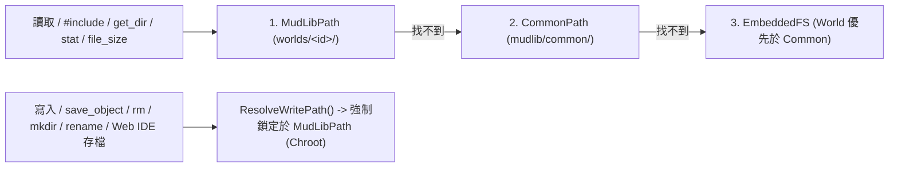

# 多小說共用 MVVM × Overlay Mudlib 實作計畫

## 目標說明
依據多小說共用 MVVM × Overlay Mudlib 架構藍圖，在**完全不動既有 [forgotten-space/](file:///home/wade/src/github/mudscript/forgotten-space)** 的前提下，於 `./mudlib/` 建置多小說共用的 Mudlib 容器：將執行期拆分為**唯讀共用核心層（`mudlib/common/`）**與**各小說獨立世界層（`mudlib/worlds/<world_id>/`）**，並透過 Go Driver 的 Overlay 虛擬檔案系統（VFS）串接，達成多世界共用引擎與前端、資料與法則完全隔離的目標。

---

## 實作進度總覽（Implementation Status）

| 階段 | 內容 | 狀態 | 關鍵產出與驗證 |
| :--- | :--- | :---: | :--- |
| **Phase 0** | Go Driver 疊層 VFS 與寫入鎖定 | ✅ 已完成 | `driver/`、`preprocessor/`、`cmd/fsmud/main.go`、`internal/signaling/hub.go`；`go test ./driver/... ./preprocessor/...` 全數通過 |
| **Phase 1** | `mudlib/common/` 共用核心與 `worlds/_template/` | ✅ 已完成 | `master.c`、`include/`、`secure/`、`std/`、`cmds/`、`daemon/`、`etc/` 與 `_template/` |
| **Phase 2** | MVVM JSON 工廠、Schema 與 DTO | ✅ 已完成 | `schema_d.c`、`*_factory_d.c`、`json_*.c`、`ui_bridge_d.c`、`mvvm_protocol.h`、`web/static/index.html`；`_template` `test_smoke.c` 58/58 通過 |
| **Phase 3** | 工具鏈與多世界模板化（`mudlib/tools/`） | ✅ 已完成 | `validate_world.py`、`audit_schema_usage.py`、`traceability_audit.py`、`new_world.py`、`world_utils.py`；對 `_template` 稽核全數通過 |
| **Phase 4** | **`forgotten-space` 重製對接** | ✅ 已完成 | `mudlib/worlds/forgotten-space/`（不動 `./forgotten-space/`）；LPC `4434/4434`、世界工具鏈與雙軌稽核全數通過 |
| **Phase 5A** | **`fsmud` 薄封裝對接** | ✅ 已完成 | `mudlib/worlds/fsmud/`（不動 `./fsmud/`）；沿用 `common/` 核心（`master.c`、`command_d`、`simul_efun`、`system_d`、`interactive`），新增 `world_init_d.c`、`schema/*.json` 與 `test_overlay_fsmud.c`；LPC `323/323` 與工具鏈全數通過 |
| **Phase 5B** | **新世界建置（`mudlib/worlds/wanjie-lou/`，最後一步）** | ⏳ 最後一步 | 《萬界風月樓》（對應 `/home/wade/src/github/novel/one-space`）目前進度為 0，待適當時機展開 |

---

## 已拍板架構決策（Locked-in Decisions）

> [!NOTE]
> 以下四項核心決策已定案，並作為實作準則：
> 1. **既有 `./forgotten-space/` 全程零更動**：根目錄 [forgotten-space/](file:///home/wade/src/github/mudscript/forgotten-space) 保持原樣不改動，於 `./mudlib/` 獨立建置共用核心 `common/`，並於 Phase 4 重製對接至 `./mudlib/worlds/forgotten-space/`。
> 2. **JSON 房間／NPC／道具具現採 `compile_object()` 虛擬工廠 ＋ JSON 感知檢查**：沿用並強化 [driver/object.go](file:///home/wade/src/github/mudscript/driver/object.go) 既有的 `MasterObject->compile_object(virtualPath)` 機制，無需產生 `.c` stub；同時讓 `common/` 守護進程與稽核工具同步支援 `.json` 存在性檢查。
> 3. **統一小說正典存放規範**：各小說來源於 `git@github.com:wade-fs/novel.git`，於 MudScript 內統一放置於 `mudlib/worlds/<world_id>/chapters/`（例如 `mudlib/worlds/forgotten-space/chapters/`），稽核工具統一讀取各世界下的 `chapters/`（並以各世界 `manifest.json` 描述其專屬章節命名／稽核規則）。
> 4. **當前推進階段**：**Phase 0–5A（Driver Overlay、`mudlib/common/`、MVVM JSON 工廠、`mudlib/tools/` 工具鏈、`mudlib/worlds/forgotten-space/` 與 `mudlib/worlds/fsmud/` 薄封裝對接）均已完成並通過自動化驗證**；接下來僅餘 **Phase 5B（`mudlib/worlds/wanjie-lou/`）**。

---

## 既有相容性保證

> [!IMPORTANT]
> **既有 Mudlib 零回歸保證**：`driver/`、`preprocessor/`、`cmd/fsmud/` 與 `internal/signaling/` 中的 Overlay VFS 擴充皆以 `-common` 參數作為開關。未指定 `-common` 時，既有 `forgotten-space/`、`fsmud/`、`fs/` 與 `testlib/`（`make test`）之行為完全維持不變。

---

## 已完成項目明細（Phase 0–3）

### Phase 0 — Go Driver 疊層 VFS 與寫入鎖定（✅ 已完成）



- [x] [driver.go](file:///home/wade/src/github/mudscript/driver/driver.go)：於 `DriverConfig` 新增 `CommonPath string`，並於 `PreloadGlobalInclude()` 將 `CommonPath` 傳入 `preprocessor`。
- [x] [file.go](file:///home/wade/src/github/mudscript/driver/file.go)：實作 `ResolveReadPath` 與 `ResolveWritePath`（Virtual Chroot + 寫入鎖定於 `MudLibPath`），更新 `ReadFile` 三層讀取鏈與 `DiscoverMasterFile()`。
- [x] [preprocessor.go](file:///home/wade/src/github/mudscript/preprocessor/preprocessor.go)：新增 `CommonPath` 與 `SetCommonPath`，重構 `#include` 讀取支援 `MudLibPath -> CommonPath -> EmbeddedFS` 與 Chroot 檢查。
- [x] [efun_system.go](file:///home/wade/src/github/mudscript/driver/efun_system.go)、[efun_buffer.go](file:///home/wade/src/github/mudscript/driver/efun_buffer.go)、[efun_object.go](file:///home/wade/src/github/mudscript/driver/efun_object.go)、[efun_string.go](file:///home/wade/src/github/mudscript/driver/efun_string.go)：寫入/刪除類與存檔 Efun 全面鎖定 `ResolveWritePath`；`cp` 來源、`read_bytes`、`file_size`、`stat` 與 `get_dir` 支援疊層讀取與同名覆寫合併。
- [x] [object.go](file:///home/wade/src/github/mudscript/driver/object.go)：傳入 `CommonPath` 給 `preprocessor`，並強化 `compile_object()` 虛擬物件鍵值與清理邏輯。
- [x] [main.go](file:///home/wade/src/github/mudscript/cmd/fsmud/main.go) & [hub.go](file:///home/wade/src/github/mudscript/internal/signaling/hub.go)：新增 `-common` 旗標、疊層靜態資源／`/theme/` 掛載，以及 Web IDE `save_file` 寫入鎖定至 `MudLibPath`。
- [x] [overlay_test.go](file:///home/wade/src/github/mudscript/driver/overlay_test.go) & [preprocessor_test.go](file:///home/wade/src/github/mudscript/preprocessor/preprocessor_test.go)：補齊 Overlay 單元測試。

---

### Phase 1 — `mudlib/common/` 共用核心與 `mudlib/worlds/_template/`（✅ 已完成）

- [x] [master.c](file:///home/wade/src/github/mudscript/mudlib/common/master.c)：讀取 `/manifest.json`、載入核心與 Phase 2 守護進程、自動偵測載入世界層 `/daemon/world_init_d.c`、實作 `compile_object()` 委派至房間／NPC／道具工廠，並支援 `MUD_TEST_MODE`。
- [x] `mudlib/common/include/`：`ansi.h`、`config.h`、`globals.h`、`mvvm_protocol.h`、`race.h`。
- [x] `mudlib/common/secure/`：`valid.c`、`command_d.c`、`simul_efun.c`、`language_d.c`、`system_d.c`、`channel_d.c`、`nature_d.c`、`quest_d.c`、`social_d.c`。
- [x] `mudlib/common/std/`：`object.c`、`container.c`、`living.c`、`combat.c`、`interactive.c`、`user.c`、`login.c`、`room.c`、`npc.c`、`item.c`、`weapon.c`、`armour.c`、`test_case.c`、`json_room.c`、`json_npc.c`、`json_item.c`。
- [x] `mudlib/common/cmds/`：`cmd_act.c`、`cmd_alias.c`、`cmd_drop.c`、`cmd_get.c`、`cmd_help.c`、`cmd_inventory.c`、`cmd_lang.c`、`cmd_look.c`、`cmd_movement.c`、`cmd_quest.c`、`cmd_quit.c`、`cmd_save.c`、`cmd_say.c`、`cmd_score.c`、`cmd_talk.c`、`admin/cmd_tests.c`。
- [x] `mudlib/common/etc/`：`issue`、`issue.en`、`issue.zh-CN`、`issue.zh-TW`。
- [x] `mudlib/worlds/_template/`：`manifest.json`、`chapters/.gitkeep`、`data/.gitkeep`、`schema/`（`currency.json`、`power_system.json`、`stat_formula.json`）、`rooms/`（`start.json`、`courtyard.json`）、`npcs/guide.json`、`items/badge.json`、`quests/intro.json`、`tests/test_smoke.c`。

---

### Phase 2 — MVVM JSON 工廠、Schema 與 DTO（✅ 已完成）

- [x] `mudlib/common/daemon/`：
  - `schema_d.c`：解析各世界 `schema/*.json`（境界對照、多面額幣制格式化、自訂屬性標籤與 `stat_formula` 運算）。
  - `room_factory_d.c`、`npc_factory_d.c`、`item_factory_d.c`：搭配 `json_room.c`、`json_npc.c`、`json_item.c` 與 `master.c::compile_object()`，實現零 `.c` stub 的純 JSON 具現。
  - `quest_engine_d.c`、`phase_d.c`、`world_state_d.c`：支援 `.json` 存在性檢查、任務階段推進、分支選擇與世界變數連動。
  - `ui_bridge_d.c` 與 `include/mvvm_protocol.h`：打包 `room`、`character`、`quest_list` 等標準化 ViewModel DTO。
- [x] `mudlib/common/web/static/index.html`：共用 SPA 前端殼層（支援讀取各世界 `/theme/` 覆寫）。

---

### Phase 3 — 工具鏈與多世界模板化（✅ 已完成）

- [x] [mudlib/tools/world_utils.py](file:///home/wade/src/github/mudscript/mudlib/tools/world_utils.py)：共用世界設定與載入輔助模組。
- [x] [mudlib/tools/validate_world.py](file:///home/wade/src/github/mudscript/mudlib/tools/validate_world.py)：驗證 `manifest.json`、JSON 結構、房間／NPC／道具／任務引用完整性。
- [x] [mudlib/tools/audit_schema_usage.py](file:///home/wade/src/github/mudscript/mudlib/tools/audit_schema_usage.py)：稽核世界 JSON 欄位是否有對應消費端（消除幽靈欄位）。
- [x] [mudlib/tools/traceability_audit.py](file:///home/wade/src/github/mudscript/mudlib/tools/traceability_audit.py)：檢查「小說章節 `chapters/` ↔ 實體」雙向追溯。
- [x] [mudlib/tools/new_world.py](file:///home/wade/src/github/mudscript/mudlib/tools/new_world.py)：從 `mudlib/worlds/_template/` 建立新世界骨架。

---

## 後續待辦階段（Phase 4–5）

- [x] **Phase 4 — `forgotten-space` 重製對接（✅ 已完成）**：於 `mudlib/worlds/forgotten-space/` 重製對接《遺忘的世界》（不動根目錄 `./forgotten-space/`），保留九城／三維法則、`chapters/` 正典（含 `assets/`）與雙軌／可追溯／鮮活性稽核，驗證成熟世界與 `mudlib/common/` 共用核心穩定運行。
- [x] **Phase 5A — `fsmud` 薄封裝對接（✅ 已完成）**：於 `mudlib/worlds/fsmud/` 以薄封裝模式整合 Fantasy Space（不動根目錄 `./fsmud/`），移除與 `common/` 重疊之 `master.c`、`secure/command_d.c`、`secure/simul_efun.c`、`secure/system_d.c`、`std/interactive.c`，新增 `daemon/world_init_d.c`、`manifest.json`（含 `exclude_cmds`）、`schema/*.json` 與 `tests/test_overlay_fsmud.c`，並強化 `common/daemon/ui_bridge_d.c`（相容 `query_stat()`）與 `evaluator/evaluator.go` 前綴運算子 nil 防護。
- [ ] **Phase 5B — 新世界建置（`mudlib/worlds/wanjie-lou/`，最後一步）**：目前進度為 0，待《萬界風月樓》（`/home/wade/src/github/novel/one-space`）展開時，建立 Vol.1（ch001–ch016）切片、`chapters/` 對應、`tower_d.c`/`anchor_d.c`/`resonance_d.c`/`commerce_d.c` 與九界 Schema，並以 `mudlib/tools/` 工具鏈驗證。

---

## 驗證紀錄（已執行通過）

1. **既有核心與 LPC 回歸測試**（確保 `-common` 未啟用時零回歸）：
   ```bash
   make test
   ```
   - 結果：通過（`277/277`）。
2. **Phase 0 Go 單元測試**：
   ```bash
   go test ./driver/... ./preprocessor/...
   ```
   - 結果：`ok mudscript/driver`、`ok mudscript/preprocessor`。
3. **Phase 1＋2 疊層啟動與冒煙整合測試（`_template`）**：
   ```bash
   go build -o bin/mudscript ./cmd/fsmud && \
   MUD_TEST_MODE=1 ./bin/mudscript -common mudlib/common -mudlib mudlib/worlds/_template -master master.c --hub none
   ```
   - 結果：`test_smoke.c` 全數通過（`58/58`），涵蓋 `schema_d`、`compile_object()` 具現 JSON 房間／NPC／道具、NPC 狀態機、任務分支與 `world_state_d` 連動、`cmd_act`/感官指令、`lang`/`alias`、`ui_bridge_d` DTO 與寫入隔離至 `_template/data/user/`。
4. **Phase 3 世界驗證工具鏈檢查（`_template`）**：
   ```bash
   python3 mudlib/tools/validate_world.py _template
   python3 mudlib/tools/audit_schema_usage.py _template
   python3 mudlib/tools/traceability_audit.py _template
   ```
   - 結果：`Validation PASSED`（0 warning）、`Schema audit PASSED`（0 ghost fields）、`Traceability`（0 chapter(s), 4 entities checked）。
5. **Phase 4 `mudlib/worlds/forgotten-space/` 整合與稽核驗證**：
   ```bash
   MUD_TEST_MODE=1 ./bin/mudscript -common mudlib/common -mudlib mudlib/worlds/forgotten-space -master master.c --hub none
   python3 mudlib/tools/validate_world.py forgotten-space
   python3 mudlib/tools/audit_schema_usage.py forgotten-space
   python3 mudlib/tools/traceability_audit.py forgotten-space
   (cd mudlib/worlds/forgotten-space && python3 tests/quests/novel_mud_sync_audit.py && python3 tests/quests/traceability_audit.py && python3 tests/quests/world_liveness_audit.py . && python3 tests/quests/quest_audit.py .)
   ```
   - 結果：LPC 核心與世界整合測試 `4434/4434` 全數通過（含 `test_overlay_phase4.c` `30/30`）；`mudlib/tools/` 三項驗證與世界內四項稽核腳本全數通過；WebSocket E2E 腳本（`test_mvp.py`、`test_ch06_to_ch12_integration.py`、`test_thinking_spec_compliance.py`、`test_world_state.py`）在 Overlay 模式下通過。
6. **Phase 5A `mudlib/worlds/fsmud/` 薄封裝整合與工具鏈驗證**：
   ```bash
   MUD_TEST_MODE=1 ./bin/mudscript -common mudlib/common -mudlib mudlib/worlds/fsmud -master master.c --hub none
   python3 mudlib/tools/validate_world.py fsmud
   python3 mudlib/tools/audit_schema_usage.py fsmud
   python3 mudlib/tools/traceability_audit.py fsmud
   ```
   - 結果：LPC 核心與 Overlay 整合測試 `323/323` 全數通過（含原有 33 組測試 `289/289` 與 `test_overlay_fsmud.c` `34/34`）；`mudlib/tools/` 三項驗證全數通過（0 warning、0 ghost fields）。
